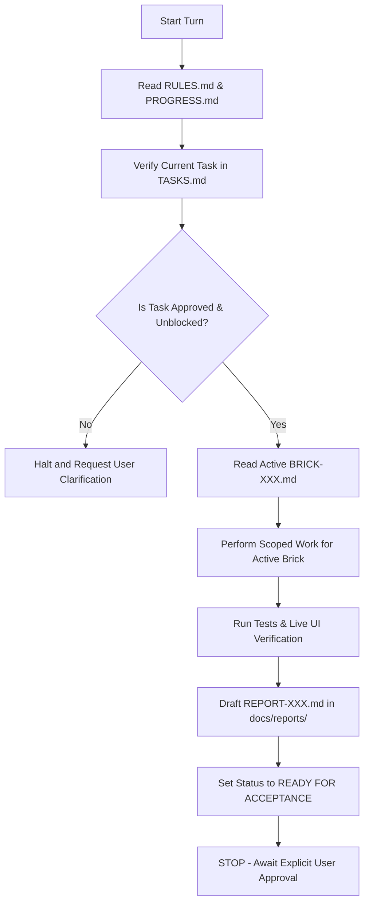

# AGENTS.md — Agent Onboarding and Operating Protocol

> **Project**: Javed — New JARVIS  
> **Status**: VERIFIED  
> **Current Stage**: Stage 2 — Intelligence & Models (BRICK-004 Complete; VERIFIED)  
> **Active Brick**: BRICK-004 (VERIFIED; Awaiting BRICK-005 Authorization)  
> **Last Revision**: 2026-10-25  

---

## 1. Mandatory Pre-Flight Protocol

Every AI agent, subagent, or developer working on **Javed** must execute the following sequential onboarding routine **before proposing, editing, or executing any changes**:

1. **Read Project Rules**: Review [RULES.md](file:///c:/Users/arehman/Desktop/AI Projects/Javed/docs/RULES.md). All 12 core rules are strictly binding. Violations will halt work immediately.
2. **Check Current Progress & State**: Inspect [PROGRESS.md](file:///c:/Users/arehman/Desktop/AI Projects/Javed/docs/PROGRESS.md) to understand current project state, active brick, and last verified milestone.
3. **Inspect Task Registry**: Check [TASKS.md](file:///c:/Users/arehman/Desktop/AI Projects/Javed/docs/TASKS.md) to verify active task IDs, blockers, prerequisites, and explicit acceptance criteria.
4. **Read Active Brick Specification**: Check [BRICK-003.md](file:///c:/Users/arehman/Desktop/AI Projects/Javed/docs/bricks/BRICK-003.md) (or currently active brick in [docs/bricks/](file:///c:/Users/arehman/Desktop/AI Projects/Javed/docs/bricks/)). Do not touch code outside the scope of the active brick.
5. **Verify Single Source of Truth**: Never duplicate authoritative data across files. Refer to the designated owner document (see [Section 3](#3-single-source-of-truth-map)).

---

## 2. Core Operational Constraints

- **Strict Stage Boundaries**: We are currently in **Stage 2 (Intelligence & Models — BRICK-004)**. BRICK-001, BRICK-002, BRICK-003, and BRICK-004 are VERIFIED. Do not install browser automation, persistent memory, or voice until authorized in subsequent bricks.
- **Brick-by-Brick Workflow**: Implementation proceeds strictly one brick at a time. Advance to the next brick **only** after explicit user acceptance of the previous brick.
- **Mandatory Live UI Verification**: Every functional brick must be verified through a live UI. Mocked or simulated success presented as actual functionality is strictly prohibited.
- **Free & Open-Source First**: Prefer proven, active, compatible FOSS libraries. OpenRouter is the **sole** preapproved proprietary paid service, accessed strictly via a replaceable adapter.
- **MCP-First Tool Integration**: Use proven, maintained, open-source Model Context Protocol (MCP) servers for tool calling wherever they satisfy requirements, rather than building custom tool integrations (Rule 1). Reuse the native LangChain MCP integration (`langchain.mcp`), subject to compatibility verification. All MCP tool calls must pass host-controlled validation and HITL gating. Follow the phased rollout: initial MCP integration in **BRICK-005**, Playwright MCP evaluation in **BRICK-006**, and full managed MCP ecosystem in **BRICK-010**. Do not install MCP servers or write MCP code prior to their designated bricks.
- **Honest Status Tracking**: Never claim a task or brick is `VERIFIED` without verifiable test evidence and recorded user approval. Acceptable statuses: `NOT STARTED`, `IN PROGRESS`, `BLOCKED`, `READY FOR ACCEPTANCE`, `VERIFIED`.
- **Scope Discipline**: Do not autonomously expand the project scope or introduce speculative dependencies.

---

## 3. Single Source of Truth Map

| Domain | Authoritative Document | Responsibility |
|---|---|---|
| **Operating Rules** | [RULES.md](file:///c:/Users/arehman/Desktop/AI Projects/Javed/docs/RULES.md) | 12 binding laws of development and ethics |
| **Product Scope & Requirements** | [PRD.md](file:///c:/Users/arehman/Desktop/AI Projects/Javed/docs/PRD.md) | Functional and non-functional requirements |
| **System Architecture** | [ARCHITECTURE.md](file:///c:/Users/arehman/Desktop/AI Projects/Javed/docs/ARCHITECTURE.md) | Approved design, data flows, and layer models |
| **Technology Stack** | [TECH_STACK.md](file:///c:/Users/arehman/Desktop/AI Projects/Javed/docs/TECH_STACK.md) | Evaluated, proposed, and approved technologies |
| **Security & Permissions** | [SECURITY.md](file:///c:/Users/arehman/Desktop/AI Projects/Javed/docs/SECURITY.md) | Threat model, tool sandbox, credential policies |
| **Roadmap & Phases** | [ROADMAP.md](file:///c:/Users/arehman/Desktop/AI Projects/Javed/docs/ROADMAP.md) | Long-term phases, milestones, dependencies |
| **Task Registry** | [TASKS.md](file:///c:/Users/arehman/Desktop/AI Projects/Javed/docs/TASKS.md) | Granular tasks, assignees, blockers, statuses |
| **Current Progress & State** | [PROGRESS.md](file:///c:/Users/arehman/Desktop/AI Projects/Javed/docs/PROGRESS.md) | Single authoritative snapshot of live state |
| **Durable Memory & Lessons** | [MEMORY.md](file:///c:/Users/arehman/Desktop/AI Projects/Javed/docs/MEMORY.md) | Knowledge base, patterns, antipatterns, learnings |
| **UI Design & Standards** | [UI_STANDARDS.md](file:///c:/Users/arehman/Desktop/AI Projects/Javed/docs/UI_STANDARDS.md) | Aesthetic guidelines and live verification rules |
| **Testing Strategy** | [TEST_STRATEGY.md](file:///c:/Users/arehman/Desktop/AI Projects/Javed/docs/TEST_STRATEGY.md) | Verification standards, evidence collection |
| **Environment Setup** | [ENVIRONMENT.md](file:///c:/Users/arehman/Desktop/AI Projects/Javed/docs/ENVIRONMENT.md) | Runtime prerequisites and configuration |
| **Architectural Decisions** | [docs/decisions/](file:///c:/Users/arehman/Desktop/AI Projects/Javed/docs/decisions/) | ADR records for approved architectural shifts |
| **Brick Specifications** | [docs/bricks/](file:///c:/Users/arehman/Desktop/AI Projects/Javed/docs/bricks/) | Detailed implementation specs for each brick |
| **Verification Reports** | [docs/reports/](file:///c:/Users/arehman/Desktop/AI Projects/Javed/docs/reports/) | Evidence-based test and verification logs |

---

## 4. Agent Execution Loop

---

## 5. Stop Conditions

An agent must immediately halt execution and request user guidance when:
- Any proposed action requires installing unapproved dependencies or services.
- A requirement or design decision is ambiguous or marked `PROPOSED`/`PENDING REVIEW`.
- Verification of a brick fails or reveals unexpected regressions.
- The active brick reaches the `READY FOR ACCEPTANCE` stage.
