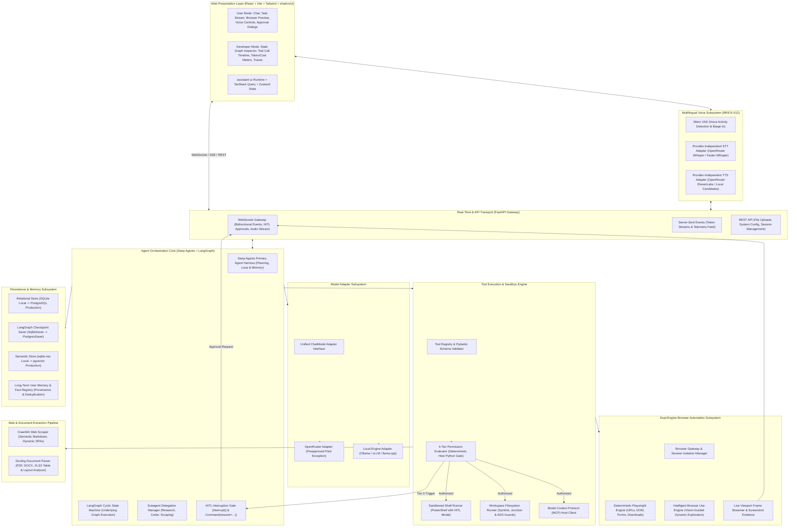

# System Architecture Specification — JARVIS

> **Document ID**: `ARCH-001`  
> **Version**: 2.2 (Governance, LangGraph HITL & Security Alignment)  
> **Status**: PROPOSED ARCHITECTURE BASELINE (PENDING OWNER APPROVAL)  
> **Project**: Javed — New JARVIS  
> **Current Stage**: Stage 0 / BRICK-000 — Master Architecture & Planning  
> **Last Revision**: 2026-10-22  

---

## 1. Architectural Principles

1. **Simplicity over Speculation**: Adopt proven, actively maintained open-source libraries (Deep Agents, LangGraph, FastAPI, Playwright, Docling, assistant-ui). Avoid homegrown reinvented wheels.
2. **Strict Trust Boundaries**: All external content (webpages, uploaded documents, LLM completions, retrieved memories, third-party tool outputs) is treated as untrusted. Delimiters and path canonicalization are parts of defense-in-depth, not standalone silver bullets.
3. **Decoupled Providers**: All external LLM, browser, retrieval, and voice engines interact through clean adapter interfaces. OpenRouter (`https://openrouter.ai/api/v1`) is the sole preapproved paid gateway, swappable for local engines (Ollama, Faster-Whisper, Kokoro).
4. **Observable State Graphs with Native HITL**: The agent core is implemented via the Deep Agents harness running on top of LangGraph cyclic state graphs, utilizing native `interrupt()` and `Command(resume=...)` with persistent checkpointing and side-effect replay protection.
5. **UI-Integrated Vertical Slices**: Every backend capability connects to a live React/Tailwind interface featuring both a consumer-grade User Mode and a deep diagnostic Developer Mode.

---

## 2. End-to-End System Topology

---

## 3. Subsystem Breakdown & Module Responsibilities

### 3.1 Presentation Layer (`frontend/`)
- **Technology**: React 18/19, TypeScript, Vite, Tailwind CSS, shadcn/ui, `assistant-ui`, TanStack Query.
- **Responsibilities**:
  - Render thread history and stream incoming tokens smoothly with syntax highlighting and LaTeX math support.
  - Present custom tool execution widgets (status, input arguments, execution timer, collapsible outputs).
  - Provide an interactive, high-visibility **Human-in-the-Loop Confirmation Modal** that displays the exact command, target path, and risk level for Tier 3 actions.
  - Maintain a live **Browser Preview Panel** showing current viewport frames and screenshots.
  - Expose a collapsible **Developer Mode Panel** displaying live LangGraph state transitions, raw token usage, latency meters, and event logs.

### 3.2 Transport & API Gateway (`src/gateway/`)
- **Technology**: FastAPI, Starlette WebSockets, HTTPX, Pydantic v2.
- **Responsibilities**:
  - Route HTTP REST requests for session creation, file uploads, document ingestion, and configuration.
  - Maintain bidirectional WebSocket connections for real-time prompt streaming, human approvals, browser frame streams, and voice audio packets.
  - Enforce correlation IDs across all requests, agent loops, and tool logs for non-repudiation.

### 3.3 Agent Orchestration Core (`src/agent/`)
- **Technology**: Deep Agents harness, LangGraph execution runtime, LangChain Core interfaces.
- **Responsibilities**:
  - **Deep Agents as Primary Agent Harness**: Deep Agents provides the high-level planning harness, memory integration, prompt optimization, context curation, and task execution loop. We do **not** prescribe a second custom agent execution loop; built-in Deep Agents functionality satisfies standard orchestration. Custom LangGraph nodes and workflows require explicit architectural justification.
  - **LangGraph Underlying Runtime**: LangGraph manages the state machine, checkpointing, and interruption lifecycle.
  - **Modern HITL Gating**: Uses LangGraph's supported `interrupt()` and `Command(resume=...)` API. Execution pauses when a Tier 3 tool is dispatched, state is saved to the checkpointer keyed by `thread_id`, an approval event emits over the WebSocket, and resumes cleanly upon receiving user confirmation.
  - **Side-Effect Replay Safety**: Tool gating is isolated into a pure, side-effect-free node to prevent duplicate execution when the node re-runs upon resumption.
  - **Subagent Routing**: Delegate specialized sub-tasks to child subgraphs with bounded context windows.

### 3.4 Model Adapter Subsystem (`src/models/`)
- **Technology**: HTTPX, Pydantic v2, LangChain `ChatOpenAI` abstraction.
- **Responsibilities**:
  - Implement a provider-agnostic client adapter with streaming, tool calling, and structured JSON generation.
  - Primary gateway: **OpenRouter** (`https://openrouter.ai/api/v1`) with dynamic model capability discovery, token tracking, and cost estimation.
  - Secondary fallback: Local OpenAI-compatible backends (**Ollama**, **vLLM**, **llama.cpp**).
  - Enforce strict timeouts, exponential backoff retries, and token budgets.

### 3.5 Tool Execution & Sandbox Engine (`src/tools/`)
- **Technology**: Python subprocess, Pydantic v2, Model Context Protocol (MCP) SDK.
- **Responsibilities**:
  - Maintain a typed registry of available tools with Pydantic input/output schemas.
  - Enforce the 4-tier security authorization taxonomy defined in [SECURITY.md](file:///c:/Users/arehman/Desktop/AI Projects/Javed/docs/SECURITY.md).
  - Restrict filesystem access to canonical workspace paths; block unauthorized access to `.env` or system directories.
  - Provide an isolated host runner for third-party MCP servers.

### 3.6 Browser Automation Subsystem (`src/browser/`)
- **Technology**: Playwright Python + Browser Use.
- **Responsibilities**:
  - Deterministic tasks: Execute direct Playwright scripts for known URLs, DOM selectors, static scraping, and file downloads.
  - Exploratory tasks: Launch Browser Use agent loops with vision-capable models for unfamiliar websites and dynamic multi-step navigation.
  - Isolate each session in an ephemeral browser context (`browser.new_context()`).
  - Stream viewport frame captures to the web interface.

### 3.7 Content & Document Extraction Pipeline (`src/extraction/`)
- **Technology**: Crawl4AI + Docling.
- **Responsibilities**:
  - Scrape and clean dynamic web content into LLM-optimized Markdown via Crawl4AI.
  - Parse PDFs, DOCX, and XLSX files using Docling, preserving complex tables, reading order, and metadata.
  - Attach source provenance (document name, page number, bounding box) to all extracted chunks.

### 3.8 Persistence & Memory Subsystem (`src/storage/`)
- **Technology**: SQLAlchemy 2.0 (asyncio), Alembic, SQLite (`aiosqlite`), PostgreSQL 16+ (`asyncpg`), `pgvector`.
- **Responsibilities**:
  - Store relational entities (sessions, messages, tool execution logs, user preferences).
  - Persist LangGraph checkpoints (`SqliteSaver` in development -> `PostgresSaver` in production).
  - Store vector embeddings for semantic document retrieval and user memory facts (`sqlite-vec` in dev -> `pgvector` in prod).
  - Provide CRUD APIs for user memory management (view, search, correct, delete).

### 3.9 Multilingual Voice Subsystem (`src/voice/` — BRICK-012)
- **Technology**: Silero VAD, Provider-Independent Audio Adapters (`AudioSTTAdapter`, `AudioTTSAdapter`), OpenRouter Audio Gateway (`openai/whisper-large-v3-turbo`, `elevenlabs/eleven-v4-turbo`), Local Fallback (Faster-Whisper, Kokoro-82M, XTTS v2 / Piper).
- **Responsibilities**:
  - Real-time microphone audio processing with Silero Voice Activity Detection.
  - Provider-independent Speech-to-Text with automatic language detection (Urdu, English, Arabic).
  - Streaming Text-to-Speech synthesis with dynamic language routing.
  - Instant barge-in / cancellation when the user speaks during assistant playback.
  - *Performance Caveat*: Remote STT/TTS availability on OpenRouter does not guarantee real-time latency (< 1.2s round-trip); performance must be verified in BRICK-012.

---

## 4. Agent Execution Lifecycle & State Machine

```mermaid
stateDiagram-v2
    [*] --> Idle: User Prompt Received
    Idle --> Thinking: Initialize Graph State
    Thinking --> Planning: Decompose into Steps (Deep Agents)
    Planning --> Reasoning: Query Model Adapter (OpenRouter / Ollama)
    Reasoning --> RouteTools: Tool Call Required?
    RouteTools --> RiskEvaluation: Inspect Hardcoded Tool Tier
    
    RiskEvaluation --> ExecutingTool: Tier 0, 1, or Pre-Authorized Tier 2
    RiskEvaluation --> HITL_Gate: Tier 3 (High-Risk Shell / Consequential Action)
    
    HITL_Gate --> PureApprovalNode: Enter Pure Gating Node (No Side Effects)
    PureApprovalNode --> Paused: Call interrupt({"command": "...", "risk": "Tier 3"})
    Paused --> AwaitingApproval: Persist Checkpoint & Emit UI Modal Event
    
    AwaitingApproval --> Resuming: User Clicks Approve (Command(resume=True))
    AwaitingApproval --> ToolAborted: User Clicks Deny / 5-min Timeout
    
    Resuming --> PureApprovalNode: Re-execute Pure Node; interrupt() returns True
    PureApprovalNode --> DownstreamRunner: Route to Downstream Execution Node
    DownstreamRunner --> ExecutingTool: Execute Subprocess in Isolated Runner
    
    ExecutingTool --> Observing: Capture Stdout/Stderr & Execution Evidence
    ToolAborted --> Observing: Inject User Rejection Feedback into Graph State
    
    Observing --> Reasoning: Next Step in Graph Loop
    RouteTools --> Synthesizing: Task Finished / No Further Tools Needed
    Synthesizing --> FinalResponse: Stream Markdown & Citations to assistant-ui
    FinalResponse --> Idle: Persist Final State Checkpoint
```

---

## 5. Trust Boundaries & Security Enclosures

| Boundary | Inbound Source | Inspection & Policy Enforcement | Outbound Target |
|---|---|---|---|
| **Boundary 1: User Prompt** | Web UI / Microphone | Length limits, prompt injection heuristic screening, token budget check. | Deep Agents Core |
| **Boundary 2: LLM Outputs** | OpenRouter / Local LLM | Pydantic response validation, structured schema parsing, tool call verification. | Agent State Machine |
| **Boundary 3: Tool Invocations** | Agent State Machine | **Deterministic Host Python Gate**: The LLM cannot self-authorize. 4-tier risk classification, symlink/ADS checks, modern `interrupt()` HITL modal for Tier 3. | Tool Runner / OS Shell |
| **Boundary 4: Web & Extracted Content** | External Websites / Documents | **Defense-in-Depth**: Delimited context framing, tag neutralization, structural data-instruction separation, format validation via Docling/Crawl4AI. Delimiters alone are not an impenetrable sandbox. | Vector DB / Agent Context |
| **Boundary 5: Filesystem Operations** | Tool Runners | Canonicalization, symlink/junction/reparse-point rejection, Windows Alternate Data Stream (ADS) blocking, protected files registry (`.env`, `.git/`). | Local Filesystem |
| **Boundary 6: Browser Navigation** | Browser Use / Playwright | Ephemeral context isolation, download quarantine, credential & payment blocking. | External Internet |
| **Boundary 7: MCP Servers** | Third-Party Tool Hosts | Subprocess isolation, stripped environment variables, schema verification. | Tool Registry |

---

## 6. Failure Recovery & Self-Healing Behaviors

1. **Transient LLM Failures**: Automatic exponential backoff retries (up to 3 attempts) on HTTP 429/503 errors. If OpenRouter fails completely, the adapter fails over to a configured secondary provider or local Ollama instance.
2. **Tool Execution Errors**: When a tool throws an error or non-zero exit code, the error is captured and injected into the agent graph as an `observation` node. The Deep Agents harness reasons over the error and attempts self-correction (up to 3 reflection retries).
3. **Server Crashes & Restarts**: Because LangGraph writes checkpoints to the persistence store at every node transition, an interrupted task is resumed from its last valid checkpoint without re-running completed tools.
4. **Browser Hangs & Navigation Timeouts**: Playwright actions enforce a 15-second DOM action timeout; Browser Use exploration loops terminate after a maximum of 25 steps.
