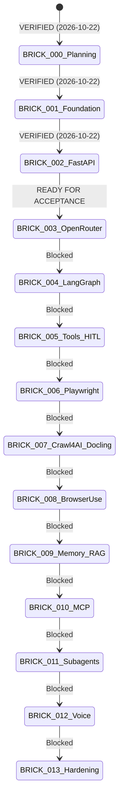

# Project Progress & Live State Registry — JARVIS

> **Document ID**: `PROG-001`  
> **Version**: 3.3 (BRICK-002 Verified; BRICK-003 Acceptance Audit Complete — Ready for Acceptance)  
> **Status**: AUTHORITATIVE STATE SNAPSHOT  
> **Last Updated**: 2026-10-22  

---

## 1. Authoritative Project State Snapshot

| Parameter | Current Value | Authority Reference |
|---|---|---|
| **Project** | **Javed — New JARVIS** | [README.md](file:///c:/Users/arehman/Desktop/AI Projects/Javed/README.md) |
| **Current Stage** | **Stage 2 / BRICK-003 — OpenRouter Integration & Streaming Chat** | [ROADMAP.md](file:///c:/Users/arehman/Desktop/AI Projects/Javed/docs/ROADMAP.md) |
| **Current Brick** | **BRICK-003: OpenRouter Integration & Streaming Chat** | [BRICK-003.md](file:///c:/Users/arehman/Desktop/AI Projects/Javed/docs/bricks/BRICK-003.md) |
| **Brick Status** | **READY FOR ACCEPTANCE** | [TASKS.md](file:///c:/Users/arehman/Desktop/AI Projects/Javed/docs/TASKS.md) |
| **Last Verified Milestone** | **BRICK-002: FastAPI Integration & Real-Time Communication** | Owner Approval 2026-10-22 |
| **Application Code** | **BRICK-003 Completed, Audited & Verified** (Dynamic OpenRouter Catalog + SSE Streaming + assistant-ui Runtime + Multi-Turn ORCHID Context + Micro-Cost Meter + Uncapped Budget Soft Controls) | Strict execution boundary |
| **Installed Packages** | **Python 3.12.15, uv 0.13.5, FastAPI 0.159.1, Uvicorn 0.54.0, Pydantic 2.14.1, Node 24.19.0, React 19.3.1, Vite 8.3.5, Playwright 1.64.1 (Chrome), Vitest 5.0.5, @assistant-ui/react 0.11.45** | Host environment |
| **Overall Status** | **READY FOR ACCEPTANCE** (BRICK-003 Acceptance Audit Complete) | Authoritative Status |

---

## 2. 14-Brick Delivery Status Matrix

| Brick ID | Title | Status | Verifier / Evidence | Blockers / Notes |
|---|---|---|---|---|
| **BRICK-000** | Master Architecture & Development Planning | **`VERIFIED`** | [REPORT-000.md](file:///c:/Users/arehman/Desktop/AI Projects/Javed/docs/reports/REPORT-000.md) | Explicitly approved by Project Owner on 2026-10-22. |
| **BRICK-001** | Reproducible Foundation & Real React UI Shell | **`VERIFIED`** | [REPORT-001.md](file:///c:/Users/arehman/Desktop/AI Projects/Javed/docs/reports/REPORT-001.md) | Explicitly approved by Project Owner on 2026-10-22 after manual acceptance. |
| **BRICK-002** | FastAPI Integration & Real-Time Communication | **`VERIFIED`** | [REPORT-002.md](file:///c:/Users/arehman/Desktop/AI Projects/Javed/docs/reports/REPORT-002.md) | Explicitly approved by Project Owner on 2026-10-22. |
| **BRICK-003** | OpenRouter Integration & Live AI Conversations | **`READY FOR ACCEPTANCE`** | [REPORT-003.md](file:///c:/Users/arehman/Desktop/AI Projects/Javed/docs/reports/REPORT-003.md) | Audited & verified: 24 pytest (inc. live ORCHID multi-turn context), 31 vitest, 11 Playwright Chrome E2E, dynamic catalog, assistant-ui runtime. Awaiting owner acceptance. |
| **BRICK-004** | Deep Agents & LangGraph Runtime | `NOT STARTED` | Pending | Blocked pending BRICK-003 verification. |
| **BRICK-005** | Tool Registry, Validation, Permissions (HITL) & Initial MCP | `NOT STARTED` | Pending | Blocked pending BRICK-004 verification. |
| **BRICK-006** | Deterministic Playwright Execution & Playwright MCP Eval | `NOT STARTED` | Pending | Blocked pending BRICK-005 verification. |
| **BRICK-007** | Crawl4AI & Docling Extraction Pipeline | `NOT STARTED` | Pending | Blocked pending BRICK-006 verification. |
| **BRICK-008** | Intelligent Browser Navigation using Browser Use | `NOT STARTED` | Pending | Blocked pending BRICK-007 verification. |
| **BRICK-009** | Persistent Memory & Knowledge Retrieval (RAG) | `NOT STARTED` | Pending | Blocked pending BRICK-008 verification. |
| **BRICK-010** | Managed Model Context Protocol (MCP) Server Ecosystem | `NOT STARTED` | Pending | Blocked pending BRICK-009 verification. |
| **BRICK-011** | Advanced Tasks, Subagents & Durable Execution | `NOT STARTED` | Pending | Blocked pending BRICK-010 verification. |
| **BRICK-012** | Real-Time Multilingual Voice (Urdu/English/Arabic) | `NOT STARTED` | Pending | Blocked pending BRICK-011 verification. |
| **BRICK-013** | Production Hardening, PG Migration & Release | `NOT STARTED` | Pending | Blocked pending BRICK-012 verification. |

---

## 3. Approved Architectural Baseline & Open Decisions

The Project Owner explicitly approved the BRICK-000 architectural baseline on 2026-10-22:
- [ADR-000](file:///c:/Users/arehman/Desktop/AI Projects/Javed/docs/decisions/ADR-000.md): Documentation and Governance System — **APPROVED**
- [ADR-001](file:///c:/Users/arehman/Desktop/AI Projects/Javed/docs/decisions/ADR-001.md): Backend Architecture, Runtime, and Tooling (Python 3.12, FastAPI, uv) — **APPROVED**
- [ADR-002](file:///c:/Users/arehman/Desktop/AI Projects/Javed/docs/decisions/ADR-002.md): Frontend Architecture & UI Frameworks (React, Vite, Tailwind CSS, shadcn/ui, assistant-ui) — **APPROVED**
- [ADR-003](file:///c:/Users/arehman/Desktop/AI Projects/Javed/docs/decisions/ADR-003.md): Agent Orchestration Runtime (Deep Agents + LangGraph vs CrewAI) — **APPROVED**
- [ADR-004](file:///c:/Users/arehman/Desktop/AI Projects/Javed/docs/decisions/ADR-004.md): Storage, Vector Retrieval & Memory Strategy (SQLite -> PostgreSQL + pgvector) — **APPROVED**
- [ADR-005](file:///c:/Users/arehman/Desktop/AI Projects/Javed/docs/decisions/ADR-005.md): Dual-Engine Browser Automation (Playwright Python + Browser Use) — **APPROVED**
- [ADR-006](file:///c:/Users/arehman/Desktop/AI Projects/Javed/docs/decisions/ADR-006.md): Web and Document Extraction Pipeline (Crawl4AI + Docling) — **APPROVED**
- [ADR-007](file:///c:/Users/arehman/Desktop/AI Projects/Javed/docs/decisions/ADR-007.md): Multilingual Voice Architecture Baseline — **APPROVED BASELINE (Local TTS Models for Urdu/Arabic Explicitly Remain EVALUATING)**

---

## 4. Current & Next Authorized Action

1. **Current Action**: BRICK-003 acceptance audit and targeted corrections completed and verified (24 Pytest, 31 Vitest, 11 Playwright Chrome E2E). Status remains `READY FOR ACCEPTANCE`.
2. **Strict Stop Condition**: Halt execution. Await project owner explicit review and acceptance of `REPORT-003.md` (including Section 10 Addendum) before advancing to BRICK-004.

---

## 5. Verification & Audit Log

| Date | Identifier | Event Summary | Outcome | Sign-off / Record |
|---|---|---|---|---|
| 2026-10-22 | TASK-000 | Bootstrap Stage 0 Documentation Foundation | VERIFIED | User Request |
| 2026-10-22 | TASK-001 | Formulate ADR-001 through ADR-007 | VERIFIED | Architecture Review |
| 2026-10-22 | TASK-002 | Refine Core Documentation Suite to Version 2.0 | VERIFIED | Architecture Review |
| 2026-10-22 | TASK-003 | Finalize BRICK-000 Planning Specification | VERIFIED | Architecture Review |
| 2026-10-22 | TASK-004 | Final Architecture Correction & Acceptance Audit (v2.2) | VERIFIED | Architecture Audit |
| 2026-10-22 | TASK-005 | Project Owner Explicit Approval of BRICK-000 & Baseline | VERIFIED | Owner Authorization |
| 2026-10-22 | TASK-010 | BRICK-001 Foundation & Real React UI Shell Implementation | VERIFIED | Automated Test Harness |
| 2026-10-22 | TASK-011 | BRICK-001 Live UI Verification & REPORT-001 Preparation | VERIFIED | REPORT-001.md |
| 2026-10-22 | TASK-020 | Launch BRICK-002: FastAPI Integration & Real-Time Comm | VERIFIED | Owner Authorization |
| 2026-10-22 | TASK-021 | BRICK-002 Backend Implementation & Unit Testing | VERIFIED | 15/15 Pytest Passed |
| 2026-10-22 | TASK-022 | BRICK-002 Frontend Communication Layer & Views Upgrades | VERIFIED | 24/24 Vitest Passed |
| 2026-10-22 | TASK-023 | BRICK-002 Chrome E2E Acceptance Verification & Report | VERIFIED | REPORT-002.md (5/5 E2E Passed) |
| 2026-10-22 | TASK-024 | Project Owner Explicit Approval of BRICK-002 | VERIFIED | Owner Authorization Recorded |
| 2026-10-22 | TASK-025 | MCP-First Policy Documentation & GitHub Synchronization | VERIFIED | Commit dfab2f7 on master |
| 2026-10-22 | TASK-030 | Launch BRICK-003: OpenRouter Integration & Streaming Chat | VERIFIED | Owner Authorization |
| 2026-10-22 | TASK-031 | BRICK-003 OpenRouter Adapter & Live Streaming Endpoints | VERIFIED | 8/8 Pytest Passed (Unit + Live Smoke) |
| 2026-10-22 | TASK-032 | BRICK-003 React Conversational UI, Model Picker & Cost Meter | VERIFIED | 31/31 Vitest Passed, 0 Oxlint Errors |
| 2026-10-22 | TASK-033 | BRICK-003 Chrome E2E Acceptance Verification & Report | VERIFIED | REPORT-003.md (10/10 Playwright Passed) |
| 2026-10-22 | TASK-034 | BRICK-003 Final Acceptance Audit & Targeted Corrections | READY FOR ACCEPTANCE | REPORT-003.md Addendum (11/11 Playwright, 24 Pytest) |
