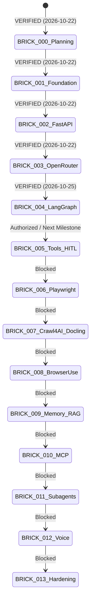

# Project Progress & Live State Registry — JARVIS

> **Document ID**: `PROG-001` 
> **Version**: 4.3 (BRICK-001, BRICK-002, BRICK-003, BRICK-004 VERIFIED; BRICK-005 IN PROGRESS) 
> **Status**: AUTHORITATIVE STATE SNAPSHOT 
> **Last Updated**: 2026-10-27

---

## 1. Authoritative Project State Snapshot

| Parameter | Current Value | Authority Reference |
|---|---|---|
| **Project** | **Javed — New JARVIS** | [README.md](file:///c:/Users/arehman/Desktop/AI Projects/Javed/README.md) |
| **Current Stage** | **Stage 2 / BRICK-005 — Dynamic MCP Tool Registry & Security Gateway** | [ROADMAP.md](file:///c:/Users/arehman/Desktop/AI Projects/Javed/docs/ROADMAP.md) |
| **Current Brick** | **BRICK-005: Dynamic MCP Tool Registry, Validation, Permissions (HITL)** | [BRICK-005.md](file:///c:/Users/arehman/Desktop/AI Projects/Javed/docs/bricks/BRICK-005.md) |
| **Brick Status** | **`IN PROGRESS` (Phase 9/9B: VERIFIED — READY FOR OWNER ACCEPTANCE; Phase 10: NOT STARTED)** | Phase 9B Windows Lifecycle Hardening & Live OpenRouter Browser Acceptance Complete |
| **Last Verified Milestone** | **BRICK-004: Deep Agents & LangGraph Runtime (Security Hardened)** | Owner Approval 2026-10-25 |
| **Application Code** | **BRICK-005 Phase 9/9B Complete & Verified** (Normal Windows process teardown verified without `os._exit`, 28/28 admin/user mode pytests cleanly pass in 4.03s, 8/8 live OpenRouter acceptance scenarios reconciled with OpenRouter API telemetry ($0.0085 USD total spend vs $0.50 budget), 1/1 real live Chrome Playwright acceptance test in Agent Mode passed in 28.0s through real OpenRouter + Time MCP STDIO server, 62/62 Vitest frontend tests passed across 12 files, 0 Ruff errors, clean Vite production build) | Strict execution boundary |
| **Installed Packages** | **Python 3.12.15, uv 0.13.3, FastAPI 0.159.1, deepagents 0.7.32, langgraph 1.2.17, langgraph-checkpoint-sqlite 3.1.2, langchain-openrouter 0.2.9, langchain[mcp] 1.4.7, fastmcp 4.1.3, mcp 2.3.0, mcp-server-time 2026.10.19, jsonschema 4.26.0, Node 24.19.0, React 19.3.1, Vite 8.3.5** | Host environment |
| **Overall Status** | **BRICK-005 IN PROGRESS — Phase 9: VERIFIED — READY FOR OWNER ACCEPTANCE; Phase 10: NOT STARTED** | Authoritative Status |

---

## 2. 14-Brick Delivery Status Matrix

| Brick ID | Title | Status | Verifier / Evidence | Blockers / Notes |
|---|---|---|---|---|
| **BRICK-000** | Master Architecture & Development Planning | **`VERIFIED`** | [REPORT-000.md](file:///c:/Users/arehman/Desktop/AI Projects/Javed/docs/reports/REPORT-000.md) | Explicitly approved by Project Owner on 2026-10-22. |
| **BRICK-001** | Reproducible Foundation & Real React UI Shell | **`VERIFIED`** | [REPORT-001.md](file:///c:/Users/arehman/Desktop/AI Projects/Javed/docs/reports/REPORT-001.md) | Explicitly approved by Project Owner on 2026-10-22 after manual acceptance. |
| **BRICK-002** | FastAPI Integration & Real-Time Communication | **`VERIFIED`** | [REPORT-002.md](file:///c:/Users/arehman/Desktop/AI Projects/Javed/docs/reports/REPORT-002.md) | Explicitly approved by Project Owner on 2026-10-22. |
| **BRICK-003** | OpenRouter Integration & Live AI Conversations | **`VERIFIED`** | [REPORT-003.md](file:///c:/Users/arehman/Desktop/AI Projects/Javed/docs/reports/REPORT-003.md) | Formally approved by Project Owner on 2026-10-22. Verified: 35 pytest (inc. 5 live smoke tests), 35 vitest, 12 Playwright Chrome E2E, openrouter/auto multi-tier routing, and manual acceptance fixes. |
| **BRICK-004** | Deep Agents & LangGraph Runtime | **`VERIFIED`** | [REPORT-004.md](file:///c:/Users/arehman/Desktop/AI Projects/Javed/docs/reports/REPORT-004.md) | Formally approved and accepted by Project Owner on 2026-10-25. Verified: 55 pytest, 41 vitest, 19 Playwright Chrome E2E passed. Security hardened. |
| **BRICK-005** | Tool Registry, Validation, Permissions (HITL) & Initial MCP | `IN PROGRESS` | [BRICK-005.md](file:///c:/Users/arehman/Desktop/AI Projects/Javed/docs/bricks/BRICK-005.md) | Phase 0–8 verified and accepted; Phase 9 & 9B (Windows Lifecycle Hardening & Real Live Model Browser Acceptance) Verified: Normal Windows process teardown verified without `os._exit`, 28/28 admin/user mode pytests pass in 4.03s, 8/8 live OpenRouter acceptance scenarios reconciled with OpenRouter API telemetry ($0.0085 USD total spend vs $0.50 budget), 1/1 real live Chrome Playwright acceptance test in Agent Mode passed in 28.0s through real OpenRouter + Time MCP STDIO server, 62/62 Vitest frontend tests passed across 12 files, 0 Ruff errors, clean Vite production build. Phase 9/9B: VERIFIED — READY FOR OWNER ACCEPTANCE; Phase 10: NOT STARTED. |
| **BRICK-006** | Deterministic Playwright Execution & Playwright MCP Eval | `NOT STARTED` | Pending | Blocked pending BRICK-005 verification. |
| **BRICK-007** | Crawl4AI & Docling Extraction Pipeline | `NOT STARTED` | Pending | Blocked pending BRICK-006 verification. |
| **BRICK-008** | Intelligent Browser Navigation using Browser Use | `NOT STARTED` | Pending | Blocked pending BRICK-007 verification. |
| **BRICK-009** | Persistent Memory & Knowledge Retrieval (RAG) | `NOT STARTED` | Pending | Blocked pending BRICK-008 verification. |
| **BRICK-010** | Managed Model Context Protocol (MCP) Server Ecosystem | `NOT STARTED` | Pending | Blocked pending BRICK-009 verification. |
| **BRICK-011** | Advanced Tasks, Subagents & Durable Execution | `NOT STARTED` | Pending | Blocked pending BRICK-010 verification. |
| **BRICK-012** | Real-Time Multilingual Voice (Urdu/English/Arabic) | `NOT STARTED` | Pending | Blocked pending BRICK-011 verification. |
| **BRICK-013** | Production Hardening, PG Migration & Release | `NOT STARTED` | Pending | Blocked pending BRICK-012 verification. |

---

## 3. Approved Architectural Baseline & Open Decisions

The Project Owner explicitly approved the BRICK-000 architectural baseline on 2026-10-22:
- [ADR-000](file:///c:/Users/arehman/Desktop/AI Projects/Javed/docs/decisions/ADR-000.md): Documentation and Governance System — **APPROVED**
- [ADR-001](file:///c:/Users/arehman/Desktop/AI Projects/Javed/docs/decisions/ADR-001.md): Backend Architecture, Runtime, and Tooling (Python 3.12, FastAPI, uv) — **APPROVED**
- [ADR-002](file:///c:/Users/arehman/Desktop/AI Projects/Javed/docs/decisions/ADR-002.md): Frontend Architecture & UI Frameworks (React, Vite, Tailwind CSS, shadcn/ui, assistant-ui) — **APPROVED**
- [ADR-003](file:///c:/Users/arehman/Desktop/AI Projects/Javed/docs/decisions/ADR-003.md): Agent Orchestration Runtime (Deep Agents + LangGraph vs CrewAI) — **APPROVED**
- [ADR-004](file:///c:/Users/arehman/Desktop/AI Projects/Javed/docs/decisions/ADR-004.md): Storage, Vector Retrieval & Memory Strategy (SQLite -> PostgreSQL + pgvector) — **APPROVED**
- [ADR-005](file:///c:/Users/arehman/Desktop/AI Projects/Javed/docs/decisions/ADR-005.md): Dual-Engine Browser Automation (Playwright Python + Browser Use) — **APPROVED**
- [ADR-006](file:///c:/Users/arehman/Desktop/AI Projects/Javed/docs/decisions/ADR-006.md): Web and Document Extraction Pipeline (Crawl4AI + Docling) — **APPROVED**
- [ADR-007](file:///c:/Users/arehman/Desktop/AI Projects/Javed/docs/decisions/ADR-007.md): Multilingual Voice Architecture Baseline — **APPROVED BASELINE (Local TTS Models for Urdu/Arabic Explicitly Remain EVALUATING)**

---

## 4. Current & Next Authorized Action

1. **Current Action**: BRICK-005 Phase 9 complete and verified across live OpenRouter inference, real Chrome Playwright E2E, Vitest, and pytest. Status set to `IN PROGRESS` (Phase 9: READY FOR REVIEW; Phase 10: NOT STARTED).
2. **Next Authorized Action**: Await explicit Project Owner review and authorization before proceeding to Phase 10 (Final Polish & BRICK-005 Completion).
3. **Strict Stop Condition**: STOP condition enforced. Phase 9: READY FOR REVIEW, BRICK-005: IN PROGRESS, Phase 10: NOT STARTED. Do not push to master, merge, or begin Phase 10 without explicit authorization.

---

## 5. Verification & Audit Log

| Date | Identifier | Event Summary | Outcome | Sign-off / Record |
|---|---|---|---|---|
| 2026-10-22 | TASK-000 | Bootstrap Stage 0 Documentation Foundation | VERIFIED | User Request |
| 2026-10-22 | TASK-001 | Formulate ADR-001 through ADR-007 | VERIFIED | Architecture Review |
| 2026-10-22 | TASK-002 | Refine Core Documentation Suite to Version 2.0 | VERIFIED | Architecture Review |
| 2026-10-22 | TASK-003 | Finalize BRICK-000 Planning Specification | VERIFIED | Architecture Review |
| 2026-10-22 | TASK-004 | Final Architecture Correction & Acceptance Audit (v2.2) | VERIFIED | Architecture Audit |
| 2026-10-22 | TASK-005 | Project Owner Explicit Approval of BRICK-000 & Baseline | VERIFIED | Owner Authorization |
| 2026-10-22 | TASK-010 | BRICK-001 Foundation & Real React UI Shell Implementation | VERIFIED | Automated Test Harness |
| 2026-10-22 | TASK-011 | BRICK-001 Live UI Verification & REPORT-001 Preparation | VERIFIED | REPORT-001.md |
| 2026-10-22 | TASK-020 | Launch BRICK-002: FastAPI Integration & Real-Time Comm | VERIFIED | Owner Authorization |
| 2026-10-22 | TASK-021 | BRICK-002 Backend Implementation & Unit Testing | VERIFIED | 15/15 Pytest Passed |
| 2026-10-22 | TASK-022 | BRICK-002 Frontend Communication Layer & Views Upgrades | VERIFIED | 24/24 Vitest Passed |
| 2026-10-22 | TASK-023 | BRICK-002 Chrome E2E Acceptance Verification & Report | VERIFIED | REPORT-002.md (5/5 E2E Passed) |
| 2026-10-22 | TASK-024 | Project Owner Explicit Approval of BRICK-002 | VERIFIED | Owner Authorization Recorded |
| 2026-10-25 | TASK-025 | MCP-First Policy Documentation & GitHub Synchronization | VERIFIED | Commit dfab2f7 on master |
| 2026-10-22 | TASK-030 | Launch BRICK-003: OpenRouter Integration & Streaming Chat | VERIFIED | Owner Authorization |
| 2026-10-22 | TASK-031 | BRICK-003 OpenRouter Adapter & Live Streaming Endpoints | VERIFIED | 8/8 Pytest Passed (Unit + Live Smoke) |
| 2026-10-22 | TASK-032 | BRICK-003 React Conversational UI, Model Picker & Cost Meter | VERIFIED | 31/31 Vitest Passed, 0 Oxlint Errors |
| 2026-10-22 | TASK-033 | BRICK-003 Chrome E2E Acceptance Verification & Report | VERIFIED | REPORT-003.md (10/10 Playwright Passed) |
| 2026-10-22 | TASK-034 | BRICK-003 Final Acceptance Audit & Manual Acceptance Corrections | VERIFIED | REPORT-003.md (35 Pytest, 35 Vitest, 12 Playwright E2E passed) |
| 2026-10-22 | TASK-030 | Project Owner Formal Acceptance & Verification of BRICK-003 | VERIFIED | Owner Authorization & Git Sync |
| 2026-10-25 | TASK-040 | Launch BRICK-004: Deep Agents & LangGraph Runtime | VERIFIED | Owner Authorization |
| 2026-10-25 | TASK-041 | Deep Agents Harness, Zero-Trust Tool Gating & SQLite Persistence | VERIFIED | 49/49 Pytest Passed |
| 2026-10-25 | TASK-042 | React Agent Mode UI, Live Task Plan Panel & Dev Mode Telemetry | VERIFIED | 41/41 Vitest Passed |
| 2026-10-25 | TASK-043 | Playwright Chrome E2E Suite (Scenarios A, B, C, D & Regressions) | VERIFIED | 19/19 Playwright Passed |
| 2026-10-25 | TASK-044 | Deliver REPORT-004.md & Milestone Stop Condition | VERIFIED | Owner Accepted (Commit 094e7e2) |
| 2026-10-26 | TASK-050 | BRICK-005 Phase 0 Baseline Preflight & Phase 1 Dependency Audit | VERIFIED | Owner Accepted |
| 2026-10-26 | TASK-050 | BRICK-005 Phase 2 Dynamic MCP Tool Registry & Security Gating | VERIFIED | Owner Accepted (12/12 Pytest Reconciled) |
| 2026-10-26 | TASK-050 | BRICK-005 Phase 3 Official Time MCP Server Integration & Runtime | VERIFIED | Owner Accepted (11/11 Live Pytest Passed) |
| 2026-10-26 | TASK-050 | BRICK-005 Phase 4 Secure Host MCP Tool Gateway & 3-Layer Auth | VERIFIED | Owner Accepted (20/20 Pytest Passed) |
| 2026-10-26 | TASK-050 | BRICK-005 Phase 5 & 5B HITL Chrome E2E, Cross-Process & Security Gate | VERIFIED — READY FOR OWNER ACCEPTANCE | 2/2 Chrome E2E, 1/1 Cross-Process Pytest, 27/27 HITL Pytest, 46/46 Vitest Passed |
| 2026-10-26 | TASK-050 | BRICK-005 Phase 6 & 6B Secure MCP Admin APIs, Host Policy Management & UI | VERIFIED | 18/18 Admin Pytest, 1/1 Cross-Process Pytest, 50/50 Vitest, 1/1 Chrome E2E Passed |
| 2026-10-26 | TASK-050 | BRICK-005 Phase 6C Owner Credential Hardening & Test Inventory Reconciliation | ACCEPTED | 22/22 Admin Pytest Passed, 149 Reconciled Backend Tests, 0 Predictable Tokens |
| 2026-10-27 | TASK-050 | BRICK-005 Phase 7 User Mode MCP Tool Interaction & Live Agent Experience | ACCEPTED | 5/5 Chrome Playwright Passed, 26/26 Pytest Passed, 57/57 Vitest Passed, Owner Accepted |
| 2026-10-27 | TASK-050 | BRICK-005 Phase 9 Live OpenRouter Tool Selection & Acceptance | ACCEPTED | 8/8 Live Pytest Passed, 4/4 Chrome E2E Passed, 5/5 Chrome Regression Passed, 36 Backend Pytest Passed, 62 Vitest Passed |
| 2026-10-27 | TASK-050 | BRICK-005 Phase 9B Windows Runner Lifecycle Hardening & Real Live Model Browser Acceptance | VERIFIED — READY FOR OWNER ACCEPTANCE | 28/28 Pytest Clean Exit (4.03s, 0 os._exit), 1/1 Real Chrome Live Model E2E Passed (28.0s, $0.000276 USD), Live OpenRouter Reconciliation ($0.0085 USD Spend vs $0.50 Budget), 62 Vitest Passed, 0 Ruff Errors |
