# Master Development Roadmap: 14-Brick Delivery Plan

> **Document ID**: `ROADMAP-001`  
> **Version**: 2.0 (Master Architecture Baseline)  
> **Status**: APPROVED ROADMAP BASELINE  
> **Project**: Javed — New JARVIS  
> **Current Stage**: Stage 0 / BRICK-000 — Master Architecture & Planning  
> **Last Revision**: 2026-10-22  

---

## 1. Roadmap Architecture & Delivery Principles

Development follows a strict **14-Brick Incremental Delivery Model**. Each brick is a vertical slice that delivers verifiable backend functionality and real UI controls.

```mermaid
flowchart LR
    B0["BRICK-000<br/>Planning"] --> B1["BRICK-001<br/>UI Shell"]
    B1 --> B2["BRICK-002<br/>FastAPI & WS"]
    B2 --> B3["BRICK-003<br/>OpenRouter"]
    B3 --> B4["BRICK-004<br/>LangGraph"]
    B4 --> B5["BRICK-005<br/>Tools & HITL"]
    B5 --> B6["BRICK-006<br/>Playwright"]
    B6 --> B7["BRICK-007<br/>Crawl4AI/Docling"]
    B7 --> B8["BRICK-008<br/>Browser Use"]
    B8 --> B9["BRICK-009<br/>Memory & RAG"]
    B9 --> B10["BRICK-010<br/>MCP Tools"]
    B10 --> B11["BRICK-011<br/>Subagents"]
    B11 --> B12["BRICK-012<br/>Multilingual Voice"]
    B12 --> B13["BRICK-013<br/>Hardening"]
```

---

## 2. Granular Brick Specifications (BRICK-000 to BRICK-013)

### BRICK-000: Master Architecture & Development Planning (CURRENT)
- **Objective**: Establish complete, unambiguous architecture specifications, ADRs, PRD, security rules, and brick roadmap before writing code.
- **Dependencies**: None.
- **Scope**: Documentation and planning only. Zero application code or package installations.
- **UI Deliverable**: Complete UI design specification documented in [UI_STANDARDS.md](file:///c:/Users/arehman/Desktop/AI Projects/Javed/docs/UI_STANDARDS.md).
- **Status**: **READY FOR ACCEPTANCE**

---

### BRICK-001: Reproducible Foundation & Real React UI Shell
- **Objective**: Scaffold the Python 3.12 (`uv`) and React/Vite/TypeScript repository structure; implement the visual UI shell with dark mode, Tailwind CSS, shadcn/ui, and User/Dev mode toggles.
- **Prerequisite**: BRICK-000 approved by user.
- **Backend Scope**: Root configuration, `pyproject.toml`, linting/formatting (`ruff`), test runner (`pytest`).
- **Frontend Scope**: Vite + React 18/19, TypeScript (strict), Tailwind CSS, shadcn/ui primitives, theme provider, User Mode / Developer Mode toggle switch.
- **UI Deliverable**: Fully rendered UI shell with responsive layout, mock event visualizer, and prompt console layout running on local dev server.
- **Test Requirements**: Automated Vitest and pytest sanity passes; Playwright browser screenshot verification.
- **Status**: `NOT STARTED`

---

### BRICK-002: FastAPI Integration & Real-Time Communication
- **Objective**: Implement the FastAPI backend server with Starlette WebSockets and Server-Sent Events (SSE); connect frontend to live backend telemetry.
- **Prerequisite**: BRICK-001 verified.
- **Backend Scope**: FastAPI app, health endpoints, WebSocket connection manager, heartbeat ping/pong, correlation IDs.
- **Frontend Scope**: TanStack Query integration, WebSocket client hook, real-time connection status indicator in top bar.
- **UI Deliverable**: Live status pill in top bar ("Connected: 127.0.0.1:8000"), latency counter, bidirectional echo test in Developer Mode.
- **Test Requirements**: Unit tests for WebSocket manager; Playwright test verifying real-time connection state transitions.
- **Status**: `NOT STARTED`

---

### BRICK-003: OpenRouter Integration & Live AI Conversations
- **Objective**: Implement the decoupled model adapter layer; connect to OpenRouter API; stream real LLM completions into `assistant-ui` chat thread.
- **Prerequisite**: BRICK-002 verified.
- **Backend Scope**: Model adapter interface (`stream`, `generate`), OpenRouter client with HTTPX, streaming token emitter, token counter, rate card cost tracker.
- **Frontend Scope**: `assistant-ui` thread integration, streaming markdown renderer, syntax-highlighted code blocks, token and cost counter widgets.
- **UI Deliverable**: User can type a natural prompt, observe real-time token streaming, see session cost accumulation, and toggle Developer Mode to view raw token statistics.
- **Test Requirements**: Mocked unit tests for adapter fallback; live OpenRouter smoke test; Playwright UI streaming test.
- **Status**: `NOT STARTED`

---

### BRICK-004: Deep Agents & LangGraph Runtime
- **Objective**: Integrate LangGraph cyclic state graph and Deep Agents planning harness; implement checkpoint persistence with SQLite.
- **Prerequisite**: BRICK-003 verified.
- **Backend Scope**: LangGraph state machine (`think` -> `plan` -> `act` -> `observe`), SQLite checkpointer (`SqliteSaver`), state serialization schemas.
- **Frontend Scope**: Reasoning step accordion in chat, active agent state badge (`THINKING`, `PLANNING`, `IDLE`), LangGraph node transition inspector in Developer Mode.
- **UI Deliverable**: Visual step-by-step reasoning collapsible card in chat; Developer Mode displays active graph node updates in real time.
- **Test Requirements**: Graph cycle unit tests; checkpoint restoration tests (simulate process kill and recovery).
- **Status**: `NOT STARTED`

---

### BRICK-005: Tool Registry, Validation & Permissions (HITL)
- **Objective**: Build the 4-tier tool execution engine with Pydantic validation, workspace path sandboxing, and the Human-in-the-Loop approval modal.
- **Prerequisite**: BRICK-004 verified.
- **Backend Scope**: Tool registry, Pydantic input schemas, risk evaluator (Tier 0 to Tier 3), LangGraph `NodeInterrupt` gate for Tier 3 actions, safe filesystem runner, shell runner.
- **Frontend Scope**: Custom inline tool cards in `assistant-ui`, Human-in-the-Loop approval modal with Approve/Deny buttons and countdown timer.
- **UI Deliverable**: Agent attempts a Tier 3 shell action -> UI displays prominent approval modal -> user approves -> real execution runs -> stdout displays in custom tool card.
- **Test Requirements**: Path traversal security test; HITL approval and rejection contract tests; Playwright modal interaction test.
- **Status**: `NOT STARTED`

---

### BRICK-006: Deterministic Playwright Browser Execution
- **Objective**: Integrate Playwright Python for deterministic web tasks (navigating URLs, extracting DOM, filling forms, downloading files, capturing screenshots).
- **Prerequisite**: BRICK-005 verified.
- **Backend Scope**: Playwright browser manager, ephemeral context isolation, screenshot streamer, download quarantine runner.
- **Frontend Scope**: Live Browser Preview panel in right workspace split displaying real-time viewport frames and step indicators.
- **UI Deliverable**: User requests to scrape or inspect a URL -> Playwright opens page -> UI Browser Preview panel renders live page snapshot and highlights clicked elements.
- **Test Requirements**: Headless Playwright integration test; screenshot capture assertion; Playwright UI preview test.
- **Status**: `NOT STARTED`

---

### BRICK-007: Crawl4AI & Docling Content Extraction Pipeline
- **Objective**: Implement high-fidelity web scraping with Crawl4AI and multi-format document parsing with Docling (PDF, DOCX, XLSX).
- **Prerequisite**: BRICK-006 verified.
- **Backend Scope**: Crawl4AI scraper service, Docling document parser, table extraction decoders, source provenance annotator (page/sheet/cell references).
- **Frontend Scope**: Document upload dropzone in prompt console, extracted document table viewer, source citation chips in chat bubbles.
- **UI Deliverable**: User drops a complex multi-column PDF or financial spreadsheet -> Docling extracts tables -> UI displays extracted table preview and enables conversational Q&A with exact page citations.
- **Test Requirements**: Complex PDF table parsing test; XLSX multi-sheet extraction test; Crawl4AI markdown conversion test.
- **Status**: `NOT STARTED`

---

### BRICK-008: Intelligent Browser Navigation using Browser Use
- **Objective**: Integrate Browser Use for open-ended, vision-guided autonomous exploration on unfamiliar dynamic websites.
- **Prerequisite**: BRICK-007 verified.
- **Backend Scope**: Browser Use agent runner, multimodal vision DOM reasoning loop, step action limiter (max 25 steps), payment/credential guards.
- **Frontend Scope**: Browser action timeline in Inspector, interactive takeover button ("Take Control"), step-by-step goal progress bar.
- **UI Deliverable**: User prompts agent to find a product on an unfamiliar site -> Browser Use autonomously navigates -> live preview streams each step -> stops before checkout with approval modal.
- **Test Requirements**: Multimodal DOM reasoning test; action timeout and step-limit enforcement test; safety guardrail test.
- **Status**: `NOT STARTED`

---

### BRICK-009: Persistent Memory & Knowledge Retrieval (RAG)
- **Objective**: Implement durable semantic memory and document retrieval using SQLite/sqlite-vec (migrating to PostgreSQL + pgvector).
- **Prerequisite**: BRICK-008 verified.
- **Backend Scope**: Vector chunking and embedding pipeline, semantic search retriever, long-term user memory store with deduplication, fact correction, and deletion APIs.
- **Frontend Scope**: Long-Term Memory Manager drawer, fact search input, inline fact editor, delete memory button, retrieved context inspector in Developer Mode.
- **UI Deliverable**: User teaches JARVIS a personal preference -> fact appears in Memory Drawer -> subsequent conversation seamlessly applies preference -> user edits or deletes fact via UI.
- **Test Requirements**: Memory deduplication and correction tests; vector search recall test; fact deletion verification test.
- **Status**: `NOT STARTED`

---

### BRICK-010: Model Context Protocol (MCP) Integrations
- **Objective**: Implement an extensible MCP client host to discover, validate, and invoke external tools and data sources.
- **Prerequisite**: BRICK-009 verified.
- **Backend Scope**: MCP client manager, stdio/SSE transport adapters, external tool schema validator, subprocess isolation wrapper.
- **Frontend Scope**: MCP Server Management tab in Developer Mode (connected servers, exposed tools, permission toggles).
- **UI Deliverable**: Developer Mode displays list of active MCP servers -> agent discovers external tool -> calls tool with HITL gating -> output appears in chat card.
- **Test Requirements**: MCP schema validation test; untrusted server isolation test; tool execution integration test.
- **Status**: `NOT STARTED`

---

### BRICK-011: Advanced Tasks, Specialized Subagents & Durable Execution
- **Objective**: Enable dynamic delegation to specialized subagents (Research Agent, Coder Agent) with isolated contexts, subgraphs, and durable execution.
- **Prerequisite**: BRICK-010 verified.
- **Backend Scope**: LangGraph subgraphs, subagent dispatcher, context summarizer, cross-agent message router, task cancellation tokens.
- **Frontend Scope**: Subagent execution tabs in chat (viewing child agent reasoning streams independently), unified task tree visualization.
- **UI Deliverable**: User assigns a complex multi-file task -> parent agent spawns Coder Subagent -> UI displays nested subagent execution stream -> results synthesized into main thread.
- **Test Requirements**: Subagent context boundary tests; dynamic subagent spawning and cancellation tests.
- **Status**: `NOT STARTED`

---

### BRICK-012: Real-Time Multilingual Voice System
- **Objective**: Implement end-to-end trilingual voice conversations (**Urdu, English, Arabic**) with automatic language detection, dynamic language switching, low latency (< 1.2s round-trip), and instant barge-in / interruption support using provider-independent audio adapters.
- **Prerequisite**: BRICK-011 verified.
- **Backend Scope**:
  - Audio WebSocket streaming pipeline.
  - Silero VAD engine for local speech detection and barge-in cut-off.
  - Provider-independent `AudioSTTAdapter`: Provisional OpenRouter endpoint (`openai/whisper-large-v3-turbo`) with local Faster-Whisper fallback; automatic detection of Urdu, English, and Arabic.
  - Provider-independent `AudioTTSAdapter`: Provisional OpenRouter endpoint (`elevenlabs/eleven-v4-turbo`, voice `george`) with local Kokoro-82M (English) and XTTS v2 / Piper (Urdu / Arabic) fallback.
  - Barge-in cancellation dispatcher: aborts active generation within 50ms of user speech.
- **Frontend Scope**: Voice mode overlay, animated audio waveform visualizer, microphone toggle button, active language detection badge, instant speaker mute on user speech.
- **UI Deliverable**: User clicks microphone and speaks in Urdu, English, or Arabic (or mixed phrases) -> waveform animates -> STT transcribes accurately -> agent reasons and responds in spoken language -> user speaks mid-sentence -> audio immediately cuts off and agent listens.
- **Test Requirements & Acceptance Criteria**:
  - Language detection accuracy > 95% across English, Urdu, and Arabic.
  - Real-time conversational turn-around latency < 1.2s proven empirically (model availability on OpenRouter does NOT prove real-time conversation performance).
  - VAD speech cut-off latency < 50ms on barge-in.
  - Intelligible, natural pronunciation in Urdu and Arabic verified with recorded audio evidence.
- **Status**: `NOT STARTED`

---

### BRICK-013: Production Hardening, Security Audit & Release Validation
- **Objective**: Perform comprehensive security audits, load testing, PostgreSQL + pgvector migration validation, and full release verification.
- **Prerequisite**: BRICK-012 verified.
- **Scope**:
  - Full automated end-to-end test suite execution across all 13 prior bricks.
  - Production PostgreSQL + pgvector migration run and verified with Alembic.
  - Penetration & injection test suite execution (path traversal, prompt injection, credential exfiltration).
  - Documentation and verification report finalization (`REPORT-RELEASE.md`).
- **UI Deliverable**: Zero visual regressions; seamless performance in both User Mode and Developer Mode; production build verification.
- **Test Requirements**: 100% test pass across unit, contract, integration, E2E, and security test suites.
- **Status**: `NOT STARTED`

---

## 3. Milestone & Dependency Matrix

| Milestone | Brick Target | Key Deliverable | Prerequisite Gate |
|---|---|---|---|
| **M0** | BRICK-000 | Complete Master Architecture & Planning Documentation | Stage 0 Approval |
| **M1** | BRICK-001 | Scaffolding & Live React/Tailwind UI Shell | M0 Approved |
| **M2** | BRICK-002 | FastAPI WebSocket & SSE Real-Time Gateway | M1 Verified |
| **M3** | BRICK-003 | OpenRouter Adapter & Live Streaming Chat | M2 Verified |
| **M4** | BRICK-004 | Deep Agents + LangGraph Runtime & Checkpointer | M3 Verified |
| **M5** | BRICK-005 | 4-Tier Tool Sandbox & HITL Approval Modal | M4 Verified |
| **M6** | BRICK-006 | Deterministic Playwright Browser & Live UI Preview | M5 Verified |
| **M7** | BRICK-007 | Crawl4AI Web & Docling Document Extraction | M6 Verified |
| **M8** | BRICK-008 | Intelligent Navigation using Browser Use | M7 Verified |
| **M9** | BRICK-009 | Persistent Memory, Fact Registry & Semantic RAG | M8 Verified |
| **M10** | BRICK-010 | Model Context Protocol (MCP) Host Client | M9 Verified |
| **M11** | BRICK-011 | Autonomous Subagents & Durable Execution | M10 Verified |
| **M12** | BRICK-012 | Real-Time Multilingual Voice (Urdu/English/Arabic) | M11 Verified |
| **M13** | BRICK-013 | Production Hardening, PG Migration & Release | M12 Verified |
