# Master Development Roadmap: 14-Brick Delivery Plan

> **Document ID**: `ROADMAP-001`  
> **Version**: 2.0 (Master Architecture Baseline)  
> **Status**: APPROVED ROADMAP BASELINE  
> **Project**: Javed — New JARVIS  
> **Current Stage**: Stage 0 / BRICK-000 — Master Architecture & Planning  
> **Last Revision**: 2026-10-22  

---

## 1. Roadmap Architecture & Delivery Principles

Development follows a strict **14-Brick Incremental Delivery Model**. Each brick is a vertical slice that delivers verifiable backend functionality and real UI controls.

```mermaid
flowchart LR
    B0["BRICK-000<br/>Planning"] --> B1["BRICK-001<br/>UI Shell"]
    B1 --> B2["BRICK-002<br/>FastAPI & WS"]
    B2 --> B3["BRICK-003<br/>OpenRouter"]
    B3 --> B4["BRICK-004<br/>LangGraph"]
    B4 --> B5["BRICK-005<br/>Tools, HITL & MCP"]
    B5 --> B6["BRICK-006<br/>Playwright & MCP Eval"]
    B6 --> B7["BRICK-007<br/>Crawl4AI/Docling"]
    B7 --> B8["BRICK-008<br/>Browser Use & Auth Nav"]
    B8 --> B9["BRICK-009<br/>Memory & Qdrant RAG"]
    B9 --> B10["BRICK-010<br/>Managed MCP Ecosystem"]
    B10 --> B11["BRICK-011<br/>Deep Agents Subagents"]
    B11 --> B12["BRICK-012<br/>English & Arabic Voice"]
    B12 --> B13["BRICK-013<br/>Hardening"]
```

---

## 2. Granular Brick Specifications (BRICK-000 to BRICK-013)

### BRICK-000: Master Architecture & Development Planning (CURRENT)
- **Objective**: Establish complete, unambiguous architecture specifications, ADRs, PRD, security rules, and brick roadmap before writing code.
- **Dependencies**: None.
- **Scope**: Documentation and planning only. Zero application code or package installations.
- **UI Deliverable**: Complete UI design specification documented in [UI_STANDARDS.md](file:///c:/Users/arehman/Desktop/AI Projects/Javed/docs/UI_STANDARDS.md).
- **Status**: **READY FOR ACCEPTANCE**

---

### BRICK-001: Reproducible Foundation & Real React UI Shell
- **Objective**: Scaffold the Python 3.12 (`uv`) and React/Vite/TypeScript repository structure; implement the visual UI shell with dark mode, Tailwind CSS, shadcn/ui, and User/Dev mode toggles.
- **Prerequisite**: BRICK-000 approved by user.
- **Backend Scope**: Root configuration, `pyproject.toml`, linting/formatting (`ruff`), test runner (`pytest`).
- **Frontend Scope**: Vite + React 18/19, TypeScript (strict), Tailwind CSS, shadcn/ui primitives, theme provider, User Mode / Developer Mode toggle switch.
- **UI Deliverable**: Fully rendered UI shell with responsive layout, mock event visualizer, and prompt console layout running on local dev server.
- **Test Requirements**: Automated Vitest and pytest sanity passes; Playwright browser screenshot verification.
- **Status**: `NOT STARTED`

---

### BRICK-002: FastAPI Integration & Real-Time Communication
- **Objective**: Implement the FastAPI backend server with Starlette WebSockets and Server-Sent Events (SSE); connect frontend to live backend telemetry.
- **Prerequisite**: BRICK-001 verified.
- **Backend Scope**: FastAPI app, health endpoints, WebSocket connection manager, heartbeat ping/pong, correlation IDs.
- **Frontend Scope**: TanStack Query integration, WebSocket client hook, real-time connection status indicator in top bar.
- **UI Deliverable**: Live status pill in top bar ("Connected: 127.0.0.1:8000"), latency counter, bidirectional echo test in Developer Mode.
- **Test Requirements**: Unit tests for WebSocket manager; Playwright test verifying real-time connection state transitions.
- **Status**: `NOT STARTED`

---

### BRICK-003: OpenRouter Integration & Live AI Conversations
- **Objective**: Implement the decoupled model adapter layer; connect to OpenRouter API; stream real LLM completions into `assistant-ui` chat thread.
- **Prerequisite**: BRICK-002 verified.
- **Backend Scope**: Model adapter interface (`stream`, `generate`), OpenRouter client with HTTPX, streaming token emitter, token counter, rate card cost tracker.
- **Frontend Scope**: `assistant-ui` thread integration, streaming markdown renderer, syntax-highlighted code blocks, token and cost counter widgets.
- **UI Deliverable**: User can type a natural prompt, observe real-time token streaming, see session cost accumulation, and toggle Developer Mode to view raw token statistics.
- **Test Requirements**: Mocked unit tests for adapter fallback; live OpenRouter smoke test; Playwright UI streaming test.
- **Status**: `NOT STARTED`

---

### BRICK-004: Deep Agents & LangGraph Runtime
- **Objective**: Integrate LangGraph cyclic state graph and Deep Agents planning harness; implement checkpoint persistence with SQLite.
- **Prerequisite**: BRICK-003 verified.
- **Backend Scope**: LangGraph state machine (`think` -> `plan` -> `act` -> `observe`), SQLite checkpointer (`SqliteSaver`), state serialization schemas.
- **Frontend Scope**: Reasoning step accordion in chat, active agent state badge (`THINKING`, `PLANNING`, `IDLE`), LangGraph node transition inspector in Developer Mode.
- **UI Deliverable**: Visual step-by-step reasoning collapsible card in chat; Developer Mode displays active graph node updates in real time.
- **Test Requirements**: Graph cycle unit tests; checkpoint restoration tests (simulate process kill and recovery).
- **Status**: `NOT STARTED`

---

### BRICK-005: Tool Registry, Validation, Permissions (HITL) & Initial MCP Integration
- **Objective**: Build the 4-tier tool execution engine with Pydantic validation, workspace path sandboxing, Human-in-the-Loop approval modal, and establish baseline Model Context Protocol (MCP) integration reusing native LangChain MCP (`langchain.mcp`).
- **Prerequisite**: BRICK-004 verified.
- **Backend Scope**: Tool registry, Pydantic input schemas, risk evaluator (Tier 0 to Tier 3), LangGraph `NodeInterrupt` gate for Tier 3 actions, safe filesystem runner, shell runner, initial MCP client integration using native LangChain MCP adapters (`langchain.mcp`, subject to compatibility verification).
- **Frontend Scope**: Custom inline tool cards in `assistant-ui`, Human-in-the-Loop approval modal with Approve/Deny buttons and countdown timer.
- **UI Deliverable**: Agent attempts a Tier 3 shell or MCP action -> UI displays prominent approval modal -> user approves -> real execution runs -> stdout displays in custom tool card.
- **Test Requirements**: Path traversal security test; HITL approval and rejection contract tests; MCP schema validation and tool dispatch test; Playwright modal interaction test.
- **Status**: `NOT STARTED`

---

### BRICK-006: Deterministic Playwright Browser Execution & Playwright MCP Evaluation
- **Objective**: Integrate Playwright Python for deterministic web tasks (navigating URLs, extracting DOM, filling forms, downloading files, capturing screenshots) and evaluate Playwright MCP for standard browser actions.
- **Prerequisite**: BRICK-005 verified.
- **Backend Scope**: Playwright browser manager, ephemeral context isolation, screenshot streamer, download quarantine runner, Playwright MCP server evaluation and integration alongside direct Python Playwright automation.
- **Frontend Scope**: Live Browser Preview panel in right workspace split displaying real-time viewport frames and step indicators.
- **UI Deliverable**: User requests to scrape or inspect a URL -> Playwright/Playwright MCP opens page -> UI Browser Preview panel renders live page snapshot and highlights clicked elements.
- **Test Requirements**: Headless Playwright integration test; Playwright MCP tool verification test; screenshot capture assertion; Playwright UI preview test.
- **Status**: VERIFIED (Formally approved by Project Owner on 2026-10-29; Merge Commit 3110d62)

---

### BRICK-007: Crawl4AI & Docling Content Extraction Pipeline
- **Objective**: Implement high-fidelity web scraping with Crawl4AI and multi-format document parsing with Docling (PDF, DOCX, XLSX).
- **Prerequisite**: BRICK-006 verified.
- **Backend Scope**: Crawl4AI scraper service, Docling document parser, table extraction decoders, source provenance annotator (page/sheet/cell references).
- **Frontend Scope**: Document upload dropzone in prompt console, extracted document table viewer, source citation chips in chat bubbles.
- **UI Deliverable**: User drops a complex multi-column PDF or financial spreadsheet -> Docling extracts tables -> UI displays extracted table preview and enables conversational Q&A with exact page citations.
- **Test Requirements**: Complex PDF table parsing test; XLSX multi-sheet extraction test; Crawl4AI markdown conversion test.
- **Status**: IN PROGRESS (Phase 0 Preflight & Architecture Completed; Awaiting Phase 1 Authorization)

---

### BRICK-008: Browser Use and Authenticated Navigation
- **Objective**: Establish robust, authenticated browser navigation, semantic web exploration, dedicated profile isolation, and native owner takeover without CAPTCHA-solving, stealth bypasses, or proxy rotation.
- **Prerequisite**: BRICK-007 verified.
- **Approved Stack**:
  - **Primary Deterministic Browser Foundation**: Microsoft Playwright, Microsoft Playwright MCP, native JAVED browser tools, and the existing Browser Preview Panel.
  - **Primary Authenticated Browser & Session Foundation Candidate**: OpenCLI (`opencli`) connecting to a dedicated JAVED Chrome profile.
  - **Evaluation-Only Candidate**: Stagehand (`stagehand`) for semantic element discovery where deterministic selectors fail.
  - **Reference-Only Architecture**: Browser Use (`browser-use`) for multi-step reasoning patterns (reference only; not a direct runtime dependency).
  - **Takeover Authority**: Native JAVED owner takeover for MFA, passkeys, logins, and security challenges.
- **Responsibility Model Hierarchy**:
  1. *Deterministic Playwright / Playwright MCP*: Direct, predictable web automation and structured interactions.
  2. *OpenCLI*: Authenticated sessions via dedicated JAVED Chrome profile.
  3. *Stagehand*: Semantic element discovery when deterministic selectors fail.
  4. *Native Owner Takeover*: When human judgment, login, MFA, or CAPTCHA is required.
  5. *Browser Use*: Architecture and reasoning reference only.
- **OpenCLI Integration Boundary**:
  - The language model must never receive an unrestricted OpenCLI command, shell, or terminal access.
  - Required flow: JAVED Agent -> `PositiveToolAllowlistMiddleware` -> Typed JAVED Authenticated-Browser Tool -> Owner, profile, domain, thread, run, and action policy -> Approval Gateway (where required) -> Argument and result redaction -> Constrained OpenCLI Adapter -> Dedicated JAVED Chrome Profile.
  - Dedicated JAVED Chrome profiles: `work-outlook`, `personal-outlook`, `work-gmail`, `personal-gmail`, `google-analytics`, `general-research`. OpenCLI must never connect to the owner's everyday Chrome profile.
  - Every profile is bound to: owner identity, account alias, approved domains, allowed read actions, approval-required actions, browser session ID, connected timestamp, expiry state, and revocation state.
- **Proposed Read-Only Tools**:
  - `authenticated_page_read`, `authenticated_page_search`, `authenticated_page_extract`, `authenticated_page_list_links`, `mail_list_messages`, `mail_search_messages`, `mail_open_message`, `mail_read_conversation`, `analytics_read_page`, `analytics_extract_report`, `browser_owner_takeover`, `browser_session_status`, `browser_session_disconnect`.
  - Enforces: owner/account binding, domain allowlisting, thread binding, output limits, redaction, source provenance, explicit task scope.
- **Proposed Approval-Required Tools (Single-Use Fail-Closed HITL)**:
  - `mail_download_attachment`, `mail_create_draft`, `mail_reply`, `mail_forward`, `mail_send`, `mail_move`, `mail_archive`, `mail_delete`, `authenticated_form_fill`, `authenticated_form_submit`, `browser_upload_file`, `browser_download_file`, `browser_change_setting`.
  - Bound to: owner, account alias, browser profile, browser session, domain, thread, run, tool-call ID, exact action, target object, recipients, content digest, attachment list, expiry timestamp.
- **Session Security & Zero Secrets to Model**:
  - Dedicated JAVED Chrome profile, encrypted session metadata and state, OS-backed secret storage where available, domain-scoped use, session expiry detection, manual reauthentication, immediate revocation, secure deletion, owner-visible control indicator, authenticated browser preview subscriptions, per-thread and per-session stream isolation, exact resource teardown.
  - Model never receives: cookies, raw Chrome profile data, browser storage, authorization headers, login form values, authentication-page DOM, sensitive screenshots, passkeys, recovery material.
  - During owner login and security challenges: pause model-visible DOM extraction and screenshots; transfer full control to owner; resume only after explicit owner approval; preserve exactly-once action semantics.
- **Mandatory Browser Security Follow-Up Criteria (Inherited from BRICK-006 Architecture Audit)**:
  - **Redirect Destination Validation**: Deep route-level request interception (`page.route("**/*")`) validating HTTP 3xx redirect destination URLs and resolved IPs against RFC 1918, loopback, and link-local policies before navigation completes.
  - **Request-Time Private-Network Validation**: Host-level DNS rebinding and IP inspection on every outbound browser network request before dispatch.
  - **Subresource and Fetch/XHR Interception**: Comprehensive request routing asserting that third-party scripts, fonts, images, or async fetch/XHR calls cannot probe internal or metadata IP addresses (`169.254.169.254`).
  - **Page-Created WebSocket Destination Enforcement**: Host interception or termination of page-initiated WebSocket connections targeting internal or untrusted network destinations.
  - **Download Blocking or Quarantine**: Explicit download isolation preventing arbitrary file landing on host.
- **Explicit Exclusions (Owner Decision)**:
  - `beyahcuruk-del/captcha-takeover` — **REMOVED BY PROJECT OWNER DECISION** (Challenge detection and owner takeover must be implemented natively within JAVED).
  - `scrapfly/Antibot-Detector` — **REMOVED BY PROJECT OWNER DECISION** (Stealth bot-detection evasion excluded).
  - `rebrowser/rebrowser-bot-detector` — **REMOVED BY PROJECT OWNER DECISION** (Bot detection evasion excluded).
  - Also excluded: stealth browser plugins, fingerprint spoofing, automated CAPTCHA-solving services, residential proxy rotation, access-control circumvention.
- **Status**: `NOT STARTED`

---

### BRICK-009: Persistent Memory and Semantic RAG
- **Objective**: Implement durable user memory, project memory, normalized document knowledge, semantic search, lexical search, provenance-aware citations, version-aware re-indexing, memory governance (inspection, editing, expiry, deletion), and bilingual English and Arabic retrieval.
- **Prerequisite**: BRICK-008 verified.
- **Approved Stack**:
  - **Primary Orchestration**: LangGraph.
  - **Canonical Extraction Input**: BRICK-007 `NormalizedDocument`.
  - **Primary Vector-Store Candidate**: Qdrant.
  - **Personal-Memory Evaluation Candidate**: Mem0 (evaluation only; subject to benchmark and security audit).
  - **Local Structured-Memory Foundation**: LangGraph Store and SQLite where appropriate during local development.
  - **Reference-Only Memory Project**: `BjornMelin/enhanced-mem-vector-rag` (reference only; not a direct dependency).
  - **Primary Chunking**: JAVED deterministic provenance-aware chunker.
  - **Embeddings**: Benchmark-selected English and Arabic embedding model.
  - **Optional Retrieval Improvements**: Sparse lexical retrieval, metadata filtering, multilingual reranking.
- **Data Flow & Trust Boundary**:
  - Pipeline: `NormalizedDocument` -> integrity verification -> source authorization check -> document and version comparison -> deterministic chunking -> chunk hashing -> embedding generation -> Qdrant indexing -> provenance-aware retrieval -> reranking -> citation construction -> grounded answer.
  - Trust Gate: No crawler, browser, mailbox reader, Docling converter, or MCP server may write directly to Qdrant. All indexed content must originate from a verified BRICK-007 `NormalizedDocument`, a governed memory write, or another explicitly approved normalized contract.
- **Qdrant Responsibilities**:
  - Store: chunk ID, document ID, version ID, ingestion ID, element IDs, source type, source URI or safe reference, source title, section hierarchy, page or sheet provenance, source hash, normalized-content hash, chunk hash, embedding model and version, language, owner or tenant scope, access classification, retention state, deletion state.
  - Enforce on every search: owner/tenant isolation, source authorization, document status, version status, deletion state, language and metadata filters.
- **Memory Governance**:
  - Do not allow the model to persist arbitrary inferred facts automatically.
  - Stored memory schema: memory ID, owner ID, source, source-message or source-document reference, provenance, created timestamp, updated timestamp, verification state, retention policy, expiry, sensitivity classification, deletion state.
  - Memory write categories: owner-stated fact, owner preference, project decision, verified system fact, document-derived fact, model inference. Model inferences must not silently become trusted owner facts.
  - Owner UI controls: list memories, inspect provenance, edit memories, delete memories, expire memories, export memories, disable automatic recall, clear memories by project or owner.
- **Hash and Version Rules**:
  - `source_sha256`: exact source-byte identity.
  - `normalized_content_sha256`: stable normalized content identity.
  - `extraction_record_sha256`: complete extraction-run record identity.
  - `chunk_sha256`: canonical chunk identity.
  - `embedding_config_sha256`: embedding model and configuration identity.
  - Rule: Do not re-embed unchanged normalized content unless embedding model, chunking policy, security classification, or metadata contract changes.
- **Evaluation Requirements**:
  - Benchmark English and Arabic separately for: semantic retrieval, mixed-language queries, exact-name retrieval, numbers and dates, table retrieval, heading retrieval, source citation accuracy, stale-version filtering, owner isolation, deletion propagation, latency, memory use, and index size.
- **Explicit Exclusions (Owner Decision)**:
  - Urdu language support — **REMOVED BY PROJECT OWNER DECISION** (Urdu-specific memory, embeddings, retrieval tests, rerankers, and voice requirements are strictly excluded).
- **Status**: `NOT STARTED`

---

### BRICK-010: Managed MCP Ecosystem
- **Objective**: Expand BRICK-005's MCP gateway into a governed multi-server ecosystem with public discovery, private allowlisting, version pinning, publisher verification, package hashing, schema fingerprinting, permission classification, health monitoring, lifecycle management, revocation, and execution audit history.
- **Prerequisite**: BRICK-009 verified.
- **Approved Control Plane**:
  - **Primary Public Discovery**: Official MCP Registry (`modelcontextprotocol/registry`).
  - **Secondary Discovery**: GitHub MCP Registry.
  - **Private Authority**: JAVED Private MCP Registry.
  - **Execution**: `SecureMCPGateway`.
  - **Authorization States**: `DENIED`, `ALLOWED_READ_ONLY`, `APPROVAL_REQUIRED`.
  - Trust rule: The public registry is a discovery source, not a trust authority. A server must never move directly from public-search result to enabled execution.
- **MCP Admission Pipeline**:
  - Registry discovery -> publisher verification -> source-repository inspection -> license review -> dependency and supply-chain audit -> version selection -> package hash -> isolated installation -> transport validation -> tool discovery -> schema fingerprinting -> security classification -> owner approval -> private-registry entry -> activation -> health monitoring -> revocation when necessary.
  - Unknown tools must default to `DENIED`. Schema changes must reset affected tools to `DENIED` pending re-review.
- **Initial Approved MCP Servers**:
  - *Existing or Primary*: Playwright MCP, Time MCP, GitHub MCP, Context7 MCP.
  - *Conditional Future Candidates*: DBHub, Notion MCP, MarkItDown MCP (must not be installed or enabled without a concrete use case, security review, and Project Owner authorization).
- **Explicitly Removed MCP Servers (Owner Decision)**:
  - Microsoft Fabric MCP Server — **REMOVED BY PROJECT OWNER DECISION**
  - Azure MCP Server — **REMOVED BY PROJECT OWNER DECISION**
- **Not Enabled by Default**:
  - Generic shell MCP, generic filesystem MCP, Desktop Commander, arbitrary remote MCP servers, unverified community servers, duplicate web-extraction servers, duplicate document-conversion servers, servers requiring broad unscoped credentials.
- **Private MCP Registry Record**:
  - Server ID, display name, publisher, repository, license, approved version, package location, package hash, transport, command and arguments, required environment variables, sandbox profile, discovered tools, tool schema digests, permission states, owner approval, installation timestamp, last health check, revocation state, last security review. Never store secret values directly in the registry record.
- **MCP Execution Controls**:
  - 8-stage filter: 1. Tool-construction filtering, 2. Pre-model schema filtering, 3. Execution-time authorization, 4. Secret redaction, 5. Output bounding, 6. Telemetry, 7. Execution ledger, 8. Process teardown.
  - Mutating MCP operations require single-use HITL approval. Tools classified individually.
- **Status**: `NOT STARTED`

---

### BRICK-011: Advanced Tasks and Subagents
- **Objective**: Delegate bounded work to specialized agents while preserving parent-agent authority, context isolation, small tool surfaces, cost limits, cancellation propagation, checkpoints, HITL, provenance, and structured outputs.
- **Prerequisite**: BRICK-010 verified.
- **Approved Stack**:
  - **Primary Subagent Framework**: Deep Agents.
  - **Orchestration**: LangGraph.
  - **Memory**: BRICK-009 governed memory and RAG.
  - **External Tools**: BRICK-010 managed MCP tools.
  - **Approvals**: Existing JAVED HITL system (`ApprovalStore`).
  - **Persistence**: Existing checkpointing (`SqliteSaver` / approved stores).
  - Anti-bloat rule: Do not introduce a second competing subagent-orchestration framework without a separate architecture decision.
- **6 Planned Subagents**:
  1. **Research Subagent**: Public web extraction, read-only RAG, read-only approved MCP sources. Outputs source-backed research packet, citations, uncertainty and missing evidence.
  2. **Document-Analysis Subagent**: BRICK-007 normalized documents, BRICK-009 retrieval, table and provenance operations. Outputs structured document analysis, evidence references, extracted risks and findings.
  3. **Analytics Subagent**: Approved analytics data, SEO datasets, approved spreadsheets, RAG. Outputs metrics, anomalies, trends, recommendations, and source references.
  4. **Browser-Operator Subagent**: Deterministic Playwright, approved OpenCLI-backed tools, owner takeover, read-only operations by default. Outputs task result, browser evidence, action and approval ledger.
  5. **Coding Subagent**: Sandboxed repository operations, GitHub MCP, test runners, narrowly approved file operations. Outputs patch proposal, changed files, verification evidence, unresolved risks.
  6. **Report-Generation Subagent**: Retrieved evidence, approved document-generation tools, citation validator. Outputs structured draft report, source traceability, unsupported-claim warnings.
- **Subagent Contract**:
  - Every subagent receives: unique subagent ID, parent run ID, explicit task, detailed system instruction, explicit output schema, narrow tool allowlist, model selection, token budget, monetary budget, maximum steps, timeout, cancellation token, source-access policy, mutation policy, memory policy, retention policy.
  - Subagents must not automatically inherit all parent tools. Subagents must not create additional subagents unless explicitly authorized.
- **Subagent Execution Rules**:
  - Parent remains authoritative; subagents return concise structured results; large intermediate outputs remain isolated; tool calls remain visible in telemetry; mutating operations remain approval-controlled; cancellation must propagate; failed subagents must not corrupt parent state; duplicate resumption must not duplicate actions; budget exhaustion stops subagent; output retains provenance; memory writes follow BRICK-009 governance; MCP access uses BRICK-010 permissions; browser access uses BRICK-008 controls.
- **Status**: `NOT STARTED`

---

### BRICK-012: Real-Time English and Arabic Voice
- **Objective**: Enable low-latency, real-time spoken interaction in English and Arabic with microphone input, voice activity detection, streaming speech-to-text, language detection, response routing, streaming text-to-speech, instant barge-in / interruption, partial transcripts, text fallback, and privacy/retention controls.
- **Prerequisite**: BRICK-011 verified.
- **Approved Stack**:
  - **Primary Real-Time Media Transport**: LiveKit.
  - **Primary Voice Activity Detection (VAD)**: Silero VAD.
  - **Primary Local Speech-to-Text Candidate**: `faster-whisper`.
  - **Primary English TTS Candidate**: Kokoro.
  - **Lightweight Fallback TTS Candidate**: Piper.
  - **Arabic TTS**: Benchmark-selected Arabic TTS engine.
  - **Reference-Only Architectures**: `S-P-A-C-E-B-A-R/VoxBigBrain`, `Madhurelision/AI_assist` (reference only; not direct dependencies).
- **Voice Pipeline**:
  - Browser microphone -> owner permission -> LiveKit room -> Silero VAD -> streaming audio segmentation -> faster-whisper -> language detection -> normalized transcript -> JAVED LangGraph agent -> response-language selection -> English or Arabic TTS router -> streaming synthesized audio -> LiveKit room -> browser speaker.
  - Barge-in: Silero VAD detects user speech while audio is playing -> LiveKit immediately mutes playback -> active agent generation cancelled -> user input collected.
- **Language Routing**:
  - English speech -> English STT -> English text response -> Kokoro (or Piper).
  - Arabic speech -> Arabic STT -> Arabic text response -> benchmarked Arabic TTS.
  - Mixed English and Arabic -> language detection chooses primary response language, matching TTS engine.
- **Arabic TTS Benchmark**:
  - Evaluate candidate Arabic TTS engines for: natural pronunciation, diacritics/tashkeel handling, latency to first audio chunk, real-time factor (RTF), CPU/GPU footprint, license, stability under continuous streaming.
- **Voice Session Security**:
  - Microphone access requires explicit owner authorization; visual recording/listening indicator; hardware/software mute; session timeout; audio stream ephemeral by default (in-memory only); no audio saved without approval; transcripts classified as user-private; no audio or transcripts sent to unauthorized third-party services; room tokens time-bounded, single-use, scoped to authorized session.
- **Proposed Voice Tools**:
  - *Read / Session-Control*: `voice_session_status`, `voice_get_active_language`, `voice_interrupt_output`, `voice_replay_last_response`, `voice_list_available_voices`, `voice_mute`, `voice_unmute`.
  - *Approval-Required*: `voice_enable_microphone`, `voice_record_session`, `voice_export_transcript`, `voice_send_transcript_to_external_service`, `voice_retain_audio`, `voice_retain_transcript`.
- **Acceptance Criteria (Evaluated Separately for English and Arabic)**:
  - Language detection, final transcript accuracy, partial transcript stability, names, dates, numbers, commands, mixed English and Arabic terms, response-language correctness, TTS naturalness, first-audio latency, end-to-end latency (< 1.2s), interruption latency (< 50ms), false interruption recovery, long-silence handling, noisy-room behavior, browser reconnect, microphone revocation, session cleanup, zero audio leakage, zero process leakage.
- **Explicit Exclusions (Owner Decision)**:
  - Urdu language support — **REMOVED BY PROJECT OWNER DECISION** (Urdu STT, TTS, fixtures, evaluation metrics, voices, routing, and acceptance criteria are completely removed).
- **Status**: `NOT STARTED`

---

### BRICK-013: Production Hardening, Security Audit & Release Validation
- **Objective**: Perform comprehensive security audits, load testing, PostgreSQL + pgvector migration validation, and full release verification.
- **Prerequisite**: BRICK-012 verified.
- **Scope**:
  - Full automated end-to-end test suite execution across all 13 prior bricks.
  - Production PostgreSQL + pgvector migration run and verified with Alembic.
  - Penetration & injection test suite execution (path traversal, prompt injection, credential exfiltration).
  - Documentation and verification report finalization (`REPORT-RELEASE.md`).
- **UI Deliverable**: Zero visual regressions; seamless performance in both User Mode and Developer Mode; production build verification.
- **Test Requirements**: 100% test pass across unit, contract, integration, E2E, and security test suites.
- **Mandatory Production Multi-User Browser Criteria (Inherited from BRICK-006 Architecture Audit)**:
  - **Authenticated Browser-Preview Subscriptions**: Cryptographic user authentication tokens required for WebSocket connection to `/ws/browser` (replacing open origin-only checks).
  - **Thread and Browser-Session Stream Isolation**: Strict multi-user stream isolation ensuring client A cannot subscribe to, inspect, or intercept viewport frames belonging to thread B or another user.
  - **Browser-Session Capability Tokens**: Time-bounded, scoped access tokens granting read-only viewport or interactive control to designated client sessions.
- **Status**: `NOT STARTED`

---

## 3. Milestone & Dependency Matrix

| Milestone | Brick Target | Key Deliverable | Prerequisite Gate |
|---|---|---|---|
| **M0** | BRICK-000 | Complete Master Architecture & Planning Documentation | Stage 0 Approval |
| **M1** | BRICK-001 | Scaffolding & Live React/Tailwind UI Shell | M0 Approved |
| **M2** | BRICK-002 | FastAPI WebSocket & SSE Real-Time Gateway | M1 Verified |
| **M3** | BRICK-003 | OpenRouter Adapter & Live Streaming Chat | M2 Verified |
| **M4** | BRICK-004 | Deep Agents + LangGraph Runtime & Checkpointer | M3 Verified |
| **M5** | BRICK-005 | 4-Tier Tool Sandbox & HITL Approval Modal | M4 Verified |
| **M6** | BRICK-006 | Deterministic Playwright Browser & Live UI Preview | M5 Verified |
| **M7** | BRICK-007 | Crawl4AI Web & Docling Document Extraction | M6 Verified |
| **M8** | BRICK-008 | Browser Use and Authenticated Navigation | M7 Verified |
| **M9** | BRICK-009 | Persistent Memory and Semantic RAG | M8 Verified |
| **M10** | BRICK-010 | Managed MCP Ecosystem | M9 Verified |
| **M11** | BRICK-011 | Advanced Tasks and Subagents | M10 Verified |
| **M12** | BRICK-012 | Real-Time English and Arabic Voice | M11 Verified |
| **M13** | BRICK-013 | Production Hardening, PG Migration & Release | M12 Verified |

---

## 4. Explicitly Removed Technologies & Architectures

In accordance with the **Owner Architecture Directive (2026-11-02)**, the following technologies, tools, and capabilities are explicitly removed from the planned JAVED architecture and must not be implemented, installed, or included in future dependencies or acceptance criteria:

1. **Microsoft Fabric MCP Server** — `REMOVED BY PROJECT OWNER DECISION`
   - *Rationale*: Enterprise cloud-specific scope outside core local-first and governed architecture; unapproved external SaaS dependency.
2. **Azure MCP Server** — `REMOVED BY PROJECT OWNER DECISION`
   - *Rationale*: Proprietary cloud-platform coupling violating FOSS-first, model-agnostic, and local-first architecture principles (Rule 1, Rule 4).
3. **beyahcuruk-del/captcha-takeover** — `REMOVED BY PROJECT OWNER DECISION`
   - *Rationale*: Security-challenge detection and human takeover must be implemented natively within JAVED (Rule 1, Rule 3, Rule 4); no unvetted external takeover wrappers.
4. **scrapfly/Antibot-Detector** — `REMOVED BY PROJECT OWNER DECISION`
   - *Rationale*: Stealth bot-detection evasion violates core operational constraints (human takeover, not security bypass); JAVED does not evade anti-bot measures.
5. **rebrowser/rebrowser-bot-detector** — `REMOVED BY PROJECT OWNER DECISION`
   - *Rationale*: Fingerprint spoofing and bot-detection patching violate Rule 4 and security principles; native owner takeover is the sole authorized path for security challenges.
6. **Urdu Language Support** — `REMOVED BY PROJECT OWNER DECISION`
   - *Rationale*: Voice, STT, TTS, memory, and RAG capabilities are formally bounded to English and Arabic to ensure acoustic quality, reliable diacritics/tashkeel handling, and high-fidelity benchmarked evaluation without unsupported models or synthetic artifacts.
