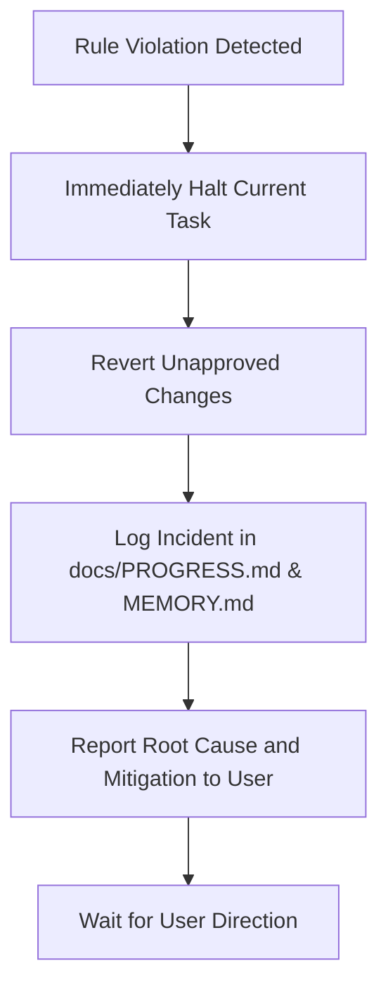

# Project Rules & Governance Policies

> **Document ID**: `RULES-001`  
> **Status**: APPROVED  
> **Effective Date**: 2026-10-22  
> **Authority**: Binding on all human contributors, autonomous agents, and subagents  

---

## 1. Overview & Purpose

This document establishes the twelve immutable core rules governing all development, architecture, testing, and operations for project **Javed**. Every agent must verify compliance with these rules before proposing or applying changes. Any violation constitutes an immediate block.

---

## 2. The Twelve Core Rules

### Rule 1: Reuse Before Build
- **Policy**: Prioritize proven, actively maintained, and battle-tested open-source libraries, packages, and frameworks over custom reinvention.
- **Enforcement**: Before implementing custom infrastructure (such as custom ORMs, homegrown vector stores, custom RPC layers, or parser engines), agents must evaluate existing ecosystem solutions and document the selection in [TECH_STACK.md](file:///c:/Users/arehman/Desktop/AI Projects/Javed/docs/TECH_STACK.md).

### Rule 2: Free and Open-Source Components by Default
- **Policy**: All runtime components, frameworks, libraries, tools, and local models must be free and open-source software (FOSS) carrying permissive licenses (e.g., MIT, Apache 2.0, BSD, ISC, or MPL 2.0).
- **Enforcement**: GPL/AGPL-licensed software or proprietary commercial packages require explicit architecture review and documentation in [docs/decisions/](file:///c:/Users/arehman/Desktop/AI Projects/Javed/docs/decisions/).

### Rule 3: OpenRouter as the Sole Preapproved Paid Exception
- **Policy**: [OpenRouter](https://openrouter.ai/) is the only preapproved proprietary paid service. It must be decoupled from the core application via a replaceable model adapter layer.
- **Enforcement**: The application must never depend on OpenRouter-specific SDK quirks. The system must support local model fallback (e.g., Ollama, vLLM, or llama.cpp) using standard OpenAI-compatible API schemas.

### Rule 4: No Unapproved Paid Services or Proprietary Dependencies
- **Policy**: No third-party paid APIs, subscription data providers, proprietary vector databases, cloud hosting subscriptions, or closed-source SDKs may be introduced without prior written user approval.
- **Enforcement**: Hard dependencies on AWS, Azure, Google Cloud paid APIs, Pinecone, OpenAI proprietary assistants API, or commercial monitoring services are prohibited unless approved through an Architecture Decision Record (ADR).

### Rule 5: Brick-by-Brick Implementation
- **Policy**: Development progresses strictly in isolated, modular units termed "bricks" (e.g., `BRICK-000`, `BRICK-001`). 
- **Enforcement**: An agent cannot begin work on `BRICK-(N+1)` until `BRICK-N` has passed all tests, achieved live UI verification, received an evidence-based report in [docs/reports/](file:///c:/Users/arehman/Desktop/AI Projects/Javed/docs/reports/), and been marked `VERIFIED` with explicit user sign-off.

### Rule 6: Mandatory Live UI Integration & Verification
- **Policy**: Every functional brick that provides or alters user-facing capabilities, telemetry, agent state, or tool orchestration must integrate with and be verified through the live UI.
- **Enforcement**: Headless-only verification is acceptable only for headless foundational utilities (e.g., raw file logging). Once the UI substrate exists, every functional brick must demonstrate live UI reflection and interaction.

### Rule 7: No Simulated or Mocked Success Presented as Real Functionality
- **Policy**: Test mocks, stubs, and synthetic fixtures are allowed strictly for unit isolation and negative testing. They must never be presented as functional verification.
- **Enforcement**: An agent must never simulate API responses, mock tool actions, hardcode fake progress, or falsify telemetry to pass acceptance criteria. If a live dependency fails or is unavailable, report it honestly as `BLOCKED` or failed.

### Rule 8: Strict Security, Authorization, and Human Approval
- **Policy**: Agent actions involving file modification outside designated workspace areas, destructive disk operations, arbitrary shell execution, system command dispatch, or external network requests require strict permission gating and human-in-the-loop authorization.
- **Enforcement**: Tool execution engines must enforce permission tiers defined in [SECURITY.md](file:///c:/Users/arehman/Desktop/AI Projects/Javed/docs/SECURITY.md). Never bypass permission gates autonomously.

### Rule 9: Rigorous Testing Before Feature Completion
- **Policy**: No brick or task may be marked `READY FOR ACCEPTANCE` without passing automated unit/integration tests and documenting concrete verification logs.
- **Enforcement**: All test runs must produce repeatable outputs recorded in [TEST_STRATEGY.md](file:///c:/Users/arehman/Desktop/AI Projects/Javed/docs/TEST_STRATEGY.md) and individual verification reports in [docs/reports/](file:///c:/Users/arehman/Desktop/AI Projects/Javed/docs/reports/).

### Rule 10: Accurate Status Tracking and Honest Reporting
- **Policy**: The project status in [PROGRESS.md](file:///c:/Users/arehman/Desktop/AI Projects/Javed/docs/PROGRESS.md) and [TASKS.md](file:///c:/Users/arehman/Desktop/AI Projects/Javed/docs/TASKS.md) must always reflect reality.
- **Enforcement**: Under no circumstances should an agent mark a task `VERIFIED` when it is untested, partially implemented, or failing. Errors, edge-case crashes, and technical blockers must be documented transparently.

### Rule 11: No Unnecessary Overlapping Frameworks or Tools
- **Policy**: Maintain architectural parsimony. Do not introduce multiple libraries or frameworks that serve the same purpose (e.g., multiple web frameworks, multiple state managers, multiple database engines).
- **Enforcement**: Every new dependency must justify its inclusion against the existing stack in [TECH_STACK.md](file:///c:/Users/arehman/Desktop/AI Projects/Javed/docs/TECH_STACK.md). Redundant libraries must be pruned.

### Rule 12: No Autonomous Expansion of Agreed Scope
- **Policy**: Agents must remain strictly within the boundaries defined by the active brick specification and the current stage.
- **Enforcement**: Speculative additions, unrequested side-features, unsolicited refactorings of out-of-scope files, or premature architectural scaffolding are forbidden without explicit prior consent.

---

## 3. Compliance & Violation Protocol

1. **Immediate Halt**: Any agent recognizing a breach must immediately stop execution.
2. **Revert**: Unapproved dependencies, files, or modifications must be reverted.
3. **Transparent Notification**: Explain the breach, the rule involved, and await human direction.
