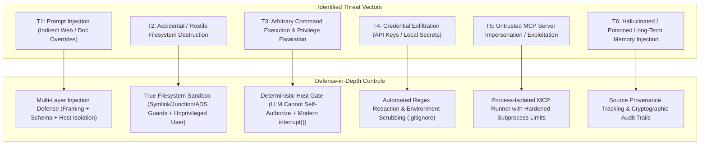

# Security Architecture, Authorization & Sandboxing Policies

> **Document ID**: `SEC-001`  
> **Version**: 2.1 (Defense-in-Depth & HITL Alignment)  
> **Status**: PROPOSED BASELINE (PENDING OWNER APPROVAL)  
> **Project**: Javed — New JARVIS  
> **Current Stage**: Stage 0 / BRICK-000 — Master Architecture & Planning  
> **Last Revision**: 2026-10-22  

---

## 1. Zero-Trust Security Philosophy

Project **JARVIS (Project Javed)** operates on an uncompromising **Zero-Trust, Least-Privilege, Deterministically Gated** security architecture.

Because an autonomous agent has access to system tools, file operations, web browsing, and external APIs, **every incoming token, retrieved document, webpage, third-party MCP tool output, and LLM completion is classified as untrusted content.**

---

## 2. Threat Modeling & Attack Surfaces



---

## 3. Four-Tier Tool Authorization Matrix

All tool functions available to JARVIS are strictly categorized into four immutable risk tiers. 

> [!IMPORTANT]
> **Deterministic Host-Side Authorization Invariant**:
> **The LLM cannot grant itself tool permissions under any circumstances.**
> Tool tiers are hardcoded in host Python classes. Tool dispatch and risk evaluation execute entirely in deterministic Python code outside the LLM's prompt context. No model completion, system prompt override, or tool parameter can demote a Tier 3 action to Tier 0 or bypass the `interrupt()` gate.

| Tier | Classification | Permitted Operations | Authorization Gate | UI & Audit Requirement |
|---|---|---|---|---|
| **Tier 0** | **Safe Read-Only** | Read workspace file, inspect directory listing, check system status, compute mathematical transformations. | **Autonomous Host Execution** | Logged to Developer Mode telemetry feed. |
| **Tier 1** | **Safe In-Memory Compute** | Text summarization, JSON schema formatting, AST parsing, token estimation. | **Autonomous Host Execution** | Logged to Developer Mode telemetry feed. |
| **Tier 2** | **Controlled Workspace Mutation** | Create or edit files *strictly* inside designated project workspace directory; run pre-approved deterministic linting/tests. | **Policy-Gated / Pre-Authorized** | Pre-execution diff preview in UI. Reversible via local backup snapshot. |
| **Tier 3** | **High Risk / System Impact** | Shell execution (`powershell`, `cmd`), file deletion, network calls outside whitelist, environment variable mutation, browser financial transactions or credential submission. | **MANDATORY HUMAN APPROVAL** | LangGraph pauses via `interrupt()`. Interactive modal appears in UI displaying exact command, directory, and risk summary. Resumes **only** via `Command(resume=...)` upon user approval. |

---

## 4. Modern Human-in-the-Loop (HITL) Protocol & Side-Effect Safety

We implement LangGraph v0.2+'s supported `interrupt()` and `Command(resume=...)` API, explicitly engineering against node re-execution hazards:

```mermaid
sequenceDiagram
    autonumber
    participant Agent as LangGraph Core
    participant Gate as Host Permission Gate (Pure Node)
    participant WS as WebSocket Gateway
    participant UI as Interactive Web UI (Modal)
    participant User as Human User
    participant Runner as Downstream Execution Node (Tool Runner)

    Agent->>Gate: Dispatches Tool Call Intent (e.g., run_shell_command)
    Gate->>Gate: Evaluates Risk Tier -> Tier 3 Detected
    Note over Gate: Pure Node: No side effects executed prior to interrupt()
    Gate->>Agent: Calls interrupt({"command": "...", "cwd": "...", "risk": "Tier 3"})
    Agent->>Agent: Checkpoints Graph State via SqliteSaver / PostgresSaver (thread_id)
    Agent->>WS: Emits 'approval_required' Event over WebSocket
    WS->>UI: Displays High-Visibility Approval Modal with Command & Target
    Note over UI,User: UI blocks input; user reviews exact command and impact
    
    alt User Approves
        User->>UI: Click 'Approve Execution'
        UI->>WS: Transmits 'approval_granted' with cryptographic token
        WS->>Agent: Invokes graph with Command(resume={"approved": True})
        Note over Gate: Node re-executes; interrupt() returns resume payload
        Gate->>Runner: Approval confirmed -> Routes to Downstream Runner Node
        Runner->>Runner: Executes tool in isolated subprocess
        Runner-->>Agent: Returns real stdout, stderr, exit code
        Agent->>UI: Streams output to Chat & Inspector
    else User Denies or Timeout
        User->>UI: Click 'Deny' (with optional user reason)
        UI->>WS: Transmits 'approval_denied' (reason='User aborted command')
        WS->>Agent: Invokes graph with Command(resume={"approved": False})
        Gate-->>Agent: Injects UserRejection Observation into Graph
        Agent->>Agent: Reflects on rejection and plans alternative approach
    end
```

### 4.1 Checkpoint & Thread Identity Requirements
- `interrupt()` strictly requires an active checkpointer (`SqliteSaver` in dev, `PostgresSaver` in prod). Checkpoints are bound to a persistent `thread_id` (`{"configurable": {"thread_id": session_id}}`).

### 4.2 Side-Effect Replay Prevention Invariant
- **The Replay Risk**: When a graph resumes from `interrupt()`, LangGraph re-runs the node containing the `interrupt()` call from the beginning.
- **Enforced Defense**:
  1. The node containing `interrupt()` is strictly **pure and idempotent**. It performs only argument validation and calls `interrupt()`.
  2. The actual side-effect execution (spawning the shell process, modifying files) resides in a separate **downstream node** that executes *only after* the approval node returns an approved state.

---

## 5. Defense-in-Depth Security Controls

### 5.1 Multi-Layer Prompt Injection Defense (Direct & Indirect)
> [!CAUTION]
> **XML Delimiters Alone Are Not an Impenetrable Sandbox**:
> Attackers can craft text containing closing tags (`</external_document>`) or jailbreak overrides. We enforce a multi-layered defense:
1. **Delimited Context Framing**: External untrusted content (webpages, documents, tool outputs) is wrapped in custom structured tags (`<untrusted_external_content source="...">`).
2. **Tag Neutralization**: Before inserting untrusted text into prompts, the host preprocessor escapes or neutralizes any embedded occurrences of the matching closing tags.
3. **Data-Instruction Separation**: Ingestion workflows parse external documents in dedicated data-extraction nodes that lack tool-calling privileges.
4. **Structured Argument Validation**: Tool parameters are parsed strictly through Pydantic v2 models. Raw model string concatenations into shell commands are strictly prohibited.
5. **Deterministic Human Gating**: Consequential actions require user confirmation via the HITL modal, ensuring that even if prompt injection bypasses model alignment, no high-risk command executes without human sign-off.

### 5.2 Complete Filesystem Sandboxing & Symlink Defense
> [!CAUTION]
> **Python `pathlib.Path.resolve()` Alone Does Not Prevent All Filesystem Attacks**:
> Canonicalization alone is vulnerable to symlink directory switches, Time-of-Check to Time-of-Use (TOCTOU) race conditions, Windows junction points, and Alternate Data Streams.
1. **Workspace Root Confinement**: All file read/write operations must resolve within `C:\Users\arehman\Desktop\AI Projects\Javed`.
2. **Symlink & Junction Point Rejection**: Tool runners explicitly inspect paths using `os.path.islink()` and Windows reparse point checks. Any symlink or junction point that targets or traverses outside the workspace root is rejected immediately.
3. **Windows Alternate Data Stream (ADS) Blocking**: Paths containing colon syntax (`file.txt:stream`) are blocked to prevent hiding data or bypassing security filters in NTFS streams.
4. **TOCTOU Race Mitigation**: File modification tools perform atomic write operations using temporary files within the same directory, followed by atomic replacements (`os.replace`), preventing partial writes and race conditions.
5. **Immutable Protected Files Registry**:
   - `.env`, `.env.*` (local credentials).
   - `.git/` (repository history and hooks).
   - Core governance files (`AGENTS.md`, `RULES.md`, `TASKS.md`, `PROGRESS.md`).
   - Any tool call attempting to target these files throws an immediate authorization error.
6. **Least Privilege OS User**: The entire application and tool runner execute under a standard Windows user account without administrator privileges.

### 5.3 Browser Session Isolation
1. **Ephemeral Contexts**: Playwright and Browser Use operate in isolated browser contexts (`browser.new_context()`) disposed of immediately upon session termination.
2. **Download Quarantine**: Browser downloads are routed to an isolated `scratch/downloads/` folder.
3. **Payment & Credential Protection**: The browser engine is strictly prohibited from autonomously submitting passwords, credit card numbers, or clicking final purchase buttons without triggering a Tier 3 HITL approval modal.

### 5.4 Model Context Protocol (MCP) Trust Boundaries
1. **Subprocess Isolation**: External MCP servers run as child processes with stripped environment variables (preventing inheritance of root `.env` secrets).
2. **Schema Verification**: MCP tool schemas are verified upon discovery. Any tool accepting arbitrary shell arguments is automatically categorized as Tier 3.

### 5.5 Credential Hygiene & Automated Redaction
1. **Git Exclusion**: `.env` and `.env.*` are excluded via [.gitignore](file:///c:/Users/arehman/Desktop/AI Projects/Javed/.gitignore).
2. **In-Line Secret Scrubber**: Regex scrubbers monitor all text before writing to logs, checkpoints, or WebSocket streams, redacting patterns matching `sk-or-v1-[a-f0-9]{64}`, Bearer tokens, or private keys to `[REDACTED_API_KEY]`.

### 5.6 Memory Privacy & The Right to be Forgotten
1. **Source Provenance**: Every stored memory fact records its conversation ID, document origin, and timestamp.
2. **User Memory Control**: The UI provides explicit memory management controls allowing the user to view all stored facts, edit incorrect memories, and permanently delete facts (`DELETE /api/memory/{id}`).
