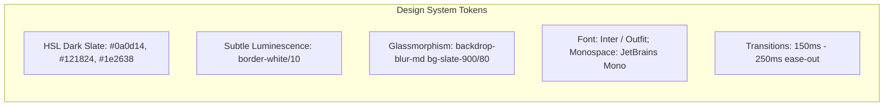

# User Interface Standards, Design System & Live Verification Protocol

> **Document ID**: `UI-001`  
> **Version**: 2.2 (Master Architecture Correction Baseline)  
> **Status**: PROPOSED (PENDING APPROVAL)  
> **Project**: Javed — New JARVIS  
> **Current Stage**: Stage 0 / BRICK-000 — Master Architecture & Planning  
> **Last Revision**: 2026-10-22  

---

## 1. UI Philosophy & Dual-Mode Architecture

JARVIS must deliver a production-quality, visually stunning, responsive interface that eliminates blind execution anxiety. The application provides two synchronized perspectives atop a single unified React application shell:

1. **User Mode**: Streamlined, intuitive personal assistant experience focusing on conversation, task completion, live browser previews, document summaries, voice controls, and high-visibility approval modals.
2. **Developer Mode**: High-density diagnostic console exposing internal LangGraph state graphs, tool invocation timelines, token counters, real-time cost estimations, system latency, and raw audit logs.

> [!IMPORTANT]
> Both User Mode and Developer Mode communicate with the exact same FastAPI backend over WebSockets and SSE. Developer Mode is an observability tool, never an administrative security bypass.

---

## 2. Design System Tokens & Aesthetics

Built using **Tailwind CSS** and **shadcn/ui** primitives adhering to modern dark-mode-first aesthetic standards:



### Color Palette (Tailwind HSL Mapping)
- `background`: `224 71% 4%` (`#0a0d14` — Deep Charcoal/Slate)
- `card`: `224 71% 6%` (`#0f141f` — Container Panel)
- `border`: `217 33% 17%` (`#1e2638` — Luminescent Subtle Border)
- `primary`: `210 100% 60%` (`#3b82f6` — Electric Blue Accent)
- `destructive`: `0 84% 60%` (`#ef4444` — Warning / Tier 3 Prompt)
- `success`: `142 71% 45%` (`#22c55e` — Verified / Passing State)
- `muted`: `215 28% 17%` (`#1e293b` — Inactive / Secondary)

---

## 3. Screen Layout & Component Structure

```text
+-----------------------------------------------------------------------------------------+
| TOP BAR: [Logo: JARVIS] | Status: ACTIVE | Model: Claude 3.5 Sonnet | Tokens: 4,120 | Mode Toggle [User/Dev] |
+-----------------------------------------------------------------------------------------+
|                                    MAIN WORKSPACE SPLIT                                  |
|                                                                                         |
|  LEFT PANEL: CONVERSATIONAL STREAM          |  RIGHT PANEL: DYNAMIC CONTEXT PANE        |
|  (assistant-ui Thread)                      |  (User Mode: Live Browser / Document View |
|                                             |   Dev Mode: LangGraph State & Telemetry)  |
|  [User Message Bubble]                      |                                           |
|  [Assistant Streaming Text Response]        |  +-------------------------------------+  |
|  [Custom Tool Call Card:                    |  | LIVE BROWSER PREVIEW / TELEMETRY    |  |
|    Tool: Crawl4AI Web Scraper               |  | [Real-time Viewport Frame]          |  |
|    URL: https://docs.python.org/3/          |  | [DOM Action: Clicking 'Tutorial']   |  |
|    Status: COMPLETED (0.42s)]               |  +-------------------------------------+  |
|                                             |  +-------------------------------------+  |
|  [Agent Reasoning & Step Planner Expander]  |  | MEMORY & SOURCE PROVENANCE          |  |
|                                             |  | Fact: User preferred language: Urdu |  |
|                                             |  +-------------------------------------+  |
+-----------------------------------------------------------------------------------------+
| PROMPT CONSOLE: [Microphone (VAD)] [Attachment Clip] [Multi-line Input Area...] [Send/Stop] |
+-----------------------------------------------------------------------------------------+
| MODAL OVERLAY: [HUMAN-IN-THE-LOOP APPROVAL REQUIRED (Tier 3 Action: Shell Execution)]     |
+-----------------------------------------------------------------------------------------+
```

---

## 4. Component Behavioral Specifications

### 4.1 Chat Thread & Tool Cards (`assistant-ui`)
- Implemented with `assistant-ui` thread primitives styled with `shadcn/ui`.
- **Markdown & Code**: Code blocks render with syntax highlighting, language badges, and one-click copy buttons.
- **Custom Tool Renderers**: Each tool invocation displays an inline interactive card:
  - Header: Tool name, status spinner, execution duration timer.
  - Body: Collapsible JSON payload of input arguments and execution output.
  - Zero decorative or simulated tools: Cards populate strictly from real backend events.

### 4.2 Human-in-the-Loop (HITL) Confirmation Modal
- Automatically renders when a `approval_required` WebSocket event is received (triggered by a LangGraph pure gating node calling `interrupt()`).
- **Visual Design**: High-contrast warning container with backdrop blur, red/amber accent borders, and prominent action buttons.
- **Required Metadata Displayed**:
  - Exact command line or operation summary.
  - Target directory or file path.
  - Risk tier justification (e.g., *"Tier 3: Execution of arbitrary shell process"*).
  - Countdown timer (default 5 minutes before auto-abort).
- **Interactive Controls & Resume Lifecycle**:
  - `Approve Execution` (Primary Button): Sends an affirmative WebSocket approval envelope. The backend dispatches `Command(resume={"approved": True})` into the waiting LangGraph thread, advancing execution to the downstream side-effect node.
  - `Deny Action` (Secondary Button with optional text reason): Dispatches `Command(resume={"approved": False, "reason": "User rejected"})` into the thread, cleanly aborting execution and informing the LLM.

### 4.3 Live Browser Preview Panel
- Embedded viewport preview receiving JPEG/WebP frame captures emitted by Playwright / Browser Use.
- Displays current URL, active tab title, and visual highlights around clicked DOM elements.

### 4.4 Long-Term Memory Manager
- Accessible in both modes via a dedicated slide-out drawer.
- Lists all extracted user facts and preferences with timestamps and source citations.
- Provides inline editing and a permanent `Delete Memory` button triggering instant backend synchronization.

### 4.5 Developer Mode Telemetry Inspector
- **Graph Inspector**: Visual rendering of active LangGraph nodes (`think` -> `route_tools` -> `execute`).
- **Performance Meters**: Real-time Time-to-First-Token (TTFT), tokens/sec, and round-trip API latency.
- **Cost Tracker**: Session token consumption broken down by prompt, completion, and USD cost calculated against OpenRouter rate tables, tracking configurable session soft spending limits and reporting provider-side spending caps.
- **Raw Event Feed**: Searchable, filterable JSON log of all raw WebSocket/SSE event envelopes.

---

## 5. Mandatory UI-Integrated Development Protocol

Per Rule 6 ([RULES.md](file:///c:/Users/arehman/Desktop/AI Projects/Javed/docs/RULES.md)):
1. **Vertical Slice Requirement**: Every functional implementation brick starting from BRICK-001 must connect to and be verified through the live web interface.
2. **No Headless Acceptances**: Backend capabilities (tool calling, browser navigation, document parsing, memory retrieval) cannot be marked `VERIFIED` without proving their live reflection in the UI.
3. **Automated UI Testing**: Every functional brick must include Playwright browser tests that load the UI, trigger the feature, and assert DOM state updates.
4. **Visual Evidence**: Every verification report in [docs/reports/](file:///c:/Users/arehman/Desktop/AI Projects/Javed/docs/reports/) must include DOM snapshots, console logs, or screenshots captured from the real web interface.
