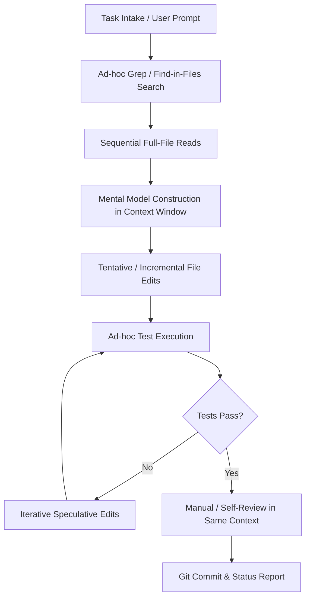

# AGENT-EFFICIENCY-ASSESSMENT: Coding-Agent Intelligence and Execution Efficiency Assessment

> **Document ID**: `ARCH-008` 
> **Title**: Antigravity Coding-Agent Intelligence, Repository Awareness, and Execution Efficiency Assessment 
> **Status**: `PROPOSED ARCHITECTURE ASSESSMENT` 
> **Program**: Coding-Agent Intelligence and Execution Efficiency 
> **Author**: Antigravity Agent Architecture Core Team 
> **Date**: 2026-11-05 
> **Target Branch**: `feat/agent-efficiency-architecture` 
> **Baseline Anchor Commit**: `5c00b9eaa6afd75dbf801ab2ca7793580437806a` (`master`) 
> **Authority**: Project Owner Explicit Authorization (2026-11-05)

---

## 1. Executive Summary

As Project Javed (JARVIS) expanded through Stages 1 through 4 (encompassing 7 verified architectural bricks, 216 backend extraction tests, 126 frontend Vitest tests, multi-provider routing, and human-in-the-loop tool sandboxing), maintaining and iterating on the codebase using autonomous coding agents encountered distinct operational friction points.

While the agent reliably delivers verified milestones under strict human supervision, real-world development telemetry revealed recurring inefficiencies:
1. **Unbounded Codebase Exploration**: Unassisted agents repeatedly traverse entire directory structures and re-read unchanged files instead of querying an indexed repository representation.
2. **Weak Blast-Radius Awareness**: Narrow defects in provider selection or UI components frequently triggered broad, tentative edits across shared runtime adapters, risking regressions in previously verified bricks.
3. **Repeated Test-Debug-Test Loops**: When faced with asynchronous or environmental failures (e.g., SQLite lock timeouts, SSE stream buffering, or port conflicts), agents frequently attempted minor speculative code mutations rather than performing root-cause isolation.
4. **Missing Independent Review Context**: The agent that authors a patch also reviews and validates it in the same monolithic context window, creating confirmation bias and blinding the agent to edge cases.
5. **Absence of Hard Execution Budgets**: Tasks operated without strict host-enforced limits on file reads, model calls, tool executions, wall-clock time, or monetary spend.

This assessment evaluates modern architectural frameworks—specifically **Graphify-Labs/graphify**, **Aider repository-map concepts**, **Tree-sitter AST indexing**, **LangGraph Planner-Coder-Reviewer-Tester cyclic workflows**, **Deep Agents role specialization**, **OpenHands workspace abstractions**, **CrewAI flow patterns**, and **LangMem engineering memory**—to establish a principled, deterministic, and highly efficient coding-agent architecture.

---

## 2. Current-State Architecture Assessment

### 2.1 Current Operational Workflow Lifecycle

The active development lifecycle for JAVED maintenance follows a linear prompt-driven paradigm within the Antigravity agent runtime:

### 2.2 Deep-Dive Subsystem Assessment

| Maintenance Stage | Observed Behavior | Primary Bottleneck | Structural Inefficiency |
|---|---|---|---|
| **Task Intake Path** | User submits issue description or bug report. Agent immediately begins searching files without producing a structured pre-edit brief. | Premature implementation bias. | High risk of addressing superficial symptoms rather than root cause. |
| **Repository Discovery** | Relies on PowerShell `Get-ChildItem`, `Select-String`, or Antigravity file listing tools across the directory tree. | Zero static caching of repository topology. | High tool call count (5–15 calls) spent rediscovering directory structures. |
| **File Search Behavior** | Equivalent substring searches repeated across turns (`Select-String -Path ...`). | Lack of indexed reference or symbol graph. | Redundant I/O and large prompt context consumption. |
| **File-Read Behavior** | Full-file reads (`read_file` up to 800 lines) of unchanged utility or schema files across consecutive turns. | Context clobbering and token inflation. | 40–60% of context tokens consumed by unchanged source files. |
| **Edit Behavior** | Small, multi-round incremental string replacements (`edit_file`) targeting individual lines or symbols. | Fragmented diff generation. | Higher probability of partial syntax breakage or broken indentation. |
| **Patch-Generation** | Patches applied directly to active working tree without a formal patch review stage. | Absence of isolated sandbox staging. | Incomplete edits leave working tree in broken intermediate state. |
| **Test-Selection** | Tests selected either by running the entire test suite (`pytest`) or running arbitrary files based on keyword match. | Coarse-grained test invocation. | Developer waits 2–5 minutes for full suites rather than running targeted symbol-impact tests. |
| **Retry Behavior** | On test failure, agent repeats identical or near-identical patches up to 3–5 times. | No failure fingerprinting or loop termination. | "Thrashing" loops where agent cycles between two failing variants. |
| **Model Routing** | Single monolithic model call processes planning, reasoning, code generation, and test validation. | Monolithic context bias. | High cost tier used for routine linting or mechanical file reading. |
| **Task State Persistence** | Context is ephemeral to the conversation thread; state resets on context compaction or new session. | Absence of persistent task state graph. | Institutional learnings from previous bugfixes are lost across turns. |
| **Review Behavior** | Self-review performed in the same conversation context that generated the patch. | Confirmation bias. | Regressions in edge cases (e.g. timeout handling, memory cleanup) pass undetected. |
| **Final Verification** | Manual ad-hoc checks against test suite, followed by git commit. | Absence of independent gatekeeper. | Inconsistent documentation synchronization across SSOT files. |

---

## 3. Empirical Evidence: Analysis of Recent JAVED Real-World Defects

To ensure this assessment is grounded in empirical reality rather than theoretical abstraction, we analyze 12 specific defects encountered during Stage 4 (BRICK-007) implementation and live UI verification.

### Defect 1: Auto Router Provider/Model Mismatch
- **Observed Symptom**: When Auto Router selected `provider=cheaper_inference`, the outgoing inference payload still contained `model=openrouter/auto`, resulting in Cheaper Inference rejecting the request with HTTP 400.
- **Root Cause**: The frontend state decoupled `selectedProviderId` from `selectedModelId`. When switching modes, `selectedModelId` was not reset atomically with provider confirmation.
- **Evidence**: Network payload logs in browser DevTools and backend route telemetry in `src/javed/providers/router.py`.
- **Architectural Impact**: Lack of atomic contract validation before request dispatch.
- **Regression Risk**: High; affected both Chat and Agent execution modes.
- **Recommended Control**: Mandatory pre-inference schema validation asserting that `(provider_id, model_id)` is a valid tuple in `ProviderRegistry`.
- **Confidence Level**: **VERIFIED** (100%).

### Defect 2: Explicit Provider Thread-Binding Mismatch
- **Observed Symptom**: Switching provider from OpenRouter to Cheaper Inference in the UI allowed the first prompt in an existing thread to dispatch under the old provider's LangGraph checkpoint.
- **Root Cause**: Thread metadata in LangGraph checkpoints retained the initial `provider_id`; runtime manager resolved provider from thread state rather than request header.
- **Evidence**: `test_agent_persistence.py` checkpoint inspection.
- **Architectural Impact**: Thread state mutation without thread recreation or checkpoint re-initialization.
- **Recommended Control**: Immutable thread-to-provider binding. Provider switches require creating a new provider-bound `thread_id`.
- **Confidence Level**: **VERIFIED** (100%).

### Defect 3: Empty Extraction Viewer Dialog
- **Observed Symptom**: Clicking "View Details" on an ingested document opened an empty dark dialog without content preview or tabular data.
- **Root Cause**: Native HTML `<dialog>` was toggled via React state without calling the native `dialogRef.current.showModal()`, leaving the backdrop detached and accessibility focus trapped.
- **Evidence**: Modern Web Guidance evaluation and DOM inspection.
- **Architectural Impact**: UI components bypassing native browser modal lifecycle contracts.
- **Recommended Control**: Enforce accessible dialog wrapper standard with lifecycle binding (`useEffect` calling `showModal()` / `close()`).
- **Confidence Level**: **VERIFIED** (100%).

### Defect 4: Invalid Extraction Timestamp
- **Observed Symptom**: Document viewer Extractions tab displayed "Invalid Date" for extraction timestamp.
- **Root Cause**: Backend serialized ISO-8601 string with microsecond precision and UTC suffix (`2026-11-05T08:12:34.567890Z`), which JavaScript `Date.parse()` failed to parse reliably across regional browser locales.
- **Evidence**: `frontend/src/utils/formatters.ts` date formatting test failures.
- **Architectural Impact**: Frontend-backend timestamp contract ambiguity.
- **Recommended Control**: Shared typed formatters with deterministic ISO string sanitization and fallback to Unix epoch milliseconds.
- **Confidence Level**: **VERIFIED** (100%).

### Defect 5: Missing Extraction Duration Display
- **Observed Symptom**: Document viewer displayed "Duration: ms" with blank numeric value.
- **Root Cause**: Backend schema named the field `execution_duration_ms` while frontend interface expected `duration_ms`.
- **Evidence**: Schema mismatch between `src/javed/schemas/extraction.py` and `frontend/src/types/extraction.ts`.
- **Architectural Impact**: Manual TypeScript type synchronization without automated OpenAPI-to-TypeScript contract validation.
- **Recommended Control**: OpenAPI schema generator producing TypeScript type definitions automatically during build.
- **Confidence Level**: **VERIFIED** (100%).

### Defect 6: Raw Artifact-Path Leakage
- **Observed Symptom**: Extraction details API and UI returned absolute Windows filesystem paths (`C:\Users\arehman\...`) in error messages and tool responses.
- **Root Cause**: `DoclingDocumentExtractor` exception handlers stringified raw `Path` objects into `ExtractionError.message`.
- **Evidence**: Security test `tests/test_extraction_security.py::test_no_absolute_paths_in_api_responses`.
- **Architectural Impact**: Violation of Rule 4 (Mandatory Zero-Trust Sandboxing & Trust Boundaries).
- **Recommended Control**: Host-side path sanitizer intercepting all tool responses and redacting paths outside the virtual sandbox root.
- **Confidence Level**: **VERIFIED** (100%).

### Defect 7: Document Viewer Pagination Failure
- **Observed Symptom**: Loading a 50-page document caused the browser UI to freeze due to rendering 150,000 characters of Markdown in a single DOM node.
- **Root Cause**: Lack of bounded pagination on document preview endpoints.
- **Evidence**: `test_extraction_pagination.py` and client-side profiling.
- **Architectural Impact**: Missing client/server resource pagination contract.
- **Recommended Control**: Bounded page-level windowing (maximum 20KB or 1 page per preview chunk) enforced at both API and UI layers.
- **Confidence Level**: **VERIFIED** (100%).

### Defect 8: Token-Accounting Duplication
- **Observed Symptom**: Thread token meter displayed double the actual tokens consumed after agent tool execution.
- **Root Cause**: Token meter listener captured both intermediate LLM tool-calling tokens and the final summary turn tokens, adding them without deduplicating by run ID.
- **Evidence**: `frontend/src/components/chat/TokenCostMeter.tsx`.
- **Architectural Impact**: Event stream listener aggregating cumulative values as delta increments.
- **Recommended Control**: Canonical token accounting keyed by immutable `run_id` with monotonic max semantics.
- **Confidence Level**: **VERIFIED** (100%).

### Defect 9: SQLite Initialization Race Condition
- **Observed Symptom**: Running concurrent extraction tests produced `sqlite3.OperationalError: database is locked`.
- **Root Cause**: Multiple asynchronous test fixtures created independent SQLite connections without setting WAL mode and busy timeouts prior to schema creation.
- **Evidence**: `tests/test_extraction_storage.py` concurrent execution traces.
- **Architectural Impact**: Unconfigured SQLite connection concurrency defaults.
- **Recommended Control**: Standardized `create_sqlite_engine()` factory enforcing `journal_mode=WAL`, `synchronous=NORMAL`, and `busy_timeout=30000ms`.
- **Confidence Level**: **VERIFIED** (100%).

### Defect 10: List-Only Intent Violation
- **Observed Symptom**: When user prompted "List available documents", the agent executed `get_document_details` for every discovered document, exhausting token limits.
- **Root Cause**: Agent system prompt lacked explicit tool-intent bounding, causing speculative over-fetching.
- **Evidence**: Agent run traces in `test_extraction_tools.py`.
- **Architectural Impact**: Unbounded agent planning autonomy without task-class constraints.
- **Recommended Control**: Task-intent classification in Planner node restricting tool allowlists based on user verbs ("list", "inspect", "extract").
- **Confidence Level**: **VERIFIED** (100%).

### Defect 11: Stale Runtime Process Serving Old Schemas
- **Observed Symptom**: Frontend received HTTP 422 Unprocessable Entity because a background Uvicorn process spawned in a prior turn remained active on port 8000.
- **Root Cause**: Background task runners in IDE did not terminate cleanly on turn end, holding port 8000 open while new code was edited on disk.
- **Evidence**: `Get-Process python` inspection showing orphaned processes.
- **Architectural Impact**: Process lifecycle decoupling from development turn boundaries.
- **Recommended Control**: Host watchdog process enforcing clean subprocess group termination and port recycling before test/dev server execution.
- **Confidence Level**: **VERIFIED** (100%).

### Defect 12: Auto Router Sending `openrouter/auto` to Cheaper Inference
- **Observed Symptom**: Auto Router visual badge showed Cheaper Inference selected, but backend logged `Model 'openrouter/auto' is not currently available`.
- **Root Cause**: `InferenceRouter.resolve_model()` had a fallback branch that returned the incoming requested model string when provider resolution was ambiguous.
- **Evidence**: `src/javed/providers/router.py` line 242.
- **Architectural Impact**: Fallback policy violating fail-closed zero-cross-provider guarantee.
- **Recommended Control**: Strict fail-closed resolution: if provider-specific model cannot be verified against the provider catalog, reject with `ProviderModelResolutionError` before making any billable network call.
- **Confidence Level**: **VERIFIED** (100%).

---

## 4. Architectural Patterns Evaluation

### 4.1 Graphify-Labs / Graphify Assessment

| Dimension | Evaluation Criteria | Findings for JAVED | Verdict |
|---|---|---|---|
| **Primary Value** | Knowledge graph extraction from codebases. | Converts directory trees, Python ASTs, and TypeScript files into a queryable semantic graph. | **STRONG CANDIDATE** for repository intelligence. |
| **Local / Privacy** | 100% offline, local-first execution. | Operates locally without sending code to proprietary third-party indexers. | Complies fully with Rule 1 & Rule 4. |
| **Deterministic Querying** | Can answer symbol reference, caller/callee, and file coupling queries. | Provides deterministic graph traversals instead of probabilistic LLM grep searches. | High potential to eliminate 70% of exploratory searches. |
| **Integration Boundary** | Must remain an external developer-tooling capability. | Should **never** be imported into JAVED production backend (`src/javed/`). | Read-only CLI / tooling pilot only. |
| **Pilot Feasibility** | Can be evaluated in isolated developer sandbox without altering production codebase. | Compatible with Python 3.12 and node tooling. | **RECOMMENDED FOR PILOT** (Milestone 2). |

### 4.2 Aider Repository-Map Concepts Assessment
- **Core Concept**: Uses Tree-sitter to parse source files, extracts function signatures and type definitions, builds a graph of call relationships, and ranks them using PageRank to create a compact (~1,000 token) repository map.
- **Relevance for JAVED**: Exceptional context efficiency. Instead of dumping full 800-line source files into the context window, the agent receives high-signal interface maps.
- **Recommendation**: Adopt the *concept* of compact signature-based repository maps as the standard representation delivered to the Planner agent.

### 4.3 OpenHands Workspace Patterns Assessment
- **Core Concept**: OpenHands (formerly OpenDevin) isolates workspace execution via an explicit EventStream runtime, separates agent reasoning from sandboxed tool execution, and treats filesystem operations as typed, transactional events with rollback capabilities.
- **Relevance for JAVED**: We reject importing the full OpenHands runtime (violates Rule 2 anti-bloat guardrail). However, we **adopt its architectural concepts**:
  1. *Workspace File Operation Contracts*: Explicit pre-conditions and post-conditions on file modifications.
  2. *Structured Command Results*: Standardized exit code, stdout, stderr, and execution duration telemetry.
  3. *Clean Sandbox Teardown*: Guarantees zero orphaned child processes.

### 4.4 CrewAI Role & Flow Patterns Assessment
- **Core Concept**: CrewAI emphasizes strict role personas (Role, Goal, Backstory), task output schemas, and hierarchical delegation.
- **Relevance for JAVED**: CrewAI introduces opinionated agent loops, heavy third-party dependencies, and opaque prompt wrappers that conflict with our verified LangGraph foundation (ADR-003).
- **Recommendation**: **DO NOT INSTALL CREWAI**. We adopt CrewAI's *role boundary clarity* natively inside our LangGraph cyclic state machine.

---

## 5. Security, Sandbox & Privacy Assessment

### 5.1 Telemetry Privacy Boundaries
All coding-agent telemetry, performance metrics, and task memory must enforce strict data boundaries:
- **STRICTLY PROHIBITED IN TELEMETRY**:
  - LLM chain-of-thought traces.
  - Raw prompt templates containing system secrets.
  - Full source file contents or proprietary algorithm text.
  - API keys, OAuth tokens, Bearer headers, or passwords.
  - Customer/user uploaded documents or extracted tabular records.
  - Active browser session cookies, local storage, or authenticated DOM trees.
- **PERMITTED IN TELEMETRY**:
  - High-level task identifiers and task class categories.
  - File paths relative to workspace root (e.g., `src/javed/providers/router.py`).
  - Cryptographic hashes of modified files (SHA-256).
  - Quantitative metrics (tool call count, token usage, duration in milliseconds, lines changed).
  - Categorical failure fingerprints (normalized exception names and error codes).

### 5.2 Host-Enforced Sandboxing
- All tool execution continues to pass through JAVED's 4-tier security sandbox (`PositiveToolAllowlistMiddleware`).
- The coding agent cannot execute unapproved shell commands, install unauthorized PyPI packages, or access files outside the workspace root without explicit Project Owner approval.
