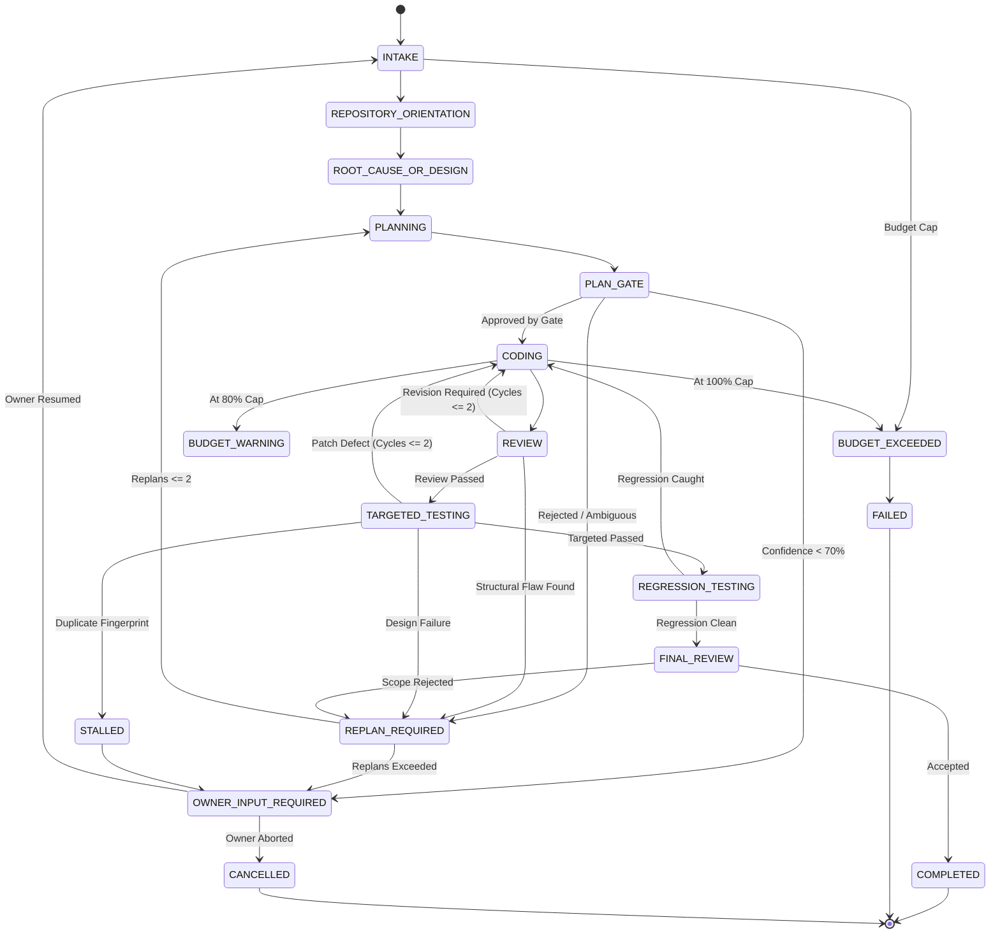
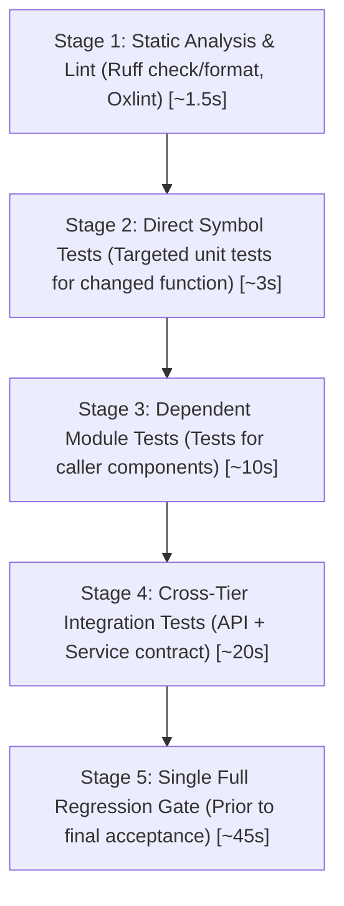

# PLANNER-CODER-REVIEWER-TESTER: Multi-Agent Cyclic Development Workflow

> **Document ID**: `ARCH-010`<br/>
> **Title**: LangGraph Cyclic State-Machine, Role Contracts, Execution Budgets, and Testing Strategy<br/>
> **Status**: `PROPOSED SPECIFICATION`<br/>
> **Program**: Coding-Agent Intelligence and Execution Efficiency<br/>
> **Author**: Antigravity Agent Architecture Core Team<br/>
> **Date**: 2026-11-05<br/>
> **Target Branch**: `feat/agent-efficiency-architecture`<br/>
> **Anchor Commit**: `5c00b9eaa6afd75dbf801ab2ca7793580437806a` (`master`)

---

## 1. Executive Summary & Objective

In unconstrained agent systems, a single agent model instance typically attempts to diagnose, plan, edit, test, and accept code changes within a single rolling conversation context. This monolithic model produces confirmation bias, unconstrained token expenditure, speculative code thrashing, and regressions.

This document designs an explicit, deterministic **LangGraph cyclic state machine** governing specialized roles—**Planner**, **Coder**, **Reviewer**, **Tester**, and **Final Reviewer**—backed by **mandatory pre-edit gates**, **hard execution budgets**, **failure fingerprinting**, and **impact-aware test selection**.

---

## 2. LangGraph Cyclic State Machine Architecture

### 2.1 State Graph Topology



### 2.2 State Definitions & Transition Guardrails

| State | Primary Responsibility | Allowed Tools | Exit Criteria / Guardrail |
|---|---|---|---|
| **`INTAKE`** | Parses task request, extracts task class, initializes task telemetry ledger. | None (pure state transformation). | Valid task class assigned; budget allocated. |
| **`REPOSITORY_ORIENTATION`** | Queries repository knowledge graph (Graphify) for affected symbols, callers, and test mappings. | `graph_query`, `symbol_lookup` (Read-only). | Top-K candidate files ranked; 0 source files edited. |
| **`ROOT_CAUSE_OR_DESIGN`** | Formulates verified defect root cause or feature architecture design. | Bounded `read_file` (target lines only). | Pre-Edit Brief generated with >= 80% confidence. |
| **`PLANNING`** | Selects exact files to modify, files NOT to modify, and targeted test suite. | None (pure reasoning). | Complete, actionable patch strategy written. |
| **`PLAN_GATE`** | Validates plan against budget, scope rules, and single-source-of-truth invariants. | Automated validator / Owner gate. | Must pass deterministic validation checks. |
| **`CODING`** | Implements the approved patch in a single coherent operation; writes new targeted tests. | `edit_file`, `write_file` (strictly bounded). | Modifies ONLY files declared in approved plan. |
| **`REVIEW`** | Independent model invocation in a **fresh context** reviewing diff against requirements. | `git_diff_check` (Read-only). | Rejects style regressions, secret leaks, scope bloat. |
| **`TARGETED_TESTING`** | Executes syntax check and targeted unit tests directly covering changed symbols. | `run_command` (pytest targeted, vitest). | 100% targeted tests pass. Fingerprints failures. |
| **`REGRESSION_TESTING`**| Executes broader subsystem regression suite once before sign-off. | `run_command` (pytest subsystem). | Zero regressions in previously verified tests. |
| **`FINAL_REVIEW`** | Validates git status, documentation alignment (SSOT), and budget telemetry. | `git_status`, doc checks. | Ready for owner acceptance report. |

---

## 3. Explicit Role Contracts

### 3.1 Planner Contract
- **Access Level**: Strictly **READ-ONLY**. Cannot call `edit_file`, `write_file`, or run destructive commands.
- **Inputs**: User prompt, repository map / Graphify query results, current baseline documentation.
- **Outputs**: Complete **Pre-Edit Brief** containing root-cause analysis, affected symbol list, target files, non-target files, and verification plan.
- **Constraint**: Must halt with `AMBIGUOUS` status rather than guessing when confidence is below 70%.

### 3.2 Coder Contract
- **Access Level**: **STRICTLY BOUNDED WRITE**.
- **Inputs**: Approved Pre-Edit Brief and planner patch strategy.
- **Rules**:
  1. Can modify **only** files explicitly listed in `FILES TO MODIFY`. Any attempt to touch other files triggers `SCOPE_EXPANSION_REQUIRED`.
  2. Must author modifications in a single, coherent patch rather than iterative line-by-line experiments.
  3. Must add or update targeted tests verifying the change.
  4. Cannot modify test assertions in existing regression tests to force a pass without explicit authorization.

### 3.3 Reviewer Contract
- **Access Level**: **ISOLATED READ-ONLY**.
- **Execution Model**: Dispatched as an independent LLM call with a **fresh, isolated context window** (zero access to the Coder's rolling chain-of-thought).
- **Inputs**: Task objective, approved brief, and `git diff`.
- **Review Criteria Checklist**:
  - [ ] Does the diff address the stated objective without extraneous changes?
  - [ ] Are any private credentials, tokens, or absolute filesystem paths exposed?
  - [ ] Are error-handling fallbacks fail-closed rather than speculative?
  - [ ] Is input validation enforced at the boundary?
  - [ ] Are appropriate unit/integration tests included?
  - [ ] Are comments, docstrings, and documentation preserved?
- **Authority**: Reviewer has absolute veto power. A rejection routes the state machine back to `CODING` (if minor) or `REPLAN_REQUIRED` (if architectural).

### 3.4 Tester Contract
- **Access Level**: **CONTROLLED EXECUTION**.
- **Inputs**: Targeted test plan from brief.
- **Behavior**:
  1. Executes test runner with strict timeouts.
  2. Captures exit code, stdout, stderr, and duration.
  3. Normalizes and classifies any failure into canonical categories: `patch_defect`, `existing_failure`, `environment_failure`, `flaky_test`, or `infrastructure_failure`.
  4. Generates a **failure fingerprint**. If the identical failure fingerprint was encountered in the immediately preceding cycle, aborts with `STALLED` state to prevent infinite loops.

### 3.5 Final Reviewer Contract
- **Role**: Validates overall milestone integrity, checks that documentation (PROGRESS.md, TASKS.md) aligns with git diff, audits monetary spend, and constructs the final acceptance report for the Project Owner.

---

## 4. Mandatory Pre-Edit Brief Contracts

No code modification is permitted in the repository until the state machine transitions through `ROOT_CAUSE_OR_DESIGN` and emits a fully populated brief:

### 4.1 Defect Brief Schema
```markdown
### MANDATORY PRE-EDIT BRIEF: DEFECT FIX
- TASK ID: [e.g. TASK-070-DEFECT-12]
- CURRENT BEHAVIOR: [Precise description of observed buggy behavior]
- EXPECTED BEHAVIOR: [Precise description of expected correct behavior]
- EVIDENCE: [Log excerpts, test failure output, or reproduction steps]
- ROOT CAUSE: [Exhaustive explanation of why the defect occurs]
- ROOT-CAUSE CONFIDENCE: [e.g. 95% / VERIFIED]
- AFFECTED SYMBOLS: [List of functions, classes, methods, or endpoints]
- FILES TO READ: [Target file paths and specific line number ranges]
- FILES TO MODIFY: [Exhaustive list of files permitted to be edited]
- FILES NOT TO MODIFY: [List of sensitive/adjacent files explicitly out of bounds]
- SECURITY RISKS: [Evaluation of trust boundaries, path traversal, secret exposure]
- REGRESSION RISKS: [Components or tests that could break from this change]
- PATCH STRATEGY: [Step-by-step description of the exact code edit]
- ROLLBACK STRATEGY: [Commands to restore working tree if patch fails]
- TEST STRATEGY: [Specific targeted test commands to verify fix]
```

### 4.2 Feature Brief Schema
```markdown
### MANDATORY PRE-EDIT BRIEF: FEATURE IMPLEMENTATION
- TASK ID: [e.g. TASK-080-P1]
- OBJECTIVE: [Clear statement of capability being added]
- DESIGN RATIONALE: [Why this architectural approach was chosen]
- OWNING COMPONENTS: [Subsystems responsible for this capability]
- AFFECTED CONTRACTS: [API schemas, Pydantic models, or TypeScript interfaces]
- FILES TO READ: [Target interfaces and dependency files]
- FILES TO MODIFY: [Exhaustive list of new and modified files]
- FILES NOT TO MODIFY: [Protected subsystems out of bounds]
- SECURITY RISKS: [Permission tiers, sandboxing, input sanitization]
- REGRESSION RISKS: [Existing workflows that could be impacted]
- IMPLEMENTATION STRATEGY: [Detailed sequence of additions]
- ROLLBACK STRATEGY: [Commands to revert changes cleanly]
- TEST STRATEGY: [Unit, integration, and E2E test plan]
```

---

## 5. Hard Execution Limits & Watchdog

To guarantee that tasks remain bounded in time, cost, and complexity, the state machine incorporates an active **Execution Watchdog**.

### 5.1 Enforceable Budget Limits by Task Class

| Limit Metric | Documentation Task | Single-File Defect | Multi-File Defect | Contract / API Change | Architecture Change |
|---|---|---|---|---|---|
| **`max_task_duration_seconds`** | 600s (10m) | 900s (15m) | 1800s (30m) | 2700s (45m) | 3600s (60m) |
| **`max_analysis_iterations`** | 1 | 2 | 3 | 3 | 4 |
| **`max_root_cause_rounds`** | 1 | 2 | 2 | 2 | 3 |
| **`max_replanning_count`** | 1 | 1 | 2 | 2 | 2 |
| **`max_planner_cycles`** | 1 | 2 | 2 | 2 | 3 |
| **`max_coder_revision_cycles`** | 1 | 2 | 2 | 2 | 3 |
| **`max_reviewer_cycles`** | 1 | 2 | 2 | 2 | 3 |
| **`max_unique_files_read`** | 5 | 8 | 16 | 24 | 40 |
| **`max_repeated_reads_per_file`**| 1 | 2 | 2 | 2 | 2 |
| **`max_repository_search_calls`**| 3 | 4 | 8 | 12 | 16 |
| **`max_graph_queries`** | 2 | 4 | 6 | 8 | 12 |
| **`max_files_modified`** | 3 | 1 | 4 | 8 | 12 |
| **`max_patch_count`** | 2 | 2 | 4 | 4 | 6 |
| **`max_targeted_test_runs`** | 1 | 3 | 3 | 4 | 5 |
| **`max_identical_test_retries`** | 1 | 1 | 1 | 1 | 1 |
| **`max_full_regression_runs`** | 0 | 1 | 1 | 1 | 1 |
| **`max_no_progress_iterations`** | 1 | 2 | 2 | 2 | 2 |
| **`max_total_tool_calls`** | 15 | 25 | 50 | 80 | 100 |
| **`max_total_model_calls`** | 2 | 4 | 6 | 8 | 12 |
| **`max_task_tokens`** | 40,000 | 80,000 | 120,000 | 160,000 | 250,000 |
| **`max_task_cost_usd`** | $0.25 | $0.50 | $1.00 | $1.50 | $2.50 |

### 5.2 Watchdog Trigger Actions
- **At 80% of any critical budget**:
  1. Emit `BUDGET_WARNING` event to telemetry and UI.
  2. Automatically halt all optional exploratory reads and opportunistic refactoring.
  3. Compact context state.
  4. Restrict next action exclusively to required verification and commit.
- **At 100% of any budget**:
  1. Trigger immediate `BUDGET_EXCEEDED` transition.
  2. Gracefully terminate active child processes (with 10s SIGTERM/SIGKILL timeout).
  3. Save current task state and git diff to `.gemini/scratch/task_state_dump.json`.
  4. Halt execution completely and request Project Owner authorization to resume or abort.
  5. **Inviolable Invariant**: No limit may increase itself automatically.

---

## 6. Infinite-Loop Prevention & Failure Fingerprinting

Speculative debugging loops ("thrashing") occur when an agent repeatedly applies slight variations of a failed patch without understanding the underlying error.

### 6.1 Failure Fingerprint Normalization
Every test failure is hashed into a canonical **Failure Fingerprint**:
```python
def compute_failure_fingerprint(
    test_name: str,
    exception_type: str,
    normalized_error: str,
    failing_file: str,
    failing_line: int,
) -> str:
    payload = f"{test_name}|{exception_type}|{normalized_error}|{failing_file}:{failing_line}"
    return hashlib.sha256(payload.encode("utf-8")).hexdigest()[:16]
```
`normalized_error` strips non-deterministic elements (timestamps, memory addresses, ephemeral process IDs, and random ports).

### 6.2 Anti-Loop Invariants
1. **Identical Failure Rule**: If a test run yields the exact same failure fingerprint as the prior run after code was modified, the Coder is **forbidden** from trying a third patch. The state machine transitions to `STALLED`.
2. **Ping-Pong Reversion Rule**: If an edit reverses changes made two iterations prior (restoring a previously failed state), the transition is immediately blocked.
3. **No-Progress Circuit Breaker**: If two consecutive tool calls produce zero state change in the working tree and zero test progress, the agent is halted.

---

## 7. Impact-Aware Testing Strategy

Instead of executing the entire test suite on every code iteration (which incurs minutes of latency and process thrashing), testing is structured as an **Impact Pyramid**:



- Stages 1 through 3 execute during the inner `CODING` -> `TARGETED_TESTING` loop.
- Stage 4 executes during `REVIEW` -> `TARGETED_TESTING`.
- Stage 5 executes strictly **once** in the `REGRESSION_TESTING` state prior to final sign-off.

---

## 8. Execution Memory & LangMem Suitability

### 8.1 Short-Term Task Memory Schema
During an active task, state is durably preserved in a lightweight JSON structure within LangGraph checkpoints:
```json
{
  "task_id": "TASK-EFF-001",
  "task_class": "multi_file_defect",
  "starting_commit": "5c00b9e",
  "root_cause_brief": { ... },
  "approved_files": ["src/javed/providers/router.py"],
  "rejected_files": ["src/javed/providers/cheaper_inference.py"],
  "iteration_count": 2,
  "failure_fingerprints_seen": ["a1b2c3d4", "e5f6g7h8"],
  "consumed_tokens": 42150,
  "consumed_cost_usd": 0.38,
  "elapsed_seconds": 412
}
```

### 8.2 Long-Term Engineering Memory (LangMem Evaluation)
- **Concept**: Cross-task memory preserving architectural decisions, verified file ownership maps, and historical anti-patterns.
- **Evaluation for JAVED**:
  - Premature activation of long-term vector memory before basic workflow boundaries and telemetry exist adds operational overhead without proven value.
  - **Verdict**: **DEFER** LangMem to **Milestone 8**. Establish deterministic repository intelligence (Graphify) and execution budgets first.
