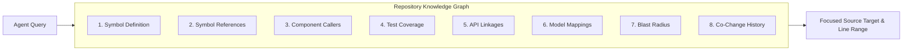
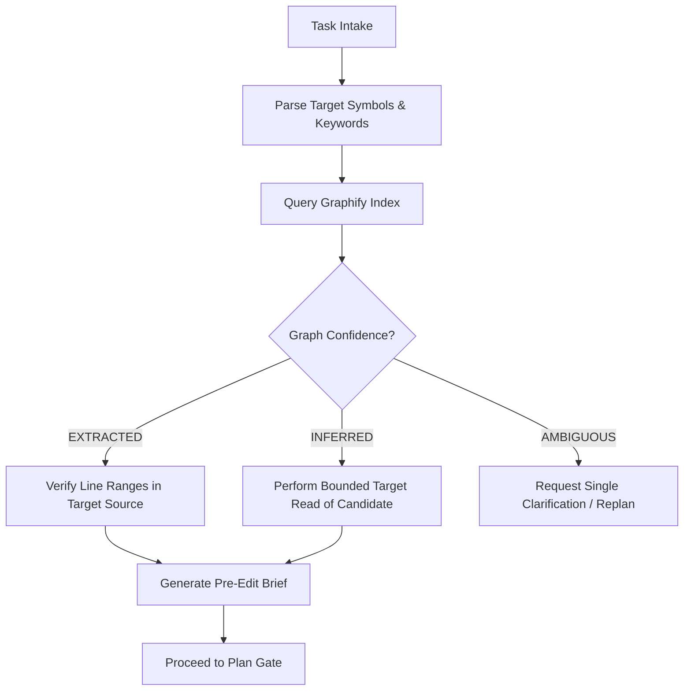

# REPOSITORY-INTELLIGENCE-DESIGN: Graphify-First Repository Awareness Specification

> **Document ID**: `ARCH-009` 
> **Title**: Codebase Knowledge Graph and Repository-Query-First Orientation Architecture 
> **Status**: `PROPOSED SPECIFICATION` 
> **Program**: Coding-Agent Intelligence and Execution Efficiency 
> **Author**: Antigravity Agent Architecture Core Team 
> **Date**: 2026-11-05 
> **Target Branch**: `feat/agent-efficiency-architecture` 
> **Anchor Commit**: `5c00b9eaa6afd75dbf801ab2ca7793580437806a` (`master`)

---

## 1. Executive Summary & Objective

The primary driver of excessive agent token consumption, long turn durations, and regression introduction is **weak repository awareness**. When tasked with fixing a defect or extending a feature, an unassisted agent resorts to broad substring searches (`grep`, `Select-String`, or recursive directory scans) and speculative full-file reading.

**Repository Intelligence** replaces probabilistic, brute-force file exploration with a deterministic, indexed knowledge graph. This document specifies the architecture for a **Repository-Query-First** orientation pipeline, evaluating **Graphify-Labs/graphify** as the primary candidate, contrasted with Aider repository-map concepts and raw Tree-sitter AST indexing.

---

## 2. Technology Candidate Evaluation

### 2.1 Comparative Analysis

| Dimension | Option A: Graphify (`Graphify-Labs/graphify`) | Option B: Aider Repo-Map Pattern | Option C: Bespoke Tree-Sitter Index |
|---|---|---|---|
| **Architecture** | Semantic Knowledge Graph (Nodes: Files, Classes, Functions, Endpoints; Edges: Imports, Calls, Extends, References). | Weighted Symbol Graph with PageRank ranking over AST symbols. | Direct relational SQLite database storing AST symbol tables and raw xrefs. |
| **Cross-Language Support** | High (Python, TypeScript, JavaScript, Markdown, JSON). | High (Tree-sitter based multi-language grammar support). | Manual parser integration required per language. |
| **Relationship Depth** | Deep (call hierarchies, data flow, component-to-endpoint linkages). | Moderate (primarily symbol definitions and immediate references). | Custom-coded queries required for multi-hop traversals. |
| **Context Density** | High-precision subgraph extraction per query (answers specific questions in < 500 tokens). | Produces compact global summary map (~1,000 to 2,000 tokens). | Raw SQL results require post-processing. |
| **Maintenance Burden** | Low (managed open-source library used as developer tooling). | Moderate (requires integrating Aider repo-map algorithm). | High (requires ongoing maintenance of custom AST visitor logic). |
| **Operational Sandbox** | Can run 100% locally as a read-only CLI or MCP server in dev environment. | Runs locally via Python Tree-sitter bindings. | Runs locally. |
| **Verdict** | **PREFERRED PILOT CANDIDATE** (Milestone 2). | **SECONDARY COMPLEMENTARY PATTERN** (for prompt map). | **REJECTED** (Unnecessary reinvention of AST tooling). |

---

## 3. Answering the 8 Core Repository Questions

To justify adoption, Graphify must deterministically answer the 8 core questions that coding agents struggle with:

### Detailed Evaluation Matrix

| Question | Current Manual Search Method | Graphify Query Capability | Efficiency Gain |
|---|---|---|---|
| **1. Which file defines this symbol?** | `Select-String -Pattern "class ModelName"` across all directories (10–30s). | Direct index lookup: `MATCH (s:Symbol {name: 'ModelName'}) RETURN s.file, s.line`. | **Instant (< 50ms)**; 0 file reads required. |
| **2. Which files reference this symbol?** | Grep pattern search returning dozens of comments, strings, and imports. | Edge traversal: `(s:Symbol)<-[:REFERENCES]-(ref) RETURN ref.file`. | Eliminates false positive string matches. |
| **3. Which components call this service?** | Grep service name across `frontend/src/` or `src/javed/`. | Call graph query: `(s:Service)<-[:CALLS]-(c:Component)`. | Pinpoints exact caller components. |
| **4. Which tests cover this component?** | Guessed by filename match (e.g. `test_extraction_storage.py`). | Test-to-target mapping: `(c:Module)<-[:TESTS]-(t:TestCase)`. | Selects minimal targeted test set automatically. |
| **5. Which frontend service calls this API?** | String search for URL paths like `/api/v1/extraction/upload`. | Cross-tier edge: `(api:Endpoint)<-[:HTTP_REQUEST]-(svc:FrontendService)`. | Bridges backend FastAPI routes to React services. |
| **6. Which models feed this React component?** | Manual tracing from React props up to service response types. | Schema lineage: `(pydantic:Schema)-[:SERIALIZES_TO]->(ts:Type)-[:PROPS]->(comp:Component)`. | Prevents frontend/backend type desynchronization. |
| **7. What is the modification blast radius?** | Agent edits file blind; full test suite catches breakages later. | Transitive closure traversal (depth <= 2): `(target)-[:DEPENDS_ON*1..2]->(impacted)`. | Predicts dependent module impacts before editing. |
| **8. Which files commonly change together?** | Mental model or git log inspection. | Co-commit frequency edge: `(f1:File)-[:COMMITTED_WITH {count: N}]-(f2:File)`. | Identifies forgotten doc or schema files. |

---

## 4. Repository-Query-First Workflow

The future workflow enforces that no exploratory file searches or unguided full-file reads occur before querying the repository graph:

### Confidence Policy
1. **`EXTRACTED`**: Direct AST-derived fact (e.g., function definition line, direct import statement). The agent may proceed directly to targeted source inspection of the specified line range.
2. **`INFERRED`**: Multi-hop heuristic or co-change association (e.g., component likely affected based on shared types). Must be verified by reading the specific interface lines before editing.
3. **`AMBIGUOUS`**: Multiple conflicting candidates or incomplete graph coverage. **Cannot authorize a code edit**. Requires one bounded exploration round or user input.

---

## 5. Strict Exclusion Boundaries & Index Sanitization

The repository index must be strictly isolated from runtime code, sensitive assets, and dynamic artifacts.

### Mandatory Indexing Exclusions
The following paths and patterns are **strictly excluded** from Graphify indexing:
- **Secrets & Credentials**: `.env`, `.env.*`, `*token*`, `*secret*`, `*.pem`, `*.key`.
- **Virtual Environments & Node Packages**: `.venv/`, `venv/`, `env/`, `node_modules/`, `frontend/node_modules/`.
- **Build & Distribution Outputs**: `dist/`, `build/`, `*.egg-info/`, `__pycache__/`, `.pytest_cache/`, `.oxlint_cache/`.
- **Dynamic Application Storage**: `data/`, `data/sources/`, `data/extractions/`, `data/tables/`, `data/quarantine/`, `data/*.db`.
- **Ephemeral Logs & Browser Traces**: `logs/`, `*.log`, `.playwright/`, `browser-profiles/`, `test-results/`.
- **Binary & Media Assets**: `*.pdf`, `*.docx`, `*.xlsx`, `*.png`, `*.jpg`, `*.svg`, `*.ico`.

### Sandbox Isolation
- Graphify is executed strictly as a developer-side CLI / local server.
- Graphify is **NEVER** imported into the production runtime (`src/javed/`).
- The generated graph database (e.g., SQLite or property graph file) resides in a git-ignored directory (`.graphify/`) and is completely disposable and rebuildable from scratch via a single command.

---

## 6. Pilot Evaluation Criteria & Go/No-Go Recommendation

### Pilot Success Criteria (Milestone 2)
1. **Query Accuracy**: Accurately resolves 100% of tested symbol definitions and references across both Python and TypeScript without hallucinating non-existent files.
2. **Indexing Time**: Full repository index builds in less than 45 seconds on the local development workstation.
3. **Storage Footprint**: Total index size does not exceed 100 MB on disk.
4. **Tool Call Reduction**: Reduces exploratory tool calls during orientation from an average of 14 calls down to <= 3 graph queries.
5. **Clean Teardown**: Leaves zero background daemon processes or memory leaks upon query completion.

### Recommendation: **GO FOR PILOT**
- **Recommendation**: **GO** for a bounded, read-only developer-tooling pilot of **Graphify** in **Milestone 2**.
- **Constraint**: Do not install Graphify during this assessment. Do not modify production source code. Graphify must be evaluated in an isolated branch (`feat/graphify-pilot`) with dedicated evaluation tasks.

---

## 7. Developer Orientation CLI Specification (`scripts/repo_intel.py`)

Implemented in **Milestone 3**, `scripts/repo_intel.py` serves as the bounded developer-facing interface between autonomous coding agents and the Graphify codebase graph.

### 7.1 Commands and Core Signatures

| Command | Signature | Primary Return Elements | Output Bounding |
|---|---|---|---|
| **`find-symbol`** | `find-symbol <Symbol>` | Definition file, line range, AST kind, signature/fields, alternatives | Max 30 alternatives |
| **`find-callers`** | `find-callers <Symbol>` | Direct callers, caller locations, relationship types (`calls`, `uses`) | Max 30 callers |
| **`find-references`** | `find-references <Symbol>` | Inbound imports, uses, inheritance links, line ranges | Max 30 references |
| **`find-tests`** | `find-tests <SymbolOrPath>` | Directly referencing tests, module-import tests, naming fallbacks | Max 12 tests |
| **`impact`** | `impact <SymbolOrPath>` | Owning file, direct callers, dependencies, related tests, candidate edits | Max 12 candidate edit files |
| **`status`** | `status` | Graphify binary, version, indexed commit, current HEAD, freshness state | N/A |
| **`update`** | `update [--force]` | Incremental AST rebuild under `GRAPHIFY_BACKEND=none`, git HEAD update | Timeout: 120s |

### 7.2 Freshness Rules and Drift Policy
1. **Commit Pinning**: Every built graph records `built_at_commit` in `graphify-out/graph.json`.
2. **Freshness Assessment**:
   - `FRESH`: Indexed commit matches current `git rev-parse HEAD`, or git diff between commits contains only documentation/markdown changes.
   - `STALE`: Source code files (`.py`, `.ts`, `.tsx`, `.js`) were modified between indexed commit and current HEAD.
   - `UPDATE_REQUIRED`: Graph lacks build commit metadata.
   - `GRAPH_UNAVAILABLE`: `graphify-out/graph.json` is missing.
3. **Execution Gating**: If the graph is `STALE`, `repo_intel.py` fails closed with warning exit code 2 unless the agent explicitly passes `--allow-stale` or runs `scripts/repo_intel.py update`.

### 7.3 Multi-Strategy Test Discovery Heuristics
To bridge the semantic gap where test files do not share high-level conceptual tokens with production code, `find-tests` executes three prioritized strategies:
1. **Strategy 1 (Direct Symbol References)**: Searches for AST call or usage edges originating from test files (`tests/*.py`, `frontend/src/test/*.test.tsx`) targeting the symbol. Confidence: `EXTRACTED`. Reason: `direct_symbol_reference`.
2. **Strategy 2 (Module Import Links)**: Traces whether any test module imports the symbol's owning file. Confidence: `EXTRACTED`. Reason: `module_import_link`.
3. **Strategy 3 (Naming Convention Fallbacks)**: Tokenizes symbol names and owning paths using CamelCase and snake_case stemmers (e.g. `ExtractionViewer` -> `['extraction', 'viewer']`), filters language stop words (`src`, `frontend`, `components`), and searches for overlap in test file stems. Confidence: `INFERRED`. Reason: `naming_convention_fallback (matched: <tokens>)`.

### 7.4 Task-Local Cache Policy
- **Storage**: `.graphify/cache/task_cache.json` (gitignored).
- **Cache Key**: SHA-256 hash of `(command, target, git_head, budget)`.
- **Invalidation**: Cache entries automatically invalidate when `git_head` drifts. Explicit bypass is supported via `--no-cache`. Graph update operations purge the cache immediately.

### 7.5 Security and Sandboxing Guardrails
- **Subprocess Isolation**: All invocations of the `graphify` binary utilize structured argument lists (`list[str]`) with explicit timeouts (30s status/query, 120s update). Shell string execution is strictly prohibited.
- **Path Redaction**: All model-facing outputs automatically sanitize user home directories (e.g., `C:\Users\...` -> `~`).
- **Path Traversal Defense**: Query targets containing `..` are rejected fail-closed.
- **Zero External Inference**: Subprocess calls explicitly enforce `$env:GRAPHIFY_BACKEND = "none"` and `$env:GRAPHIFY_QUERY_LOG_DISABLE = "1"`.

