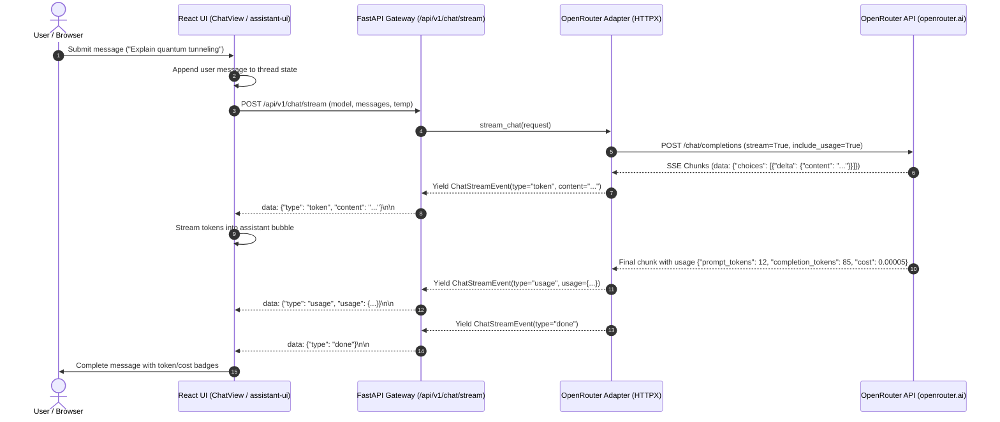

# BRICK-003: OpenRouter LLM Integration & Live Streaming Chat

> **Brick ID**: `BRICK-003`  
> **Phase**: Phase 1 — Foundations & Core Capabilities  
> **Version**: 1.1 (Acceptance Audit & Targeted Corrections Complete)  
> **Status**: `READY FOR ACCEPTANCE`  
> **Author**: Principal Full-Stack Engineer & AI Systems Architect  
> **Implementation Date**: 2026-10-22  
> **Prerequisites**: BRICK-002 VERIFIED  
> **Report Reference**: [docs/reports/REPORT-003.md](file:///c:/Users/arehman/Desktop/AI Projects/Javed/docs/reports/REPORT-003.md)  

---

## 1. Executive Summary & Objective

**BRICK-003** equips Project Javed with its foundational cognitive layer: direct, real-time, streaming LLM inference powered by OpenRouter (the sole preapproved paid proprietary API service, governed by Rule 1).

Building directly upon the FastAPI backend and React frontend established in BRICK-001 and BRICK-002, this vertical slice delivers:

1. **Robust OpenRouter Adapter (`src/javed/services/openrouter.py`)**:
   - Clean async HTTPX integration with streaming Server-Sent Events (SSE).
   - Dynamic model routing and multi-model catalog (`GET /api/v1/models`).
   - Upstream usage tracking, token counting, and transparent USD cost calculation with rate cards.
   - Graceful error handling, network timeout resilience, and client cancellation support (`asyncio.CancelledError`).
   - Key quota and balance telemetry inspection via OpenRouter `/auth/key`.

2. **Standardized Streaming Endpoints (`src/javed/api/v1/chat.py`)**:
   - `POST /api/v1/chat/stream`: True SSE stream (`text/event-stream`) returning typed event envelopes (`token`, `usage`, `error`, `done`).
   - `POST /api/v1/chat/completions`: Non-streaming fallback endpoint for synchronous inspection.
   - `GET /api/v1/models`: Curated model catalog with live availability and pricing metadata.

3. **Production React Chat UI Integration (`frontend/src/views/user/ChatView.tsx`)**:
   - Interactive conversational thread supporting multi-turn dialogue with Markdown rendering.
   - Dynamic Model Selector supporting instant switching across top frontier models (Claude, GPT-4o, Gemini Flash, DeepSeek).
   - Real-time token counter and estimated USD cost badge per turn and per conversation.
   - Responsive Stop Generation button powered by standard `AbortController`.
   - Clear Conversation control with prompt reset.

4. **Developer Mode Diagnostics Upgrades**:
   - Real-time OpenRouter connectivity, account credit/quota status, and rate limit diagnostics.
   - Time-to-first-token (TTFT) and token generation velocity (tokens/sec) telemetry.

5. **Strict Scope Discipline & Safety**:
   - No MCP server installation or execution (strictly scheduled for BRICK-005, BRICK-006, BRICK-010).
   - No Deep Agents, LangGraph, autonomous tool execution, persistent vector memory, or voice engines.
   - Secrets preserved: `.env` strictly untracked and never exposed.

---

## 2. Technical Architecture & Data Flow

---

## 3. Curated Models & Rate Cards

| Model ID | Provider | Context Window | Prompt / 1M | Completion / 1M | Recommended Role |
|---|---|---|---|---|---|
| `openai/gpt-4o-mini` | OpenAI | 128k | $0.15 | $0.60 | **Default**: Fast, efficient daily tasks |
| `openai/gpt-4o` | OpenAI | 128k | $2.50 | $10.00 | Complex multi-step reasoning |
| `anthropic/claude-sonnet-4.5` | Anthropic | 200k | $3.00 | $15.00 | Deep coding, analysis, architecture |
| `google/gemini-2.5-flash` | Google | 1M | $0.30 | $2.50 | Ultra-low latency, huge context |
| `deepseek/deepseek-chat` | DeepSeek | 64k | $0.26 | $1.03 | High-value conversational reasoning |

---

## 4. Verification & Acceptance Criteria

1. **Automated Unit Tests**:
   - Backend `pytest tests/test_openrouter.py`: Mock streaming, cancellation, rate card math, and model listing.
   - Frontend `vitest`: Chat service client, model selector component, token counter state.
2. **Live OpenRouter Smoke Test**:
   - Verified real network handshake with `openrouter.ai`, validating live token generation and exact cost return.
3. **Google Chrome E2E Browser Test**:
   - Playwright test against real Google Chrome verifying:
     - Model selection dropdown displays and allows switching models.
     - Submitting a prompt initiates SSE stream.
     - Real-time token streaming renders in the conversational thread.
     - Token count and cost badge render accurately.
     - Stop Generation halts in-flight stream.
4. **Zero Lint & Type Errors**:
   - `ruff check .` passes with 0 errors.
   - `oxlint` passes with 0 errors.
   - TypeScript build (`tsc -b`) completes cleanly.
5. **Stop Condition**:
   - Halt at `READY FOR ACCEPTANCE` and submit `REPORT-003.md` for project owner approval.
