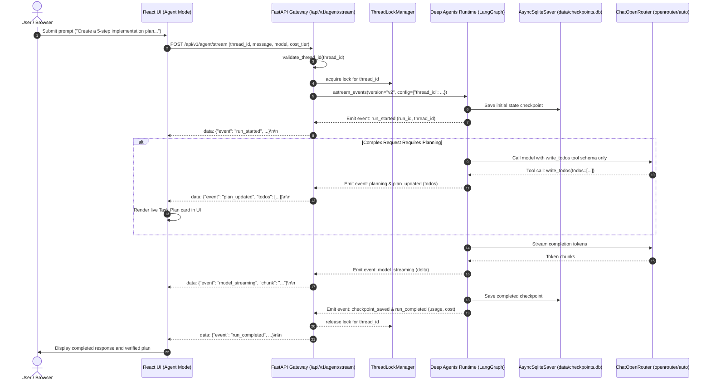

# BRICK-004: Deep Agents & LangGraph Runtime (Security Hardened)

> **Brick ID**: `BRICK-004`  
> **Phase**: Phase 1 — Foundations & Core Capabilities  
> **Version**: 2.0 (Security Hardened & Concurrency Serialized)  
> **Status**: `READY FOR ACCEPTANCE`  
> **Author**: Principal Full-Stack Engineer & AI Systems Architect  
> **Implementation Date**: 2026-10-25  
> **Prerequisites**: BRICK-003 VERIFIED  
> **Working Branch**: `recovery/brick-004-hardened`  
> **Report Reference**: [docs/reports/REPORT-004.md](file:///c:/Users/arehman/Desktop/AI Projects/Javed/docs/reports/REPORT-004.md)  
> **Audit Reference**: [docs/reports/BRICK-004_RECONCILIATION_AUDIT.md](file:///c:/Users/arehman/Desktop/AI Projects/Javed/docs/reports/BRICK-004_RECONCILIATION_AUDIT.md)  

---

## 1. Executive Summary & Objective

**BRICK-004** transforms Project Javed from a stateless AI chat application into an observable, stateful, reliable AI agent using the maintained **Deep Agents SDK** and **LangGraph** runtime.

Building upon the verified foundation of BRICK-001 through BRICK-003, this vertical slice delivers:

1. **Clean Deep Agents Runtime (`src/javed/agent/`)**:
   - Official `create_deep_agent` construction using maintained Deep Agents SDK and LangGraph.
   - Structured task planning via `TodoListMiddleware` exposing the internal state-backed `write_todos` tool (`pending`, `in_progress`, `completed`).
   - Strict 3-Layer Positive Tool Allowlist: Only `write_todos` is authorized. All unapproved built-in tools (`ls`, `read_file`, `write_file`, `edit_file`, `delete`, `glob`, `grep`, `execute`, `eval`, `task`) are filtered from model visibility, blocked from host execution by `PositiveToolAllowlistMiddleware`, and eliminated via `StateBackend()`. Subagents are disabled via `GeneralPurposeSubagentProfile(enabled=False)`.
   - Complete absence of host filesystem mutation, arbitrary shell execution, browser automation, or unapproved MCP execution in this brick.

2. **Server-Side Thread Validation & Concurrency Serialization**:
   - `validate_thread_id` enforces strict pattern `^[a-zA-Z0-9_\-]+$`, rejecting directory traversal (`..`, `/`, `\`), null bytes, whitespace, and injection attempts.
   - `ThreadLockManager` manages per-thread `asyncio.Lock` instances, serializing concurrent multi-turn runs on the same thread in FIFO order to prevent SQLite WAL lock contention and state corruption.

3. **Durable LangGraph SQLite Checkpointing (`src/javed/agent/checkpointer.py`)**:
   - Persistent `AsyncSqliteSaver` storing thread-scoped state in `data/checkpoints.db` with WAL mode (`PRAGMA journal_mode=WAL;`) and 30s busy timeout.
   - Complete thread isolation: thread A context is strictly segregated from thread B.
   - Multipart message restoration: `extract_message_text` extracts text from lists of dict blocks (`[{"type": "text", "text": "..."}]`).
   - Cross-process crash recovery: thread state and conversational context survive backend restarts and separate OS subprocess invocations.

4. **OpenRouter Integration Preservation**:
   - Seamless integration with `ChatOpenRouter` maintaining OpenRouter Auto Router (`openrouter/auto`) with five cost tiers (`low`, `medium`, `high`, `xhigh`, `max`), manual model selection, dynamic catalog, session stickiness (`session_id`), and provider-reported usage telemetry.

5. **FastAPI Agent Streaming Gateway (`src/javed/api/v1/agent.py`)**:
   - `POST /api/v1/agent/stream`: Server-Sent Events (SSE) streaming real-time agent lifecycle events (`run_started`, `planning`, `plan_updated`, `model_streaming`, `checkpoint_saved`, `run_completed`, `run_cancelled`, `run_failed`).
   - `GET /api/v1/agent/threads/{thread_id}`: Inspect saved checkpoints and conversation state with thread ID security validation.
   - `GET /api/v1/agent/status`: Agent runtime health, checkpointer status, and active tool capabilities.

6. **Live React UI Integration (User & Developer Mode)**:
   - **User Mode**: Seamless Chat Mode vs. Agent Mode toggle in the existing Chat view; live Task Plan panel rendering real `TodoList` items when structured planning occurs; real-time agent status badges (`IDLE`, `PLANNING`, `STREAMING`, `COMPLETED`, `CANCELLED`); responsive Stop Generation control.
   - **Developer Mode**: High-density Agent Diagnostics panel exposing Active Run ID, Thread ID, Graph/Runtime status, Checkpoint persistence state, and tool permission restrictions.

---

## 2. Technical Architecture & Lifecycle Flow

---

## 3. Tool Permissions & Security Boundaries

| Tool Name | Origin | Visibility | Execution Status | Security Enforcement |
|---|---|---|---|---|
| `write_todos` | `TodoListMiddleware` | **Exposed to Model** | **Authorized** | Internal, in-memory state tracking only. No host side effects. |
| `ls`, `glob`, `grep` | Built-in Deep Agents FS | **Hidden / Filtered** | **Prohibited** | Excluded via `HarnessProfile` and `PositiveToolAllowlistMiddleware`. Backend replaced with `StateBackend()`. |
| `read_file`, `write_file`, `edit_file`, `delete` | Built-in Deep Agents FS | **Hidden / Filtered** | **Prohibited** | File mutations strictly prohibited until sandbox in BRICK-005. |
| `execute` | Built-in Sandbox | **Hidden / Filtered** | **Prohibited** | Shell execution strictly blocked. Intercepted by middleware. |
| `eval` | Built-in QuickJS Interpreter | **Hidden / Filtered** | **Prohibited** | Arbitrary code execution blocked. Intercepted by middleware. |
| `task` | Built-in SubAgentMiddleware | **Hidden / Filtered** | **Prohibited** | Subagent spawning deferred to BRICK-011. Disabled in profile. |
| MCP Tools | External MCP Servers | **Non-existent** | **N/A** | Phased rollout begins in BRICK-005. |

---

## 4. Verification & Acceptance Criteria

1. **Backend Unit, Security & Persistence Tests (Pytest)**:
   - **55/55 PASSED** in 15.75s.
   - `test_agent_security.py`: Proves positive allowlist, model-visible filtering, host execution interception, and thread ID traversal rejection.
   - `test_agent_persistence.py`: Proves SQLite checkpoint durability across process restart, thread isolation, concurrency serialization, multipart parsing, and cross-process OS recovery.
   - `test_agent_runtime.py`: Tests agent construction, planning events, token streaming, and status.
   - `test_agent_api.py`: Validates FastAPI REST, SSE streaming, thread retrieval, and 400 rejection of invalid thread IDs.
2. **Frontend Vitest Suites**:
   - **41/41 PASSED** across 8 test suites.
   - `agent.test.tsx`: Tests Chat/Agent mode toggling, plan rendering, streaming chunk handling, and stop cancellation.
3. **Automated Playwright Chrome E2E**:
   - **19/19 PASSED** on live Google Chrome (8.1 minutes) covering BRICK-002, BRICK-003, and BRICK-004 scenarios.
4. **Code Quality & Build**:
   - 0 Ruff errors, 39 files formatted, strict TypeScript build pass (2,888 modules transformed).
