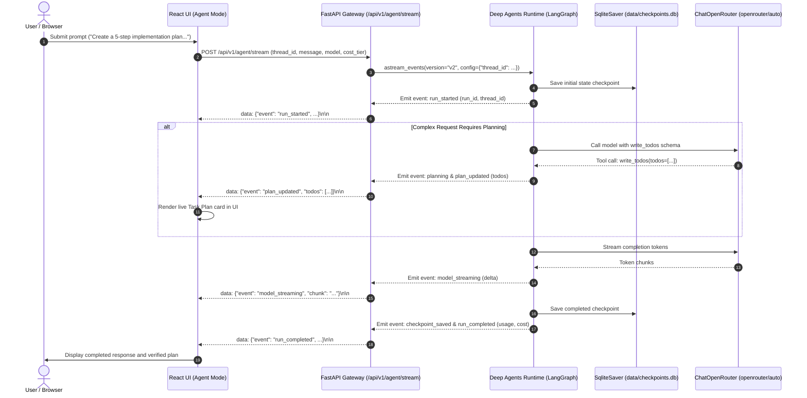

# BRICK-004: Deep Agents & LangGraph Runtime

> **Brick ID**: `BRICK-004`  
> **Phase**: Phase 1 — Foundations & Core Capabilities  
> **Version**: 1.0 (Implementation Specification)  
> **Status**: `READY FOR ACCEPTANCE`  
> **Author**: Principal Full-Stack Engineer & AI Systems Architect  
> **Implementation Date**: 2026-10-25  
> **Prerequisites**: BRICK-003 VERIFIED  
> **Report Reference**: [docs/reports/REPORT-004.md](file:///c:/Users/arehman/Desktop/AI Projects/Javed/docs/reports/REPORT-004.md)  

---

## 1. Executive Summary & Objective

**BRICK-004** transforms Project Javed from a stateless AI chat application into an observable, stateful, reliable AI agent using the maintained **Deep Agents SDK** and **LangGraph** runtime.

Building upon the verified foundation of BRICK-001 through BRICK-003, this vertical slice delivers:

1. **Clean Deep Agents Runtime (`src/javed/agent/`)**:
   - Official `create_deep_agent` construction using maintained Deep Agents SDK and LangGraph.
   - Structured task planning via `TodoListMiddleware` exposing the internal state-backed `write_todos` tool (`pending`, `in_progress`, `completed`).
   - Strict Zero-Trust Security: Exclusion of all unapproved built-in tools (`ls`, `read_file`, `write_file`, `edit_file`, `delete`, `glob`, `grep`, `execute`, `eval`, `task`) via custom `HarnessProfile` and disabling of general-purpose subagents.
   - Complete absence of host filesystem mutation, arbitrary shell execution, browser automation, or unapproved MCP execution in this brick.

2. **Durable LangGraph SQLite Checkpointing (`src/javed/agent/checkpointer.py`)**:
   - Persistent `SqliteSaver` storing thread-scoped state in `data/checkpoints.db`.
   - Complete thread isolation: thread A context is strictly segregated from thread B.
   - Crash recovery: thread state and conversational context survive backend restarts and browser refreshes.

3. **OpenRouter Integration Preservation**:
   - Seamless integration with `ChatOpenRouter` maintaining OpenRouter Auto Router (`openrouter/auto`) with five cost tiers (`low`, `medium`, `high`, `xhigh`, `max`), manual model selection, dynamic catalog, session stickiness (`session_id`), and provider-reported usage telemetry.

4. **FastAPI Agent Streaming Gateway (`src/javed/api/v1/agent.py`)**:
   - `POST /api/v1/agent/stream`: Server-Sent Events (SSE) streaming real-time agent lifecycle events (`run_started`, `planning`, `plan_updated`, `model_streaming`, `checkpoint_saved`, `run_completed`, `run_cancelled`, `run_failed`).
   - `GET /api/v1/agent/threads/{thread_id}`: Inspect saved checkpoints and conversation state.
   - `GET /api/v1/agent/status`: Agent runtime health, security profile, and active tool capabilities.

5. **Live React UI Integration (User & Developer Mode)**:
   - **User Mode**: Seamless Chat Mode vs. Agent Mode toggle in the existing Chat view; live Task Plan panel rendering real `TodoList` items when structured planning occurs; real-time agent status badges (`IDLE`, `PLANNING`, `STREAMING`, `COMPLETED`, `CANCELLED`); responsive Stop Generation control.
   - **Developer Mode**: High-density Agent Diagnostics panel exposing Active Run ID, Thread ID, Graph/Runtime status, Checkpoint persistence state, and tool permission restrictions.

---

## 2. Technical Architecture & Lifecycle Flow

---

## 3. Tool Permissions & Security Boundaries

| Tool Name | Origin | Status in BRICK-004 | Justification |
|---|---|---|---|
| `write_todos` | `TodoListMiddleware` | **`PERMITTED`** | Internal, in-memory state tracking only. No side effects. |
| `ls`, `glob`, `grep` | Built-in Deep Agents FS | **`EXCLUDED`** | Filesystem inspection prohibited in BRICK-004. |
| `read_file`, `write_file`, `edit_file`, `delete` | Built-in Deep Agents FS | **`EXCLUDED`** | File mutations strictly prohibited until sandbox in BRICK-005. |
| `execute` | Built-in Sandbox | **`EXCLUDED`** | Shell execution strictly blocked. |
| `eval` | Built-in QuickJS Interpreter | **`EXCLUDED`** | Arbitrary code execution blocked. |
| `task` | Built-in SubAgentMiddleware | **`EXCLUDED`** | Subagent spawning deferred to BRICK-011. |
| MCP Tools | External MCP Servers | **`EXCLUDED`** | Phased rollout begins in BRICK-005. |

---

## 4. Verification & Acceptance Criteria

1. **Backend Unit & Contract Tests**:
   - `test_agent_security.py`: Proves that unapproved filesystem, shell, and subagent tools are completely excluded from the model tool surface.
   - `test_agent_persistence.py`: Proves SQLite checkpoint durability across process restart and validates strict thread context isolation.
   - `test_agent_runtime.py`: Tests agent construction, OpenRouter auto-router integration, and event streaming.
   - `test_agent_api.py`: Validates FastAPI REST and SSE endpoints with cancellation support.
2. **Frontend Vitest Suites**:
   - `agent.test.tsx`: Tests Chat/Agent mode toggling, plan rendering, streaming chunk handling, and stop cancellation.
3. **Automated Playwright Chrome E2E**:
   - Scenarios A, B, C, D verified on live Google Chrome against running FastAPI and Vite servers.
4. **Code Quality**:
   - 0 Ruff errors, 0 Oxlint errors, strict TypeScript build pass.
