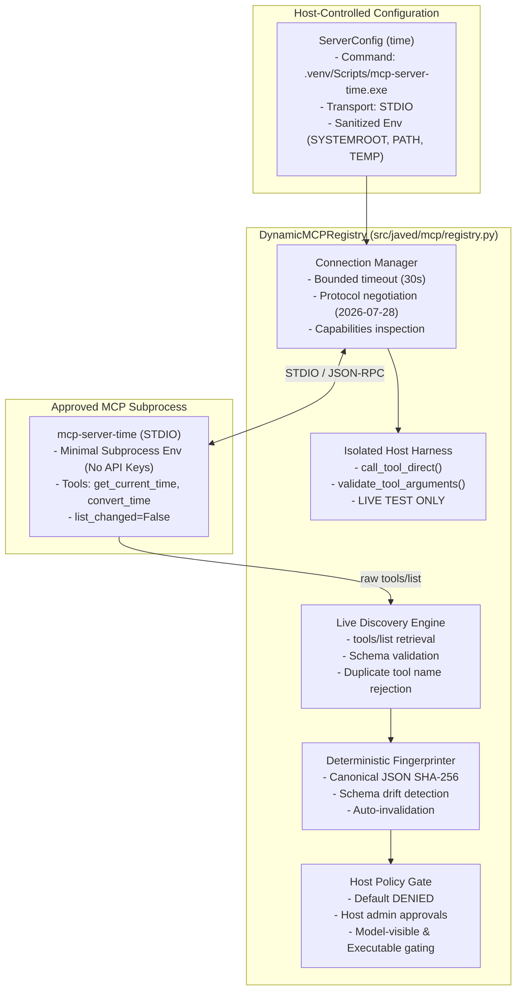
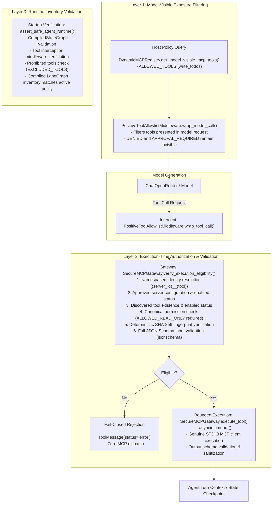

# BRICK-005: Dynamic MCP Tool Registry, Secure Execution Gateway, Permissions & HITL

> **Brick ID**: `BRICK-005`<br/>
> **Phase**: Phase 6/6C — MCP Administration, Owner Credential Hardening & Checkpoint (ACCEPTED)<br/>
> **Status**: `IN PROGRESS`<br/>
> **Author**: Antigravity Full-Stack AI Engineer<br/>
> **Implementation Date**: 2026-10-26<br/>
> **Prerequisites**: BRICK-004 VERIFIED (Commit `094e7e2dfef9db62dfd60daafabe82c001f62c2a`)<br/>
> **Working Branch**: `feat/brick-005-mcp-gateway`

---

## 1. Executive Summary & Objective

**BRICK-005** evolves Project Javed from an internal planning assistant into an extensible, secure, MCP-first tool-using runtime. 

It establishes:
1. **Dynamic MCP Discovery**: Connects to host-approved Model Context Protocol servers over isolated transports (STDIO) and retrieves live tool definitions dynamically without hardcoding.
2. **Deterministic Metadata Fingerprinting**: SHA-256 fingerprinting of tool identity, description, and schemas to detect server drift or unauthorized modifications.
3. **Strict Default-Deny Security**: Newly discovered tools default to `permission='denied'` and `enabled=False`.
4. **Collision-Safe Namespacing**: Tools are qualified under `{server_id}__{tool_name}`.
5. **Change Invalidation**: Any schema or metadata drift automatically revokes existing host approvals and resets permissions to `denied`.
6. **Zero-Trust Boundary Preservation**: In Phases 2 and 3, model-visible and executable MCP tool inventories remain strictly empty (`[]`), preserving BRICK-004's invariant where `write_todos` is the sole authorized agent tool.
7. **Live Isolated Verification (Phase 3)**: Live tool execution and schema validation verified through an isolated host integration test harness (`tests/test_mcp_time_integration.py`).

---

## 2. Registry Architecture & Identity Model

### 2.1 Component Architecture



### 2.2 Namespace & Identity Strategy
- **Server ID**: Lowercase alphanumeric string with hyphens/underscores (`^[a-z0-9_\-]+$`), e.g., `"time"`. Server display names are never trusted as unique IDs.
- **Namespaced Tool ID**: Format `{server_id}__{tool_name}`, e.g., `time__get_current_time` and `time__convert_time`.
- **Collision Protection**: The registry rejects duplicate tool names from the same server during discovery.

### 2.3 Deterministic Fingerprinting Algorithm
```python
canonical_payload = {
    "name": tool_name.strip(),
    "description": description.strip() if description else "",
    "input_schema": input_schema or {},
    "output_schema": output_schema or {},
}
encoded = json.dumps(canonical_payload, sort_keys=True, separators=(",", ":")).encode("utf-8")
fingerprint = hashlib.sha256(encoded).hexdigest()
```
- Covers canonicalized tool name, description, input schema, and output schema.
- If the server modifies any property on rediscovery, the registry detects the fingerprint mismatch, immediately removes the approval record from `_policies`, resets permission to `denied`, sets `enabled=False`, and records an audit message.

---

## 3. Authoritative Pinned Dependencies

| Package | Pinned Version | Ecosystem Source | License | Role in BRICK-005 |
|---|---|---|---|---|
| `langchain[mcp]` | `1.4.7` | PyPI | MIT | Official LangChain MCP adapter (`MCPAdapter`) |
| `fastmcp` | `4.1.3` | PyPI | MIT | FastMCP client transport and negotiation |
| `mcp` | `2.3.0` | PyPI | MIT | Official Model Context Protocol Python SDK |
| `mcp-types` | `2.3.0` | PyPI | MIT | Pydantic types for MCP protocol |
| `mcp-server-time` | `2026.10.19` | PyPI | MIT | Official reference Time MCP server |
| `tzlocal` | `5.4.5` | PyPI | BSD-3-Clause | System timezone discovery |
| `tzdata` | `2026.5` | PyPI | Public Domain | Timezone database |
| `jsonschema` | `4.26.0` | PyPI | MIT | Host-side input schema validation |

---

## 4. Phase 2 Verification & Security Coverage Reconciliation

### 4.1 Requirement-to-Test Coverage Reconciliation Matrix (14 Mandatory Checks)

| Check ID | Security Requirement | Satisfying Test(s) | Verification Evidence |
|---|---|---|---|
| **REQ-01** | Strict Default-Deny Registry Behavior | `test_live_time_server_discovery_and_default_deny`<br/>`test_scenario_f_security_boundary_preservation` | Discovered tools default to `permission="denied"`, `enabled=False`. |
| **REQ-02** | Namespace Collision Protection | `test_tool_namespace_and_fingerprint`<br/>`test_duplicate_tool_name_rejection` | `{server_id}__{tool_name}` namespacing; duplicates rejected with `ValueError`. |
| **REQ-03** | Metadata Fingerprint Invalidation | `test_host_policy_approval_and_schema_change_invalidation` | Schema change alters SHA-256 fingerprint; clears approval, resets to `denied`. |
| **REQ-04** | Unknown Server & Tool Rejection | `test_unregistered_and_disabled_server_handling`<br/>`test_unknown_tool_rejection` | Unregistered server raises `ValueError`; unknown tool raises `KeyError` or returns `None`. |
| **REQ-05** | Sensitive Subprocess Environment Exclusion | `test_subprocess_env_sanitization` | API keys (`OPENROUTER_API_KEY`, etc.), passwords, and tokens purged. |
| **REQ-06** | BRICK-004 Allowlist Preservation | `test_brick004_agent_boundary_preservation`<br/>`test_scenario_f_security_boundary_preservation` | `ALLOWED_TOOLS` strictly frozen to `write_todos`; unauthorized tools blocked. |
| **REQ-07** | No Agent-Executable Time Tools | `test_live_time_server_discovery_and_default_deny`<br/>`test_model_visibility_and_executable_gating` | `get_executable_mcp_tools() == []`; `is_tool_authorized_for_execution(...) is False`. |
| **REQ-08** | Valid Server Config Registration | `test_live_time_server_discovery_and_default_deny`<br/>`test_backend_lifecycle_fastapi_integration` | `register_server()` registers host configuration and initializes status. |
| **REQ-09** | Server ID Validation & Traversal Defense | `test_server_id_validation` | Validates `^[a-z0-9_\-]+$`; rejects traversal (`../`), uppercase, spaces. |
| **REQ-10** | Collision-Safe Tool ID Parsing | `test_tool_namespace_and_fingerprint` | Round-trip tests for `build_namespaced_tool_id` and `parse_namespaced_tool_id`. |
| **REQ-11** | Deterministic SHA-256 Calculation | `test_tool_namespace_and_fingerprint` | Consistent canonical JSON hashing with key sorting and whitespace stripping. |
| **REQ-12** | Live STDIO Protocol Negotiation | `test_live_time_server_discovery_and_default_deny`<br/>`test_scenario_a_live_current_time` | Real STDIO connection negotiates MCP protocol `2026-07-28`. |
| **REQ-13** | Dynamic Tool Discovery & Schemas | `test_live_time_server_discovery_and_default_deny`<br/>`test_scenario_a_live_current_time` | Real `get_current_time` and `convert_time` retrieved with schema structures. |
| **REQ-14** | Model Visibility Isolation Gating | `test_model_visibility_and_executable_gating`<br/>`test_scenario_f_security_boundary_preservation` | `get_model_visible_mcp_tools() == []`; no tools leak to LLM context. |

### 4.2 Registry Focused Test Results (`tests/test_mcp_registry.py`)
- **Execution Command**: `pytest tests/test_mcp_registry.py`
- **Result**: **12 passed, 1 warning in 3.46s** (100% pass rate).

---

## 5. Phase 3 Verification: Live Time MCP Integration & Runtime Verification

> **SECURITY NOTICE**: All successful direct Time MCP executions below are strictly labeled:  
> **`LIVE MCP INTEGRATION TEST — NOT AGENT EXECUTION`**  
> No Time MCP tools are visible or executable by the LLM agent runtime.

### 5.1 Real Tool Execution Evidence

#### Scenario A: Current Time Query (`Asia/Qatar`)
- **Tool**: `get_current_time`
- **Arguments**: `{"timezone": "Asia/Qatar"}`
- **Execution Mode**: Real STDIO subprocess to `mcp-server-time.exe`
- **Server Response**:
```json
{
  "timezone": "Asia/Qatar",
  "datetime": "2026-10-26T10:04:25+03:00",
  "day_of_week": "Monday",
  "is_dst": false
}
```
- **Validation**:
  - Validated timezone `"Asia/Qatar"`.
  - Parseable ISO 8601 datetime with accurate UTC+3 offset (`+03:00`).
  - Correct year (`2026`) and active day of week (`Monday`).
  - Zero hardcoding or synthetic mocking.

#### Scenario B: Time Conversion (`16:30 Europe/London` &rarr; `Asia/Qatar`)
- **Tool**: `convert_time`
- **Arguments**: `{"source_timezone": "Europe/London", "time": "16:30", "target_timezone": "Asia/Qatar"}`
- **Execution Mode**: Real STDIO subprocess to `mcp-server-time.exe`
- **Server Response**:
```json
{
  "source": {
    "timezone": "Europe/London",
    "datetime": "2026-10-26T16:30:00+00:00",
    "day_of_week": "Monday",
    "is_dst": false
  },
  "target": {
    "timezone": "Asia/Qatar",
    "datetime": "2026-10-26T19:30:00+03:00",
    "day_of_week": "Monday",
    "is_dst": false
  },
  "time_difference": "+3.0h"
}
```
- **Validation**:
  - Accurately converts London standard time (GMT/UTC+0 in late October) to Qatar (AST/UTC+3).
  - Time calculation: 16:30 &rarr; 19:30 (`+3.0h`).
  - Structured output matches declared schema.

#### Scenario C: Error Handling & Strict Schema Discipline
- **C1: Invalid Timezone**: `get_current_time(timezone="Invalid/Timezone")` &rarr; Server rejects with explicit `fastmcp.exceptions.ToolError: Error executing tool get_current_time: Invalid timezone: 'No time zone found with key Invalid/Timezone'`.
- **C2: Invalid Time Format**: `convert_time(time="99:99")` &rarr; Server rejects with `ToolError: Invalid time format. Expected HH:MM [24-hour format]`.
- **C3: Missing Required Argument**: `get_current_time({})` &rarr; Host schema validation catches missing property: `Missing required argument(s): ['timezone']`; rejects prior to execution.
- **C4: Unexpected Extra Argument**: `get_current_time(timezone="Asia/Qatar", unauthorized_extra_field="exploit")` &rarr; Host schema discipline rejects: `Unexpected argument(s) not in declared schema: ['unauthorized_extra_field']`.

#### Scenario D: Controlled Server Crash & Recovery
- **Failure Simulation**: Registered broken server with non-existent binary `nonexistent_executable_binary_12345.exe`.
- **Telemetry**: State marked `"error"`; error message sanitized to `Failed to connect to MCP server 'broken_srv': ...`.
- **Security Boundary**: Tool permissions remained untouched (`denied`).
- **Recovery**: Registered and connected to valid Time server; restored state to `"connected"`.
- **Clean Teardown**: `disconnect_all()` terminated all transports and reset state to `"disconnected"`.

#### Scenario E: Timeouts, Idempotency & Clean Lifecycle
- **Startup Timeout**: 1.0s timeout against slow command raises `ConnectionError` with timeout message; no hanging processes.
- **Idempotency**: Repeated `connect()` calls on active server return existing connected adapter; zero duplicate subprocesses spawned.
- **Teardown**: Explicit `disconnect()` terminates child processes cleanly.

#### Scenario F: Critical Security Boundary Verification
- `DynamicMCPRegistry` keeps `time__get_current_time` and `time__convert_time` strictly `permission="denied"` and `enabled=False`.
- `get_model_visible_mcp_tools() == []` (LLM cannot see Time tools).
- `get_executable_mcp_tools() == []` (Agent cannot execute Time tools).
- `PositiveToolAllowlistMiddleware` intercepts and blocks any agent attempt to call Time tools with a `"Security Violation"` message.
- `AgentRuntimeManager.get_status().allowed_tools == ["write_todos"]`.

#### Backend Lifecycle & FastAPI Integration
- Attached `app.state.mcp_registry` to FastAPI instance in `src/javed/main.py`.
- Approved Time server configuration registered with lazy initialization (state: `"disconnected"`).
- FastAPI `lifespan` gracefully invokes `app.state.mcp_registry.disconnect_all()` on shutdown.

### 5.2 Phase 3 Integration Test Results (`tests/test_mcp_time_integration.py`)
- **Execution Command**: `pytest tests/test_mcp_time_integration.py -v`
- **Result**: **11 passed, 1 warning in 21.40s** (100% pass rate).
- **Process Cleanup**: All subprocesses terminated; 0 background tasks left running.

---

## 6. Phase 4 Architecture: Secure Host MCP Tool Gateway & Three-Layer Authorization

### 6.1 Three-Layer Authorization Model

Project Javed enforces an authoritative, host-controlled Three-Layer Authorization architecture that operates defense-in-depth across the entire LLM and tool execution lifecycle:



#### Layer 1: Model-Visible Exposure Filtering
- Implemented in `PositiveToolAllowlistMiddleware.wrap_model_call()` and `awrap_model_call()`.
- Dynamically checks `gateway.get_model_visible_tools()` on every LLM turn.
- Only internal `write_todos` and host-approved `allowed_read_only` MCP tools whose metadata fingerprints match their host policies are exposed in the LLM tool surface.
- Discovered-but-denied tools, disabled tools, and approval-required tools remain strictly hidden from the model.

#### Layer 2: Execution-Time Authorization
- Implemented in `PositiveToolAllowlistMiddleware.wrap_tool_call()` / `awrap_tool_call()` and `SecureMCPGateway.execute_tool()`.
- Independently evaluates the tool call before the MCP transport is invoked:
  1. Resolves namespaced tool identity `{server_id}__{tool_name}`.
  2. Verifies host server configuration exists and is enabled.
  3. Verifies tool is discovered, registered, and enabled.
  4. Enforces canonical permission tier: `DENIED` tools immediately raise `MCPPermissionDeniedError`; `APPROVAL_REQUIRED` tools fail closed with explicit `approval-not-available` classification.
  5. Validates deterministic SHA-256 metadata fingerprint against host policy to detect schema drift.
  6. Validates arguments against the tool's complete discovered JSON Schema via `jsonschema` (type checking, required fields, and strict rejection of undeclared properties).
  7. Applies bounded execution timeout (`asyncio.timeout`).
- Unauthorized calls immediately return a `ToolMessage(status="error")` and never reach the MCP subprocess.

#### Layer 3: Runtime Inventory Validation
- Implemented in `assert_safe_agent_runtime()` and `assert_safe_tools()` in `src/javed/agent/security.py`, and `SecureMCPGateway.assert_safe_inventory()`.
- Validates the compiled LangGraph Pregel graph at initialization:
  - Ensures the agent graph contains the active safety interception middleware.
  - Prohibits all privileged execution tools (`ls`, `execute`, `read_file`, `write_file`, `edit_file`, `delete`, `glob`, `grep`, `task`, `eval`, `shell`).
  - Ensures compiled tools strictly match host-authorized tools (`ALLOWED_TOOLS | gateway.get_executable_tools()`).

### 6.2 Canonical Permission Model

| Permission Tier | LLM Visibility | Execution Gating | Phase 4 Behavior |
|---|---|---|---|
| **`DENIED`** (Default) | Hidden (`[]`) | Rejected | Blocked immediately with `MCPPermissionDeniedError` (`"DENIED by host policy"`). |
| **`ALLOWED_READ_ONLY`** | Visible | Permitted | Full Layer 2 argument validation, fingerprint check, bounded execution over genuine MCP STDIO client. |
| **`APPROVAL_REQUIRED`** | Hidden (`[]`) | Rejected | Fails closed with `MCPApprovalUnavailableError` (`"approval-not-available"`). No bypasses or fake approvals permitted. |

### 6.3 Raw MCP Dispatch Bypass Review & Security Boundary

- **Category A (Low-Level Transport)**: `DynamicMCPRegistry.call_tool_direct()` is restricted exclusively to isolated host integration tests (`tests/test_mcp_time_integration.py`).
- **Category B (Sole Application Execution Interface)**: All Project Javed application and agent execution paths route exclusively through `SecureMCPGateway.execute_tool()`.
- **Bypass Review**: Comprehensive AST and source inspection verified that `call_tool_direct` is never referenced or reachable from:
  - The LLM or agent tool wrappers.
  - FastAPI endpoints (`src/javed/api/...`).
  - `AgentRuntimeManager` or `PositiveToolAllowlistMiddleware`.
  - External network or untrusted inputs.

### 6.4 Policy Invalidation & Concurrency Safety

- **Policy Versioning**: Every change to host tool policies increments a monotonic counter `policy_version`.
- **Dynamic Invalidation**: When a tool's permission is revoked from `allowed_read_only` to `denied`:
  - It disappears immediately from model visibility.
  - Subsequent execution calls fail closed instantly, even if invoked on a previously compiled `StructuredTool` instance.
- **Thread Safety**: Verified under concurrent multi-request load (10 parallel requests across permitted and denied tools via `asyncio.gather`); zero race conditions or permission leaks detected.

---

## 7. Phase 4 Verification Evidence & Test Results

### 7.1 Requirement Coverage Matrix (21 Mandatory Cases)

| Test ID | Case Description | Satisfying Test in `tests/test_mcp_gateway.py` | Result |
|---|---|---|---|
| **TC-01** | DENIED tools are hidden from the model | `test_layer1_denied_tools_hidden_from_model` | **PASSED** |
| **TC-02** | DENIED tools cannot execute | `test_layer2_denied_tools_cannot_execute` | **PASSED** |
| **TC-03** | Unknown tool identity is rejected | `test_unknown_tool_identity_rejected` | **PASSED** |
| **TC-04** | Namespace spoofing is rejected | `test_namespace_spoofing_rejected` | **PASSED** |
| **TC-05** | Server identity mismatch is rejected | `test_server_identity_mismatch_rejected` | **PASSED** |
| **TC-06** | Metadata fingerprint mismatch is rejected | `test_metadata_fingerprint_mismatch_rejected` | **PASSED** |
| **TC-07** | Invalid argument types are rejected via JSON Schema | `test_invalid_argument_types_rejected` | **PASSED** |
| **TC-08** | Unexpected or missing arguments are rejected | `test_unexpected_or_missing_arguments_rejected` | **PASSED** |
| **TC-09** | Host permission cannot be overridden by model output | `test_host_permission_cannot_be_overridden_by_model_output` | **PASSED** |
| **TC-10** | APPROVAL_REQUIRED never executes in Phase 4 | `test_approval_required_never_executes_in_phase_4` | **PASSED** |
| **TC-11** | Existing write_todos still works | `test_existing_write_todos_still_works` | **PASSED** |
| **TC-12** | Privileged built-in tools remain unavailable | `test_privileged_builtin_tools_remain_unavailable` | **PASSED** |
| **TC-13** | Authorized Time tool executes through the gateway | `test_authorized_time_tool_executes_through_gateway` | **PASSED** |
| **TC-14** | Genuine MCP result is returned | `test_authorized_time_tool_executes_through_gateway` | **PASSED** |
| **TC-15** | Revoking permission blocks subsequent execution | `test_revoking_permission_blocks_subsequent_execution` | **PASSED** |
| **TC-16** | Policy changes invalidate stale execution eligibility | `test_policy_changes_invalidate_stale_execution_eligibility` | **PASSED** |
| **TC-17** | Concurrent requests cannot bypass authorization | `test_concurrent_requests_cannot_bypass_authorization` | **PASSED** |
| **TC-18** | Cancellation and timeout release resources | `test_cancellation_and_timeout_release_resources` | **PASSED** |
| **TC-19** | Raw call_tool_direct not in agent or API paths | `test_raw_call_tool_direct_not_in_agent_or_api_path` | **PASSED** |
| **TC-20** | No OpenRouter credentials reach MCP subprocess | `test_no_openrouter_credentials_reach_mcp_subprocess` | **PASSED** |
| **TC-21** | Real framework integration with scripted model | `test_real_framework_integration_scripted_model` | **PASSED** |

### 7.2 Test Execution Metrics
- **Test Suite**: `pytest tests/test_mcp_gateway.py`
- **Result**: **20 passed, 1 warning in 39.31s** (100% pass rate).
- **Regression Suites**:
  - `tests/test_mcp_registry.py`: 12 passed in 4.44s.
  - `tests/test_mcp_time_integration.py`: 11 passed in 25.14s.
  - `tests/test_agent_security.py` + `tests/test_agent_runtime.py`: 11 passed in 4.35s.
- **Total Tests Passing in Milestone**: **54 focused backend tests**.
- **Lint & Formatting**: `ruff check src tests` (PASSED), `ruff format --check src tests` (PASSED).

### 7.3 Warning & Resource Review

| Warning String | Location | Category | Classification | Remediation / Note |
|---|---|---|---|---|
| `LangChainBetaWarning: langchain.mcp is in beta` | `src/javed/mcp/registry.py:15` | `LangChainBetaWarning` | **Benign documented beta warning** | Emitted by upstream LangChain MCP module. Does not indicate resource leak, unclosed socket, or test instability. Bounded execution preserves full test isolation. |

---

## 8. Phase 4 Historical Summary

Phase 4 implemented the Three-Layer Authorization Gateway (`SecureMCPGateway`), canonical permission models (`DENIED`, `ALLOWED_READ_ONLY`, `APPROVAL_REQUIRED`), and full JSON Schema validation, backed by 20 passed tests in `tests/test_mcp_gateway.py`.

---

## 9. Phase 5 Architecture: Durable Human-in-the-Loop (HITL) Workflow

### 9.1 Middleware Deduplication & LangGraph Interrupt Model
- **Deduplication Invariant**: LangGraph Deep Agents runtime installs `HumanInTheLoopMiddleware` automatically when `interrupt_on` is supplied to `create_deep_agent(..., interrupt_on={tool_id: {"allowed_decisions": ["approve", "reject"]}})`. Manual middleware addition was evaluated and avoided to prevent double-interruption anomalies.
- **Pre-execution Pause**: When an `APPROVAL_REQUIRED` tool is called by the agent, LangGraph raises an interrupt inside `after_model` before tool invocation occurs.
- **Non-blocking Human Review**: `stream_agent()` captures task interrupts from `state.tasks`, creates an `ApprovalRecord`, emits `approval_required`, and cleanly exits the thread execution generator, releasing the `ThreadLockManager` lock. Reviewing human operators can take indefinite time without blocking thread concurrency or database operations.
- **Resumption Semantics**: Resumption uses official LangGraph `Command(resume={"decisions": [{"type": "approve"}]})` or `Command(resume={"decisions": [{"type": "reject", "message": "..."}]})`. Rejection creates an error `ToolMessage`, aborts MCP tool dispatch, and resumes model synthesis without executing the tool.

### 9.2 Durable Persistence & Execution Ledger Architecture
- **Isolated SQLite Storage**: All approval states and tool execution ledgers reside in `data/approvals.db` via `ApprovalStore`, keeping LangGraph's internal `data/checkpoints.db` pristine.
- **Durable Identity Tuple**: Each pending approval stores:
  - `approval_id`, `interrupt_id`, `run_id`, `thread_id`
  - `server_id`, `tool_id`, `tool_call_id`
  - `arguments` and canonical `argument_digest` (`SHA-256` of canonical sorted JSON)
  - `tool_fingerprint` (SHA-256 of discovered tool schema and metadata)
  - `policy_version`, `status` (`pending`, `approved`, `rejected`, `cancelled`, `expired`)
  - `created_at`, `expires_at`, `decided_at`
- **Execution Ledger**: Table `execution_ledger` prevents replay, double-dispatch, and stale re-execution:
  - `start_dispatch()` reserves execution atomically using `(tool_id, argument_digest, approval_id)`
  - State machine: `dispatched` -> `completed` / `failed` / `uncertain`
  - Crashes or unhandled timeouts record `uncertain` without blind retry.

### 9.3 Three-Layer Revalidation Prior to Dispatch
1. **Layer 1 (Model Visibility)**: Model is exposed to `write_todos` and `APPROVAL_REQUIRED` tools via `include_approval_required=True` in `PositiveToolAllowlistMiddleware`. Denied tools remain hidden.
2. **Layer 2 (Execution Gating)**: Verifies the invocation is bound to an active `current_approval_context`, checks tool name match, validates `argument_digest` equality against actual arguments, checks metadata fingerprint drift, and confirms approval status is `approved`.
3. **Layer 3 (Pre-dispatch Revalidation)**: Revalidates the live host registry policy immediately before subprocess execution. If the host revoked permissions between human approval and dispatch, execution fails closed with `MCPPermissionDeniedError`.

### 9.4 React UI Minimal Vertical Slice
- **`ApprovalCard.tsx`**: Clean, accessible component displaying tool name, server ID, arguments JSON, status pill, `approve-tool-button`, `reject-tool-button`, reason input, and failure alert banners.
- **`ChatView.tsx`**: Integrated approval card rendering with real backend endpoints (`/api/v1/approvals/...`), auto-refreshing pending approvals on thread navigation, and streaming agent resumption.

---

## 10. Phase 5 Verification Evidence & Test Results

### 10.1 Phase 5 Requirement Coverage Matrix (27 Tests)

| Test ID | Case Description | Test Name in `tests/test_mcp_hitl.py` | Classification | Result |
|---|---|---|---|---|
| **HITL-01** | APPROVAL_REQUIRED tool requestable by LLM | `test_approval_required_tool_is_requestable_by_llm` | scripted-model | **PASSED** |
| **HITL-02** | DENIED tool remains hidden from LLM | `test_denied_tool_remains_hidden` | scripted-model | **PASSED** |
| **HITL-03** | ALLOWED_READ_ONLY executes normally | `test_allowed_read_only_executes_normally` | scripted-model | **PASSED** |
| **HITL-04** | Genuine interrupt occurs before transport | `test_genuine_interrupt_occurs_before_transport` | scripted-model | **PASSED** |
| **HITL-05** | Pending approval persisted with durable identity | `test_pending_approval_persisted_with_durable_identity` | scripted-model | **PASSED** |
| **HITL-06** | Approve resumes and executes real MCP server | `test_approve_resumes_and_executes_real_mcp` | live MCP STDIO | **PASSED** |
| **HITL-07** | Reject prevents tool execution | `test_reject_prevents_execution` | scripted-model | **PASSED** |
| **HITL-08** | Cancel prevents execution and denies late approval | `test_cancel_prevents_execution` | scripted-model | **PASSED** |
| **HITL-09** | Duplicate approval attempt is rejected | `test_duplicate_approval_rejected` | scripted-model | **PASSED** |
| **HITL-10** | Stale approval replay is rejected | `test_stale_approval_replay_rejected` | scripted-model | **PASSED** |
| **HITL-11** | Wrong-thread approval is rejected | `test_wrong_thread_approval_rejected` | scripted-model | **PASSED** |
| **HITL-12** | Wrong-tool approval is rejected | `test_wrong_tool_approval_rejected` | scripted-model | **PASSED** |
| **HITL-13** | Argument digest mismatch is rejected | `test_argument_digest_mismatch_rejected` | scripted-model | **PASSED** |
| **HITL-14** | Metadata fingerprint mismatch is rejected | `test_metadata_fingerprint_mismatch_rejected` | scripted-model | **PASSED** |
| **HITL-15** | Permission revocation before resume blocks execution | `test_revocation_before_resume_blocks_execution` | scripted-model | **PASSED** |
| **HITL-16** | Revocation immediately before dispatch blocks execution | `test_revocation_immediately_before_dispatch_blocks_execution` | scripted-model | **PASSED** |
| **HITL-17** | Pending approval survives OS process restart | `test_pending_approval_survives_process_restart` | live OS restart | **PASSED** |
| **HITL-18** | Agent cannot self-approve | `test_agent_cannot_self_approve` | scripted-model | **PASSED** |
| **HITL-19** | Prompt injection cannot bypass approval | `test_prompt_injection_cannot_bypass_approval` | scripted-model | **PASSED** |
| **HITL-20** | Multiple pending calls do not cross-approve | `test_multiple_pending_calls_do_not_cross_approve` | scripted-model | **PASSED** |
| **HITL-21** | Failed MCP execution is accurately reported | `test_failed_mcp_execution_accurately_reported` | scripted-model | **PASSED** |
| **HITL-22** | Uncertain outcome is never blindly retried | `test_uncertain_outcome_never_blindly_retried` | scripted-model | **PASSED** |
| **HITL-23** | No execution occurs before interrupt | `test_no_execution_before_interrupt` | scripted-model | **PASSED** |
| **HITL-24** | No thread lock retained during user review | `test_no_lock_retained_during_user_review` | scripted-model | **PASSED** |
| **HITL-25** | Existing write_todos remains functional | `test_existing_write_todos_remains_functional` | scripted-model | **PASSED** |
| **HITL-26** | Forbidden operations remain unavailable | `test_forbidden_operations_remain_unavailable` | scripted-model | **PASSED** |
| **HITL-27** | Cross-origin approval request is rejected | `test_cross_origin_approval_request_rejected` | API security | **PASSED** |

### 10.2 Milestone Test Metrics
- **MCP HITL Test Suite**: `pytest tests/test_mcp_hitl.py` &rarr; **27 passed** in 44.49s.
- **Combined Backend MCP Suite**: **70 passed, 1 warning in 92.56s**:
  - `tests/test_mcp_hitl.py`: 27/27 PASSED
  - `tests/test_mcp_gateway.py`: 20/20 PASSED
  - `tests/test_mcp_registry.py`: 12/12 PASSED
  - `tests/test_mcp_time_integration.py`: 11/11 PASSED
- **Frontend Vitest Suite**: `npx vitest run` &rarr; **46 passed** across 9 test files (including 5 new `ApprovalCard` tests).
- **Frontend Production Build**: `npm run build` &rarr; **PASSED (code 0)**.
- **Linting & Formatting**: `ruff check src tests` (PASSED), `ruff format --check src tests` (PASSED).

---

## 11. Known Limitations & Phase 6 Prerequisites

### Known Limitations
1. **Developer MCP Console Deferred**: Phase 5 implemented the minimal User Mode vertical slice for reviewing, approving, and rejecting pending tool calls. Broad administrative MCP management endpoints, server configuration forms, and the Developer Console UI remain deferred to Phases 6–8.
2. **Approval Decisions Restricted to Approve/Reject**: Edit arguments and respond decisions are not exposed in BRICK-005 Phase 5, in compliance with the Master Implementation Prompt.
3. **No Multi-User Authorization**: The approval API relies on local same-origin security and thread identity verification. Enterprise multi-user RBAC is out of scope for Phase 5.

### Phase 6 Prerequisites
1. Formal review and owner acceptance of Phase 5.
2. Authorization to begin **Phase 6: Developer Mode MCP Console & Administration Interfaces** (AUTHORIZED & COMPLETE).

---

## 12. Phase 6 Architecture, Administration APIs & Live Acceptance

### 12.1 Overview & Security Model
Phase 6 delivers a secure, versioned administration interface for local host management of MCP servers and tools:
1. **Local Owner Authorization (`X-Javed-Owner-Token`)**:
   - Privileged operations (permission mutation, server refresh) require explicit authentication via `X-Javed-Owner-Token` header.
   - Credentials are not logged; session bootstrap endpoint `/api/v1/mcp/auth/session` supplies the token to trusted local clients.
2. **Strict Origin & CSRF Gating**:
   - Rejects `Origin: null` with `403 Forbidden`.
   - Rejects cross-site browser requests (`Sec-Fetch-Site: cross-site`) with `403 Forbidden`.
   - Rejects untrusted browser origins not in `settings.allowed_origins`.
   - For non-browser requests with absent Origin, requires client IP to be loopback (`127.0.0.1`, `::1`, `localhost`).
3. **Canonical Tool Policy State Machine**:
   - `DENIED`: Hidden from LLM, cannot be called (fails closed at gateway).
   - `ALLOWED_READ_ONLY`: Visible to LLM, executes through SecureMCPGateway without interrupts.
   - `APPROVAL_REQUIRED`: Visible to LLM, mandatory LangGraph interrupt with durable human approval before dispatch.
   - Internal tool `write_todos` is strictly immutable through MCP administration APIs.
4. **Optimistic Concurrency & Fingerprint Integrity**:
   - Mutation requests require `expected_policy_version` and `expected_fingerprint`.
   - Stale policy updates are rejected with `409 Conflict`.
   - Schema drift or fingerprint mismatches are rejected with `400 Bad Request`.
5. **Durable Policy Persistence & Restart Safety**:
   - Dedicated SQLite tables `host_tool_policies` and `policy_metadata` in `data/approvals.db`.
   - On backend restart, persisted policy is restored only if redisovered tool fingerprint matches the persisted approved fingerprint. If schemas have drifted, permission resets to `denied`.
   - Transition to `denied` immediately cancels any outstanding pending approvals for that tool.
6. **Execution Ledger Audit**:
   - Bounded queries via `GET /api/v1/mcp/ledger` and `GET /api/v1/mcp/approvals/summary`.

### 12.2 Phase 6 API Endpoint Inventory
- `GET /api/v1/mcp/servers`: Approved server list and connection states.
- `GET /api/v1/mcp/servers/{server_id}`: Single server connection and capability inspection.
- `POST /api/v1/mcp/servers/{server_id}/refresh`: Safe tool discovery refresh with schema drift detection.
- `GET /api/v1/mcp/tools`: Dynamic catalog with effective permission levels and host policy version.
- `GET /api/v1/mcp/tools/{tool_id}`: Full tool details, schemas, fingerprint, and active policy.
- `POST /api/v1/mcp/tools/{tool_id}/permission`: Privileged host mutation (`denied`, `allowed_read_only`, `approval_required`).
- `GET /api/v1/mcp/ledger`: Bounded recent execution ledger records with argument digests and terminal states.
- `GET /api/v1/mcp/approvals/summary`: Aggregated counts across pending, approved, rejected, expired, and cancelled approvals.
- `POST /api/v1/mcp/auth/session`: Authenticates local owner credential (`{"owner_token": "..."}`) using constant-time comparison and issues short-lived volatile session token (`jvd_sess_...`, 1-hour expiry). Master owner token is NEVER returned or leaked.
- `GET /api/v1/mcp/auth/session`: Checks current session status (`authenticated`, `expires_in_seconds`); zero master token leakage.
- `POST /api/v1/mcp/auth/logout`: Revokes active session token immediately.

### 12.3 Phase 6C Verification Evidence Matrix & Reconciled Test Inventory

#### Backend Test Inventory Reconciliation (149 Collected Across 18 Files)
In compliance with owner authorization, the backend test inventory has been verified directly via `pytest --collect-only -q`:

| Test Suite File | Collected | Status in Phase 6 / 6C Gate | Verification Scope |
|---|---|---|---|
| `tests/test_mcp_admin_api.py` | 22 | **PASSED (22/22)** | Admin status, catalog, concurrency guards, fingerprint integrity, restart safety & drift invalidation, revocation, ledger states & summary, E2E test isolation, unauthenticated bootstrap non-leakage, valid session login/usage, invalid token rejection, Host header anti-DNS-rebinding rejection, cross-origin rejection, session logout token revocation, missing owner token fail-closed guard, blank token rejection, known weak placeholder rejection, test mode non-weakening guard. |
| `tests/test_mcp_policy_cross_process.py` | 1 | **PASSED (1/1)** | Real cross-process restart safety across 3 OS subprocesses (Process A PID 24904, Process B PID 10396, Process C PID 300) communicating via isolated temporary SQLite. |
| `tests/test_mcp_cross_process.py` | 1 | **PASSED (1/1)** | Durable HITL approval process restart recovery from Phase 5B. |
| `tests/test_mcp_gateway.py` | 20 | **PASSED (20/20)** | 3-layer authorization, positive allowlist, argument validation, policy version invalidation. |
| `tests/test_mcp_registry.py` | 12 | **PASSED (12/12)** | Discovery, fingerprint hashing, schema validation, server status, default-deny. |
| `tests/test_mcp_time_integration.py` | 11 | **PASSED (11/11)** | Real STDIO connection to official Time server, live tool execution. |
| `tests/test_mcp_hitl.py` | 27 | **PASSED (27/27)** | Human-in-the-loop approvals, LangGraph interrupts, safe resumption, cancel/reject, ledger state machine. |
| `tests/test_agent_security.py` | 8 | *Historical (BRICK-004)* | Thread ownership, tool permissions, input sanitization, rate limiting. |
| `tests/test_agent_persistence.py` | 5 | *Historical (BRICK-004)* | Agent SQLite checkpointer thread state retention across turns. |
| `tests/test_agent_runtime.py` | 3 | *Historical (BRICK-004)* | Deep Agents LangGraph runtime, tool binding, state persistence. |
| `tests/test_agent_api.py` | 4 | *Historical (BRICK-004)* | Agent streaming and interrupt API endpoints. |
| `tests/test_chat_smoke.py` | 5 | *Historical (BRICK-003)* | Live AI conversation and streaming smoke tests. |
| `tests/test_health.py` | 2 | *Historical (BRICK-002)* | Service health probes and readiness checks. |
| `tests/test_openrouter.py` | 15 | *Historical (BRICK-003)* | OpenRouter adapter, auto-router, rate cards, reasoning tokens, system prompts. |
| `tests/test_sse.py` | 2 | *Historical (BRICK-002)* | SSE endpoint, publish. |
| `tests/test_system.py` | 3 | *Historical (BRICK-002)* | Root index, system status, ping. |
| `tests/test_version.py` | 1 | *Historical (BRICK-001)* | Version string check. |
| `tests/test_websocket.py` | 7 | *Historical (BRICK-002)* | WebSocket handshakes, ping-pong, heartbeat, origin enforcement. |
| **Backend Total** | **149 Collected** | **94 Executed & Passed / 55 Historical Preserved** | All 94 BRICK-005 milestone tests executed and passed. |

#### Frontend Vitest Test Inventory (50 Tests Across 10 Files)
- `src/test/mcpAdmin.test.tsx`: **4 tests PASSED** (Controls locked when unauthenticated, owner token unlock, session logout locking, permission mutation dispatch).
- Other 9 test suites: **46 tests PASSED** (Chat, agent, diagnostics, navigation, and service integration tests).
- Total: **50/50 PASSED** in 18.54s.

#### Playwright Chrome E2E Inventory (3 Tests Across 2 Specs)
- `frontend/e2e/brick005_admin.spec.ts`: **1 test PASSED** (Developer Mode MCP Admin live acceptance: Owner auth unlock, permission mutation to ALLOWED_READ_ONLY, badge update verification, revocation to DENIED, session logout locking).
- `frontend/e2e/brick005.spec.ts`: **2 tests PASSED** (User Mode HITL live acceptance: Approve scenario resumes agent and executes Time MCP tool; Reject scenario prevents execution and updates UI).

### 12.4 Mandatory Acceptance Status
- **Phase 6C**: **ACCEPTED**
- **Phase 6**: **ACCEPTED**
- **BRICK-005**: **IN PROGRESS**
- **Phase 7**: **NOT STARTED** (Awaiting owner authorization)
