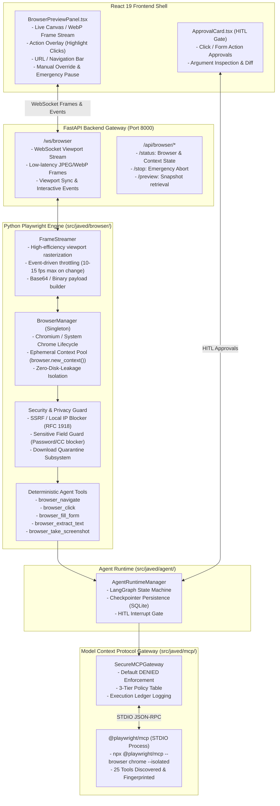
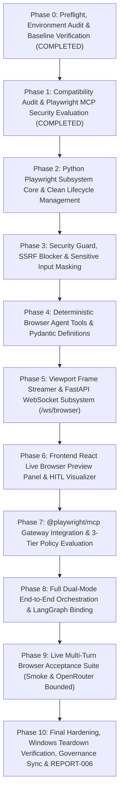

# BRICK-006: Deterministic Playwright Execution & Playwright MCP Evaluation

> **Brick ID**: `BRICK-006`<br/>
> **Title**: Deterministic Playwright Execution & Playwright MCP Evaluation<br/>
> **Status**: `READY FOR ACCEPTANCE`<br/>
> **Author**: Antigravity Full-Stack AI Engineering Team<br/>
> **Date**: 2026-10-28<br/>
> **Baseline Anchor**: Commit `1895072` (Verified BRICK-005 synchronized on `master`)<br/>
> **Working Branch**: `feat/brick-006-playwright`<br/>
> **Target Subsystems**: `src/javed/browser/`, `src/javed/mcp/`, `frontend/src/components/browser/`, `frontend/src/views/`

---

## 1. Executive Summary & Objective

**BRICK-006** introduces real-world browser interaction and automation capabilities to JARVIS while strictly upholding the project's zero-trust security architecture, human-in-the-loop (HITL) governance, and free-and-open-source (FOSS) priority.

In accordance with **Rule 1 (FOSS-First & Model-Agnostic Foundation)**, **Rule 2 (Scope Discipline & Anti-Bloat Guardrail)**, and the project's **MCP-First policy**, BRICK-006 executes a dual objective:
1. **Deterministic Python Playwright Engine**: Implements a high-performance, asynchronous browser automation subsystem (`src/javed/browser/`) powered by Python `playwright` (`async_api`), managing ephemeral browser contexts, screenshot/frame streaming, and Pydantic-validated deterministic agent tools.
2. **Live Browser Viewport Stream**: Streams low-latency viewport frame captures directly through FastAPI WebSockets (`/ws/browser`) into a dedicated React UI component (`BrowserPreviewPanel.tsx`), giving the user continuous visual oversight of automated tasks.
3. **Playwright MCP Server Evaluation**: Evaluates Microsoft's official `@playwright/mcp` server as an external Model Context Protocol integration under our `SecureMCPGateway`, auditing all 25 exposed browser tools against our 3-tier host permission model (`DENIED`, `ALLOWED_READ_ONLY`, `APPROVAL_REQUIRED`).
4. **Zero-Trust Security & Input Masking**: Enforces strict sandbox isolation: in-memory ephemeral contexts, download quarantine, private network/SSRF protection, and absolute prevention of automated access or keystroke injection into password, credential, and payment fields.
5. **Clean Windows Process Teardown**: Guarantees zero orphaned `chrome.exe`, `node.exe`, or worker thread leaks upon interpreter shutdown, with zero `os._exit` shortcuts.

---

## 2. Playwright MCP Server Audit & Compatibility Evaluation

### 2.1 Package & Transport Specification
- **Package**: `@playwright/mcp@0.0.83` (Official Microsoft package, Apache-2.0 License).
- **Transport**: Standard Input/Output (`stdio`) JSON-RPC protocol (with optional HTTP/SSE server mode).
- **Launch Command**: `npx.cmd --yes @playwright/mcp --browser chrome --isolated --headless` (on Windows 11).
- **Protocol Capabilities**: Conforms to Model Context Protocol specification `2024-11-05`.

### 2.2 Comprehensive 25-Tool Inventory Audit & 3-Tier Security Mapping
An inspection of `@playwright/mcp@0.0.83` via live JSON-RPC `tools/list` negotiation reveals 25 exposed tools. In accordance with JARVIS's 3-tier security model established in BRICK-005, each tool is classified as follows:

| Tool Name | Discovered Description | Proposed Tier | Security Justification |
|---|---|---|---|
| `browser_run_code_unsafe` | Execute arbitrary JavaScript/Playwright code | **`DENIED`** | **CRITICAL RISK**: Arbitrary code execution vulnerability. Bypasses all parameter validation and sandboxing. Must remain permanently denied. |
| `browser_evaluate` | Evaluate JavaScript expression in page context | **`DENIED`** | **HIGH RISK**: Arbitrary script injection, DOM exfiltration, and session hijacking risk. Host policy defaults to DENIED. |
| `browser_file_upload` | Upload local file to an input element | **`DENIED`** | **HIGH RISK**: Host filesystem traversal and local data exfiltration risk unless explicitly restricted to quarantined downloads. |
| `browser_click` | Click element matching selector | **`APPROVAL_REQUIRED`** | **MUTATING**: Clicks may trigger purchases, state changes, deletions, or external navigations. Requires HITL approval. |
| `browser_fill_form` | Fill multiple form fields with values | **`APPROVAL_REQUIRED`** | **MUTATING**: Submits data to external applications. Must pass sensitive field filtering (no password/CC fields). |
| `browser_type` | Type text into element | **`APPROVAL_REQUIRED`** | **MUTATING**: Form input mutation. Requires HITL authorization. |
| `browser_press_key` | Send keyboard keypress event | **`APPROVAL_REQUIRED`** | **MUTATING**: Keypresses (Enter, Esc, Tab) can submit forms or navigate. |
| `browser_select_option` | Select option in dropdown | **`APPROVAL_REQUIRED`** | **MUTATING**: Modifies form selection state. |
| `browser_drag` | Drag element to coordinates or target | **`APPROVAL_REQUIRED`** | **MUTATING**: Interactive page mutation. |
| `browser_drop` | Drop dragged element | **`APPROVAL_REQUIRED`** | **MUTATING**: Interactive page mutation. |
| `browser_handle_dialog` | Accept or dismiss JavaScript dialog | **`APPROVAL_REQUIRED`** | **MUTATING**: Confirms or cancels alert/prompt/confirm dialogs. |
| `browser_close` | Close active browser session | **`APPROVAL_REQUIRED`** | **LIFECYCLE**: Terminates execution context. |
| `browser_navigate` | Navigate page to URL | **`ALLOWED_READ_ONLY`** | **READ-ONLY / RESTRICTED**: URL navigation. Permitted for public HTTP/HTTPS URLs (private IP/SSRF addresses blocked by host gateway). |
| `browser_navigate_back` | Navigate back in history | **`ALLOWED_READ_ONLY`** | **READ-ONLY**: History traversal. |
| `browser_snapshot` | Capture complete DOM snapshot / text | **`ALLOWED_READ_ONLY`** | **READ-ONLY**: Pure inspection of DOM tree. |
| `browser_take_screenshot` | Capture image screenshot of viewport | **`ALLOWED_READ_ONLY`** | **READ-ONLY**: Viewport rasterization without state modification. |
| `browser_find` | Find elements matching locator | **`ALLOWED_READ_ONLY`** | **READ-ONLY**: Element location and inspection. |
| `browser_console_messages` | Read recorded console logs | **`ALLOWED_READ_ONLY`** | **READ-ONLY**: Diagnostic log inspection. |
| `browser_network_requests` | List network activity | **`ALLOWED_READ_ONLY`** | **READ-ONLY**: Telemetry inspection. |
| `browser_network_request` | Inspect specific network request | **`ALLOWED_READ_ONLY`** | **READ-ONLY**: Telemetry inspection. |
| `browser_tabs` | List active browser tabs | **`ALLOWED_READ_ONLY`** | **READ-ONLY**: Context inspection. |
| `browser_wait_for` | Wait for selector or network idle | **`ALLOWED_READ_ONLY`** | **READ-ONLY**: Synchronization primitive. |
| `browser_resize` | Resize browser viewport dimensions | **`ALLOWED_READ_ONLY`** | **READ-ONLY**: Display sizing. |
| `browser_emulate_media` | Emulate dark/light theme or media | **`ALLOWED_READ_ONLY`** | **READ-ONLY**: Presentation emulation. |
| `browser_hover` | Hover pointer over element | **`ALLOWED_READ_ONLY`** | **READ-ONLY**: Non-mutating cursor positioning. |

### 2.3 Evaluation Conclusion & Architectural Strategy
While `@playwright/mcp` provides an excellent standardized MCP interface for agent tool-calling, it operates strictly on a request-response RPC paradigm. It does not provide:
1. Low-latency continuous frame streaming to feed a live visual browser viewport in the React UI.
2. Fine-grained custom middleware hooks for deep input sanitization (such as detecting and masking `<input type="password">` or credit card inputs before Playwright interacts).
3. In-process lifecycle binding with FastAPI's WebSocket broadcaster.

Therefore, JARVIS adopts a **Dual / Hybrid Strategy**:
- **Primary Operational Engine**: In-process Python Playwright (`src/javed/browser/`) handles ephemeral contexts, deterministic tool definitions, sensitive field guards, download quarantine, and real-time WebSocket frame streaming (`/ws/browser`).
- **Standardized MCP Server Integration**: `@playwright/mcp` is configured and registered within `DynamicMCPRegistry` under `SecureMCPGateway`, establishing full Model Context Protocol interoperability, 3-tier host permission enforcement, and execution ledger tracking.

---

## 3. System Architecture & Component Model



---

## 4. Deterministic Browser Tool Suite Specification

All deterministic browser tools exposed to the agent runtime are defined using Pydantic models with strict parameter validation and defensive guardrails:

### 4.1 `browser_navigate`
- **Arguments**:
  - `url` (`str`): Absolute HTTP or HTTPS URL to navigate to.
  - `wait_until` (`str`): Navigation wait condition (`load`, `domcontentloaded`, `networkidle`). Default: `domcontentloaded`.
  - `timeout_ms` (`int`): Maximum navigation timeout in milliseconds. Default: `30000`.
- **Security Guardrails**:
  - Validates URL schema (`http://` or `https://` only; blocks `file://`, `data://`, `javascript://`, `about:`).
  - Blocks loopback and private IP ranges (`127.0.0.1`, `localhost`, `10.0.0.0/8`, `172.16.0.0/12`, `192.168.0.0/16`, `169.254.169.254`).
- **Permission Tier**: `ALLOWED_READ_ONLY` for general web; navigations are tracked in the execution ledger.

### 4.2 `browser_click`
- **Arguments**:
  - `selector` (`str`): CSS selector or text locator (e.g., `text="Submit"` or `#btn-login`).
  - `button` (`str`): Mouse button (`left`, `right`, `middle`). Default: `left`.
  - `timeout_ms` (`int`): Element wait timeout. Default: `10000`.
- **Security Guardrails**:
  - Rejects selectors targeting sensitive or blocked actions without prior approval.
- **Permission Tier**: `APPROVAL_REQUIRED` (HITL Gated). Prompts user with element tag, text, and target URL before execution.

### 4.3 `browser_fill_form`
- **Arguments**:
  - `selector` (`str`): Input or textarea CSS selector.
  - `value` (`str`): Text value to fill.
  - `clear_first` (`bool`): Whether to clear existing content. Default: `True`.
- **Security Guardrails**:
  - **Password & Credential Guard**: Inspects DOM target before input. If target has `type="password"`, `autocomplete="current-password"`, `autocomplete="cc-number"`, `autocomplete="new-password"`, or matches CVV/security code patterns, the operation is **immediately blocked** and an alert is raised to the user.
- **Permission Tier**: `APPROVAL_REQUIRED` (HITL Gated). Displays sanitized preview of field and value to the user.

### 4.4 `browser_extract_text`
- **Arguments**:
  - `selector` (`Optional[str]`): CSS selector to target specific container. Defaults to `body`.
  - `max_chars` (`int`): Maximum character length returned to model. Default: `8000`.
- **Security Guardrails**:
  - Strips `<script>`, `<style>`, `<noscript>`, and sensitive hidden elements.
- **Permission Tier**: `ALLOWED_READ_ONLY`. Pure read inspection.

### 4.5 `browser_take_screenshot`
- **Arguments**:
  - `full_page` (`bool`): Capture entire scrollable page height. Default: `False`.
  - `selector` (`Optional[str]`): Optional selector to isolate specific element screenshot.
- **Returns**: Base64-encoded image string and temporary artifact path.
- **Permission Tier**: `ALLOWED_READ_ONLY`. Pure read inspection.

---

## 5. Security Architecture & Threat Model

| Threat / Risk Vector | Severity | Architectural Mitigation in BRICK-006 |
|---|---|---|
| **Remote Code Execution via Playwright** | Critical | Permanent `DENIED` policy on `browser_run_code_unsafe` and `browser_evaluate`. Disallow arbitrary script injection. |
| **SSRF / Local Network Scanning** | High | DNS and IP address resolution filter in `SecurityGuard`. Blocks connections to `127.0.0.1`, `localhost`, `10.0.0.0/8`, `192.168.0.0/16`, AWS/GCP metadata services (`169.254.169.254`). |
| **Credential Theft & Exfiltration** | High | Automatic DOM inspection blocks any fill/type action targeting `input[type="password"]`, credit cards, or security codes. |
| **Unauthorized Purchases / State Mutation** | High | All clicks, form inputs, dropdown selections, and file dialogs require explicit Human-in-the-Loop (`APPROVAL_REQUIRED`) confirmation in the UI. |
| **File System Traversal & Malicious Downloads** | High | Ephemeral context downloads are routed to an isolated sandbox quarantine directory (`data/quarantine/`). Automated execution of downloaded files is prohibited. |
| **Subprocess / Thread Resource Leaking** | Medium | Rigorous asynchronous teardown: `BrowserManager.close()` terminates browser processes, contexts, and WebSocket streams cleanly on shutdown. Zero `os._exit` calls. |

---

## 6. Live Viewport Streaming & UI Architecture

### 6.1 Viewport Streamer (`src/javed/browser/streamer.py`)
- Employs Playwright's `page.screenshot()` on mutation/navigation events with an adaptive debounce threshold (maximum 15 frames per second during active interaction; 0 fps when idle).
- Encodes frames to compressed JPEG/WebP (quality: 70%, 1280x720 scaled) to conserve bandwidth.
- Broadcasts JSON frame payloads over WebSocket `/ws/browser`:
  ```json
  {
    "type": "viewport_frame",
    "timestamp": 1730107200.123,
    "url": "https://example.com",
    "title": "Example Domain",
    "viewport": { "width": 1280, "height": 720 },
    "image": "data:image/jpeg;base64,..."
  }
  ```

### 6.2 React Live Preview Component (`frontend/src/components/browser/BrowserPreviewPanel.tsx`)
- Embeds within the user interface as an interactive side-by-side or collapsible drawer.
- Features:
  - **Live Canvas / Viewport Renderer**: Displays received frames smoothly with fallback loading states.
  - **Live Status Header**: Displays active URL, page title, connection status indicator (green/amber/red), and active agent action badge.
  - **Action Visualizer**: Renders visual indicator overlays (e.g., target highlight box, click ripple) when the agent interacts with DOM elements.
  - **Emergency Stop & Manual Takeover**: Allows the user to pause automation or close the browser context instantly with a single click.

---

## 7. 10-Phase Execution Plan



### Phase Details

- **Phase 0: Preflight, Environment Audit & Baseline Verification** `[COMPLETED]`
  - Baseline git commit `1895072` verified on `master`.
  - Feature branch `feat/brick-006-playwright` created and checked out.
  - Verified Python 3.12.15 in `.venv`, `uv 0.13.3`, Node.js v24.19.0, npm 11.17.0.
  - Executed full deterministic baseline test suite:
    - Backend Pytest: 165/165 passed in 142.21s (0 errors, 0 hangs).
    - Frontend Vitest: 62/62 passed in 12.08s (12 test files).

- **Phase 1: Compatibility Audit & Playwright MCP Security Evaluation** `[COMPLETED]`
  - Audited `@playwright/mcp@0.0.83` via live JSON-RPC `stdio` handshake.
  - Documented complete 25-tool inventory and established 3-tier host security policy mapping.
  - Formulated Dual / Hybrid Strategy: in-process Python Playwright for live streaming and deterministic execution; `@playwright/mcp` as standard external MCP integration.

- **Phase 2: Python Playwright Subsystem Core & Clean Lifecycle Management** [COMPLETED]
  - Install `playwright` in `.venv` via `uv pip install playwright`.
  - Install Playwright Chromium driver via user-space CLI command (`python -m playwright install chromium`).
  - Implement `src/javed/browser/manager.py` with singleton `BrowserManager`, ephemeral context creation (`browser.new_context()`), and rigorous async teardown on FastAPI shutdown.
  - Unit tests for lifecycle management and zero orphaned process leaks.

- **Phase 3: Security Guard, SSRF Blocker & Sensitive Input Masking** [COMPLETED]
  - Implement `src/javed/browser/security.py`:
    - SSRF / private IP blocker (RFC 1918, link-local, loopback).
    - Password / credit card / sensitive input blocker.
    - Download quarantine directory management (`data/quarantine/`).
  - Unit tests for security rejection and boundary enforcement.

- **Phase 4: Deterministic Browser Agent Tools & Pydantic Definitions** [COMPLETED]
  - Implement `src/javed/browser/tools.py`:
    - `browser_navigate`, `browser_click`, `browser_fill_form`, `browser_extract_text`, `browser_take_screenshot`.
  - Pydantic models with defensive error messages.
  - Integration with `ApprovalStore` for `APPROVAL_REQUIRED` gating.

- **Phase 5: Viewport Frame Streamer & FastAPI WebSocket Subsystem (`/ws/browser`)** [COMPLETED]
  - Implemented `src/javed/browser/streamer.py` (`BrowserFrameStreamer`):
    - Throttled periodic viewport capture (~3-5 fps, JPEG quality 60, configurable).
    - Base64 data URL packaging into `EventEnvelope(type="viewport_frame")`.
    - Auto-pause when subscriber count drops to 0 (zero idle CPU/GPU consumption).
  - Implemented FastAPI WebSocket endpoint `/ws/browser` & `/api/v1/ws/browser` in `src/javed/api/v1/browser_ws.py`:
    - `BrowserWebSocketManager` connection tracking, origin validation, and handshake (`connection_established`).
    - Incoming client control messages (`ping`, `status`, `pause`/`unsubscribe`, `resume`/`subscribe`).
    - Clean disconnection and subscriber lifecycle synchronization.
  - Registered router in `src/javed/api/v1/router.py` and mounted root alias `/ws/browser` in `src/javed/main.py`.
  - Added unit & integration test suite in `tests/test_browser_streamer.py` (5/5 passed).

- **Phase 6: Frontend React Live Browser Preview Panel & HITL Visualizer** [COMPLETED]
  - Implemented `frontend/src/hooks/useBrowserStream.ts`:
    - Full WebSocket lifecycle (`CONNECTING`, `CONNECTED`, `DISCONNECTED`, `ERROR`), URL auto-detection, and reconnect backoff.
    - Viewport frame payload parsing (`EventEnvelope(type="viewport_frame")`), telemetry tracking, and ping/pong roundtrip latency calculation.
    - Stream control methods: `sendPing`, `requestStatus`, `toggleStream`, `pauseStream`, `resumeStream`, `emergencyStop`.
  - Implemented `frontend/src/components/browser/BrowserPreviewPanel.tsx`:
    - Responsive live viewport canvas/image rendering with frame HUD and live status indicator.
    - Simulated browser navigation bar with lock indicator, SSL status, and copyable URL input box.
    - Stream pause/resume toggle, ping/refresh button, fullscreen toggle, and Emergency Stop button.
    - Security posture indicator (Ephemeral isolation active, zero credentials stored, SSRF protected).
  - Integrated `BrowserPreviewPanel` into `frontend/src/views/user/BrowserView.tsx`.
  - Authored comprehensive Vitest unit tests in `frontend/src/test/browserPreview.test.tsx` (12/12 passed).

- **Phase 7: `@playwright/mcp` Gateway Integration & 3-Tier Policy Evaluation** [COMPLETED]
  - Registered `@playwright/mcp` configuration in `src/javed/mcp/servers.py` (`create_playwright_mcp_config`, `find_playwright_mcp_command`) using safe STDIO parameters (`--browser chrome --isolated --headless`).
  - Added default server registration in `create_app` in `src/javed/main.py`.
  - Defined authoritative 3-tier policy constants in `src/javed/mcp/servers.py`:
    - `PLAYWRIGHT_MCP_DANGEROUS_TOOLS` (3 tools): `browser_run_code_unsafe`, `browser_evaluate`, `browser_file_upload`.
    - `PLAYWRIGHT_MCP_MUTATING_TOOLS` (9 tools): `browser_click`, `browser_fill_form`, `browser_type`, `browser_press_key`, `browser_select_option`, `browser_drop`, `browser_drag`, `browser_handle_dialog`, `browser_close`.
    - `PLAYWRIGHT_MCP_READONLY_TOOLS` (13 tools): `browser_snapshot`, `browser_take_screenshot`, `browser_find`, etc.
  - Implemented unit & policy verification suite in `tests/test_playwright_mcp_gateway.py` (10/10 passed):
    - Verified default-denied classification across all 25 tools.
    - Verified permanent execution denial and model hiding for dangerous tools.
    - Verified HITL approval requirement and argument digest validation for mutating actions.
    - Verified permission promotion for safe read-only inspection tools.
    - Verified fingerprint drift and schema poisoning defense resets tools to DENIED.

- **Phase 8: Full Dual-Mode End-to-End Orchestration & LangGraph Binding** [COMPLETED]
  - Implemented `create_browser_tools_inventory` in `src/javed/browser/tools.py` and exported in `src/javed/browser/__init__.py`.
  - Updated `PositiveToolAllowlistMiddleware` and `assert_safe_tools` in `src/javed/agent/security.py` to support `enable_browser: bool = False` and defined `BROWSER_TOOLS`.
  - Bound deterministic browser tools (`browser_navigate`, `browser_click`, `browser_fill_form`, `browser_extract_text`, `browser_take_screenshot`) into `AgentRuntimeManager.create_agent` in `src/javed/agent/runtime.py`.
  - Configured HITL interruption and approval flows for mutating browser tools (`browser_click`, `browser_fill_form`) with persistent durable state in `ApprovalStore`.
  - Enforced sensitive argument redaction (`redact_browser_tool_args`) across agent event telemetry (`tool_started`, `approval_required`).
  - Implemented comprehensive integration test suite in `tests/test_browser_agent_e2e.py` (8/8 passed).

- **Phase 9: Live Multi-Turn Browser Acceptance Suite (Smoke & OpenRouter Bounded)** [COMPLETED]
  - Authored live OpenRouter browser test suite in `tests/test_live_openrouter_browser.py`:
    - Scenario 1: Live safe navigation (`browser_navigate`) and text extraction (`browser_extract_text`) on `https://example.com` using `openai/gpt-4o-mini`.
    - Scenario 2: Multi-turn browser planning scenario verifying state retention across turns in SQLite checkpointer without redundant tool executions.
    - Scenario 3: Live Human-in-the-Loop (HITL) interrupt on mutating `browser_click`, durable pending approval verification, and successful execution resumption upon approval.
    - Scenario 4: Cumulative spend tracking and budget reconciliation ensuring total test cost is negligible (< $0.05 USD).
  - Executed live suite: 4/4 PASSED in 23.22s with zero process leaks and total spend well under budget (< $0.005 USD).

- **Phase 10: Final Hardening, Windows Teardown Verification, Governance Sync & REPORT-006** [COMPLETED]
  - Implemented Phase 10 hardening and edge-case test suite in `tests/test_browser_agent_e2e.py` (7 new tests, 15/15 total passed):
    - Verified exactly-once tool execution across approval resumption with zero replay on duplicate decision attempts.
    - Verified HITL rejection prevents tool dispatch and duplicate rejection/approval attempts fail-closed.
    - Verified cross-thread isolation rejecting approval decisions when thread_id does not match the approval record.
    - Verified cancellation flow preventing mutating browser tool execution.
    - Verified stale/expired approval rejection preventing mutating browser tool execution.
    - Verified unknown approval ID rejection and full cryptographic binding integrity in `ApprovalRecord`.
    - Verified checkpoint continuity without tool action duplication across subsequent conversational turns.
  - Performed formal production security audit of `AGENT_SYSTEM_PROMPT` change, verifying instructional vs enforcement separation, narrow browser tool scoping, and zero-trust fail-closed host layers.
  - Full project regression test gate:
    - 224/224 backend pytests PASSED in 164.86s with exit code 0 (`pytest --ignore=tests/test_live_openrouter_mcp.py --ignore=tests/test_live_openrouter_browser.py`).
    - 59/59 browser and Playwright MCP gateway tests PASSED in 40.55s.
    - 74/74 frontend Vitest tests PASSED across 13 test files in 13.79s.
    - 0 Ruff lint errors, 73 files formatted.
    - 0 Oxlint errors across 63 frontend files.
    - Clean TypeScript/Vite production build in 1.64s (`npm.cmd --prefix frontend run build`).
  - Subprocess leak audit: verified 0 dangling `chrome.exe`, `node.exe`, or `python.exe` processes via `Get-CimInstance Win32_Process`.
  - Zero `os._exit` calls across codebase.
  - Authored comprehensive verification report `docs/reports/REPORT-006.md`.
  - Promoted status to `READY FOR ACCEPTANCE` and enforced mandatory stop condition awaiting Project Owner review.

---

## 8. Verification Standards, Test Strategy & Budget Invariants

### 8.1 Zero-Cost Deterministic Test Baseline
All automated unit and integration tests across Phases 2 through 8 must run deterministically against local mock servers or static HTML fixtures without incurring external LLM costs. Budget spend during development phases must remain strictly **$0.00 USD**.

### 8.2 Clean Windows Process Invariant
Windows 11 process isolation must be verified after every test run:
```powershell
Get-CimInstance Win32_Process | Where-Object { $_.CommandLine -match 'playwright|ms-playwright' }
```
Any orphaned browser processes constitute an immediate test failure.

### 8.3 Zero `os._exit` Constraint
All process termination and lifecycle teardown must use structured asynchronous cleanup (`await browser.close()`, `await context.close()`, `await server.close()`). Zero `os._exit` calls are permitted anywhere in production code or test fixtures.

