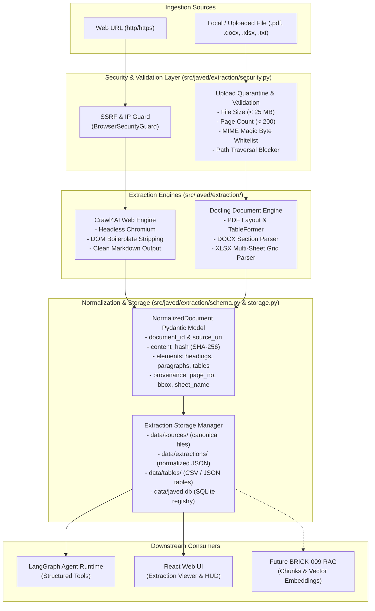

# BRICK-007: Crawl4AI & Docling Extraction Pipeline

> **Brick ID**: `BRICK-007`<br/>
> **Title**: Crawl4AI & Docling Extraction Pipeline<br/>
> **Status**: `IN PROGRESS` (Phase 0 Preflight & Architecture Completed; Awaiting Phase 1 Authorization)<br/>
> **Author**: Antigravity Full-Stack AI Engineering Team<br/>
> **Date**: 2026-10-29<br/>
> **Baseline Anchor**: Commit `83cdeeac0db71a646cb06c906d59e14e55a56c00` (Verified BRICK-006 synchronized on `master`)<br/>
> **Working Branch**: `feat/brick-007-extraction`<br/>
> **Target Subsystems**: `src/javed/extraction/`, `src/javed/api/v1/extraction.py`, `frontend/src/components/extraction/`

---

## 1. Executive Summary & Objective

**BRICK-007** establishes the foundational content ingestion and extraction engine for Project Javed (JARVIS). It transforms heterogeneous unstructured data sources into high-fidelity, structured, and normalized intermediate representations suitable for agent reasoning, analysis, and downstream persistent memory (BRICK-009).

In accordance with **Rule 1 (FOSS-First & Model-Agnostic Foundation)**, **Rule 2 (Scope Discipline & Anti-Bloat Guardrail)**, and [ADR-006](file:///c:/Users/arehman/Desktop/AI Projects/Javed/docs/decisions/ADR-006.md), BRICK-007 implements a dual-engine architecture:
1. **Crawl4AI Web Extraction Subsystem**: Asynchronous, high-performance web crawler optimized for AI agents, executing headless Chromium rendering, dynamic SPA execution, boilerplate stripping, and clean semantic Markdown generation.
2. **Docling Document Understanding Subsystem**: Open-source, local-first multimodal document converter (developed by IBM Research) specialized in deep layout analysis, multi-column reading order reconstruction, structured table parsing (retaining grids, headers, and cell relationships), and precise page/bounding-box provenance tracking for PDF, DOCX, and XLSX formats.

### Core Architectural Invariants:
- **100% Local Processing**: All document parsing (PDF, Word, Excel) occurs strictly in-process on the local workstation. Document bytes never leave the machine.
- **Fail-Closed Defensive Security**: Strict validation on file sizes, page counts, MIME magic bytes, archive expansion blocking, path traversal prevention, and pre-crawl SSRF IP gating (`BrowserSecurityGuard`).
- **Normalized Extraction Schema**: All web and document extractions map into a single canonical Pydantic model (`NormalizedDocument`) with element-level provenance, structured tables, and content hashes.
- **Strict Separation from RAG**: BRICK-007 is strictly an *extraction and normalization* pipeline. Text chunking, tokenization, embeddings calculation, and vector indexing are explicitly deferred to **BRICK-009 (Persistent Memory & Semantic RAG)**.

---

## 2. Technology Audit & Dependency Compatibility Evaluation

### 2.1 Python Environment & Package Compatibility
During Phase 0 preflight, dependency resolution was simulated against the active `.venv` runtime using `uv pip compile`:
- **Python Version**: Python 3.12.15 (Windows x86_64). Both `crawl4ai` (0.9.5) and `docling` (2.144.0) natively support Python 3.12.
- **Dependency Resolution**: Resolved 153 packages in 3.75s with zero dependency conflicts against the existing baseline:
  - `pydantic`: Resolves to Pydantic v2 (v2.12.5 / v2.14.1), fully compatible with `javed` and `langchain`.
  - `playwright`: Crawl4AI shares `playwright>=1.40.0` (v1.64.1 already verified in BRICK-006).
  - `pypdfium2`: Bundles precompiled PDFium C++ binaries for `win_amd64` (zero external PDF binaries needed).
  - `rapidocr` & `opencv-python-headless`: Provides precompiled Windows wheels for local OCR fallback.
  - `python-docx` & `openpyxl`: Pure-Python parsers for Word and Excel without deep learning overhead.

### 2.2 System & Hardware Resource Profile
| Subsystem | CPU Impact | Memory Footprint | Disk Storage | Network Behavior |
|---|---|---|---|---|
| **Crawl4AI** | Low-Moderate (Chromium page render) | ~150–300 MB per active tab | Minimal cache | Network-dependent (requires live URL fetch) |
| **Docling (DOCX / XLSX)** | Low (Pure Python parser) | < 150 MB RAM | Minimal | 100% Offline |
| **Docling (Text PDF)** | Moderate (PDFium layout parse) | ~200–400 MB RAM | Minimal | 100% Offline |
| **Docling (Complex Layout / TableFormer)** | High during inference (1–4s per page) | ~1.5–2.5 GB RAM | ~1.2 GB model weights in HF cache | Offline after initial model weight download |

### 2.3 Air-Gapped / Offline Resilience Strategy
- Docling vision models download once from HuggingFace to `%USERPROFILE%/.cache/huggingface/hub`.
- If network access is disabled or HuggingFace is unreachable:
  - The pipeline automatically falls back to `SimplePdfPipeline` / `FastPdfPipeline` using `PyPdfiumDocumentBackend`, allowing pure text and simple table extraction without model downloads.
  - DOCX, XLSX, and plain text processing remain 100% functional without external network connectivity.

---

## 3. Subsystem Architecture & Responsibility Boundaries



### 3.1 Crawl4AI vs Docling Clear Boundaries
| Responsibility | Crawl4AI Subsystem | Docling Subsystem |
|---|:---:|:---:|
| **Public Web Page Acquisition** | **PRIMARY** | Disallowed |
| **Dynamic SPA / JavaScript Execution** | **PRIMARY** | Disallowed |
| **HTML Cleanup (Nav, Footer, Cookie Banners)** | **PRIMARY** | Disallowed |
| **Web Link Graph & Metadata** | **PRIMARY** | Disallowed |
| **PDF Extraction & Layout Analysis** | Disallowed | **PRIMARY** |
| **Table Structure & Grid Preservation** | Basic HTML tables | **PRIMARY (Deep TableFormer)** |
| **Word Document (.docx) Parsing** | Disallowed | **PRIMARY** |
| **Excel Spreadsheet (.xlsx) Multi-Sheet** | Disallowed | **PRIMARY** |
| **Element Bounding Box & Page Provenance** | DOM CSS paths | **PRIMARY (Exact BBox & Pages)** |

---

## 4. Normalized Extraction Schema Specification

Every extraction result, regardless of source type, conforms to the canonical `NormalizedDocument` Pydantic model defined in `src/javed/extraction/schema.py`:

```python
from datetime import datetime
from enum import StrEnum
from typing import Any, List, Optional
from pydantic import BaseModel, Field

class SourceType(StrEnum):
    WEB_PAGE = "web_page"
    PDF = "pdf"
    DOCX = "docx"
    XLSX = "xlsx"
    PPTX = "pptx"
    TEXT = "text"

class BlockType(StrEnum):
    HEADING = "heading"
    PARAGRAPH = "paragraph"
    TABLE = "table"
    LIST_ITEM = "list_item"
    CODE_BLOCK = "code_block"
    CAPTION = "caption"
    FOOTNOTE = "footnote"

class ExtractionStatus(StrEnum):
    SUCCESS = "success"
    PARTIAL_SUCCESS = "partial_success"
    FAILED = "failed"

class ElementProvenance(BaseModel):
    page_no: Optional[int] = Field(default=None, description="1-based page number")
    bbox: Optional[List[float]] = Field(default=None, description="Bounding box [x0, y0, x1, y1]")
    char_span: Optional[List[int]] = Field(default=None, description="Character offset [start, end]")
    sheet_name: Optional[str] = Field(default=None, description="Sheet name for spreadsheets")
    cell_range: Optional[str] = Field(default=None, description="Cell range e.g. A1:D15")

class TableRepresentation(BaseModel):
    headers: List[str] = Field(default_factory=list)
    rows: List[List[str]] = Field(default_factory=list)
    num_rows: int = 0
    num_cols: int = 0
    sheet_name: Optional[str] = None
    cell_range: Optional[str] = None
    markdown_table: str = ""
    csv_table: str = ""

class ExtractionElement(BaseModel):
    element_id: str = Field(description="Deterministic ID e.g. doc_id#el_0")
    block_type: BlockType
    text_content: str
    section_hierarchy: List[str] = Field(default_factory=list)
    provenance: Optional[ElementProvenance] = None
    table_data: Optional[TableRepresentation] = None

class ExtractorInfo(BaseModel):
    name: str = Field(description="'crawl4ai' or 'docling'")
    version: str
    strategy: str

class NormalizedDocument(BaseModel):
    document_id: str = Field(description="UUID4 document record identifier")
    source_type: SourceType
    source_uri: str = Field(description="Original URL or relative file path")
    source_title: Optional[str] = None
    content_hash: str = Field(description="SHA-256 hex digest of raw source content")
    extraction_timestamp: datetime = Field(default_factory=datetime.utcnow)
    extractor: ExtractorInfo
    mime_type: str
    language: Optional[str] = None
    word_count: int = 0
    page_count: Optional[int] = None
    content_markdown: str = Field(description="Complete normalized markdown representation")
    content_text: str = Field(description="Plain text representation")
    elements: List[ExtractionElement] = Field(default_factory=list)
    metadata: dict[str, Any] = Field(default_factory=dict)
    warnings: List[str] = Field(default_factory=list)
    extraction_status: ExtractionStatus = ExtractionStatus.SUCCESS
    error_message: Optional[str] = None
```

---

## 5. Security & Defensive Ingestion Boundaries

| Attack Vector / Failure Mode | Defensive Enforcement Mechanism | Enforcement Layer |
|---|---|---|
| **Server-Side Request Forgery (SSRF)** | Pre-crawl IP validation via `BrowserSecurityGuard`. Blocks RFC 1918, loopbacks (`127.0.0.1`), link-local metadata (`169.254.169.254`), and numeric encoded IPs. | `src/javed/browser/security.py` |
| **Zip Bomb / Decompression Attacks** | Strict file type whitelist. Archive formats (`.zip`, `.tar.gz`, `.7z`) are rejected immediately. | `src/javed/extraction/security.py` |
| **Oversized Document / OOM** | Strict file size cap: **25 MB** default (max 50 MB). Memory check before task acceptance (`psutil.virtual_memory().percent < 90%`). | `src/javed/extraction/security.py` |
| **Page Count Exhaustion** | Maximum PDF page limit: **200 pages**. Documents exceeding this limit are truncated or rejected. | `src/javed/extraction/security.py` |
| **Processing Timeout** | Web crawl capped at 30s; document conversion capped at 60s via `asyncio.wait_for`. | Async Worker Gateway |
| **Path Traversal Attacks** | UUID-based sanitized storage in `data/quarantine/` and `data/sources/`. Blocks `..`, absolute paths, and NTFS stream syntax (`::$DATA`). | `src/javed/extraction/security.py` |
| **XML External Entity (XXE)** | XML parsers in `python-docx` and `openpyxl` protected via `defusedxml` and strict entity resolution disabling. | Parser Configuration |
| **Password-Protected Documents** | Fail-closed graceful detection. Returns `ErrorCode.PASSWORD_PROTECTED` with status `FAILED` without worker crash. | `DoclingDocumentExtractor` |
| **Corrupted / Malformed Files** | Exception containment. Catches parser failures (`PdfiumError`, `BadZipFile`), records diagnostic warning, flags `FAILED`. | Ingestion Pipeline |
| **Active Code / Embedded Scripts** | PDF embedded JavaScript dictionaries (`/JS`) are ignored. Web extractions strip `<script>`, `<style>`, `<iframe>`, and event attributes. | Parser & Crawler Sanitizer |
| **Sensitive Content Leaks** | Telemetry and console logging strictly exclude raw document contents. Only document ID, MIME type, page count, and status are logged. | API & Worker Logging |

---

## 6. Document Identity, Deduplication & Versioning Lifecycle

1. **Content Hashing**:
   - Every source file or downloaded web page has its raw bytes hashed via `sha256(raw_bytes).hexdigest()`.
2. **Deduplication Logic**:
   - When a document is ingested:
     - Query SQLite `documents` table for `(source_uri, content_hash)`.
     - If an exact match exists with status `SUCCESS`, skip re-extraction and return the cached `NormalizedDocument`.
3. **Incremental Versioning**:
   - If `source_uri` matches an existing document but `content_hash` differs:
     - Mark existing record as `is_latest = False`.
     - Insert new record with `version = previous_version + 1` and `is_latest = True`.
4. **State Transition Machine**:
   - `QUEUED` -> `EXTRACTING` -> `SUCCESS` (or `FAILED` / `PARTIAL_SUCCESS`).
   - Failed extractions preserve failure diagnostics in the database and can be safely retried.

---

## 7. Storage Architecture & Directory Structure

```
data/
  ├── sources/                   # Canonical raw uploaded / acquired source files
  │     └── [doc_id].[ext]       # Stored by UUID filename with original extension
  ├── quarantine/                # Temporary upload staging for pre-validation inspection
  ├── extractions/               # Persisted NormalizedDocument JSON representations
  │     └── [doc_id].json        # Full document JSON with elements and provenance
  ├── tables/                    # Standalone tabular data exports
  │     └── [doc_id]_table_0.csv # Formatted CSV export for fast spreadsheet review
  ├── tmp/                       # Ephemeral scratch files (auto-purged in finally blocks)
  └── javed.db                   # SQLite database (documents & extractions tables)
```

---

## 8. Deterministic Acceptance Fixtures Strategy

To ensure reproducible testing without external network dependencies, a dedicated test fixture suite will be created in `tests/fixtures/extraction/`:
1. `static_page.html`: Semantic HTML5 page with headings, paragraphs, lists, and meta tags.
2. `dynamic_page.html`: Page requiring client-side JS DOM manipulation before content appears.
3. `simple.pdf`: 1-page clean PDF with title and paragraph.
4. `multipage.pdf`: 3-page PDF with multi-level headings and page headers/footers.
5. `table.pdf`: PDF containing a structured financial data table with row/column headers.
6. `sample.docx`: Word document containing Heading 1, Heading 2, bulleted list, and a 3x3 table.
7. `sample.xlsx`: Multi-sheet spreadsheet ("Quarterly_Sales", "Expenses") with headers and data.
8. `unsupported.bin`: Random binary file testing MIME whitelist rejection.
9. `corrupted.pdf`: Truncated, unparseable PDF testing fail-closed exception handling.
10. `oversized.bin`: Synthetic file exceeding 25 MB limit testing 413 rejection.
11. `duplicate.pdf`: Identical copy of `simple.pdf` testing deduplication bypass.
12. `updated_v2.docx`: Modified version of `sample.docx` testing incremental version increment.

---

## 9. Phased Execution Plan (Phases 0 through 10)

| Phase | Milestone Phase Description | Key Deliverables & Acceptance Criteria |
|:---:|---|---|
| **Phase 0** | **Preflight, Dependency Audit & Architecture Plan** | Author `BRICK-007.md`, evaluate dependencies, design normalized schema, define security boundaries. *(Active)* |
| **Phase 1** | **Dependency Installation & Hardware Sandbox** | Install `crawl4ai` and `docling` in `pyproject.toml`; verify Windows CPython 3.12 compatibility; verify zero process leaks. |
| **Phase 2** | **Normalized Extraction Schema & Pydantic Models** | Implement `src/javed/extraction/schema.py`; full serialization and validation unit tests. |
| **Phase 3** | **Security Guard, Quarantine & Whitelist Validator** | Implement `src/javed/extraction/security.py` (`ExtractionSecurityGuard`); file size, page count, MIME magic, XXE, and path traversal guards. |
| **Phase 4** | **Crawl4AI Web Extraction Subsystem** | Implement `src/javed/extraction/web.py` (`Crawl4AIWebExtractor`); SSRF protection, headless Chromium rendering, markdown generation; deterministic mock HTTP server tests. |
| **Phase 5** | **Docling Document Extraction Subsystem** | Implement `src/javed/extraction/documents.py` (`DoclingDocumentExtractor`); PDF (layout + table extraction), DOCX, XLSX parsers; provenance tracking; fixture tests. |
| **Phase 6** | **Storage Manager, Deduplication & Metadata Registry** | Implement `src/javed/extraction/storage.py` (`ExtractionStorageManager`); SQLite `documents` and `extractions` tables; SHA-256 deduplication and versioning. |
| **Phase 7** | **LangChain Agent Tools & HITL Ingestion Gating** | Implement `src/javed/extraction/tools.py` (`extract_web_page`, `extract_document`, `list_ingested_documents`); bind into LangGraph agent runtime; permission tier enforcement. |
| **Phase 8** | **REST API & Developer Mode Telemetry** | Implement FastAPI endpoints in `src/javed/api/v1/extraction.py` (`/upload`, `/crawl`, `/documents`); streaming progress events; OpenAPI schemas. |
| **Phase 9** | **React Document Ingestion UI & Extraction Viewer** | Build `DocumentUploadZone.tsx`, `ExtractionViewer.tsx`, and `TableView.tsx` in `frontend/src/components/extraction/`; Vitest component tests. |
| **Phase 10** | **Full Regression Gate, Hardening & REPORT-007** | Full test sweep (backend pytest, frontend vitest, ruff, oxlint, build); Windows process leak audit; deliver comprehensive `docs/reports/REPORT-007.md`. |

---

## 10. Mandatory Stop Points & Acceptance Criteria

In strict accordance with project rules:
1. **Phase 0 Stop Point**: Execution halts upon committing the Phase 0 specification and plan. Await explicit Project Owner review and Phase 1 authorization.
2. **Phase Boundaries**: Advance strictly one phase at a time upon explicit authorization.
3. **Phase 10 Final Stop Point**: Upon completing Phase 10 verification, deliver `docs/reports/REPORT-007.md` and set status to `READY FOR ACCEPTANCE`. Await explicit Project Owner sign-off before merging into `master`.
