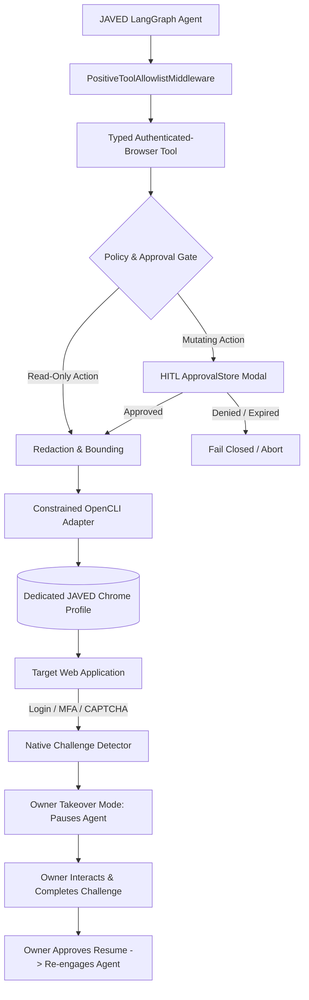

# BRICK-008: Browser Use and Authenticated Navigation Specification

> **Brick ID**: `BRICK-008`  
> **Title**: Browser Use and Authenticated Navigation  
> **Phase**: Planning Baseline (Preflight Pending)  
> **Status**: `NOT STARTED`  
> **Author**: Principal Architect & Project Owner  
> **Created**: 2026-11-02  
> **Last Updated**: 2026-11-02  
> **Architecture Authority**: [ADR-008](file:///c:/Users/arehman/Desktop/AI Projects/Javed/docs/decisions/ADR-008.md)  
> **Report Reference**: [docs/reports/REPORT-008.md](file:///c:/Users/arehman/Desktop/AI Projects/Javed/docs/reports/REPORT-008.md)  

---

## 1. Executive Summary & Objective

**BRICK-008** establishes JAVED's governed authenticated web navigation and open-ended exploration architecture. It provides reliable interaction with authenticated web applications (Outlook, Gmail, Google Analytics, internal dashboards) via isolated browser profiles, structured read-only data extraction, single-use approval-gated mutations, and native human takeover for login and security challenges.

In accordance with **Rule 1 (FOSS-First)**, **Rule 4 (Security & Sandboxing)**, and the **Owner Architecture Directive (2026-11-02)**, BRICK-008 enforces strict operational boundaries:
1. Deterministic Playwright and Playwright MCP serve as the deterministic automation foundation.
2. OpenCLI serves as the primary candidate for authenticated browser session management via dedicated, isolated Chrome profiles.
3. Stagehand is evaluated strictly as a semantic element discovery fallback when deterministic selectors fail.
4. Browser Use is utilized for multi-step reasoning patterns as an architectural reference only (not a direct runtime dependency).
5. Native JAVED owner takeover handles MFA, CAPTCHAs, and login challenges. Automated CAPTCHA solving, stealth browser spoofing, and residential proxy rotation are strictly prohibited.

---

## 2. Scope & Boundaries

### In Scope
- **Deterministic Foundation**: Extending BRICK-006's deterministic Playwright engine and Playwright MCP for structured navigation.
- **Dedicated Profile Isolation**: Constrained OpenCLI adapter driving dedicated JAVED profiles (`work-outlook`, `personal-outlook`, `work-gmail`, `personal-gmail`, `google-analytics`, `general-research`).
- **Owner Takeover Subsystem**: Seamless pausing of agent DOM extraction and screenshots during logins or security challenges, handing full control to the owner, and resuming only upon explicit owner approval.
- **Granular Tool Segregation**: Distinct read-only tools and single-use, fail-closed approval-gated mutating tools.
- **Advanced Network Security Guards**: Redirect destination validation (HTTP 3xx), request-time private network IP checks (RFC 1918 / loopback / metadata IP `169.254.169.254`), subresource filtering, and page WebSocket destination enforcement.
- **Session Privacy**: Strict exclusion of raw profile cookies, authorization headers, passwords, and passkeys from language model context.

### Out of Scope / Non-Goals
- Accessing or attaching to the owner's personal, everyday, unconstrained Chrome profile.
- Automated CAPTCHA solving services or bypass libraries.
- Stealth browser plugins or browser fingerprint evasion.
- Residential proxy rotation or rate-limit evasion.
- Direct raw shell or terminal access granted to the language model.
- Autonomous unapproved mutating actions (sending emails, modifying analytics settings, deleting messages).

### Explicit Exclusions (Owner Decision)
The following candidates and techniques are strictly excluded from the architecture:
1. `beyahcuruk-del/captcha-takeover` — **REMOVED BY PROJECT OWNER DECISION** (Challenge detection and owner takeover must be native to JAVED).
2. `scrapfly/Antibot-Detector` — **REMOVED BY PROJECT OWNER DECISION** (Anti-bot evasion prohibited).
3. `rebrowser/rebrowser-bot-detector` — **REMOVED BY PROJECT OWNER DECISION** (Fingerprint spoofing prohibited).
4. Automated CAPTCHA-solving APIs (2Captcha, Anti-Captcha, CapSolver).
5. Residential proxy pools and IP rotation networks.

---

## 3. Prerequisites & Blockers

- [ ] Prior brick verified: `BRICK-007` marked `VERIFIED` in `docs/PROGRESS.md`.
- [ ] Required ADR approved: [ADR-008](file:///c:/Users/arehman/Desktop/AI Projects/Javed/docs/decisions/ADR-008.md).
- [ ] No unresolved blockers in `docs/TASKS.md` under `TASK-080`.
- [ ] Dedicated JAVED Chrome profile directory initialized in isolated user data directory.
- [ ] Preflight security audit completed before installing OpenCLI or Stagehand.

---

## 4. Technical Design & Architecture

### 4.1 Component Diagram & Execution Flow

### 4.2 Responsibility Hierarchy
1. **Deterministic Playwright / Playwright MCP**: Direct, predictable web automation and structured interactions.
2. **OpenCLI**: Authenticated session management via dedicated JAVED Chrome profiles.
3. **Stagehand**: Semantic element discovery where deterministic selectors fail (evaluation only).
4. **Native Owner Takeover**: Manual human judgment when login, MFA, passkey, or CAPTCHA is encountered.
5. **Browser Use**: Architectural reference for multi-step reasoning patterns only.

### 4.3 Tool Taxonomy

#### Read-Only Tools (Allowlisted with Output Bounding)
- `authenticated_page_read`: Read visible DOM and text from authorized domain.
- `authenticated_page_search`: Search in-page text or DOM elements.
- `authenticated_page_extract`: Extract structured data into Phase 2 schema.
- `authenticated_page_list_links`: List discovered sanitized links on the active page.
- `mail_list_messages`: List email message headers within an authorized mailbox.
- `mail_search_messages`: Search mailbox by query, date, or sender.
- `mail_open_message`: Open and read specific email body.
- `mail_read_conversation`: Read threaded email conversation.
- `analytics_read_page`: Read analytics dashboard summary.
- `analytics_extract_report`: Extract tabular metrics report.
- `browser_owner_takeover`: Voluntarily request owner takeover for inspection.
- `browser_session_status`: Check connection, profile, and authorization status.
- `browser_session_disconnect`: Safely close and tear down the authenticated browser session.

#### Approval-Required Mutating Tools (Single-Use Fail-Closed HITL)
- `mail_download_attachment`: Download message attachment to secure quarantine.
- `mail_create_draft`: Compose new email draft.
- `mail_reply`: Reply to an existing email thread.
- `mail_forward`: Forward an email thread to specified recipients.
- `mail_send`: Send an email message.
- `mail_move`: Move message to a different folder.
- `mail_archive`: Archive email message.
- `mail_delete`: Delete email message.
- `authenticated_form_fill`: Populate input fields on authenticated form.
- `authenticated_form_submit`: Submit authenticated form data.
- `browser_upload_file`: Upload authorized file to authenticated web app.
- `browser_download_file`: Trigger file download into quarantine.
- `browser_change_setting`: Modify user configuration on target web app.

---

## 5. Session Security & Network Controls

### 5.1 Privacy & Redaction Boundary
- **Never Visible to Model**: Cookies, session tokens, authorization headers, raw browser storage, passwords, OTPs, passkeys, and recovery codes.
- **Masking during Authentication**: When on an authentication page or during owner takeover, screenshot streaming and DOM harvesting are immediately suspended.
- **Single-Use Approvals**: Every approval token is bound to owner, account alias, profile, session ID, domain, thread ID, run ID, tool-call ID, exact action, target object, content digest, and expiration timestamp.

### 5.2 Mandatory Network Defenses
- **Redirect Validation**: Route-level interception of HTTP 3xx redirects asserting destinations resolve to public, non-private, non-loopback IP addresses.
- **Request-Time IP Checks**: Pre-dispatch DNS inspection on all outbound browser network requests blocking RFC 1918 and metadata endpoints.
- **Subresource Interception**: Strict blocking of unauthorized internal network probes originating from embedded page scripts.
- **WebSocket Route Enforcement**: Termination of page-initiated WebSocket connections targeting internal or untrusted hosts.

---

## 6. Verification & Test Plan

### 6.1 Automated Tests
- `tests/test_browser_auth_tools.py`: Unit tests for read-only vs mutating tool authorization.
- `tests/test_opencli_adapter.py`: Mocked OpenCLI process lifecycle, argument sanitization, and output boundary.
- `tests/test_owner_takeover.py`: Challenge detection and state pause/resume contract tests.
- `tests/test_browser_security_guards.py`: Redirect destination, private IP blocking, and subresource interception tests.

### 6.2 Live UI Verification
- **Browser Preview Panel**: Live view of authenticated navigation in dedicated profile.
- **Takeover Overlay**: Clear visual badge ("Owner Takeover Active — Agent Paused") when challenge encountered.
- **HITL Modal**: Single-use approval prompt displaying exact action, target, recipients, and content digest before mutating actions.

---

## 7. Acceptance Criteria

- [ ] All code implemented strictly within approved brick boundaries.
- [ ] Dedicated JAVED Chrome profile isolation verified (zero everyday profile leakage).
- [ ] Zero credential, cookie, or token exposure to model context or telemetry.
- [ ] 100% test pass rate across unit, contract, and security test suites.
- [ ] Zero os._exit calls; natural and idempotent teardown of browser sessions.
- [ ] Zero unapproved dependencies; OpenCLI and Stagehand vetted before installation.
- [ ] Explicit human user sign-off recorded in `REPORT-008.md`.

---

## 8. Stop Condition

Once implementation and testing are complete:
1. Update status to `READY FOR ACCEPTANCE`.
2. Generate `docs/reports/REPORT-008.md`.
3. **STOP** and await explicit Project Owner review and authorization before proceeding to BRICK-009.
