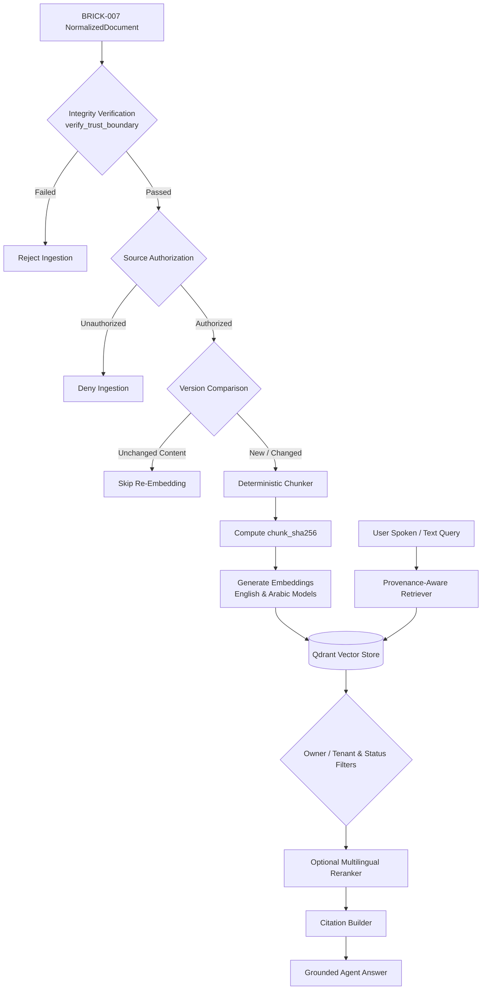

# BRICK-009: Persistent Memory and Semantic RAG Specification

> **Brick ID**: `BRICK-009`  
> **Title**: Persistent Memory and Semantic RAG  
> **Phase**: Planning Baseline (Preflight Pending)  
> **Status**: `NOT STARTED`  
> **Author**: Principal Architect & Project Owner  
> **Created**: 2026-11-02  
> **Last Updated**: 2026-11-02  
> **Architecture Authority**: [ADR-004](file:///c:/Users/arehman/Desktop/AI Projects/Javed/docs/decisions/ADR-004.md), [ADR-008](file:///c:/Users/arehman/Desktop/AI Projects/Javed/docs/decisions/ADR-008.md)  
> **Report Reference**: [docs/reports/REPORT-009.md](file:///c:/Users/arehman/Desktop/AI Projects/Javed/docs/reports/REPORT-009.md)  

---

## 1. Executive Summary & Objective

**BRICK-009** delivers long-term user memory, project memory, and high-fidelity semantic document retrieval (RAG) for Project Javed. It bridges BRICK-007's structured content extraction into durable vector and structured knowledge stores, enabling context-aware recall, provenance-backed answers, and user-governed memory management.

In accordance with **Rule 1 (FOSS-First)**, **Rule 2 (Anti-Bloat Guardrail)**, and the **Owner Architecture Directive (2026-11-02)**:
1. LangGraph serves as the primary orchestration framework.
2. BRICK-007 `NormalizedDocument` serves as the sole authoritative extraction contract for ingested knowledge.
3. Qdrant serves as the primary vector database candidate.
4. Mem0 serves strictly as an evaluation candidate for personal memory (subject to benchmark and security review).
5. LangGraph Store and SQLite provide local structured memory.
6. `BjornMelin/enhanced-mem-vector-rag` serves as an architectural reference only (not a direct dependency).
7. Multilingual capabilities are bounded to **English and Arabic**; Urdu support is explicitly excluded.

---

## 2. Scope & Boundaries

### In Scope
- **Ingestion Pipeline**: Ingestion of verified, finalized `NormalizedDocument` objects through deterministic provenance-aware chunking and hashing.
- **Vector Storage**: Qdrant indexing with strict tenant/owner isolation, metadata filtering, and chunk-level provenance.
- **Local Structured Memory**: SQLite / LangGraph Store for user preferences, project facts, and conversation context.
- **Memory Governance**: Explicit user inspection, editing, deletion, expiration, and export of stored memories.
- **Bilingual Semantic & Lexical Search**: Benchmarked English and Arabic embeddings with optional hybrid sparse lexical retrieval and multilingual reranking.
- **Hash Integrity**: Exact source-byte (`source_sha256`), stable content (`normalized_content_sha256`), extraction-run (`extraction_record_sha256`), chunk (`chunk_sha256`), and embedding config (`embedding_config_sha256`) digests preventing redundant re-embedding.

### Out of Scope / Non-Goals
- Direct writes to Qdrant from web crawlers, document converters, or unverified MCP servers.
- Automatic, unverified persistence of model inferences as trusted owner facts.
- Multi-vector database deployments (Chroma, Pinecone, Weaviate, Milvus).
- Urdu language embeddings, retrieval benchmarks, test fixtures, or voices.

### Explicit Exclusions (Owner Decision)
The following are strictly removed from the planned architecture:
1. **Urdu Language Support** — **REMOVED BY PROJECT OWNER DECISION** (Urdu STT, TTS, memory, embeddings, retrieval tests, rerankers, and voices are excluded).
2. Unvetted third-party memory SaaS platforms.
3. Direct database writes bypassing the `NormalizedDocument` trust boundary.

---

## 3. Prerequisites & Blockers

- [ ] Prior brick verified: `BRICK-008` marked `VERIFIED` in `docs/PROGRESS.md`.
- [ ] Required ADR approved: [ADR-004](file:///c:/Users/arehman/Desktop/AI Projects/Javed/docs/decisions/ADR-004.md), [ADR-008](file:///c:/Users/arehman/Desktop/AI Projects/Javed/docs/decisions/ADR-008.md).
- [ ] No unresolved blockers in `docs/TASKS.md` under `TASK-090`.
- [ ] Qdrant local instance or embedded client configured with test isolation.
- [ ] English and Arabic embedding benchmark harness established.

---

## 4. Technical Design & Architecture

### 4.1 Knowledge Ingestion & RAG Data Flow

### 4.2 Qdrant Point Schema & Payload
Every vector record in Qdrant must preserve:
- `chunk_id`: UUIDv4 deterministic chunk identity.
- `document_id`: Canonical document identifier.
- `version_id`: Monotonic document version.
- `ingestion_id`: Extraction ingestion run UUID.
- `element_ids`: Array of source `ExtractionElement` IDs.
- `source_type`: Ingestion source (`WEB`, `PDF`, `DOCX`, `XLSX`).
- `source_uri`: Sanitized source URI or storage path.
- `source_title`: Sanitized document title.
- `section_hierarchy`: Breadcrumb array of heading hierarchy.
- `page_or_sheet`: Page number or worksheet name provenance.
- `source_sha256`: Raw source-byte digest.
- `normalized_content_sha256`: Stable normalized content digest.
- `chunk_sha256`: Canonical chunk text digest.
- `embedding_config_sha256`: Model identifier and configuration digest.
- `language`: Detected language (`en`, `ar`).
- `owner_id`: Owner identity for strict multi-user tenant isolation.
- `access_classification`: Data sensitivity classification.
- `retention_state`: Active, expired, or pending deletion.

### 4.3 Memory Governance Model
Facts and memory records are classified into explicit categories:
1. **Owner-Stated Fact**: Explicitly taught by user ("I prefer dark mode").
2. **Owner Preference**: Behavioral preferences confirmed by user.
3. **Project Decision**: Architecture and team decisions recorded in session.
4. **Verified System Fact**: Grounded fact verified against internal records.
5. **Document-Derived Fact**: Fact extracted from authorized `NormalizedDocument`.
6. **Model Inference**: Speculative hypothesis generated by agent. **Must never silently become a trusted fact without explicit user verification.**

---

## 5. Evaluation Requirements (English & Arabic)

Candidate embedding models and rerankers must be evaluated separately for English and Arabic across:
- Semantic retrieval accuracy (MRR, NDCG@10).
- Mixed-language queries (e.g. English technical terminology in Arabic questions).
- Exact-name, number, date, and table retrieval recall.
- Stale-version and soft-deleted document exclusion.
- Strict owner/tenant isolation under concurrent queries.
- Query latency (< 150ms P95) and RAM / VRAM footprint.

---

## 6. Verification & Test Plan

### 6.1 Automated Tests
- `tests/test_memory_governance.py`: Unit tests for memory CRUD, fact categories, and inference isolation.
- `tests/test_rag_chunker.py`: Deterministic chunking, boundary preservation, and chunk hashing tests.
- `tests/test_qdrant_isolation.py`: Multi-tenant isolation and soft-delete filtering tests.
- `tests/test_bilingual_retrieval.py`: English and Arabic semantic search recall tests.

### 6.2 Live UI Verification
- **Memory Drawer**: Interactive UI displaying active facts with category badges.
- **Inline Fact Editor**: Capability to edit, delete, or expire stored memories directly from UI.
- **Citation Chips**: Grounded chat responses displaying clickable provenance chips referencing source documents and exact page numbers.

---

## 7. Acceptance Criteria

- [ ] Zero unverified writes to Qdrant (all data sourced from `NormalizedDocument` or governed memory).
- [ ] Model inferences strictly segregated from verified facts.
- [ ] English and Arabic retrieval recall benchmarked with documented evidence.
- [ ] Zero Urdu fixtures, tests, or models present in test suites.
- [ ] 100% test pass rate across unit, contract, and retrieval test suites.
- [ ] User memory editing, deletion, and expiration verified via live UI.
- [ ] Explicit human user sign-off recorded in `REPORT-009.md`.

---

## 8. Stop Condition

Once implementation and testing are complete:
1. Update status to `READY FOR ACCEPTANCE`.
2. Generate `docs/reports/REPORT-009.md`.
3. **STOP** and await explicit Project Owner review and authorization before proceeding to BRICK-010.
