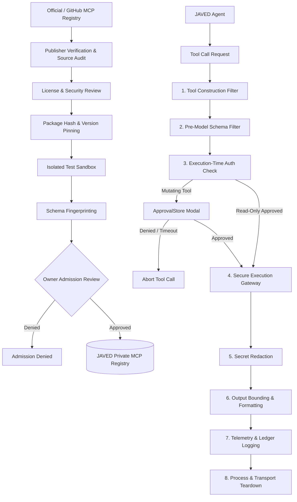

# BRICK-010: Managed Model Context Protocol (MCP) Ecosystem Specification

> **Brick ID**: `BRICK-010`  
> **Title**: Managed Model Context Protocol (MCP) Ecosystem  
> **Phase**: Planning Baseline (Preflight Pending)  
> **Status**: `NOT STARTED`  
> **Author**: Principal Architect & Project Owner  
> **Created**: 2026-11-02  
> **Last Updated**: 2026-11-02  
> **Architecture Authority**: [ADR-008](file:///c:/Users/arehman/Desktop/AI Projects/Javed/docs/decisions/ADR-008.md)  
> **Report Reference**: [docs/reports/REPORT-010.md](file:///c:/Users/arehman/Desktop/AI Projects/Javed/docs/reports/REPORT-010.md)  

---

## 1. Executive Summary & Objective

**BRICK-010** expands JAVED's foundational MCP client gateway (established in BRICK-005) into a comprehensive, enterprise-grade, managed multi-server MCP ecosystem. It provides dynamic discovery, cryptographically verified publisher admissions, private allowlisting, version pinning, schema fingerprinting, permission classification, runtime health monitoring, and audit logging.

In accordance with **Rule 1 (FOSS-First)**, **Rule 4 (Security & Sandboxing)**, and the **Owner Architecture Directive (2026-11-02)**:
1. Public MCP registries serve strictly for discovery, never as trust authorities.
2. The JAVED Private MCP Registry is the sole authoritative gatekeeper for enabled servers.
3. All tool calls execute through the host-controlled `SecureMCPGateway`.
4. Tools default to `DENIED`. Schema changes automatically revoke affected tools pending review.
5. Mutating operations strictly require single-use, fail-closed Human-in-the-Loop (HITL) approval.

---

## 2. Scope & Boundaries

### In Scope
- **Discovery Plane**: Official MCP Registry (`modelcontextprotocol/registry`) as primary public discovery; GitHub MCP Registry as secondary discovery.
- **Private Control Plane**: JAVED Private MCP Registry maintaining cryptographically pinned, audited server records.
- **Admission Pipeline**: Automated and manual review pipeline (publisher verification, license check, supply-chain audit, package hashing, isolated testing, schema fingerprinting).
- **Approved Initial Servers**: Playwright MCP, Time MCP, GitHub MCP, and Context7 MCP.
- **Conditional Candidates**: DBHub, Notion MCP, and MarkItDown MCP (evaluated only upon concrete use case and explicit owner authorization).
- **Runtime Execution Controls**: 8-stage execution filter, individual tool permission classification (`DENIED`, `ALLOWED_READ_ONLY`, `APPROVAL_REQUIRED`), output bounding, secret redaction, and execution ledger.
- **Developer UI**: Managed MCP tab in Developer Mode with connection status, tool toggles, and live audit telemetry.

### Out of Scope / Non-Goals
- Allowing public search results to execute directly without private registry admission.
- Blanket server-level approvals granting shell or filesystem access to all tools from a server.
- Generic unconstrained shell or filesystem MCP servers.
- Unverified community servers or remote servers without local governance.

### Explicit Exclusions (Owner Decision)
The following servers are permanently removed from the roadmap:
1. **Microsoft Fabric MCP Server** — **REMOVED BY PROJECT OWNER DECISION** (Enterprise cloud SaaS outside core local-first architecture).
2. **Azure MCP Server** — **REMOVED BY PROJECT OWNER DECISION** (Proprietary cloud platform coupling violating Rule 1 and Rule 4).
3. Generic shell MCP servers enabled by default.
4. Desktop Commander and arbitrary remote unvetted MCP servers.

---

## 3. Prerequisites & Blockers

- [ ] Prior brick verified: `BRICK-009` marked `VERIFIED` in `docs/PROGRESS.md`.
- [ ] Required ADR approved: [ADR-008](file:///c:/Users/arehman/Desktop/AI Projects/Javed/docs/decisions/ADR-008.md).
- [ ] No unresolved blockers in `docs/TASKS.md` under `TASK-100`.
- [ ] Stdio and SSE transport isolation harnesses operational.
- [ ] Private registry schema and database table migration prepared.

---

## 4. Technical Design & Architecture

### 4.1 MCP Admission Pipeline & Execution Control Plane

### 4.2 Private MCP Registry Record Schema
Each registered MCP server record contains:
- `server_id`: Unique identifier (e.g., `mcp-github-official`).
- `display_name`: Human-readable name.
- `publisher`: Verified publisher identity.
- `repository_url`: Source code repository URL.
- `license`: Permissive FOSS license identifier (MIT, Apache-2.0, BSD-3-Clause).
- `approved_version`: Pinned semantic version.
- `package_location`: Local path or verified npm/PyPI coordinate.
- `package_sha256`: Cryptographic digest of installed package.
- `transport`: Transport type (`stdio` or `sse`).
- `command_and_args`: Exact sanitized execution command and arguments.
- `required_env_vars`: List of required environment variable names (never raw secret values).
- `sandbox_profile`: Process isolation level and filesystem/network boundaries.
- `discovered_tools`: Array of exposed tool names.
- `tool_schema_digests`: Map of tool names to schema SHA-256 fingerprints.
- `permission_states`: Map of tool names to authorization state (`DENIED`, `ALLOWED_READ_ONLY`, `APPROVAL_REQUIRED`).
- `owner_approval`: Timestamp and owner approval token.
- `installation_timestamp`: ISO 8601 creation timestamp.
- `last_health_check`: Timestamp and status of latest heartbeat.
- `revocation_state`: Active or revoked.
- `last_security_review`: Date of most recent security audit.

### 4.3 8-Stage Execution Filter
1. **Tool-Construction Filtering**: Prune unauthorized tools before prompt construction.
2. **Pre-Model Schema Filtering**: Strip secret parameters or unvetted inputs from tool descriptions.
3. **Execution-Time Authorization**: Enforce active permission state (`DENIED` fails closed).
4. **Secret Redaction**: Scrub environment secrets and credentials from tool inputs and outputs.
5. **Output Bounding**: Enforce 500 KB / 2,000 element payload ceilings.
6. **Telemetry**: Emit structured JSON events to Developer Mode streaming socket.
7. **Execution Ledger**: Append tamper-evident audit record to SQLite ledger.
8. **Process Teardown**: Gracefully terminate and close subprocess pipes upon completion.

---

## 5. Verification & Test Plan

### 5.1 Automated Tests
- `tests/test_mcp_admission.py`: Admission pipeline validation, package hashing, and schema fingerprint tests.
- `tests/test_mcp_gateway_security.py`: Dynamic tool permission gating, unauthorized tool blocking, and secret redaction.
- `tests/test_mcp_schema_tamper.py`: Schema mutation detection triggering automatic tool revocation.
- `tests/test_mcp_process_lifecycle.py`: Subprocess crash recovery, timeout enforcement, and zero process leak tests.

### 5.2 Live UI Verification
- **Developer Mode MCP Tab**: Live list of registered servers, latency indicators, and tool permission toggles.
- **Audit Ledger View**: Real-time stream of executed MCP tool calls, parameters, and outputs.
- **HITL Modal**: Single-use approval prompt before mutating MCP tools (e.g. GitHub issue creation or repo edits).

---

## 6. Acceptance Criteria

- [ ] All code implemented within scoped MCP subsystems.
- [ ] Unknown tools default to `DENIED`; schema changes reset affected tools to `DENIED`.
- [ ] Zero secret storage in registry records or telemetry logs.
- [ ] Initial approved servers (Playwright, Time, GitHub, Context7) fully verified.
- [ ] Microsoft Fabric MCP and Azure MCP completely excluded.
- [ ] 100% test pass rate across unit, contract, and security test suites.
- [ ] Natural process cleanup with zero zombie processes or `os._exit` calls.
- [ ] Explicit human user sign-off recorded in `REPORT-010.md`.

---

## 7. Stop Condition

Once implementation and testing are complete:
1. Update status to `READY FOR ACCEPTANCE`.
2. Generate `docs/reports/REPORT-010.md`.
3. **STOP** and await explicit Project Owner review and authorization before proceeding to BRICK-011.
