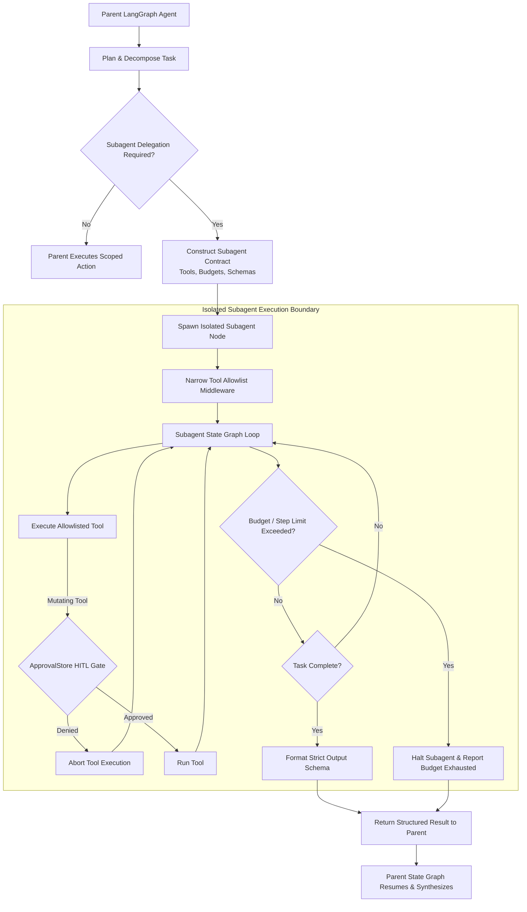

# BRICK-011: Advanced Tasks and Subagents Specification

> **Brick ID**: `BRICK-011`  
> **Title**: Advanced Tasks and Subagents  
> **Phase**: Planning Baseline (Preflight Pending)  
> **Status**: `NOT STARTED`  
> **Author**: Principal Architect & Project Owner  
> **Created**: 2026-11-02  
> **Last Updated**: 2026-11-02  
> **Architecture Authority**: [ADR-003](file:///c:/Users/arehman/Desktop/AI Projects/Javed/docs/decisions/ADR-003.md), [ADR-008](file:///c:/Users/arehman/Desktop/AI Projects/Javed/docs/decisions/ADR-008.md)  
> **Report Reference**: [docs/reports/REPORT-011.md](file:///c:/Users/arehman/Desktop/AI Projects/Javed/docs/reports/REPORT-011.md)  

---

## 1. Executive Summary & Objective

**BRICK-011** enables JAVED to delegate complex, multi-phase tasks to specialized, isolated autonomous subagents while strictly preserving parent-agent authority, context isolation, token and financial budgets, cancellation propagation, Human-in-the-Loop governance, and structured result synthesis.

In accordance with **Rule 1 (FOSS-First)**, **Rule 2 (Anti-Bloat Guardrail)**, and the **Owner Architecture Directive (2026-11-02)**:
1. Deep Agents on LangGraph serves as the primary subagent orchestration framework.
2. Competing multi-agent frameworks (CrewAI, AutoGen, ChatDev) are strictly prohibited.
3. Subagents receive narrowly scoped tool allowlists and explicit input/output contracts.
4. Subagents never inherit parent tools automatically and cannot recursively spawn subagents without authorization.
5. All mutating actions initiated by subagents pass through the existing JAVED HITL approval system.

---

## 2. Scope & Boundaries

### In Scope
- **Subagent Runtime Engine**: Deep Agents subagent spawning harness integrated into LangGraph cyclic state machine.
- **6 Specialized Subagents**:
  1. *Research Subagent*: Public web extraction, read-only RAG, read-only approved MCP sources.
  2. *Document-Analysis Subagent*: BRICK-007 normalized documents, BRICK-009 retrieval, table and provenance operations.
  3. *Analytics Subagent*: Approved analytics data, SEO datasets, approved spreadsheets, RAG.
  4. *Browser-Operator Subagent*: Deterministic Playwright, approved OpenCLI-backed tools, owner takeover.
  5. *Coding Subagent*: Sandboxed repository operations, GitHub MCP, test runners, narrowly approved file edits.
  6. *Report-Generation Subagent*: Retrieved evidence, approved document-generation tools, citation validator.
- **Subagent Contract**: Explicit task definition, system prompt, output schema, tool allowlist, token budget, monetary budget, step ceiling, timeout, cancellation token, mutation policy, and retention policy.
- **Parent-Child Coordination**: Parent-agent authority, asynchronous task delegation, isolated context windows, cancellation propagation, and failure containment (subagent failure cannot corrupt parent state).

### Out of Scope / Non-Goals
- Introducing second or third competing subagent frameworks.
- Autonomous, unbounded recursive subagent creation (spawning trees of arbitrary depth).
- Broad tool inheritance granting subagents shell or browser access without explicit scoping.
- Bypassing HITL approval gates for subagent-initiated mutations.

---

## 3. Prerequisites & Blockers

- [ ] Prior brick verified: `BRICK-010` marked `VERIFIED` in `docs/PROGRESS.md`.
- [ ] Required ADR approved: [ADR-003](file:///c:/Users/arehman/Desktop/AI Projects/Javed/docs/decisions/ADR-003.md), [ADR-008](file:///c:/Users/arehman/Desktop/AI Projects/Javed/docs/decisions/ADR-008.md).
- [ ] No unresolved blockers in `docs/TASKS.md` under `TASK-110`.
- [ ] Subagent state serialization schemas defined and verified.
- [ ] Token and cost tracking budgets integrated into subagent execution wrappers.

---

## 4. Technical Design & Architecture

### 4.1 Delegation & Execution Lifecycle

### 4.2 Subagent Taxonomy & Tool Contracts

| Subagent Type | Permitted Tools | Prohibited Tools | Primary Output |
|---|---|---|---|
| **Research Subagent** | Crawl4AI web extraction, read-only RAG, read-only approved MCP sources | Shell, filesystem write, email sending, form submit | Source-backed research packet, citations, uncertainty report |
| **Document-Analysis Subagent** | BRICK-007 `NormalizedDocument` decoders, Qdrant retrieval, table operators | Public web crawling, shell, file writes | Structured document analysis, evidence citations, extracted risks |
| **Analytics Subagent** | Analytics API read, spreadsheet decoders, RAG retrieval | Code execution, mailbox modification, file deletion | Metrics summary, anomaly alerts, trend projections |
| **Browser-Operator Subagent** | Deterministic Playwright, approved OpenCLI tools, owner takeover | Unrestricted shell, personal everyday Chrome profile | Task result, browser visual evidence, action/approval ledger |
| **Coding Subagent** | Sandboxed repo read, GitHub MCP read/write (approval-gated), test runners | Unrestricted host filesystem, root shell, external network | Patch proposal, diff preview, verification test evidence |
| **Report-Generation Subagent** | Markdown/HTML generator, retrieved evidence store, citation validator | Raw web crawling, shell, browser navigation | Final structured draft report, citation audit, unsupported-claim warnings |

### 4.3 Subagent Execution Rules
- **Parent Authority**: The parent agent remains authoritative and may cancel, modify, or supersede subagent runs at any turn.
- **Budget Enforced**: Token counts and API costs are tracked per subagent; exceeding limits triggers immediate fail-closed termination.
- **Cancellation Propagation**: Cancelling a parent conversation run automatically aborts all active subagent tasks.
- **Telemetry Transparency**: Every subagent tool invocation and state transition emits structured events visible in the UI.

---

## 5. Verification & Test Plan

### 5.1 Automated Tests
- `tests/test_subagent_spawning.py`: Contract validation, isolation, and state isolation tests.
- `tests/test_subagent_tool_allowlist.py`: Tool inheritance prohibition and unauthorized tool blocking tests.
- `tests/test_subagent_budget_enforcement.py`: Token ceiling, step ceiling, and timeout termination tests.
- `tests/test_subagent_cancellation.py`: Parent-to-child cancellation propagation tests.

### 5.2 Live UI Verification
- **Inspector Subagent Drawer**: Collapsible card showing active subagents, current step, and resource consumption.
- **Subagent Output Card**: Embedded chat cards presenting structured subagent results with evidence chips.
- **HITL Modal**: Dedicated modal attributing approval requests to the calling subagent and parent thread.

---

## 6. Acceptance Criteria

- [ ] All 6 specialized subagents implemented with strict tool allowlists.
- [ ] Deep Agents and LangGraph runtime handle dynamic subagent lifecycle without race conditions.
- [ ] Subagents cannot spawn child subagents or inherit parent tools without authorization.
- [ ] Token, step, and time budgets terminate runaway subagents cleanly.
- [ ] Zero state corruption or process leaks on subagent failure.
- [ ] 100% test pass rate across unit, contract, and lifecycle test suites.
- [ ] Explicit human user sign-off recorded in `REPORT-011.md`.

---

## 7. Stop Condition

Once implementation and testing are complete:
1. Update status to `READY FOR ACCEPTANCE`.
2. Generate `docs/reports/REPORT-011.md`.
3. **STOP** and await explicit Project Owner review and authorization before proceeding to BRICK-012.
