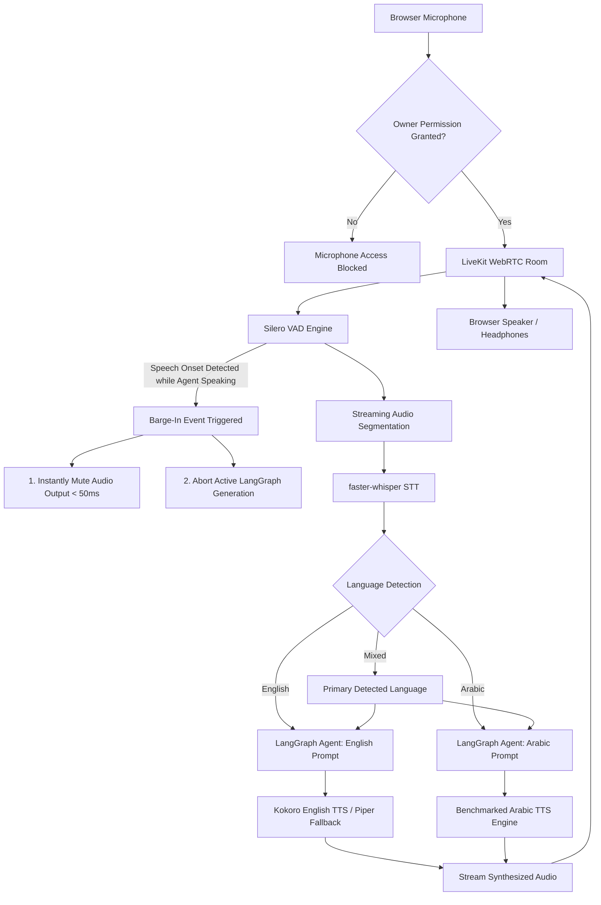

# BRICK-012: Real-Time English and Arabic Voice Specification

> **Brick ID**: `BRICK-012`  
> **Title**: Real-Time English and Arabic Voice  
> **Phase**: Planning Baseline (Preflight Pending)  
> **Status**: `NOT STARTED`  
> **Author**: Principal Architect & Project Owner  
> **Created**: 2026-11-02  
> **Last Updated**: 2026-11-02  
> **Architecture Authority**: [ADR-007](file:///c:/Users/arehman/Desktop/AI Projects/Javed/docs/decisions/ADR-007.md), [ADR-008](file:///c:/Users/arehman/Desktop/AI Projects/Javed/docs/decisions/ADR-008.md)  
> **Report Reference**: [docs/reports/REPORT-012.md](file:///c:/Users/arehman/Desktop/AI Projects/Javed/docs/reports/REPORT-012.md)  

---

## 1. Executive Summary & Objective

**BRICK-012** implements a real-time, low-latency, conversational voice system for Project Javed, providing natural spoken interaction in **English and Arabic**. The architecture features streaming speech-to-text, voice activity detection (VAD), language detection, dynamic language routing, low-latency text-to-speech synthesis, instant barge-in / interruption handling (< 50ms cut-off), and strict privacy controls.

In accordance with **Rule 1 (FOSS-First)**, **Rule 4 (Security & Sandboxing)**, and the **Owner Architecture Directive (2026-11-02)**:
1. LiveKit serves as the primary real-time media transport layer.
2. Silero VAD provides local, low-latency voice activity detection and interruption triggers.
3. `faster-whisper` serves as the primary local speech-to-text (STT) engine.
4. Kokoro serves as the primary English text-to-speech (TTS) engine, with Piper as lightweight fallback.
5. Arabic TTS is selected through a dedicated benchmark (evaluating pronunciation, tashkeel/diacritics, and latency).
6. Reference architectures `VoxBigBrain` and `AI_assist` serve as design references only (not direct dependencies).
7. **Urdu language support is completely removed** by Project Owner decision.

---

## 2. Scope & Boundaries

### In Scope
- **Real-Time Media Transport**: WebRTC audio streaming via LiveKit rooms with client-side microphone streaming.
- **Voice Activity Detection**: Local Silero VAD running client-side or on streaming server to detect speech onsets and offsets.
- **Speech-to-Text Pipeline**: Streaming audio segmentation and transcription via `faster-whisper`.
- **Language Detection & Routing**: Automatic classification of spoken utterances into English or Arabic, dynamically selecting the appropriate agent response language and TTS synthesis pipeline.
- **Text-to-Speech Synthesis**: Low-latency audio generation via Kokoro (English), Piper (fallback), and benchmarked Arabic TTS.
- **Instant Barge-In**: User speech onset instantly mutes speaker playback and cancels active agent generation within 50ms.
- **Privacy & Security**: Ephemeral in-memory audio buffers, explicit microphone permission prompts, scoped room tokens, and session timeout controls.

### Out of Scope / Non-Goals
- Multi-party conference calling or telephony bridging (SIP/PSTN).
- Permanent storage of raw voice audio without explicit user consent.
- Transmitting raw audio to unvetted third-party commercial APIs.
- Urdu speech recognition, Urdu text-to-speech, Urdu language routing, or Urdu test fixtures.

### Explicit Exclusions (Owner Decision)
The following are permanently excluded from the voice system:
1. **Urdu Language Support** — **REMOVED BY PROJECT OWNER DECISION** (Urdu STT, TTS, fixtures, evaluation metrics, voices, routing, and acceptance criteria are completely removed).
2. Direct dependencies on `VoxBigBrain` or `AI_assist` (reference architectures only).
3. Unscoped persistent microphone streaming without active session tokens.

---

## 3. Prerequisites & Blockers

- [ ] Prior brick verified: `BRICK-011` marked `VERIFIED` in `docs/PROGRESS.md`.
- [ ] Required ADR approved: [ADR-007](file:///c:/Users/arehman/Desktop/AI Projects/Javed/docs/decisions/ADR-007.md), [ADR-008](file:///c:/Users/arehman/Desktop/AI Projects/Javed/docs/decisions/ADR-008.md).
- [ ] No unresolved blockers in `docs/TASKS.md` under `TASK-120`.
- [ ] LiveKit server local development instance or embedded test harness operational.
- [ ] Dedicated Arabic TTS benchmark suite established.

---

## 4. Technical Design & Architecture

### 4.1 Real-Time Audio Pipeline & Barge-In Flow

### 4.2 Language Routing & Arabic TTS Benchmark
- **English Path**: Spoken English -> faster-whisper (English) -> text -> LangGraph -> Kokoro TTS (high naturalness, low RTF).
- **Arabic Path**: Spoken Arabic -> faster-whisper (Arabic) -> text -> LangGraph -> benchmark-selected Arabic TTS.
- **Mixed Code-Switching**: Utterance language detection selects the dominant language for the response text and TTS voice, preserving terms in the alternate language without phonemic distortion.
- **Arabic TTS Benchmark Criteria**:
  1. Phonetic and diacritics / tashkeel correctness.
  2. Latency to first synthesized audio chunk (< 250ms).
  3. Real-Time Factor (RTF < 0.3 on CPU/GPU).
  4. Permissive FOSS license (MIT, Apache-2.0).
  5. Stability under continuous streaming without audio clipping.

### 4.3 Voice Tool Classification

#### Read-Only / Session-Control Tools
- `voice_session_status`: Retrieve active room, latency, and connection metrics.
- `voice_get_active_language`: Get currently detected language (`en` or `ar`).
- `voice_interrupt_output`: Manually trigger barge-in cut-off.
- `voice_replay_last_response`: Replay the previous spoken response.
- `voice_list_available_voices`: Enumerate installed English and Arabic voice profiles.
- `voice_mute`: Temporarily mute outgoing microphone stream.
- `voice_unmute`: Unmute microphone stream.

#### Approval-Required Tools (Single-Use Fail-Closed HITL)
- `voice_enable_microphone`: Request initial browser microphone permission.
- `voice_record_session`: Enable session audio recording to local file.
- `voice_export_transcript`: Export conversation transcript to external file.
- `voice_send_transcript_to_external_service`: Transmit transcript outside local boundary.
- `voice_retain_audio`: Save audio snippet to persistent storage.
- `voice_retain_transcript`: Save raw audio transcript to durable storage.

---

## 5. Session Security & Privacy Controls

- **Ephemeral Audio**: Audio buffers exist in-memory only during streaming; zero unapproved disk writes.
- **Explicit Authorization**: Microphone access requires explicit user confirmation.
- **Visual Recording Indicator**: Persistent, animated waveform and glowing badge indicating active listening state.
- **Scoped Room Tokens**: LiveKit room tokens are short-lived, single-use, and bound to the authenticated user session.
- **Transcript Privacy**: Transcripts are classified as user-private data and are never forwarded to unauthorized telemetry.

---

## 6. Verification & Test Plan

### 6.1 Automated Tests
- `tests/test_vad_bargein.py`: VAD speech onset detection and generation abort latency tests (< 50ms).
- `tests/test_whisper_stt.py`: Transcription accuracy and partial transcript stability tests.
- `tests/test_voice_routing.py`: English and Arabic language detection and voice routing tests.
- `tests/test_voice_security.py`: Ephemeral buffer cleanup, token expiration, and permission tests.

### 6.2 Bilingual Evaluation Matrix (English & Arabic)
Separately verified for English and Arabic:
1. Language detection accuracy (> 95%).
2. Final transcript Word Error Rate (WER) on standard test sets.
3. Partial transcript stability without word jitter.
4. Proper noun, technical term, date, and number recognition.
5. Response-language alignment (English query -> English response; Arabic query -> Arabic response).
6. Speech synthesis naturalness and prosody.
7. Time-to-First-Audio (< 800ms) and full turn-around latency (< 1.2s).
8. Barge-in interruption cut-off (< 50ms).
9. Background noise robustness and recovery from false interruptions.
10. Long silence timeout and disconnect handling.

---

## 7. Acceptance Criteria

- [ ] Low-latency voice conversation verified in both English and Arabic.
- [ ] Turn-around latency < 1.2s and barge-in cut-off < 50ms verified empirically with recorded audio evidence.
- [ ] Zero Urdu STT, TTS, fixtures, voices, or test artifacts in the repository.
- [ ] Ephemeral audio lifecycle verified (zero persistent audio files without explicit user approval).
- [ ] 100% test pass rate across unit, contract, and voice latency test suites.
- [ ] Explicit human user sign-off recorded in `REPORT-012.md`.

---

## 8. Stop Condition

Once implementation and testing are complete:
1. Update status to `READY FOR ACCEPTANCE`.
2. Generate `docs/reports/REPORT-012.md`.
3. **STOP** and await explicit Project Owner review and authorization before proceeding to BRICK-013.
