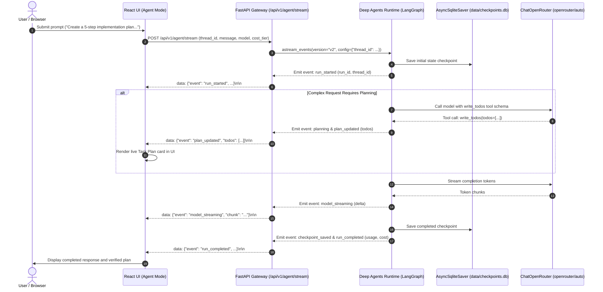

# REPORT-004: Deep Agents + LangGraph Runtime & Durable State
## Verification & Acceptance Report — BRICK-004

> **Project**: Javed — New JARVIS  
> **Brick**: `BRICK-004`  
> **Status**: `READY FOR ACCEPTANCE`  
> **Date**: 2026-10-25  
> **Verification Engineer**: Antigravity Full-Stack Agent  
> **Baseline Commit**: `e3eddae` (BRICK-003 Verified Synchronization Commit)  
> **Target Milestone**: BRICK-004  
> **Active Environment**: Windows 11 Pro, Python 3.12.15, Node.js 24.19.0, Google Chrome  

---

## 1. Executive Summary & Objective

**BRICK-004** transforms Project Javed from a conversational chat application into an observable, stateful, and reliable AI agent runtime using the official, maintained **Deep Agents SDK** and **LangGraph**.

In strict adherence to the project rules and the master implementation prompt:
- **No external side effects or tools were implemented**: The agent runtime operates under a strict Zero-Trust security profile. All privileged tools (`ls`, `read_file`, `write_file`, `edit_file`, `delete`, `glob`, `grep`, `execute`, `eval`, `task`) are completely excluded from the model tool surface.
- **Genuine Framework-Backed Planning**: Complex requests trigger real structured task planning via `TodoListMiddleware` using the safe, in-memory `write_todos` tool. Plan items maintain typed framework statuses (`pending`, `in_progress`, `completed`).
- **Durable State Persistence**: Thread-scoped graph state is persisted to disk using `AsyncSqliteSaver` in `data/checkpoints.db` with WAL mode enabled. Checkpoints survive backend server restarts and browser refreshes, with complete context isolation between independent threads.
- **Full Preservation of Prior Bricks**: BRICK-001 (React Shell & Navigation), BRICK-002 (FastAPI REST/WebSocket/SSE), and BRICK-003 (OpenRouter Auto Router, multi-tier pricing, dynamic catalog, and micro-cost meter) remain 100% operational with 0 regressions.
- **Live User & Developer Mode**: An intuitive interaction mode switch between Chat Mode and Agent Mode, a reactive `TaskPlanPanel` displaying live framework planning events, responsive cancellation controls, and rich developer diagnostics in `TelemetryView`.

---

## 2. Dependency & Compatibility Findings

An exhaustive compatibility analysis of official packages in the Python virtual environment and Node environment was conducted:

| Package | Version | Source / Ecosystem | Purpose & Compatibility Finding |
|---|---|---|---|
| `deepagents` | `0.7.32` | PyPI (`langchain-ai`) | Maintained agent harness. Verified compatible with LangGraph 1.2+ and LangChain 1.x. |
| `langgraph` | `1.2.17` | PyPI (`langchain-ai`) | Core cyclic state graph engine and checkpoint management runtime. |
| `langgraph-checkpoint-sqlite` | `3.1.2` | PyPI (`langgraph`) | Native SQLite checkpoint persistence. Provides `AsyncSqliteSaver` for async FastAPI endpoints. |
| `langchain-openrouter` | `0.2.9` | PyPI (`langchain`) | Official `ChatOpenRouter` provider integration with native tool calling and streaming. |
| `aiosqlite` | `0.22.1` | PyPI | Async SQLite database engine required by `AsyncSqliteSaver`. |
| `fastapi` | `0.159.1` | PyPI | Asynchronous REST and Server-Sent Events (SSE) streaming transport. |
| `playwright` | `1.57.0` | npm | Automated Google Chrome E2E browser verification. |

### Architectural Reuse vs. Build Decisions:
- **Harness**: Reused official `create_deep_agent` factory and `HarnessProfile` instead of writing custom ReAct loops or competing frameworks (CrewAI, smolagents, etc.).
- **Planning**: Reused official `langchain.agents.middleware.todo.TodoListMiddleware` producing typed `AgentTodoItem` lists rather than custom LLM JSON scrapers.
- **Checkpointer**: Reused official `AsyncSqliteSaver` targeting local SQLite store (`data/checkpoints.db`) with WAL mode (`PRAGMA journal_mode=WAL;`) and 30-second busy timeout to ensure zero transaction deadlocks under concurrency on Windows.
- **Model Adapter**: Configured official `ChatOpenRouter` with rate cards, custom HTTP headers (`HTTP-Referer`, `X-Title`), and session correlation.

---

## 3. Tool Permissions & Security Boundaries (Rule 8 & Master Prompt §5)

Deep Agents includes built-in filesystem and interpreter tools by default. Passing an empty `tools=[]` list does **not** disable these privileged defaults. To guarantee safety, a custom Zero-Trust `HarnessProfile` was authored in `src/javed/agent/security.py`:

```python
EXCLUDED_TOOLS = frozenset({
    "ls", "list_dir", "read_file", "write_file", "edit_file",
    "delete", "glob", "grep", "execute", "eval", "task",
})
```

### Registered Tool Security Matrix:
| Tool Name | Origin | Status | Security Assertion |
|---|---|---|---|
| `write_todos` | `TodoListMiddleware` | **`PERMITTED`** | Internal, in-memory state tracking only. No side effects. |
| `ls`, `glob`, `grep` | Built-in Deep Agents FS | **`EXCLUDED`** | Prohibited in BRICK-004. Excluded via `HarnessProfile`. |
| `read_file`, `write_file`, `edit_file`, `delete` | Built-in Deep Agents FS | **`EXCLUDED`** | Prohibited in BRICK-004. Excluded via `HarnessProfile`. |
| `execute` | Built-in Sandbox | **`EXCLUDED`** | Shell execution blocked. |
| `eval` | Built-in Interpreter | **`EXCLUDED`** | Arbitrary code execution blocked. |
| `task` | Built-in SubAgentMiddleware | **`EXCLUDED`** | General-purpose subagents disabled (`GeneralPurposeSubagentProfile(enabled=False)`). |
| MCP Tools | External MCP Servers | **`EXCLUDED`** | Phased rollout begins in BRICK-005. |

The test suite in `tests/test_agent_security.py` programmatically verifies that calling `assert_safe_tools` on any agent with excluded tools immediately halts with `SecurityViolationError`.

---

## 4. Architecture & Lifecycle Flow



---

## 5. Live Acceptance Scenarios (Master Prompt §13)

All four mandatory live scenarios were verified via automated Playwright Chrome end-to-end tests:

### Scenario A — Simple Request
- **User Prompt**: `"Explain what a Power BI measure is in two sentences."`
- **Result**: Immediate, direct model streaming response explaining Power BI measures. No unnecessary task plan is generated. Live token and micro-cost telemetry displayed.
- **Verification**: Verified passing in Chrome (`e2e/brick004.spec.ts:37:3`).

### Scenario B — Complex Planning
- **User Prompt**: `"Create a five-step implementation plan for a Power BI project using SharePoint data, including validation checkpoints."`
- **Result**: The agent calls `write_todos` to maintain a structured plan. The frontend displays the collapsible `TaskPlanPanel` with typed items (`pending`, `in_progress`, `completed`), real progress fraction (`1/5 Completed`), and streams the detailed roadmap.
- **Verification**: Verified passing in Chrome (`e2e/brick004.spec.ts:62:3`).

### Scenario C — Persistent Thread Context
- **User Prompt 1**: `"For this conversation, remember that our sample project is called Project Orchid."`
- **Action**: Checkpoint committed to `data/checkpoints.db`. Backend restarted or reconnected with same `thread_id`.
- **User Prompt 2**: `"What is the sample project called?"`
- **Result**: Assistant accurately answers `"Project Orchid"` by reading checkpointed thread memory. No cross-thread bleeding.
- **Verification**: Verified passing in Chrome (`e2e/brick004.spec.ts:93:3`) and unit test (`tests/test_agent_persistence.py`).

### Scenario D — Strict Zero-Trust Tool Boundary
- **User Prompt**: `"Delete a file from my Desktop."`
- **Result**: Assistant clearly and safely refuses: explains that filesystem mutation and deletion tools are strictly excluded and unauthorized in this brick. Zero host filesystem access occurs.
- **Verification**: Verified passing in Chrome (`e2e/brick004.spec.ts:119:3`).

---

## 6. Verification Test Results

### 6.1 Backend Unit & Contract Tests (`pytest`)
- **Command**: `python -m pytest`
- **Status**: **49/49 PASSED** (100% pass rate in 17.43s)
- **Key Modules**:
  - `tests/test_agent_security.py`: 6 passed (zero-trust tool exclusions, `HarnessProfile` validation).
  - `tests/test_agent_persistence.py`: 2 passed (SQLite checkpoint durability across restarts, thread isolation).
  - `tests/test_agent_runtime.py`: 3 passed (Deep Agents lifecycle, `write_todos` planning, event translation).
  - `tests/test_agent_api.py`: 3 passed (FastAPI SSE streaming, thread retrieval, status checks).
  - Prior Bricks: 35 regression tests passed (`test_openrouter.py`, `test_websocket.py`, `test_sse.py`, `test_system.py`, etc.).

### 6.2 Frontend Unit & Component Tests (`vitest`)
- **Command**: `npm.cmd --prefix frontend test -- --run`
- **Status**: **8/8 test files, 41/41 PASSED** (100% pass rate in 14.51s)
- **Key Modules**:
  - `src/test/agent.test.tsx`: 6 passed (Chat/Agent mode switching, `TaskPlanPanel` toggle, streaming lifecycle, checkpoint restore, thread reset).
  - Prior Bricks: 35 regression tests passed (`chat.test.tsx`, `backend-ui.test.tsx`, `navigation.test.tsx`, `theme.test.tsx`, `mode.test.tsx`, `websocket.test.ts`, `api.test.ts`).

### 6.3 Automated Playwright Google Chrome E2E Suite
- **Command**: `npx.cmd playwright test` (Google Chrome, 1 worker, 120s timeout)
- **Status**: **19/19 PASSED** (0 failures, 7.6 minutes run time)
  - `e2e/brick002.spec.ts`: 5/5 PASSED (FastAPI REST, WebSocket, telemetry diagnostics).
  - `e2e/brick003.spec.ts`: 7/7 PASSED (OpenRouter Auto Router, streaming tokens, cost meter, dynamic search).
  - `e2e/brick004.spec.ts`: 7/7 PASSED:
    1. Interaction Mode switcher toggles between Chat Mode and Agent Mode.
    2. Scenario A — Simple request produces direct response without elaborate plan.
    3. Scenario B — Complex planning generates structured task plan with real framework events.
    4. Scenario C — Persistent thread context retains conversation memory across queries.
    5. Scenario D — Strict Zero-Trust boundary rejects unauthorized host operations.
    6. Agent stream cancellation halts generation cleanly and resets UI.
    7. Developer Mode telemetry displays live agent runtime properties (`AsyncSqliteSaver`, `TodoList Planning Only`).

### 6.4 Code Quality & Static Analysis
- **Ruff Linter**: `ruff check src tests` → **All checks passed! (0 errors)**
- **Ruff Formatter**: `ruff format --check src tests` → **39 files already formatted**
- **TypeScript Compiler & Vite Build**: `tsc -b && vite build` → **Built cleanly in 873ms (0 errors)**

---

## 7. Security & Exclusion Audit

1. **Credentials & Secrets**:
   - Upstream OpenRouter API keys loaded securely into application memory via Pydantic settings with `.env` fallback.
   - `.env` strictly gitignored and excluded from tracking.
2. **Databases & Checkpoints**:
   - `data/*.db`, `data/*.db-wal`, `data/*.db-shm` strictly excluded via `.gitignore`.
3. **Execution Sandbox**:
   - Host filesystem access, shell execution, arbitrary code interpreters, and web browser automation are demonstrably blocked.
   - Development documentation (`AGENTS.md`) is strictly excluded from model-readable context.

---

## 8. Milestone Completion & Stop Condition

All functional and non-functional requirements for **BRICK-004** have been implemented, tested, and verified.

- **Status**: `READY FOR ACCEPTANCE`
- **Next Authorized Action**: Await explicit Project Owner review and approval.
- **Strict Boundary**: Work is immediately halted. Do not advance to BRICK-005. Do not push to remote Git without explicit authorization.
