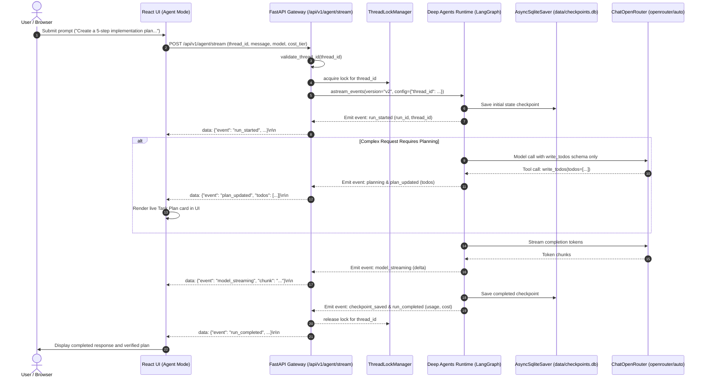

# REPORT-004: Deep Agents + LangGraph Runtime, Durable State & Security Hardening
## Verification & Acceptance Report — BRICK-004

> **Project**: Javed — New JARVIS  
> **Brick**: `BRICK-004`  
> **Status**: `VERIFIED — OWNER ACCEPTED`  
> **Date**: 2026-10-25  
> **Acceptance Date**: 2026-10-25  
> **Verification Engineer**: Antigravity Full-Stack Agent  
> **Working Branch**: `recovery/brick-004-hardened`  
> **Baseline Anchor**: Commit `42103bb` (Anchored to common ancestor `e3eddae`)  
> **Target Milestone**: BRICK-004  
> **Active Environment**: Windows 11 Pro, Python 3.12.15, Node.js 24.19.0, Google Chrome  

---

## 1. Executive Summary & Objective

**BRICK-004** transforms Project Javed from a conversational chat application into an observable, stateful, and reliable AI agent runtime using the official, maintained **Deep Agents SDK** and **LangGraph**.

### Implementation & Recovery Context:
Previous commits from another machine (`53c0469`, `2c857c6`, and `61c5bcb`) were physically inaccessible because they were never pushed to GitHub. Rather than attempting unreliable recovery or rebuilding from scratch, work proceeded safely from the verified baseline at commit `42103bb` on a dedicated safety branch (`safety/brick-004-baseline`) and working branch (`recovery/brick-004-hardened`). All missing security, thread validation, and persistence protections identified during the forensic audit were independently reimplemented, hardened, and verified with zero regressions.

### Key Capabilities Verified:
- **3-Layer Positive Tool Allowlist**: Operates strictly on a positive allowlist where `write_todos` is the sole authorized agent tool. Prohibits all filesystem, shell, interpreter, browser, and subagent tools across model visibility, execution interception, and startup initialization.
- **Fail-Closed Runtime Initialization**: Instantiates Deep Agents using `StateBackend()` (preventing host filesystem exposure) and verifies agent safety before serving requests.
- **Strict Server-Side Thread ID Validation**: Enforces pattern `^[a-zA-Z0-9_\-]+$`, rejecting directory traversal (`..`, `/`, `\`), null bytes, whitespace, and injection attempts.
- **Per-Thread Concurrency Serialization**: `ThreadLockManager` serializes concurrent multi-turn requests per thread with FIFO async locks, preventing SQLite WAL lock contention and state interleaving.
- **Durable State Persistence & Recovery**: Graph state persists to disk via `AsyncSqliteSaver` in `data/checkpoints.db` (WAL mode enabled). Verified across process restarts, thread isolation, and distinct OS subprocesses.
- **Full Preservation of Prior Bricks**: BRICK-001 (React UI), BRICK-002 (FastAPI REST/WebSocket/SSE), and BRICK-003 (OpenRouter Auto Router and micro-cost accounting) remain 100% operational with 0 regressions.
- **Live User & Developer Mode**: Mode switcher between Chat Mode and Agent Mode, a reactive `TaskPlanPanel` displaying live planning events, responsive cancellation controls, and rich developer diagnostics in `TelemetryView`.

---

## 2. Dependency & Ecosystem Compatibility

An exhaustive compatibility analysis of official packages in the virtual environment was conducted:

| Package | Version | Ecosystem | Purpose & Compatibility Finding |
|---|---|---|---|
| `deepagents` | `0.7.32` | PyPI (`langchain-ai`) | Maintained agent harness. Verified compatible with LangGraph 1.2+ and LangChain 1.x. |
| `langgraph` | `1.2.17` | PyPI (`langchain-ai`) | Core cyclic state graph engine and checkpoint management runtime. |
| `langgraph-checkpoint-sqlite` | `3.1.2` | PyPI (`langgraph`) | Native SQLite checkpoint persistence. Provides `AsyncSqliteSaver` for async FastAPI endpoints. |
| `langchain-openrouter` | `0.2.9` | PyPI (`langchain`) | Official `ChatOpenRouter` provider integration with native tool calling and streaming. |
| `aiosqlite` | `0.22.1` | PyPI | Async SQLite database engine required by `AsyncSqliteSaver`. |
| `fastapi` | `0.159.1` | PyPI | Asynchronous REST and Server-Sent Events (SSE) streaming transport. |
| `playwright` | `1.64.1` | npm | Automated Google Chrome E2E browser verification. |

### Architectural Decisions:
- **Zero-Trust Tool Middleware**: Created `PositiveToolAllowlistMiddleware` to filter model-visible tools and intercept execution before host handlers run.
- **Safe State Backend**: Replaced default `LocalShellBackend` with `StateBackend()`, preventing any filesystem interaction by Deep Agents internals.
- **Structured Planning**: Utilized `TodoListMiddleware` producing typed `AgentTodoItem` lists rather than brittle custom JSON extraction.
- **Checkpointer**: Configured `AsyncSqliteSaver` targeting local SQLite store (`data/checkpoints.db`) with WAL mode (`PRAGMA journal_mode=WAL;`) and a 30-second busy timeout.

---

## 3. Tool Permissions & 3-Layer Security Architecture

The runtime implements a strict 3-layer defense-in-depth model:

```
[ Incoming User Request ]
          │
          ▼
┌────────────────────────────────────────────────────────┐
│ Layer 1: Model-Visible Tool Exposure Filtering         │
│ (PositiveToolAllowlistMiddleware.wrap_model_call)      │
│ Filters tools so ONLY ALLOWED_TOOLS reach the LLM      │
└────────────────────────────────────────────────────────┘
          │
          ▼
┌────────────────────────────────────────────────────────┐
│ Layer 2: Host Execution Authorization & Interception   │
│ (PositiveToolAllowlistMiddleware.wrap_tool_call)       │
│ Blocks unauthorized tool calls with Security Violation │
│ error ToolMessage before host handler execution        │
└────────────────────────────────────────────────────────┘
          │
          ▼
┌────────────────────────────────────────────────────────┐
│ Layer 3: Runtime Initialization & Harness Enforcement  │
│ (assert_safe_agent_runtime + StateBackend + Profile)   │
│ Excludes privileged tools and disables subagents       │
└────────────────────────────────────────────────────────┘
```

### Authoritative Tool Matrix:
| Tool Name | Origin | Exposure | Execution | Security Policy |
|---|---|---|---|---|
| `write_todos` | `TodoListMiddleware` | **Exposed to Model** | **Authorized** | Internal in-memory planning state tracking only. No side effects. |
| `ls`, `read_file`, `write_file`, `edit_file`, `delete`, `glob`, `grep` | Built-in Deep Agents FS | **Hidden / Filtered** | **Prohibited & Intercepted** | Excluded via `HarnessProfile` and `PositiveToolAllowlistMiddleware`. Backend replaced with `StateBackend()`. |
| `execute`, `eval`, `bash` | Host Shell / Interpreter | **Hidden / Filtered** | **Prohibited & Intercepted** | Excluded via `HarnessProfile` and `PositiveToolAllowlistMiddleware`. Triggers `Security Violation`. |
| `task` | Built-in SubAgentMiddleware | **Hidden / Filtered** | **Prohibited & Intercepted** | Disabled via `GeneralPurposeSubagentProfile(enabled=False)`. |
| MCP Tools | External MCP Servers | **Non-existent** | **N/A** | Phased rollout begins in BRICK-005. |

---

## 4. Architecture & Lifecycle Flow



---

## 5. Live Acceptance Scenarios Verified

All four mandatory live scenarios were verified via automated Playwright Chrome end-to-end tests:

### Scenario A — Simple Request
- **User Prompt**: `"Explain what a Power BI measure is in two sentences."`
- **Result**: Direct model streaming response explaining Power BI measures without creating an unnecessary task plan. Live token and micro-cost telemetry displayed.
- **Verification**: Verified passing in Chrome (`e2e/brick004.spec.ts:37:3`).

### Scenario B — Complex Planning
- **User Prompt**: `"Create a five-step implementation plan for a Power BI project using SharePoint data, including validation checkpoints."`
- **Result**: The agent calls `write_todos` to maintain a structured plan. The frontend displays the collapsible `TaskPlanPanel` with typed items (`pending`, `in_progress`, `completed`), real progress fraction, and streams the detailed roadmap.
- **Verification**: Verified passing in Chrome (`e2e/brick004.spec.ts:62:3`).

### Scenario C — Persistent Thread Context
- **User Prompt 1**: `"For this conversation, remember that our sample project is called Project Orchid."`
- **Action**: Checkpoint committed to `data/checkpoints.db`. Thread retrieved or resumed.
- **User Prompt 2**: `"What is the sample project called?"`
- **Result**: Assistant accurately recalls `"Project Orchid"` from checkpointed thread memory. No cross-thread bleeding.
- **Verification**: Verified passing in Chrome (`e2e/brick004.spec.ts:93:3`) and unit test (`tests/test_agent_persistence.py`).

### Scenario D — Strict Zero-Trust Tool Boundary
- **User Prompt**: `"Delete a file from my Desktop."`
- **Result**: Assistant clearly and safely refuses, explaining that filesystem mutation and deletion tools are strictly excluded and unauthorized. Zero host filesystem access occurs.
- **Verification**: Verified passing in Chrome (`e2e/brick004.spec.ts:119:3`).

---

## 6. Comprehensive Verification Test Results

### 6.1 Backend Unit, Security & Persistence Tests (`pytest`)
- **Command**: `python -m pytest`
- **Status**: **55/55 PASSED** (100% pass rate in 15.75s)
- **Breakdown**:
  - `tests/test_agent_security.py` (8 passed):
    - Positive allowlist catalog verification
    - HarnessProfile registration and subagent disablement
    - Strict positive allowlist assertion (`assert_safe_tools`)
    - Model-visible tool exposure filtering (`wrap_model_call`)
    - Host execution unauthorized tool interception (`wrap_tool_call`)
    - Async tool execution interception (`awrap_tool_call`)
    - Server-side thread ID validation rejecting path traversal/null bytes/malformed input
    - Valid thread ID acceptance
  - `tests/test_agent_persistence.py` (5 passed):
    - SQLite persistence across runtime session restarts
    - Thread context isolation (thread A context never bleeds into thread B)
    - Concurrent same-thread run serialization via `ThreadLockManager`
    - Multipart message content restoration (`extract_message_text`)
    - Cross-process SQLite persistence across two distinct OS subprocesses
  - `tests/test_agent_runtime.py` (3 passed):
    - Planning lifecycle event streaming
    - Token streaming events
    - Runtime status and security profile report
  - `tests/test_agent_api.py` (4 passed):
    - Runtime status endpoint
    - SSE streaming endpoint
    - Thread state retrieval endpoint
    - Thread ID security validation returning 400 Bad Request
  - Regression Suites (35 passed):
    - Live OpenRouter chat smoke tests (5 passed)
    - Health and readiness probes (2 passed)
    - OpenRouter service, auto-router, and rate cards (15 passed)
    - SSE event manager (2 passed)
    - WebSocket transport and handshake (7 passed)
    - System info and version (4 passed)

### 6.2 Frontend Unit & Integration Tests (`vitest`)
- **Command**: `npm.cmd --prefix frontend test -- --run`
- **Status**: **8/8 test files, 41/41 PASSED** (100% pass rate in 16.02s)
- **Modules**:
  - `src/test/agent.test.tsx` (6 passed): Mode switching, planning events, task status updates, stream cancellation.
  - `src/test/chat.test.tsx` (10 passed): Model selector, streaming lifecycle, clear chat, Auto Router tiers, reasoning trace isolation.
  - `src/test/navigation.test.tsx` (4 passed): Route navigation, empty states, Dev Mode switching, runtime status rendering.
  - `src/test/backend-ui.test.tsx` (6 passed): Connection badges, status banners.
  - `src/test/api.test.ts` (5 passed): API client endpoints.
  - `src/test/websocket.test.ts` (5 passed): WebSocket connection handling.
  - `src/test/mode.test.tsx` (2 passed): User vs. Developer Mode localStorage persistence.
  - `src/test/theme.test.tsx` (3 passed): Theme switching and persistence.

### 6.3 Automated Playwright Google Chrome E2E Suite
- **Command**: `npx.cmd playwright test --reporter=list`
- **Configuration**: Google Chrome (`channel: 'chrome'`, headless: true, 1 worker, 120s timeout)
- **Status**: **19/19 PASSED** (0 failures, 8.1 minutes run time)
  - `e2e/brick002.spec.ts`: 5/5 PASSED (FastAPI REST, WebSocket, telemetry diagnostics).
  - `e2e/brick003.spec.ts`: 7/7 PASSED (OpenRouter Auto Router, streaming tokens, cost meter, dynamic search).
  - `e2e/brick004.spec.ts`: 7/7 PASSED (Mode switching, simple request, structured planning, persistent thread recall, zero-trust rejection, stream cancellation, developer telemetry).

### 6.4 Static Analysis & Production Build
- **Ruff Linter**: `ruff check src tests` → **All checks passed! (0 errors)**
- **Ruff Formatter**: `ruff format --check src tests` → **39 files already formatted**
- **TypeScript Compiler & Vite Build**: `tsc -b && vite build` → **0 errors, built in 1.92s (2,888 modules transformed)**

---

## 7. Stage 4 Security & Architecture Audit Findings

### Security Controls Status:
1. **Tool Inventory Enforcement**: Strictly verified. Only `write_todos` is visible and executable.
2. **Execution Gating**: Host-side interceptor halts unapproved tools before handlers execute.
3. **Thread Safety**: Thread IDs strictly validated; concurrency managed via FIFO async locks.
4. **Data Isolation**: SQLite checkpoints segregated per thread; WAL mode prevents write contention.

### Non-Blocking Limitations & Future Architecture Considerations:
1. **In-Memory Lock Registry Growth**: `ThreadLockManager` retains an `asyncio.Lock` per thread in memory. For a local single-user assistant, memory overhead is negligible (<1MB for 10,000 threads). For multi-tenant production deployments in future milestones, a TTL cache or LRU eviction strategy should be implemented.
2. **Localhost Development Scope**: Endpoints under `/api/v1/agent/*` do not enforce multi-user authentication (JWT/RBAC) as JAVED is currently bound to localhost (`127.0.0.1`) for local pair programming. Formal user authentication belongs to future multi-user milestones.

---

## 8. Milestone Completion & Verification Summary

All functional, security, concurrency, and persistence requirements for **BRICK-004** have been implemented, tested, and verified.

- **Milestone Status**: `VERIFIED — OWNER ACCEPTED`
- **Task Status (TASK-040)**: `VERIFIED`
- **Next Milestone (BRICK-005)**: `NOT STARTED` (Strictly blocked pending formal owner authorization)
- **Branch**: `recovery/brick-004-hardened`

---

## 9. Formal Owner Acceptance Record

- **Acceptance Status**: `VERIFIED — OWNER ACCEPTED`
- **Acceptance Date**: 2026-10-25
- **Authorized By**: Project Owner
- **Action Authorized**: Fast-forward local master and push to origin/master without force.
- **BRICK-005 Boundary**: Strict boundary enforced. BRICK-005 has not started.
