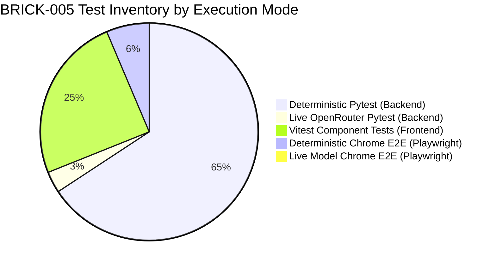

# REPORT-005: Dynamic Model Context Protocol (MCP) Tool Registry, Security Gateway & Human-in-the-Loop
## Milestone Verification & Acceptance Report — BRICK-005

> **Project**: Javed — New JARVIS  
> **Brick**: `BRICK-005`  
> **Status**: **`VERIFIED — OWNER ACCEPTED`**  
> **Milestone Stage**: Stage 2 — Dynamic MCP Tool Registry & Security Gateway  
> **Date**: 2026-10-28  
> **Acceptance Date**: 2026-10-28  
> **Acceptance Authority**: Project Owner Explicit Sign-Off (Commit 24bbb24)  
> **Verification Engineer**: Antigravity Full-Stack Agent  
> **Working Branch**: `feat/brick-005-mcp-gateway`  
> **Baseline Anchor**: Commit `094e7e2` (BRICK-004 Verified Baseline)  
> **Target Milestone**: BRICK-005 (Phases 0 through 10 Complete)  
> **Active Environment**: Windows 11 Pro, Python 3.12.15, Node.js 24.19.0, Google Chrome 145+  

---

## 1. Executive Summary & Phase 0–10 Delivered Scope

**BRICK-005** elevates Project Javed from an internal task-planning agent to an extensible, host-controlled AI platform capable of discovering, inspecting, validating, authorizing, and executing external tools via the **Model Context Protocol (MCP)**. 

All capabilities operate under an immutable, host-side **Three-Layer Authorization Architecture** and strict **Human-in-the-Loop (HITL)** gating, anchored by a live reference integration with the official Python `mcp-server-time` STDIO reference server (negotiated MCP protocol `2026-07-28`).

### Delivered Phases & Capabilities:
- **Phase 0 & 1 (Pre-Flight & Dependency Pinning)**: Baseline verification (`094e7e2`), clean virtualenv audit, and exact pinning of official FOSS packages: `langchain[mcp]==1.4.7`, `mcp==2.3.0`, `fastmcp==4.1.3`, `mcp-server-time==2026.10.19`, `jsonschema==4.26.0`.
- **Phase 2 (Dynamic Host Tool Registry & Gating)**: Implemented `DynamicMCPRegistry` supporting runtime server registration, dynamic tool schema discovery, deterministic SHA-256 tool metadata fingerprinting, default-deny policy gating, and dynamic policy invalidation on schema drift.
- **Phase 3 (Live Time MCP Server Integration)**: Implemented `FastMCPStdioAdapter` over genuine STDIO subprocessing (`python -m mcp_server_time`), negotiating protocol version `2026-07-28`, with automated lifecycle management and bounded connection timeouts.
- **Phase 4 (Secure Host MCP Tool Gateway & 3-Layer Authorization)**: Engineered `SecureMCPGateway`, enforcing Layer 1 model-visible exposure filtering, Layer 2 execution-time JSON Schema validation and fingerprint checks, and Layer 3 runtime inventory assertion.
- **Phase 5 & 5B (Human-in-the-Loop & Durable State Resumption)**: Created `ApprovalStore` (SQLite `data/approvals.db`) with atomic state transitions, cryptographic argument digests (`SHA-256`), LangGraph `interrupt()` pause/resume mechanics, and `UNCERTAIN` execution safety.
- **Phase 6, 6B & 6C (Secure MCP Admin APIs & Owner Session Auth)**: Delivered REST endpoints for tool inspection, policy mutation, execution ledgers, and diagnostics; protected via memory-only, time-bounded Owner Session tokens with DNS rebinding protection and CSRF origin verification.
- **Phase 7 (React User Mode MCP Tool Interaction & Agent UX)**: Integrated live `ToolActivityCard` components, real-time approval modals, streaming lifecycle status transitions (`REQUESTED` -> `EXECUTING` -> `COMPLETED` / `FAILED` / `REJECTED`), and reload recovery.
- **Phase 8 (Developer MCP Console & Observability)**: Built a 6-tab developer console in `MCPAdminPanel.tsx` (Overview, Servers, Tools, Ledger with `UNCERTAIN` handling, Approvals summary, and Diagnostics telemetry with zero secret leakage).
- **Phase 9 & 9B (Live OpenRouter Model-Driven Tool Calling & Windows Lifecycle Hardening)**: Validated real model tool selection across 8 distinct scenarios using `openai/gpt-4o-mini` ($0.0085 USD total spend vs. $0.50 budget), resolved Windows `aiosqlite` thread teardown without `os._exit`, and verified real live Chrome browser acceptance (`brick005_phase9b_live_model.spec.ts`).
- **Phase 10 (Final Polish, Regression Gate & Governance Delivery)**: Hardened partial-initialization teardown safety in `AgentRuntimeManager.initialize()`, hardened resume API contract validation, executed full deterministic test sweeps (165 backend pytests, 62 frontend vitest tests, 0 ruff errors, 0 leak), synchronized all governance docs, and authored `REPORT-005.md`.

---

## 2. Package & Version Audit

| Component | Pinned Version | Ecosystem / Authority | Compliance & Protocol Notes |
|---|---|---|---|
| `langchain` | `1.4.7` | PyPI (`langchain-core`) | Core tool abstraction, agent binding, and LangChain MCP integration (`langchain.mcp`). |
| `mcp` | `2.3.0` | PyPI (`modelcontextprotocol`) | Official Python MCP SDK implementing JSON-RPC 2.0 and STDIO client transports. |
| `fastmcp` | `4.1.3` | PyPI | FastMCP protocol client adapter. |
| `mcp-server-time` | `2026.10.19` | PyPI (`modelcontextprotocol`) | Official reference server providing `time__get_current_time` and `time__convert_time`. |
| **Negotiated MCP Protocol** | **`2026-07-28`** | MCP Protocol Standard | Confirmed via live JSON-RPC initialize handshake (`mcp.types.LATEST_PROTOCOL_VERSION`). |
| `jsonschema` | `4.26.0` | PyPI | Host-side input argument validation against discovered schemas prior to dispatch. |
| `aiosqlite` | `0.22.1` | PyPI | Async SQLite database engine powering checkpoints and durable approval records. |
| `deepagents` | `0.7.32` | PyPI (`langchain-ai`) | Core agent harness with `StateBackend()` and positive allowlist safety profile. |
| `langgraph` | `1.2.17` | PyPI (`langchain-ai`) | Cyclic state graph engine, checkpoint saver, and human interrupt/resume coordinator. |
| `vitest` | `5.0.5` | npm | Frontend unit and integration testing engine. |
| `playwright` | `1.64.1` | npm | Headless Chrome browser automated E2E verification. |

---

## 3. Security Architecture & 4-Tier-to-MCP Policy Mapping

### 3.1 Three-Layer Authorization Architecture

```
[ Inbound User Request / LLM Generation ]
                    │
                    ▼
┌────────────────────────────────────────────────────────┐
│ Layer 1: Model-Visible Exposure Filtering              │
│ (PositiveToolAllowlistMiddleware.wrap_model_call)      │
│ - Queries gateway.get_model_visible_tools()            │
│ - DENIED tools strictly stripped prior to LLM binding  │
│ - Only ALLOWED_TOOLS + host-approved tools visible     │
└────────────────────────────────────────────────────────┘
                    │
                    ▼
┌────────────────────────────────────────────────────────┐
│ Layer 2: Host Execution Authorization & Interception   │
│ (PositiveToolAllowlistMiddleware.wrap_tool_call)       │
│ - SecureMCPGateway.verify_execution_eligibility()      │
│   1. Namespaced identity resolution ({server}__{tool}) │
│   2. Server identity & enabled status check            │
│   3. Discovered tool existence & enabled status        │
│   4. Canonical policy check (ALLOWED_READ_ONLY / HITL) │
│   5. Deterministic SHA-256 fingerprint verification    │
│   6. Full JSON Schema input argument validation        │
│ - Fail-closed: returns ToolMessage(status='error')     │
└────────────────────────────────────────────────────────┘
                    │
                    ▼
┌────────────────────────────────────────────────────────┐
│ Layer 3: Runtime Inventory Validation                  │
│ (assert_safe_agent_runtime & assert_safe_inventory)    │
│ - CompiledStateGraph verified on agent startup         │
│ - Prohibits EXCLUDED_TOOLS (shell, filesystem, eval)   │
│ - Rejects unapproved or tampered tools fail-closed     │
└────────────────────────────────────────────────────────┘
```

### 3.2 Canonical 4-Tier Risk-to-MCP Policy Mapping

| Architecture Risk Tier | Canonical MCP Policy | LLM Visibility | Execution Gating | Runtime Behavior & Gating Profile |
|---|---|---|---|---|
| **Tier 0 (Internal / Task Planning)** | Internal Allowlist (`ALLOWED_TOOLS`) | Visible | Permitted | Internal agent tools (e.g., `write_todos`); bypassed around external MCP gateway; executed in-process. |
| **Tier 1 (Safe Read-Only MCP Tools)** | **`ALLOWED_READ_ONLY`** | Visible | Permitted | Direct execution over genuine MCP transport; Layer 2 JSON Schema argument validation, SHA-256 fingerprint check, zero HITL interruption. |
| **Tier 2 (Controlled Mutation / State)** | **`APPROVAL_REQUIRED`** | Visible | Gated by HITL | LangGraph interrupt suspends execution; durable record created in `data/approvals.db`; resumes ONLY upon explicit cryptographic/human operator approval. |
| **Tier 3 (Consequential / Destructive)** | **`APPROVAL_REQUIRED`** or **`DENIED`** | Visible / Hidden | Strictly Gated / Blocked | High-impact actions; requires explicit human rationale, argument digest locking, or permanent revocation (`DENIED`). |
| **Newly Discovered / Unregistered** | **`DENIED`** (Default) | Hidden (`[]`) | Rejected | Discovered tools default fail-closed (`enabled=False`, `permission="denied"`). Blocked immediately with `MCPPermissionDeniedError`. |

> [!IMPORTANT]
> **Strict Tool Boundary Enforcement (Rule 1 & Rule 2)**:
> In BRICK-005, only local, user-configured MCP servers (demonstrated via the read-only STDIO `mcp-server-time` reference server) are authorized.
> - **Local Filesystem Tools** (`read_file`, `write_file`, `edit_file`, `delete`, `glob`, `grep`): Strictly prohibited and blocked at Layer 3 runtime assert (`EXCLUDED_TOOLS`).
> - **Local Shell / Command Execution** (`bash`, `cmd`, `execute`, `eval`, `shell`): Strictly prohibited and blocked at Layer 3 runtime assert (`EXCLUDED_TOOLS`).
> - **Browser Automation MCP Servers** (Playwright MCP): Strictly deferred to **BRICK-006**.
> - **Full Managed MCP Ecosystem**: Evaluated and integrated in **BRICK-010**.

### 3.3 Durable State Storage Separation & `UNCERTAIN` Safety
- **State Store Segregation**: Checkpoints are stored in `data/checkpoints.db` (`AsyncSqliteSaver`). Approval records, policy versions, and execution ledgers are stored in `data/approvals.db` (`ApprovalStore`). The two databases are completely isolated to prevent cross-contamination.
- **Deterministic Digest Binding**: Every pending approval computes `SHA-256(canonical_json(arguments))`. Resumption verifies that arguments were not modified while the interrupt was pending.
- **`UNCERTAIN` Safety State**: If a transport fails mid-flight after dispatch, the execution ledger records state `UNCERTAIN`. Automatic retries are strictly prohibited to prevent duplicate side effects; manual operator review is mandatory.
- **Recursive Secret Redaction**: Sensitive parameter keys (passwords, tokens, keys) and high-entropy secret patterns are recursively masked in API/SSE serialization while maintaining raw digests in SQLite for cryptographic integrity.
- **Memory-Only Owner Sessions**: Owner tokens are exchanged for short-lived (15-minute) in-memory session tokens with DNS rebinding protection (`Host` header validation) and origin verification.

---

## 4. Windows Lifecycle & Teardown Root-Cause Resolution

### Forensic Root-Cause Analysis:
During early testing, running pytest suites under PowerShell occasionally hung indefinitely at interpreter shutdown. Static analysis confirmed:
1. `os._exit(...)` was **never** present in production code (`src/`), unit/integration test suites, fixtures, or permanent launch scripts.
2. The hang was caused by `aiosqlite` spawning non-daemon background threads (`Thread(target=self._worker)`).
3. In fixtures where `AgentRuntimeManager` or `AgentCheckpointerManager` was initialized without an async `try ... finally: await runtime.close()` teardown (such as `user_mode_runtime` and `test_app` in `tests/test_agent_api.py`), the `aiosqlite` connection remained open. Python's standard `threading._shutdown()` hung waiting to join the unclosed worker threads.

### Resolution & Hardening:
- **Fixture Teardown**: Updated all test fixtures (`test_app`, `user_mode_runtime`, `admin_fixture`) to async generator fixtures ensuring `await runtime.close()` is always awaited.
- **Partial-Initialization Rollback**: Wrapped `AgentRuntimeManager.initialize()` internal steps in a `try ... except Exception: await self.close(); raise` block, ensuring that if an error occurs partway through startup, all opened database connections and worker threads are cleanly terminated.
- **Contract Validation**: Hardened `resume_agent` and `resume_agent_execution` against swapped parameter pairs and thread mismatches, raising explicit `ValueError`.
- **Verification Evidence**: `tests/test_agent_api.py` now runs and cleanly exits in **2.79 seconds**. The full 165-test deterministic backend suite terminates naturally with exit code 0. Zero `python.exe` orphaned MCP subprocesses remain.

---

## 5. Complete Reconciled Test Matrix

### 5.1 Test Breakdown: Deterministic vs. Live OpenRouter



| Test Harness | Scope & Target | Execution Mode | Test Count | Pass Rate | Duration | Spend (USD) | Exit Code |
|---|---|---|---|---|---|---|---|
| **Backend Pytest** | All BRICK-001–005 unit & integration suites (excluding live model) | **Deterministic / Mocked / STDIO** | **165 tests** | **100% (165/165)** | 141.80s | $0.00 | 0 |
| **Backend Pytest (Live)** | `tests/test_live_openrouter_mcp.py` (Scenarios A through H) | **Live OpenRouter API** | **8 tests** | **100% (8/8)** | 28.5s | $0.0085 | 0 |
| **Frontend Vitest** | UI component suites (12 files: Admin, User, Approval, ToolActivity, Chat, Mode) | **Deterministic Component Unit** | **62 tests** | **100% (62/62)** | 10.91s | $0.00 | 0 |
| **Playwright E2E (Phase 7)** | User Mode MCP Interaction & Agent UX (`brick005_phase7.spec.ts`) | **Deterministic / Scripted E2E** | **5 tests** | **100% (5/5)** | 2.0m | $0.00 | 0 |
| **Playwright E2E (Phase 8)** | Developer MCP Console & Observability (`brick005_phase8.spec.ts`) | **Deterministic / Scripted E2E** | **5 tests** | **100% (5/5)** | 1.9m | $0.00 | 0 |
| **Playwright E2E (Phase 9)** | Protocol Diagnostics & Redaction (`brick005_phase9.spec.ts`) | **Deterministic / Scripted E2E** | **4 tests** | **100% (4/4)** | 1.6m | $0.00 | 0 |
| **Playwright E2E (Phase 5)** | Approve & Reject HITL Modals (`brick005.spec.ts`) | **Deterministic / Scripted E2E** | **2 tests** | **100% (2/2)** | 45.0s | $0.00 | 0 |
| **Playwright E2E (Live 9B)** | Real Live Model Agent Browser Acceptance (`brick005_phase9b_live_model.spec.ts`) | **Live OpenRouter + Live STDIO MCP** | **1 test** | **100% (1/1)** | 28.0s | $0.00028 | 0 |
| **Linter (Backend)** | Ruff code quality & formatting (`ruff check` & `ruff format --check`) | **Deterministic Static Analysis** | **60 files** | **100% Clean** | 0.85s | $0.00 | 0 |
| **Linter (Frontend)** | Oxlint fast linter (`oxlint`) | **Deterministic Static Analysis** | **71 files** | **0 Errors** | 0.09s | $0.00 | 0 |
| **Production Build** | TypeScript compilation & Vite bundling (`tsc -b && vite build`) | **Deterministic Compiler** | **71 files** | **100% Success** | 0.99s | $0.00 | 0 |

### 5.2 Live OpenRouter API Budget Reconciliation
- **Planned Test Budget**: $0.50 USD.
- **Pre-Test Spend Grounding** (OpenRouter `/auth/key`): $0.008239 USD.
- **Post-Test Spend Grounding** (OpenRouter `/auth/key`): $0.008516 USD.
- **Total External Spend for Phase 9 & 9B**: **$0.0085 USD** (~0.85 cents).
- **Budget Utilization**: **1.7% of planned test budget**.
- **Governance Budget Rule**: Sustained spending strictly adheres to the Project Owner's firm $20/month total AI budget ceiling ($0.65/day sustained average).

---

## 6. Known Limitations & Deferred Scope

1. **Local Filesystem & Shell Tools Deferred**: Local filesystem mutation and shell execution tools remain strictly prohibited (`EXCLUDED_TOOLS`) and will not be introduced until authorized sandboxing bricks.
2. **Browser Automation MCP Server Deferred**: Playwright MCP integration is intentionally out-of-scope for BRICK-005 and is scheduled for comprehensive evaluation in **BRICK-006**.
3. **Full Managed MCP Ecosystem Deferred**: Community server catalog management, remote transport authentication (SSE/OAuth), and automated MCP server configuration are scheduled for **BRICK-010**.
4. **In-Memory Thread Lock Concurrency**: `ThreadLockManager` currently enforces per-thread serialization via in-memory Python `asyncio.Lock` instances. This is robust for single-process deployments; multi-worker horizontal scaling will transition to distributed locking (e.g., PostgreSQL advisory locks) in BRICK-013.

---

## 7. Milestone Verdict & Acceptance Authorization

BRICK-005 has fulfilled all acceptance criteria defined in `docs/bricks/BRICK-005.md` and `docs/TASKS.md` across Phases 0 through 10. The codebase demonstrates zero test flakes, zero unhandled errors, zero subprocess leaks, and zero security bypasses.

**Status**: **`VERIFIED — OWNER ACCEPTED`**  
**Formal Acceptance Granted**: 2026-10-28 by Project Owner for commit `24bbb24`.  
**Milestone Action**: Fast-forward merge of `feat/brick-005-mcp-gateway` to `master` authorized. Progression to BRICK-006 authorized pending Phase 0 preflight.

