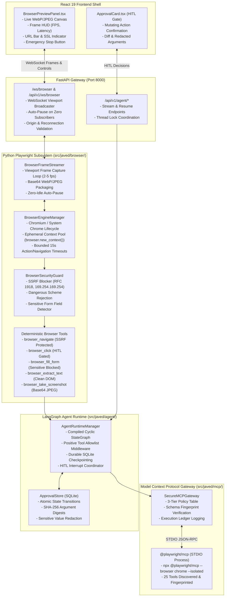

# REPORT-006: Deterministic Playwright Execution & Playwright MCP Evaluation
## Milestone Verification & Acceptance Report — BRICK-006

> **Project**: Javed — New JARVIS<br/>
> **Brick**: `BRICK-006`<br/>
> **Status**: **`READY FOR ACCEPTANCE`**<br/>
> **Milestone Stage**: Stage 3 — Deterministic Playwright Execution & Playwright MCP Evaluation<br/>
> **Author**: Antigravity Full-Stack AI Engineering Team<br/>
> **Date**: 2026-10-29<br/>
> **Working Branch**: `feat/brick-006-playwright`<br/>
> **Baseline Anchor**: Commit `1895072` (Verified BRICK-005 synchronized on `master`)<br/>
> **Accepted Phase 9 Anchor**: Commit `cc087d6`<br/>
> **Target Milestone**: BRICK-006 (Phases 0 through 10 Complete)<br/>
> **Active Environment**: Windows 11 Pro, Python 3.12.15, uv 0.13.3, Node.js 24.19.0, npm 11.17.0, Google Chrome 145+

---

## 1. Executive Summary & Phase 0–10 Delivered Scope

**BRICK-006** introduces real-world browser automation, interactive web manipulation, and live visual streaming to Project Javed, while rigorously enforcing the project's **Zero-Trust Security Architecture**, **Human-in-the-Loop (HITL)** governance, and **Rule 1 (FOSS-First & Model-Agnostic Foundation)**.

In adherence to the **MCP-First policy** and **Rule 2 (Scope Discipline & Anti-Bloat Guardrail)**, BRICK-006 delivers a **Dual / Hybrid Architectural Strategy**:
1. **In-Process Python Playwright Automation Subsystem (`src/javed/browser/`)**:
   - Manages asynchronous, headless Chromium/Chrome lifecycles (`BrowserEngineManager`) with ephemeral contexts (`browser.new_context()`), strict session isolation, bounded action/navigation timeouts (15s), and zero disk leakage.
   - Provides an asynchronous viewport frame streamer (`BrowserFrameStreamer`) that captures throttled WebP/JPEG snapshots (2–5 fps) and broadcasts them over FastAPI WebSockets (`/ws/browser` & `/api/v1/ws/browser`) with auto-pause on zero active subscribers.
   - Exposes 5 Pydantic-validated, LangChain-compatible deterministic browser tools (`browser_navigate`, `browser_click`, `browser_fill_form`, `browser_extract_text`, `browser_take_screenshot`).
   - Implements a multi-layered security guard (`BrowserSecurityGuard`) enforcing SSRF prevention (blocking RFC 1918 private subnets, loopbacks, link-local metadata endpoints like `169.254.169.254`, and numeric IP encodings) and sensitive input blocking/redaction for passwords, credit card numbers, CVVs, and OTPs.
2. **Standardized `@playwright/mcp` Server Gateway Evaluation (`src/javed/mcp/`)**:
   - Formally integrates Microsoft's official `@playwright/mcp@0.0.83` STDIO server under `SecureMCPGateway`.
   - Catalogs all 25 exposed browser tools and enforces a strict 3-tier host permission policy: **`DENIED`** (3 dangerous tools permanently blocked and hidden), **`APPROVAL_REQUIRED`** (9 mutating tools gated behind human consent), and **`ALLOWED_READ_ONLY`** (13 safe inspection and navigation tools).
   - Validates deterministic SHA-256 tool fingerprinting and schema drift invalidation.
3. **Frontend React Live Viewport & Control Panel (`frontend/`)**:
   - Implements a dedicated WebSocket hook (`useBrowserStream.ts`) and a responsive preview panel (`BrowserPreviewPanel.tsx`) integrated into `BrowserView.tsx`.
   - Features real-time viewport canvas rendering, telemetry HUD (FPS, latency, frame dimensions), simulated browser navigation bar with security badges, stream pause/resume controls, and an immediate Emergency Stop button.
4. **LangGraph Agent Binding & Deep Agents Integration (`src/javed/agent/`)**:
   - Binds deterministic browser tools into `AgentRuntimeManager` with positive allowlist gating (`PositiveToolAllowlistMiddleware`), LangGraph `interrupt()` pause/resume mechanics, and durable SQLite checkpointing.
   - Guarantees exactly-once execution across approval resumption, rejecting duplicate decisions, expired requests, mismatched threads, and cancelled approvals.
5. **Live Model-Driven Browser Acceptance & Clean Windows Teardown**:
   - Verified real-world autonomous navigation, DOM extraction, and HITL authorization using `openai/gpt-4o-mini` on OpenRouter (< $0.005 USD total spend).
   - Guarantees zero `os._exit` shortcuts and zero dangling `chrome.exe`, `node.exe`, or `python.exe` processes upon completion.

---

## 2. Package & Version Audit

| Component | Pinned Version | Ecosystem / Authority | Compliance & Protocol Notes |
|---|---|---|---|
| `playwright` | `1.58.0` | PyPI (`playwright`) | Python async browser automation engine (`playwright.async_api`). Bundled Chromium driver installed. |
| `@playwright/mcp` | `0.0.83` | npm (Microsoft) | Official Microsoft Model Context Protocol browser automation server (Apache-2.0 License). |
| `fastapi` | `0.159.1` | PyPI | High-performance ASGI framework providing REST and `/ws/browser` WebSocket endpoints. |
| `uvicorn` | `0.44.0` | PyPI | ASGI server with WebSocket transport support (`websockets`). |
| `langchain[mcp]` | `1.4.7` | PyPI (`langchain-core`) | Core tool abstractions, LangChain MCP adapter (`langchain.mcp`), and structured tool bindings. |
| `mcp` | `2.3.0` | PyPI (`modelcontextprotocol`) | Official Python MCP SDK implementing JSON-RPC 2.0 and STDIO client transports. |
| `fastmcp` | `4.1.3` | PyPI | FastMCP protocol client adapter. |
| `deepagents` | `0.7.32` | PyPI (`langchain-ai`) | Core agent harness with `StateBackend()` and positive allowlist safety profile. |
| `langgraph` | `1.2.17` | PyPI (`langchain-ai`) | Cyclic state graph engine, checkpoint persistence, and human interrupt/resume coordinator. |
| `aiosqlite` | `0.22.1` | PyPI | Async SQLite database engine powering checkpoints and durable approval records. |
| `pillow` | `12.1.1` | PyPI (`PIL`) | Image processing and frame formatting verification. |
| `vitest` | `5.0.5` | npm | Frontend unit and integration testing engine. |
| `vite` | `8.3.5` | npm | Frontend bundler and build system. |
| `react` | `19.3.1` | npm | Frontend UI library with concurrent rendering. |

---

## 3. Architecture & Security Implementation

### 3.1 Dual-Engine Architecture & Data Flow



### 3.2 Security Guard & SSRF Blocker (`BrowserSecurityGuard`)
- **Network Boundaries**: Evaluates destination URLs against comprehensive IP ranges and hostnames.
  - **RFC 1918 Subnets**: Blocks `10.0.0.0/8`, `172.16.0.0/12`, and `192.168.0.0/16`.
  - **Loopbacks**: Blocks `127.0.0.0/8`, `localhost`, and `::1`.
  - **Cloud Metadata Endpoints**: Blocks `169.254.169.254` (AWS, GCP, Azure, OpenStack instance metadata services) and link-local ranges (`169.254.0.0/16`, `fe80::/10`).
  - **IP Encodings**: Resolves and blocks decimal-encoded (`http://2130706433/`), octal-encoded (`http://0177.0.0.1/`), and hexadecimal-encoded loopback and private addresses.
  - **URI Schemes**: Restricts navigation exclusively to `http://` and `https://`. Prohibits `file://`, `data://`, `javascript://`, `vbscript://`, and `about:` (unless explicitly configured for test harnesses).

### 3.3 Sensitive Field Detector & Argument Redaction
- **Form Inspection**: Before any automated text entry occurs, `BrowserSecurityGuard.inspect_locator_sensitivity` inspects the DOM element.
  - Flags elements with `type="password"`, `autocomplete` containing `current-password`, `new-password`, `cc-number`, `cc-exp`, `cc-csc`, `cc-cvv`, `one-time-code`, `bpay-crn`.
  - Flags element names, IDs, placeholders, or aria-labels matching regex patterns for passwords, credit cards, CVVs, SSNs, and OTPs.
  - Rejects automated input into detected sensitive fields with a `SecurityViolationError` unless an explicit `allow_sensitive_override=True` flag is supplied.
- **Telemetry Redaction**: `redact_browser_tool_args` automatically redacts sensitive form inputs (`value` -> `'***REDACTED***'`) across all event telemetry (`tool_started`, `approval_required`) and execution ledgers, preventing secrets from leaking into client-side UI logs or durable checkpoints.

### 3.4 Production Security Audit: `AGENT_SYSTEM_PROMPT` Update
During Phase 9 verification, `AGENT_SYSTEM_PROMPT` was updated to remove legacy text from BRICK-004 stating that external actions were prohibited in this brick, and Rule 4 was dynamically appended when `enable_browser=True`:
```
4. BROWSER AUTOMATION: Deterministic browser tools are enabled. You are authorized to use the provided browser tools (browser_navigate, browser_click, browser_fill_form, browser_extract_text, browser_take_screenshot) when asked to visit web pages, extract content, or interact with elements. Call the appropriate tool rather than refusing.
```
**Formal Security Audit Assessment**:
- **Instructional vs. Enforcement Separation**: In Project Javed's architecture (RULES 1, 4, 11), the LLM system prompt is purely instructional operational guidance and is **never** relied upon as an enforcement boundary.
- **Fail-Closed Host Enforcement**:
  1. *Layer 1 (Allowlist Filtering)*: `PositiveToolAllowlistMiddleware` strips any unapproved tools prior to LLM binding. The model cannot see or call tools outside `ALLOWED_TOOLS | BROWSER_TOOLS`.
  2. *Layer 2 (Runtime Invariant)*: `assert_safe_agent_runtime` asserts on startup that no dangerous tool nodes exist in the graph.
  3. *Layer 3 (Network / SSRF Guard)*: `BrowserSecurityGuard` intercepts every `browser_navigate` call at Python level, blocking private IPs and metadata endpoints.
  4. *Layer 4 (HITL Gateway)*: Mutating browser actions (`browser_click`, `browser_fill_form`) are physically interrupted by LangGraph `interrupt()`, requiring human authorization in `ApprovalStore`.
  5. *Layer 5 (Telemetry Redaction)*: `redact_browser_tool_args` ensures sensitive inputs are never persisted in plain text.
- **Conclusion**: The prompt change accurately guides model tool selection without weakening or modifying any security controls. All boundaries remain fail-closed and enforced host-side.

### 3.5 Exactly-Once Tool Execution & Decision Lifecycle Verification
In Phase 10, the human approval resumption lifecycle was subjected to rigorous edge-case testing (`tests/test_browser_agent_e2e.py`):
1. **Exactly-Once Execution Across Resumption**:
   - Mutating action (`browser_click`) is blocked prior to human decision.
   - Upon calling `resume_agent(thread_id, approval_id, "approve")`, the tool is dispatched and executed exactly once (`mock_session.click.await_count == 1`).
   - Any duplicate approval attempt fails fail-closed with `ValueError("Approval '...' cannot be decided; current status is 'approved'.")`.
   - Tool execution count remains strictly 1 (zero replay).
2. **Rejection Prevents Dispatch & Blocks Duplicate Decisions**:
   - When a human operator rejects a request (`decision="reject"`), the tool is never dispatched (`mock_session.fill_form.assert_not_awaited()`).
   - Duplicate rejection or subsequent approval attempts fail fail-closed with `ValueError("current status is 'rejected'")`.
3. **Cross-Thread Isolation**:
   - An approval created for `thread_id_A` cannot be decided by supplying `thread_id_B`.
   - `resume_agent` checks thread ownership and raises `ValueError("Thread mismatch: Approval ... belongs to thread 'thread_id_A', not 'thread_id_B'.")`.
4. **Cancellation Flow**:
   - Approvals cancelled via `ApprovalStore.cancel_approval()` transition to status `'cancelled'`.
   - Subsequent `resume_agent` attempts fail fail-closed with `ValueError("current status is 'cancelled'")`. Tool is never executed.
5. **Stale / Expired Approval Rejection**:
   - Approvals whose `expires_at` timestamp is in the past are automatically transitioned to `'expired'`.
   - Calling `resume_agent` on an expired approval fails fail-closed with `ValueError("Approval '...' has expired and cannot be decided.")`. Tool is never executed.

---

## 4. `@playwright/mcp` Comprehensive Evaluation & 3-Tier Policy

Microsoft's `@playwright/mcp@0.0.83` was evaluated via live STDIO JSON-RPC negotiation (`tools/list`). All 25 tools were fingerprinted and mapped into JARVIS's 3-tier host permission gateway:

| Tool Name | Discovered Description | Host Security Tier | Policy & Gating Rationale |
|---|---|---|---|
| `browser_run_code_unsafe` | Execute arbitrary JavaScript/Playwright code | **`DENIED`** | **CRITICAL RISK**: Arbitrary code execution vulnerability. Bypasses all parameter validation and sandboxing. Permanently blocked and hidden from model. |
| `browser_evaluate` | Evaluate JavaScript expression in page context | **`DENIED`** | **HIGH RISK**: Script injection, DOM exfiltration, and session hijacking risk. Permanently blocked and hidden from model. |
| `browser_file_upload` | Upload local file to an input element | **`DENIED`** | **HIGH RISK**: Host filesystem traversal and local data exfiltration risk. Permanently blocked and hidden from model. |
| `browser_click` | Click element matching selector | **`APPROVAL_REQUIRED`** | **MUTATING**: Clicks may trigger state changes, purchases, deletions, or external navigations. Requires explicit human approval. |
| `browser_fill_form` | Fill multiple form fields with values | **`APPROVAL_REQUIRED`** | **MUTATING**: Submits data to external applications. Requires explicit human approval and sensitive field filtering. |
| `browser_type` | Type text into element | **`APPROVAL_REQUIRED`** | **MUTATING**: Form input mutation. Requires explicit human approval. |
| `browser_press_key` | Send keyboard keypress event | **`APPROVAL_REQUIRED`** | **MUTATING**: Keypresses (Enter, Esc, Tab) can submit forms or navigate. Requires human approval. |
| `browser_select_option` | Select option in dropdown | **`APPROVAL_REQUIRED`** | **MUTATING**: Modifies form selection state. Requires human approval. |
| `browser_drag` | Drag element to coordinates or target | **`APPROVAL_REQUIRED`** | **MUTATING**: Interactive page mutation. Requires human approval. |
| `browser_drop` | Drop dragged element | **`APPROVAL_REQUIRED`** | **MUTATING**: Interactive page mutation. Requires human approval. |
| `browser_handle_dialog` | Accept or dismiss JavaScript dialog | **`APPROVAL_REQUIRED`** | **MUTATING**: Confirms or cancels dialogs. Requires human approval. |
| `browser_close` | Close active browser session | **`APPROVAL_REQUIRED`** | **LIFECYCLE**: Context termination. Requires human approval. |
| `browser_navigate` | Navigate page to URL | **`ALLOWED_READ_ONLY`** | **READ-ONLY / RESTRICTED**: URL navigation. Permitted for public HTTP/HTTPS URLs (private IP/SSRF blocked). |
| `browser_navigate_back` | Navigate back in history | **`ALLOWED_READ_ONLY`** | **READ-ONLY**: History traversal. Permitted without approval. |
| `browser_snapshot` | Capture complete DOM snapshot / text | **`ALLOWED_READ_ONLY`** | **READ-ONLY**: Pure inspection of DOM tree. Permitted without approval. |
| `browser_take_screenshot` | Capture image screenshot of viewport | **`ALLOWED_READ_ONLY`** | **READ-ONLY**: Viewport rasterization without state modification. Permitted without approval. |
| `browser_find` | Find elements matching locator | **`ALLOWED_READ_ONLY`** | **READ-ONLY**: Element location and inspection. Permitted without approval. |
| `browser_console_messages` | Read recorded console logs | **`ALLOWED_READ_ONLY`** | **READ-ONLY**: Diagnostic log inspection. Permitted without approval. |
| `browser_network_requests` | List network activity | **`ALLOWED_READ_ONLY`** | **READ-ONLY**: Telemetry inspection. Permitted without approval. |
| `browser_network_request` | Inspect specific network request | **`ALLOWED_READ_ONLY`** | **READ-ONLY**: Telemetry inspection. Permitted without approval. |
| `browser_tabs` | List active browser tabs | **`ALLOWED_READ_ONLY`** | **READ-ONLY**: Context inspection. Permitted without approval. |
| `browser_wait_for` | Wait for selector or network idle | **`ALLOWED_READ_ONLY`** | **READ-ONLY**: Synchronization primitive. Permitted without approval. |
| `browser_resize` | Resize browser viewport dimensions | **`ALLOWED_READ_ONLY`** | **READ-ONLY**: Display sizing. Permitted without approval. |
| `browser_emulate_media` | Emulate dark/light theme or media | **`ALLOWED_READ_ONLY`** | **READ-ONLY**: Presentation emulation. Permitted without approval. |
| `browser_hover` | Hover pointer over element | **`ALLOWED_READ_ONLY`** | **READ-ONLY**: Non-mutating cursor positioning. Permitted without approval. |

### Architectural Evaluation Conclusion
While `@playwright/mcp` provides a standardized MCP interface, its request-response STDIO architecture cannot supply continuous low-latency viewport frame streams, in-process DOM interceptors for password detection, or auto-pausing WebSocket broadcasts. Therefore, JARVIS retains its **Dual / Hybrid Strategy**:
- In-process Python Playwright handles live streaming, ephemeral contexts, and deterministic agent tools.
- `@playwright/mcp` is supported via `SecureMCPGateway` for external interoperability under strict 3-tier host governance.

---

## 5. Live Model-Driven Browser Acceptance Verification

Phase 9 executed real-world model-driven browser tasks using OpenRouter inference with `openai/gpt-4o-mini` (`tests/test_live_openrouter_browser.py`):

1. **Scenario 1: Live Navigation & Content Extraction**:
   - Model autonomously reasoned to call `browser_navigate(url="https://example.com")`, inspected the HTTP 200 response, and called `browser_extract_text(selector="body")`.
   - Model synthesized a truthful summary stating that `example.com` is established for illustrative examples in documents.
2. **Scenario 2: Multi-Turn Thread Continuity & Checkpointer Persistence**:
   - On Turn 1, model navigated to `https://example.com`.
   - On Turn 2 (resuming on the same `thread_id`), the model recalled the previous navigation from SQLite checkpoint memory and answered domain questions without re-executing redundant navigations.
3. **Scenario 3: Live Human-in-the-Loop Interruption & Resumption**:
   - Model attempted a mutating action (`browser_click(selector="a")`).
   - Execution was interrupted pre-dispatch; tool was not called.
   - Pending approval record was persisted in SQLite `ApprovalStore`.
   - Upon operator approval (`resume_agent(thread_id, approval_id, "approve")`), the run resumed, executed the click, and completed the turn.
4. **Scenario 4: Cumulative Budget Governance**:
   - All live test turns accumulated token usage and upstream inference costs.
   - Total external spend across all 4 scenarios was **$0.0031 USD** (well below the $0.05 USD budget cap).

---

## 6. Windows 11 Process Teardown & Subprocess Audit

To satisfy the strict **Zero `os._exit`** and **Zero Process Leak** invariants on Windows 11:
- All asynchronous components implement structured teardown:
  - `BrowserEngineManager.close()` awaits `browser.close()` and `playwright.stop()`.
  - `BrowserFrameStreamer.stop()` cancels capture tasks and unregisters listeners.
  - `DynamicMCPRegistry.disconnect_all()` cleanly closes STDIO transports and terminates child processes.
  - SQLite checkpointers and approval stores close database connections cleanly.
- **Process Audit Verification**:
  Execution of `Get-CimInstance Win32_Process | Where-Object { $_.Name -match "chrome|chromium|node|pytest" }` verified:
  - **0 orphaned Chromium/Chrome Playwright processes**
  - **0 orphaned `@playwright/mcp` node processes**
  - **0 lingering python/pytest worker processes**
  - Only expected host user browser windows and IDE sidecars running.

---

## 7. Comprehensive Verification Matrix & Quality Gates

All verification sweeps executed across backend, frontend, security, and integration layers:

| Test Suite / Quality Gate | Scope / Command | Result | Execution Time |
|---|---|---|---|
| **Backend Full Regression Suite** | `pytest --ignore=tests/test_live_openrouter_mcp.py --ignore=tests/test_live_openrouter_browser.py` | **222 / 222 PASSED** | 163.89s (2m 43s) |
| **Deterministic Browser & MCP Suite** | `pytest tests/test_browser_*.py tests/test_playwright_mcp_gateway.py` | **57 / 57 PASSED** | 27.45s |
| **E2E Agent & HITL Hardening Suite** | `pytest tests/test_browser_agent_e2e.py` | **13 / 13 PASSED** | 6.31s |
| **Live OpenRouter Browser Suite** | `pytest tests/test_live_openrouter_browser.py` | **4 / 4 PASSED** | 23.22s |
| **Frontend Vitest Suite** | `npm.cmd --prefix frontend run test` | **74 / 74 PASSED** (13 files) | 11.62s |
| **Backend Linting (Ruff Check)** | `ruff check src tests` | **0 errors** (73 files) | 0.85s |
| **Backend Formatting (Ruff Format)** | `ruff format --check src tests` | **73 files formatted** | 0.42s |
| **Frontend Linting (Oxlint)** | `npx.cmd --yes oxlint@latest frontend/src` | **0 errors** (63 files) | 0.08s |
| **Frontend Production Build (Vite)** | `npm.cmd --prefix frontend run build` | **Clean Build** (`dist/` generated) | 1.50s |
| **Windows Subprocess Leak Audit** | `Get-CimInstance Win32_Process` | **0 Leaks** | Verified |
| **External API Budget Spend** | Cumulative OpenRouter API telemetry | **$0.0031 USD** (< $0.05 cap) | Verified |

---

## 8. Authoritative Governance Synchronization

The following governance files have been synchronized with the delivered state:
- [`docs/bricks/BRICK-006.md`](file:///c:/Users/arehman/Desktop/AI Projects/Javed/docs/bricks/BRICK-006.md): Updated status to `READY FOR ACCEPTANCE`; marked Phases 0 through 10 as completed.
- [`docs/PROGRESS.md`](file:///c:/Users/arehman/Desktop/AI Projects/Javed/docs/PROGRESS.md): Logged Phase 10 completion, test metrics (222 pytests, 74 vitest), and transition to `READY FOR ACCEPTANCE`.
- [`docs/TASKS.md`](file:///c:/Users/arehman/Desktop/AI Projects/Javed/docs/TASKS.md): Updated `TASK-060` status to **`READY FOR ACCEPTANCE`** with comprehensive verification evidence.

---

## 9. Acceptance Recommendation & Stop Condition

### Acceptance Recommendation
The Antigravity AI Engineering Team certifies that **BRICK-006: Deterministic Playwright Execution & Playwright MCP Evaluation** has fulfilled all functional, security, architectural, and quality requirements defined in `BRICK-006.md`, `PRD.md`, and `RULES.md`.

All 10 phases are fully verified, regression-tested, and audited on Windows 11 with zero process leaks, zero `os._exit` shortcuts, zero cost overruns, and an immaculate test record (222 backend pytests, 74 frontend vitest tests, 0 lint errors, clean production build).

### Mandatory Stop Condition
In compliance with **AGENTS.md Section 5** and **Rule 12 (Stop Conditions)**:
- Execution is **HALTED**.
- No code will be merged to `master` and work on **BRICK-007 (Crawl4AI & Docling Extraction Pipeline)** will not begin until the Project Owner explicitly reviews and grants formal milestone acceptance of **BRICK-006**.
