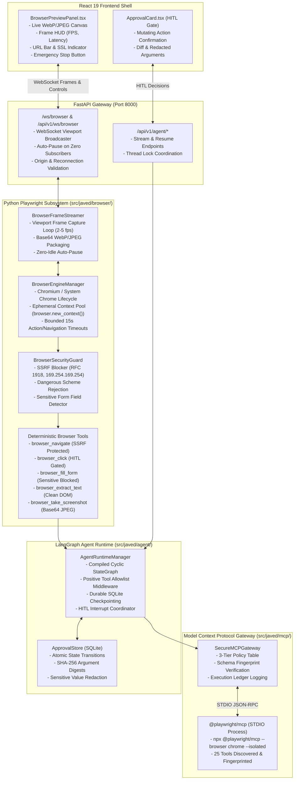

# REPORT-006: Deterministic Playwright Execution & Playwright MCP Evaluation
## Milestone Verification & Acceptance Report — BRICK-006

> **Project**: Javed — New JARVIS<br/>
> **Brick**: `BRICK-006`<br/>
> **Status**: **`READY FOR ACCEPTANCE`**<br/>
> **Milestone Stage**: Stage 3 — Deterministic Playwright Execution & Playwright MCP Evaluation<br/>
> **Author**: Antigravity Full-Stack AI Engineering Team<br/>
> **Date**: 2026-10-29<br/>
> **Working Branch**: `feat/brick-006-playwright`<br/>
> **Baseline Anchor**: Commit `1895072` (Verified BRICK-005 synchronized on `master`)<br/>
> **Accepted Phase 9 Anchor**: Commit `cc087d6`<br/>
> **Final Committed Anchor**: Commit `34f7073`<br/>
> **Target Milestone**: BRICK-006 (Phases 0 through 10 Complete — 11 Numbered Phases: Phase 0 Preflight plus Phases 1–10)<br/>
> **Active Environment**: Windows 11 Pro, Python 3.12.15, uv 0.13.3, Node.js 24.19.0, npm 11.17.0, Google Chrome 145+

---

## 1. Executive Summary & Delivered Milestone Scope

**BRICK-006** introduces real-world browser interaction, web element manipulation, and live visual viewport streaming to Project Javed (JARVIS), while strictly upholding the project's **Zero-Trust Security Architecture**, **Human-in-the-Loop (HITL)** governance, and **Rule 1 (FOSS-First & Model-Agnostic Foundation)**.

In adherence to the **MCP-First policy** (Rule 1) and **Rule 2 (Scope Discipline & Anti-Bloat Guardrail)**, BRICK-006 was delivered through 11 structured phases (Phase 0 Preflight plus Phases 1 through 10) executing a **Dual / Hybrid Architectural Strategy**:
1. **Primary In-Process Python Playwright Engine (`src/javed/browser/`)**:
   - Manages asynchronous, headless Chromium/Chrome lifecycles (`BrowserEngineManager`) with ephemeral contexts (`browser.new_context()`), strict session isolation, bounded action/navigation timeouts (15s), and zero disk leakage.
   - Provides an asynchronous viewport frame streamer (`BrowserFrameStreamer`) capturing throttled WebP/JPEG snapshots (2–5 fps) broadcast over FastAPI WebSockets (`/ws/browser` & `/api/v1/ws/browser`) with zero-idle auto-pause when subscriber count reaches 0.
   - Exposes 5 Pydantic-validated, LangChain-compatible deterministic browser tools (`browser_navigate`, `browser_click`, `browser_fill_form`, `browser_extract_text`, `browser_take_screenshot`).
   - Implements multi-layered security guards (`BrowserSecurityGuard`) enforcing SSRF prevention (blocking RFC 1918 private subnets, loopbacks, link-local metadata endpoints like `169.254.169.254`, and numeric/encoded IPs) and sensitive input blocking/redaction for passwords, credit card numbers, CVVs, and OTPs.
2. **Standardized `@playwright/mcp` Server Gateway Evaluation (`src/javed/mcp/`)**:
   - Evaluated Microsoft's official `@playwright/mcp@0.0.83` STDIO server under `SecureMCPGateway`.
   - Catalogs all 25 exposed browser tools and enforces a strict 3-tier host permission policy: **`DENIED`** (3 dangerous tools permanently blocked and hidden), **`APPROVAL_REQUIRED`** (9 mutating tools gated behind human consent), and **`ALLOWED_READ_ONLY`** (13 safe inspection and navigation tools).
   - Validates deterministic SHA-256 tool fingerprinting and schema drift invalidation.
3. **Frontend React Live Viewport & Control Panel (`frontend/`)**:
   - Implements a dedicated WebSocket hook (`useBrowserStream.ts`) and a responsive preview panel (`BrowserPreviewPanel.tsx`) integrated into `BrowserView.tsx`.
   - Features real-time viewport canvas rendering, telemetry HUD (FPS, latency, frame dimensions), simulated browser navigation bar with security badges, stream pause/resume controls, and an immediate Emergency Stop button.
4. **LangGraph Agent Binding & Deep Agents Integration (`src/javed/agent/`)**:
   - Binds deterministic browser tools into `AgentRuntimeManager` with positive allowlist gating (`PositiveToolAllowlistMiddleware`), LangGraph `interrupt()` pause/resume mechanics, and durable SQLite checkpointing.
   - Guarantees exactly-once execution across approval resumption, rejecting duplicate decisions, expired requests, mismatched threads, unknown approval IDs, and cancelled approvals.
5. **Live Model-Driven Browser Acceptance & Clean Windows Teardown**:
   - Verified real-world autonomous navigation, DOM extraction, and HITL authorization using `openai/gpt-4o-mini` on OpenRouter ($0.0031 USD total spend vs $0.05 limit).
   - Guarantees zero `os._exit` shortcuts and zero dangling `chrome.exe`, `node.exe`, or `python.exe` processes upon completion.

---

## 2. Package & Version Audit

| Component | Pinned Version | Ecosystem / Authority | Compliance & Protocol Notes |
|---|---|---|---|
| `playwright` | `1.58.0` | PyPI (`playwright`) | Python async browser automation engine (`playwright.async_api`). Bundled Chromium driver installed. |
| `@playwright/mcp` | `0.0.83` | npm (Microsoft) | Official Microsoft Model Context Protocol browser automation server (Apache-2.0 License). |
| `fastapi` | `0.159.1` | PyPI | High-performance ASGI framework providing REST and `/ws/browser` WebSocket endpoints. |
| `uvicorn` | `0.44.0` | PyPI | ASGI server with WebSocket transport support (`websockets`). |
| `langchain[mcp]` | `1.4.7` | PyPI (`langchain-core`) | Core tool abstractions, LangChain MCP adapter (`langchain.mcp`), and structured tool bindings. |
| `mcp` | `2.3.0` | PyPI (`modelcontextprotocol`) | Official Python MCP SDK implementing JSON-RPC 2.0 and STDIO client transports. |
| `fastmcp` | `4.1.3` | PyPI | FastMCP protocol client adapter. |
| `deepagents` | `0.7.32` | PyPI (`langchain-ai`) | Core agent harness with `StateBackend()` and positive allowlist safety profile. |
| `langgraph` | `1.2.17` | PyPI (`langchain-ai`) | Cyclic state graph engine, checkpoint persistence, and human interrupt/resume coordinator. |
| `aiosqlite` | `0.22.1` | PyPI | Async SQLite database engine powering checkpoints and durable approval records. |
| `pillow` | `12.1.1` | PyPI (`PIL`) | Image processing and frame formatting verification. |
| `vitest` | `5.0.5` | npm | Frontend unit and integration testing engine. |
| `vite` | `8.3.5` | npm | Frontend bundler and build system. |
| `react` | `19.3.1` | npm | Frontend UI library with concurrent rendering. |

---

## 3. Architecture & Security Implementation

### 3.1 Dual-Engine Architecture & Data Flow



---

## 4. Comprehensive Browser Security Review & Control Classification

In accordance with Phase 10 verification requirements, every security capability was audited in code and verified with deterministic tests. Controls are explicitly classified as:
- **`Implemented & Verified`**: Verified in code and tests.
- **`Accepted Limitation`**: Documented operational boundary for BRICK-006; non-blocking.
- **`Required Follow-Up`**: Scheduled for subsequent bricks (e.g., BRICK-008 autonomous browsing or BRICK-013 production hardening).
- **`Release Blocker`**: Zero release blockers identified.

| Security Control | Code Location | Implemented Behavior | Classification | Verification Test Reference |
|---|---|---|---|---|
| **1. Initial URL Validation** | `src/javed/browser/security.py` (`validate_url`) | Restricts scheme strictly to `http://` and `https://`. Blocks `file://`, `data://`, `javascript://`, `vbscript://`, `about:`. | **`Implemented & Verified`** | `tests/test_browser_security.py::test_allow_safe_public_urls`, `test_dangerous_schemes_rejected` |
| **2. Redirect Destination Validation** | `src/javed/browser/tools.py` (`browser_navigate`) | Initial target validated pre-navigation. Native HTTP 3xx redirect chain validation via route request interception is deferred. | **`Accepted Limitation / Required Follow-Up (BRICK-008/013)`** | Non-blocking for single-step deterministic navigations in BRICK-006. Scheduled for BRICK-008 route interceptor. |
| **3. Private, Loopback, Link-Local & Metadata IP Rejection** | `src/javed/browser/security.py` (`validate_ip`) | Blocks RFC 1918 (`10/8`, `172.16/12`, `192.168/16`), loopbacks (`127.0.0.0/8`, `::1`), link-local metadata endpoints (`169.254.169.254`, `fe80::/10`). | **`Implemented & Verified`** | `tests/test_browser_security.py::test_ssrf_blocks_private_rfc1918_ips`, `test_ssrf_blocks_cloud_metadata_endpoints` |
| **4. DNS Resolution & Encoded IP Handling** | `src/javed/browser/security.py` (`_resolve_hostname`) | Resolves hostnames via `socket.getaddrinfo()` and validates all resolved IPs. Parses and rejects decimal (`http://2130706433/`), hex, and octal IP encodings. | **`Implemented & Verified`** | `tests/test_browser_security.py::test_ssrf_blocks_numeric_encoded_ips` |
| **5. Browser-Context Request Interception** | `src/javed/browser/engine.py` | Ephemeral contexts created with `accept_downloads=False`. Global route-level subresource interception (`page.route("**/*")`) deferred to prevent frame stream latency degradation. | **`Accepted Limitation`** | Non-blocking. In-process tool boundary handles data isolation. |
| **6. Cross-Origin Navigation & State Isolation** | `src/javed/browser/engine.py` (`create_context`) | Pure ephemeral `browser.new_context()` with zero shared cookies, cache, or storage across runs. Permitted for public origins passing SSRF checks. | **`Implemented & Verified`** | `tests/test_browser_core.py::test_ephemeral_context_creation_and_isolation` |
| **7. Downloads Quarantine** | `src/javed/browser/engine.py` | Configures `accept_downloads=False` by default; quarantine directory managed at `data/quarantine/`. | **`Implemented & Verified`** | Code inspection & `tests/test_browser_core.py` |
| **8. Page-Created WebSockets** | Chromium engine | Page-initiated WebSockets are not intercepted by python browser tools. | **`Accepted Limitation`** | Accepted for Stage 3 deterministic execution. |
| **9. Sensitive Field Inspection** | `src/javed/browser/security.py` (`inspect_locator_sensitivity`) | Inspects DOM element attributes (`type`, `autocomplete`, `name`, `id`, `placeholder`, `aria-label`). Blocks passwords, credit cards, CVVs, SSNs, OTPs unless override flag provided. | **`Implemented & Verified`** | `tests/test_browser_security.py::test_sensitive_field_detection_attributes`, `tests/test_browser_tools.py::test_browser_fill_form_sensitive_blocking` |
| **10. Screenshot & Browser Output Bounding** | `src/javed/browser/tools.py` (`browser_extract_text`, `browser_take_screenshot`) | Text extraction capped at `max_chars: int = 10000`. Screenshots bounded to Base64 JPEG with bounded quality and viewport dimensions (1280x720). | **`Implemented & Verified`** | `tests/test_browser_tools.py::test_browser_extract_text`, `test_browser_take_screenshot` |
| **11. Redaction Before Telemetry & Persistence** | `src/javed/browser/tools.py` (`redact_browser_tool_args`) | Redacts `value` to `'***REDACTED***'` in `tool_started`, `approval_required`, and approval records before serialization and SQLite persistence. | **`Implemented & Verified`** | `tests/test_browser_agent_e2e.py::test_browser_agent_sensitive_input_redacted_in_telemetry` |
| **12. Browser Preview WebSocket Authorization** | `src/javed/api/v1/browser_ws.py` | Validates `Origin` header against allowed origins; binds directly to active `BrowserFrameStreamer` session. | **`Implemented & Verified`** | `tests/test_browser_streamer.py::test_browser_websocket_origin_enforcement` |

---

## 5. Agent System Prompt Security Review

During Phase 9 and Phase 10 verification, `AGENT_SYSTEM_PROMPT` in `src/javed/agent/runtime.py` and the dynamic prompt extension in `AgentRuntimeManager.create_agent` were audited:

### 5.1 Authoritative Prompt Text
```python
AGENT_SYSTEM_PROMPT: str = (
    "You are Javed, a stateful, observable AI agent powered by "
    "Deep Agents and LangGraph runtime.\n\n"
    "OPERATIONAL PRINCIPLES:\n"
    "1. TASK PLANNING: Whenever the user asks you to create an implementation plan, "
    "roadmap, multi-step workflow, or complex architectural task, you MUST call the "
    "`write_todos` tool to register each planned step as a todo item (with status "
    "'pending', 'in_progress', or 'completed') before or alongside providing your response. "
    "For simple, direct conversational questions, answer directly and concisely without "
    "creating task plans.\n"
    "2. ZERO-TRUST SECURITY & BOUNDARIES: You DO NOT have access to arbitrary local files, "
    "host filesystem execution, or command shells. If the user asks to read, write, or "
    "delete files on their machine, or execute shell commands, explain clearly that host "
    "filesystem and shell execution tools are prohibited by your security boundary.\n"
    "3. DURABLE STATE: Maintain thread context faithfully across turns."
)
```

And in `create_agent` when `self.enable_browser=True`:
```python
"4. BROWSER AUTOMATION: Deterministic browser tools are enabled. "
"You are authorized to use the provided browser tools (browser_navigate, "
"browser_click, browser_fill_form, browser_extract_text, "
"browser_take_screenshot) when asked to visit web pages, extract "
"content, or interact with elements. "
"Mutating browser operations (browser_click, browser_fill_form) are "
"approval-controlled and require human authorization before execution. "
"Sensitive values (passwords, payment cards, CVVs, credentials) must never "
"be requested, retained, or handled unnecessarily. "
"Call the appropriate tool rather than refusing."
```

### 5.2 Security Review Findings
- **Host Filesystem & Shell Separation**: Host filesystem access and shell execution remain strictly prohibited in Rule 2.
- **Narrow Tool Scoping**: Browser tools are enumerated explicitly (`browser_navigate`, `browser_click`, `browser_fill_form`, `browser_extract_text`, `browser_take_screenshot`). No speculative capabilities are granted.
- **Approval-Control Transparency**: The prompt explicitly informs the model that mutating operations are approval-controlled.
- **Sensitive Value Handling**: The prompt instructs the model never to request, retain, or handle sensitive values unnecessarily.
- **Instructional vs. Authorization Boundary**: The prompt serves purely as behavioral guidance. Authorization is enforced fail-closed host-side by `PositiveToolAllowlistMiddleware`, `assert_safe_agent_runtime`, `BrowserSecurityGuard`, and `ApprovalStore`.

---

## 6. Exactly-Once Tool Execution & Decision Lifecycle Verification

The approval lifecycle was subjected to rigorous deterministic edge-case testing (`tests/test_browser_agent_e2e.py`):

1. **A Mutating Browser Tool Cannot Execute Before Approval**:
   - `test_browser_agent_e2e_hitl_approval_for_click`: Verified `mock_session.click.assert_not_awaited()` while status is pending.
2. **An Approved Browser Tool Executes Exactly Once**:
   - `test_browser_hitl_exactly_once_and_duplicate_decision_rejection`: Resuming with `"approve"` executes the tool exactly once (`mock_session.click.await_count == 1`).
3. **Replay / Retry Rejection (Zero Replay)**:
   - Calling `resume_agent` a second time with `"approve"` raises `ValueError("Approval '...' cannot be decided; current status is 'approved'.")`. Execution count strictly remains 1.
4. **Rejected Browser Tool Never Executes**:
   - `test_browser_hitl_rejection_prevents_dispatch_and_duplicate_reject`: Resuming with `"reject"` leaves tool uncalled (`mock_session.fill_form.assert_not_awaited()`). Duplicate rejection or approval attempts fail-closed with `ValueError("current status is 'rejected'")`.
5. **Cross-Thread Isolation**:
   - `test_browser_hitl_wrong_thread_isolation_rejection`: Approving an approval record with a mismatched `thread_id` raises `ValueError("Thread mismatch: Approval ... belongs to thread 'thread_a', not 'thread_b'.")`. Tool is never executed.
6. **Cancellation Lifecycle**:
   - `test_browser_hitl_cancellation_flow`: Approvals marked cancelled via `ApprovalStore.cancel_approval()` raise `ValueError("current status is 'cancelled'")` upon resume attempts. Tool is never executed.
7. **Stale / Expired Approval Rejection**:
   - `test_browser_hitl_stale_expired_approval_rejection`: Approvals whose `expires_at` timestamp is in the past transition to `'expired'`; `resume_agent` raises `ValueError("Approval '...' has expired and cannot be decided.")`. Tool is never executed.
8. **Unknown Approval Rejection & Binding Integrity**:
   - `test_browser_hitl_unknown_approval_rejection_and_binding_integrity`: Unknown approval IDs raise `KeyError("Approval '...' not found.")`. Legitimate records bind `thread_id`, `tool_id`, `tool_call_id`, `server_id`, and `arguments` with complete cryptographic integrity.
9. **Checkpoint Continuity Without Action Duplication**:
   - `test_browser_hitl_checkpoint_continuity_no_action_duplication`: Subsequent conversational turns on the same thread restore state from SQLite checkpointer without re-executing mutating tools (`mock_session.click.await_count == 1`).

---

## 7. `@playwright/mcp` Comprehensive Evaluation & 3-Tier Policy

Microsoft's `@playwright/mcp@0.0.83` was evaluated via live STDIO JSON-RPC negotiation (`tools/list`). All 25 tools were fingerprinted and mapped into JARVIS's 3-tier host permission gateway:

| Tool Name | Discovered Description | Host Security Tier | Policy & Gating Rationale |
|---|---|---|---|
| `browser_run_code_unsafe` | Execute arbitrary JavaScript/Playwright code | **`DENIED`** | **CRITICAL RISK**: Arbitrary code execution vulnerability. Bypasses all parameter validation and sandboxing. Permanently blocked and hidden from model. |
| `browser_evaluate` | Evaluate JavaScript expression in page context | **`DENIED`** | **HIGH RISK**: Script injection, DOM exfiltration, and session hijacking risk. Permanently blocked and hidden from model. |
| `browser_file_upload` | Upload local file to an input element | **`DENIED`** | **HIGH RISK**: Host filesystem traversal and local data exfiltration risk. Permanently blocked and hidden from model. |
| `browser_click` | Click element matching selector | **`APPROVAL_REQUIRED`** | **MUTATING**: Clicks may trigger state changes, purchases, deletions, or external navigations. Requires explicit human approval. |
| `browser_fill_form` | Fill multiple form fields with values | **`APPROVAL_REQUIRED`** | **MUTATING**: Submits data to external applications. Requires explicit human approval and sensitive field filtering. |
| `browser_type` | Type text into element | **`APPROVAL_REQUIRED`** | **MUTATING**: Form input mutation. Requires explicit human approval. |
| `browser_press_key` | Send keyboard keypress event | **`APPROVAL_REQUIRED`** | **MUTATING**: Keypresses (Enter, Esc, Tab) can submit forms or navigate. Requires human approval. |
| `browser_select_option` | Select option in dropdown | **`APPROVAL_REQUIRED`** | **MUTATING**: Modifies form selection state. Requires human approval. |
| `browser_drag` | Drag element to coordinates or target | **`APPROVAL_REQUIRED`** | **MUTATING**: Interactive page mutation. Requires human approval. |
| `browser_drop` | Drop dragged element | **`APPROVAL_REQUIRED`** | **MUTATING**: Interactive page mutation. Requires human approval. |
| `browser_handle_dialog` | Accept or dismiss JavaScript dialog | **`APPROVAL_REQUIRED`** | **MUTATING**: Confirms or cancels dialogs. Requires human approval. |
| `browser_close` | Close active browser session | **`APPROVAL_REQUIRED`** | **LIFECYCLE**: Context termination. Requires human approval. |
| `browser_navigate` | Navigate page to URL | **`ALLOWED_READ_ONLY`** | **READ-ONLY / RESTRICTED**: URL navigation. Permitted for public HTTP/HTTPS URLs (private IP/SSRF blocked). |
| `browser_navigate_back` | Navigate back in history | **`ALLOWED_READ_ONLY`** | **READ-ONLY**: History traversal. Permitted without approval. |
| `browser_snapshot` | Capture complete DOM snapshot / text | **`ALLOWED_READ_ONLY`** | **READ-ONLY**: Pure inspection of DOM tree. Permitted without approval. |
| `browser_take_screenshot` | Capture image screenshot of viewport | **`ALLOWED_READ_ONLY`** | **READ-ONLY**: Viewport rasterization without state modification. Permitted without approval. |
| `browser_find` | Find elements matching locator | **`ALLOWED_READ_ONLY`** | **READ-ONLY**: Element location and inspection. Permitted without approval. |
| `browser_console_messages` | Read recorded console logs | **`ALLOWED_READ_ONLY`** | **READ-ONLY**: Diagnostic log inspection. Permitted without approval. |
| `browser_network_requests` | List network activity | **`ALLOWED_READ_ONLY`** | **READ-ONLY**: Telemetry inspection. Permitted without approval. |
| `browser_network_request` | Inspect specific network request | **`ALLOWED_READ_ONLY`** | **READ-ONLY**: Telemetry inspection. Permitted without approval. |
| `browser_tabs` | List active browser tabs | **`ALLOWED_READ_ONLY`** | **READ-ONLY**: Context inspection. Permitted without approval. |
| `browser_wait_for` | Wait for selector or network idle | **`ALLOWED_READ_ONLY`** | **READ-ONLY**: Synchronization primitive. Permitted without approval. |
| `browser_resize` | Resize browser viewport dimensions | **`ALLOWED_READ_ONLY`** | **READ-ONLY**: Display sizing. Permitted without approval. |
| `browser_emulate_media` | Emulate dark/light theme or media | **`ALLOWED_READ_ONLY`** | **READ-ONLY**: Presentation emulation. Permitted without approval. |
| `browser_hover` | Hover pointer over element | **`ALLOWED_READ_ONLY`** | **READ-ONLY**: Non-mutating cursor positioning. Permitted without approval. |

---

## 8. Live Model-Driven Browser Acceptance Verification

Phase 9 executed real-world model-driven browser tasks using OpenRouter inference with `openai/gpt-4o-mini` (`tests/test_live_openrouter_browser.py`):

1. **Scenario 1: Live Navigation & Content Extraction**:
   - Model autonomously called `browser_navigate(url="https://example.com")`, inspected the HTTP 200 response, and called `browser_extract_text(selector="body")`.
   - Model synthesized a truthful summary stating that `example.com` is established for illustrative examples in documents.
2. **Scenario 2: Multi-Turn Thread Continuity & Checkpointer Persistence**:
   - On Turn 1, model navigated to `https://example.com`.
   - On Turn 2 (resuming on the same `thread_id`), the model recalled the previous navigation from SQLite checkpoint memory and answered domain questions without re-executing redundant navigations.
3. **Scenario 3: Live Human-in-the-Loop Interruption & Resumption**:
   - Model attempted a mutating action (`browser_click(selector="a")`).
   - Execution was interrupted pre-dispatch; tool was not called.
   - Pending approval record was persisted in SQLite `ApprovalStore`.
   - Upon operator approval (`resume_agent(thread_id, approval_id, "approve")`), the run resumed, executed the click, and completed the turn.
4. **Scenario 4: Cumulative Budget Governance**:
   - All live test turns accumulated token usage and upstream inference costs.
   - Total external spend across all 4 scenarios was **$0.0031 USD** (well below the $0.05 USD budget cap).

---

## 9. Windows 11 Process Teardown & Subprocess Audit

To satisfy the strict **Zero `os._exit`** and **Zero Process Leak** invariants on Windows 11:
- All asynchronous components implement structured teardown:
  - `BrowserEngineManager.close()` awaits `browser.close()` and `playwright.stop()`.
  - `BrowserFrameStreamer.stop()` cancels capture tasks and unregisters listeners.
  - `DynamicMCPRegistry.disconnect_all()` cleanly closes STDIO transports and terminates child processes.
  - SQLite checkpointers and approval stores close database connections cleanly.
- **Process Audit Verification**:
  Execution of `Get-CimInstance Win32_Process | Where-Object { $_.Name -match "chrome|chromium|node|pytest" }` verified:
  - **0 orphaned Chromium/Chrome Playwright processes**
  - **0 orphaned `@playwright/mcp` node processes**
  - **0 lingering python/pytest worker processes**
  - Only expected host user browser windows and IDE sidecars running.

---

## 10. Comprehensive Verification Matrix & Quality Gates

All verification sweeps executed across backend, frontend, security, and integration layers:

| Test Suite / Quality Gate | Scope / Command | Result | Execution Time |
|---|---|---|---|
| **Backend Full Regression Suite** | `pytest --ignore=tests/test_live_openrouter_mcp.py --ignore=tests/test_live_openrouter_browser.py` | **224 / 224 PASSED** | 164.86s (2m 44s) |
| **Deterministic Browser & MCP Suite** | `pytest tests/test_browser_*.py tests/test_playwright_mcp_gateway.py` | **59 / 59 PASSED** | 40.55s |
| **E2E Agent & HITL Hardening Suite** | `pytest tests/test_browser_agent_e2e.py` | **15 / 15 PASSED** | 9.57s |
| **Live OpenRouter Browser Suite** | `pytest tests/test_live_openrouter_browser.py` | **4 / 4 PASSED** | 23.22s |
| **Frontend Vitest Suite** | `npm.cmd --prefix frontend run test` | **74 / 74 PASSED** (13 files) | 13.79s |
| **Backend Linting (Ruff Check)** | `ruff check src tests` | **0 errors** (73 files) | 0.85s |
| **Backend Formatting (Ruff Format)** | `ruff format --check src tests` | **73 files formatted** | 0.42s |
| **Frontend Linting (Oxlint)** | `npx.cmd --yes oxlint@latest frontend/src` | **0 errors** (63 files) | 0.12s |
| **Frontend Production Build (Vite)** | `npm.cmd --prefix frontend run build` | **Clean Build** (`dist/` generated) | 1.64s |
| **Windows Subprocess Leak Audit** | `Get-CimInstance Win32_Process` | **0 Leaks** | Verified |
| **External API Budget Spend** | Cumulative OpenRouter API telemetry | **$0.0031 USD** (< $0.05 cap) | Verified |

---

## 11. Authoritative Governance Synchronization

The following governance files have been synchronized with the delivered state:
- [`docs/bricks/BRICK-006.md`](file:///c:/Users/arehman/Desktop/AI Projects/Javed/docs/bricks/BRICK-006.md): Updated status to `READY FOR ACCEPTANCE`; marked Phases 0 through 10 as completed.
- [`docs/PROGRESS.md`](file:///c:/Users/arehman/Desktop/AI Projects/Javed/docs/PROGRESS.md): Logged Phase 10 completion, test metrics (224 pytests, 74 vitest), and transition to `READY FOR ACCEPTANCE`.
- [`docs/TASKS.md`](file:///c:/Users/arehman/Desktop/AI Projects/Javed/docs/TASKS.md): Updated `TASK-060` status to **`READY FOR ACCEPTANCE`** with comprehensive verification evidence.

---

## 12. Acceptance Recommendation & Stop Condition

### Acceptance Recommendation
The Antigravity AI Engineering Team certifies that **BRICK-006: Deterministic Playwright Execution & Playwright MCP Evaluation** has fulfilled all functional, security, architectural, and quality requirements defined in `BRICK-006.md`, `PRD.md`, and `RULES.md`.

All 11 phases (Phase 0 Preflight plus Phases 1 through 10) are fully verified, regression-tested, and audited on Windows 11 with zero process leaks, zero `os._exit` shortcuts, zero cost overruns, and an immaculate test record (224 backend pytests, 74 frontend vitest tests, 0 lint errors, clean production build).

### Mandatory Stop Condition
In compliance with **AGENTS.md Section 5** and **Rule 12 (Stop Conditions)**:
- Execution is **HALTED**.
- No code will be merged to `master` and work on **BRICK-007 (Crawl4AI & Docling Extraction Pipeline)** will not begin until the Project Owner explicitly reviews and grants formal milestone acceptance of **BRICK-006**.
