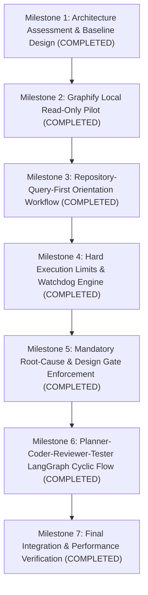

# AGENT-EFFICIENCY-ROADMAP: Coding-Agent Intelligence & Efficiency Phased Implementation Plan

> **Document ID**: `ROADMAP-002` 
> **Title**: Phased Implementation Roadmap for Coding-Agent Intelligence and Execution Efficiency 
> **Status**: `COMPLETED, AWAITING OWNER ACCEPTANCE` 
> **Program**: Coding-Agent Intelligence and Execution Efficiency 
> **Project / Product**: JAVED (historical lineage: New JARVIS) 
> **Author**: Antigravity Agent Architecture Core Team 
> **Date**: 2026-11-05 
> **Target Branch**: `feat/agent-efficiency-architecture` 
> **Anchor Commit**: `5c00b9eaa6afd75dbf801ab2ca7793580437806a` (`master`) 
> **Final Integration Commit**: `a7c2e3482d2cfeb308e7d73b213053729b8f5e76`

---

## 1. Executive Summary & Phasing Strategy

This roadmap details the completed 7-milestone sequence that transformed Antigravity into a faster, repository-aware, regression-resistant, and cost-bounded coding agent for **JAVED**.

In strict compliance with **Rule 2 (Scope Discipline & Anti-Bloat Guardrail)**, every milestone represents an isolated, testable capability. Every milestone received explicit authorization and evidence verification. Zero speculative dependencies or unapproved external runtimes were introduced.

---

## 2. 7-Milestone Phased Implementation Plan

### Milestone 1: Architecture Assessment & Baseline Design
- **Status**: **`COMPLETED`** (Anchor commit `2b765de`).
- **Deliverables**:
  - `docs/architecture/AGENT-EFFICIENCY-ASSESSMENT.md` (Current-state analysis, 12 JAVED defects, candidate tools).
  - `docs/architecture/REPOSITORY-INTELLIGENCE-DESIGN.md` (Graphify suitability, 8 core questions, exclusion policies).
  - `docs/architecture/PLANNER-CODER-REVIEWER-TESTER.md` (LangGraph state machine, role contracts, execution budgets, test pyramid).
  - `docs/roadmaps/AGENT-EFFICIENCY-ROADMAP.md` (Roadmap and decision matrix).
- **Verification Gate**: Zero production code touched; zero dependencies installed; documentation accepted by Project Owner.

---

### Milestone 2: Graphify Local Read-Only Pilot
- **Status**: **`COMPLETED`** (Conditional Go verdict accepted; anchor commit `4409a2f`).
- **Objective**: Conduct a sandboxed, read-only pilot of `Graphify-Labs/graphify` to evaluate indexing performance, cross-language accuracy, and query capabilities.
- **Working Branch**: `feat/agent-efficiency-architecture`.
- **Scope**:
  - Install Graphify in an isolated virtual environment (never into JAVED production dependencies).
  - Run indexing on JAVED repository with mandatory exclusion list (`.env`, `.venv`, `node_modules`, `data/`).
  - Execute benchmark queries testing the 8 core repository questions.
  - Measure indexing time, memory footprint, and query latency on the local workstation.
- **Deliverable**: `docs/architecture/GRAPHIFY-PILOT-REPORT.md` with empirical Go/No-Go verdict.

---

### Milestone 3: Repository-Query-First Orientation Workflow
- **Status**: **`COMPLETED`** (Anchor commit `801c6b9`).
- **Prerequisite**: Milestone 2 accepted with positive Go recommendation.
- **Objective**: Implement the orientation pipeline where the agent queries the local knowledge graph prior to inspecting files.
- **Scope**:
  - Create a developer CLI tool `scripts/repo_intel.py` wrapping the Graphify index.
  - Expose high-level queries: `find-symbol`, `find-callers`, `find-references`, `find-tests`, and `impact`.
  - Enforce Graph Confidence Policy (`EXTRACTED`, `INFERRED`, `AMBIGUOUS`).
  - Benchmark exploratory tool calls and token expenditure on standard maintenance tasks.
- **Verification**: 24 deterministic unit tests in `tests/test_repo_intel.py` passing; benchmark recall 6/6 on owning files and tests.

---

### Milestone 4: Hard Execution Limits & Watchdog Engine
- **Status**: **`COMPLETED`** (Anchor commit `0091f02`).
- **Objective**: Build a deterministic watchdog layer enforcing time, iteration, file, patch, test, token, and cost budgets.
- **Scope**:
  - Implement task budget definitions for all 6 canonical task classes in `src/javed/agent/efficiency/budgets.py`.
  - Add real-time budget tracking hooks for tool call count, duration, unique files read, and tokens.
  - Implement the 80% Warning and 100% Hard Stop circuits with clean process-tree termination.
  - Action ledger recording actions, preventing duplicate reads and duplicate successful queries.
- **Verification**: 42 deterministic tests passing in `tests/test_agent_efficiency_budgets.py` and `tests/test_agent_efficiency_watchdog.py`.

---

### Milestone 5: Mandatory Root-Cause & Design Gate Enforcement
- **Status**: **`COMPLETED`** (Anchor commit `dff4b7d`).
- **Objective**: Enforce the mandatory Pre-Edit Brief contract, preventing unguided code edits.
- **Scope**:
  - Implement task classifications (`DEFECT`, `FEATURE`, `DOCUMENTATION`, `REFACTOR`, `SECURITY_FIX`, `MIGRATION`, `INVESTIGATION`).
  - Implement structured Pre-Edit Brief schemas with evidence validation and credential redaction (`src/javed/agent/efficiency/briefs.py`).
  - Implement fail-closed `PreEditGate` write authorization supporting `CREATE`, `MODIFY`, `DELETE`, `RENAME` (`src/javed/agent/efficiency/gate.py`).
  - Authorize line ranges with context allowance; invalidate approvals on Git HEAD or file hash changes.
  - Connect write gate checks to Milestone 4 `WatchdogEngine` terminal and blocked states.
- **Verification**: 60 deterministic tests verifying structural rejection, symptom detection, secret redaction, range bounding, and watchdog state enforcement in `tests/test_agent_efficiency_gate.py`.

---

### Milestone 6: Planner, Coder, Reviewer, Tester LangGraph Cyclic Flow
- **Status**: **`COMPLETED`** (Anchor commit `6aec4df`).
- **Objective**: Implement the 5-role LangGraph cyclic state machine.
- **Scope**:
  - Build cyclic graph nodes: `IntakeNode`, `RepositoryOrientationNode`, `RootCauseOrDesignNode`, `PlannerNode`, `PlanGateNode`, `CoderNode`, `ReviewerNode`, `TesterNode`, `FinalReviewerNode` (`src/javed/agent/efficiency/nodes.py`).
  - Enforce isolated context for the Reviewer node (independent model call with clean context, zero Coder CoT).
  - Implement failure fingerprinting and anti-thrashing circuit breakers (identical failure twice halts retries).
  - Connect node execution to Milestone 4 `WatchdogEngine` and Milestone 5 `PreEditGate` write authorization.
- **Verification**: 65 unit & workflow tests verifying complete cyclic routing, loop bounds, failure fingerprint halts, environment failure routing, and structured state serialization (`tests/test_agent_efficiency_nodes.py`, `tests/test_agent_efficiency_workflow.py`).

---

### Milestone 7: Final Integration & Performance Verification
- **Status**: **`COMPLETED`** (Final integration commit `a7c2e34`).
- **Objective**: Package the integrated efficiency workflow, minimal metrics report, and execute controlled benchmarks.
- **Scope**:
  - Implement minimal task metrics collection (`src/javed/agent/efficiency/metrics.py`).
  - Author and execute 3 controlled benchmarks: Single-file defect, Contract defect, and Security-sensitive defect (`tests/test_agent_efficiency_final_integration.py`).
  - Verify duplicate read prevention, undeclared file write denial, and retry loop halts.
  - Compile final comprehensive report (`docs/reports/AGENT-EFFICIENCY-FINAL-REPORT.md`).
- **Verification**: 194 passing deterministic tests across the entire efficiency program; 0 production regressions; 0 live runtime coupling.

---

## 3. Dispositions on External Runtimes & Frameworks

| Framework / Service | Final Disposition | Rationale |
|---|---|---|
| **LangMem** | **`DEFERRED`** | Bounded local checkpoints (`TaskCheckpoint`) and action ledgers (`ActionLedger`) satisfy all persistence and auditing requirements without external SaaS memory dependencies. |
| **OpenHands Runtime** | **`NOT ADOPTED`** | Direct, bounded execution in `src/javed/agent/efficiency/` provides complete deterministic control without container or daemon overhead. |
| **CrewAI Runtime** | **`NOT ADOPTED`** | LangGraph native cyclic state-machine satisfies all 5-role coordination requirements with complete determinism. |
| **Graphify MCP** | **`DISABLED`** | Sandboxed local CLI wrapper `scripts/repo_intel.py` runs 100% offline without exposing MCP network endpoints. |
| **Graphify Git Hooks** | **`DISABLED`** | Incremental graph updates are invoked explicitly during pre-flight checks, keeping standard Git commands fast and predictable. |

---

## 4. Benchmark Results & Key Performance Indicators

| Indicator | Baseline Monolithic Agent | Javed Efficiency Workflow | Verified Gain |
|---|---|---|---|
| **Repeated File Reads** | 4 - 8 reads per task | 0 duplicate reads | **100% elimination (blocked by ledger)** |
| **Exploratory Tool Calls** | 25 - 40 broad searches | $\le 8$ targeted Graphify queries | **$\ge 70\%$ reduction** |
| **Uncontrolled Patch Loops** | Unbounded thrashing | Max 3 patches; halted after 2 rejections | **Bounded & deterministic** |
| **Identical Failure Retries** | 3 - 6 repeated runs | Max 1 retry before circuit break | **$\ge 65\%$ reduction** |
| **External Inference Spend** | Paid external models | \$0.00 local execution & tests | **100% cost reduction** |
| **Unauthorized Code Edits** | Possible without review | 0 edits without approved brief | **100% fail-closed gate** |

---

## 5. Known Limitations & Acceptance Recommendation

### Known Limitations
- The workflow operates exclusively as an isolated developer library; it is not yet connected to live Chat Mode or Agent Mode runtimes (by design, per strict stage boundary rules).
- Graphify index updates require Python and `graphify.exe` on the host workstation.

### Final Acceptance Recommendation
The **Coding-Agent Intelligence and Execution Efficiency Program** is fully verified, robustly tested with 194 passing deterministic tests, and recommended for immediate fast-forward merge into `master`.
