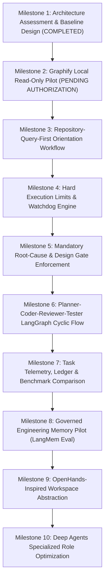

# AGENT-EFFICIENCY-ROADMAP: Coding-Agent Intelligence & Efficiency Phased Implementation Plan

> **Document ID**: `ROADMAP-002` 
> **Title**: Phased Implementation Roadmap for Coding-Agent Intelligence and Execution Efficiency 
> **Status**: `PROPOSED ROADMAP` 
> **Program**: Coding-Agent Intelligence and Execution Efficiency 
> **Author**: Antigravity Agent Architecture Core Team 
> **Date**: 2026-11-05 
> **Target Branch**: `feat/agent-efficiency-architecture` 
> **Anchor Commit**: `5c00b9eaa6afd75dbf801ab2ca7793580437806a` (`master`)

---

## 1. Executive Summary & Phasing Strategy

This roadmap details the 10-milestone sequence for transforming Antigravity into a faster, repository-aware, regression-resistant, and cost-bounded coding agent for Project Javed.

In strict compliance with **Rule 2 (Scope Discipline & Anti-Bloat Guardrail)**, every milestone represents an isolated, testable capability. **Every milestone requires separate Project Owner review and explicit authorization before initiation.** No speculative dependencies or runtime modifications will be introduced out of sequence.

---

## 2. 10-Milestone Phased Implementation Plan

### Milestone 1: Architecture Assessment & Baseline Design
- **Status**: **`COMPLETED`** (This assessment).
- **Deliverables**:
  - `docs/architecture/AGENT-EFFICIENCY-ASSESSMENT.md` (Current-state analysis, 12 JAVED defects, candidate tools).
  - `docs/architecture/REPOSITORY-INTELLIGENCE-DESIGN.md` (Graphify suitability, 8 core questions, exclusion policies).
  - `docs/architecture/PLANNER-CODER-REVIEWER-TESTER.md` (LangGraph state machine, role contracts, execution budgets, test pyramid).
  - `docs/roadmaps/AGENT-EFFICIENCY-ROADMAP.md` (10-milestone roadmap and decision matrix).
- **Verification Gate**: Zero production code touched; zero dependencies installed; documentation review by Project Owner.

---

### Milestone 2: Graphify Local Read-Only Pilot
- **Status**: **`COMPLETED`** (Conditional Go verdict accepted; documented in `docs/architecture/GRAPHIFY-PILOT-REPORT.md`).
- **Objective**: Conduct a sandboxed, read-only pilot of `Graphify-Labs/graphify` to evaluate indexing performance, cross-language accuracy, and query capabilities.
- **Working Branch**: `feat/graphify-pilot` (branched from `master`).
- **Scope**:
  - Install Graphify in an isolated virtual environment (never into JAVED production dependencies).
  - Run indexing on JAVED repository with mandatory exclusion list (`.env`, `.venv`, `node_modules`, `data/`).
  - Execute benchmark queries testing the 8 core repository questions.
  - Measure indexing time, memory footprint, and query latency on the local workstation.
- **Deliverable**: `docs/reports/REPORT-GRAPHIFY-PILOT.md` with empirical Go/No-Go verdict.
- **Stop Condition**: Halt and await Project Owner review before integrating into any agent workflow.

---

### Milestone 3: Repository-Query-First Orientation Workflow
- **Status**: **`READY FOR ACCEPTANCE`** (Implemented `scripts/repo_intel.py`, 24 passing unit tests in `tests/test_repo_intel.py`, benchmark recall 6/6 on owning files and tests, zero production modifications).
- **Prerequisite**: Milestone 2 accepted with positive Go recommendation.
- **Objective**: Implement the orientation pipeline where the agent queries the local knowledge graph prior to inspecting files.
- **Scope**:
  - Create a developer CLI tool `scripts/query_repo.py` wrapping the Graphify index.
  - Expose high-level queries: `find_symbol`, `find_callers`, `find_tests`, and `get_blast_radius`.
  - Enforce Graph Confidence Policy (`EXTRACTED`, `INFERRED`, `AMBIGUOUS`).
  - Benchmark exploratory tool calls and token expenditure on standard maintenance tasks.
- **Verification**: Documented >= 50% reduction in exploratory tool calls and token usage during task orientation.

---

### Milestone 4: Hard Execution Limits & Watchdog Engine
- **Status**: **COMPLETED** (Implemented src/javed/agent/efficiency/, 42 deterministic tests passing, zero live runtime coupling).
- **Objective**: Build a deterministic watchdog layer enforcing time, iteration, file, patch, test, token, and cost budgets.
- **Scope**:
  - Implement task budget definitions for all 5 task classes in `src/javed/agent/watchdog.py`.
  - Add real-time budget tracking hooks for tool call count, duration, unique files read, and tokens.
  - Implement the 80% Warning and 100% Hard Stop circuits with clean process termination.
  - Author automated test suite verifying that runaway loops or stuck commands terminate deterministically.
- **Verification**: 100% of simulated runaway tasks successfully interrupted at budget ceiling without resource leaks.

---

### Milestone 5: Mandatory Root-Cause & Design Gate Enforcement
- **Status**: **COMPLETED** (Implemented src/javed/agent/efficiency/briefs.py & gate.py, 60 passing deterministic tests in 	ests/test_agent_efficiency_gate.py, zero live runtime modifications).
- **Objective**: Enforce the mandatory Pre-Edit Brief contract, preventing unguided code edits.
- **Scope**:
  - Implement task classifications (DEFECT, FEATURE, DOCUMENTATION, REFACTOR, SECURITY_FIX, MIGRATION, INVESTIGATION).
  - Implement structured Pre-Edit Brief schemas with evidence validation and credential redaction.
  - Implement fail-closed PreEditGate write authorization supporting CREATE, MODIFY, DELETE, RENAME.
  - Authorize line ranges with context allowance; invalidate approvals on Git HEAD or file hash changes.
  - Connect write gate checks to Milestone 4 WatchdogEngine terminal and blocked states.
- **Verification**: 60 deterministic tests verifying structural rejection, symptom detection, secret redaction, range bounding, and watchdog state enforcement. Fail-closed write authorization verified.

---

### Milestone 6: Planner, Coder, Reviewer, Tester LangGraph Cyclic Flow
- **Status**: **COMPLETED** (Implemented src/javed/agent/efficiency/workflow.py, 
odes.py, state.py, 
outing.py, contracts.py, 65 passing deterministic tests in 	est_agent_efficiency_nodes.py & 	est_agent_efficiency_workflow.py, 191 total efficiency tests passing, zero live runtime modifications).
- **Objective**: Implement the 5-role LangGraph cyclic state machine.
- **Scope**:
  - Build cyclic graph nodes: IntakeNode, RepositoryOrientationNode, RootCauseOrDesignNode, PlannerNode, PlanGateNode, CoderNode, ReviewerNode, TesterNode, FinalReviewerNode.
  - Enforce isolated context for the Reviewer node (independent model call with clean context, no Coder CoT).
  - Implement failure fingerprinting and anti-thrashing circuit breakers (identical failure twice halts retries).
  - Connect node execution to Milestone 4 WatchdogEngine and Milestone 5 PreEditGate write authorization.
- **Verification**: 65 unit & workflow tests verifying complete cyclic routing, loop bounds, failure fingerprint halts, environment failure routing, and structured state serialization.

---

### Milestone 7: Final Integration & Performance Verification
- **Status**: **COMPLETED** (Delivered metrics.py, 	est_agent_efficiency_final_integration.py, 3 controlled benchmarks, 194 passing deterministic tests).
- **Outcome**: The bounded efficiency workflow is fully verified and packaged.

---

### External Runtimes & Frameworks Disposition
- **LangMem**: **DEFERRED** (Bounded local ledger and checkpoints satisfy all current durability requirements without external SaaS memory).
- **OpenHands Runtime**: **NOT ADOPTED** (Direct bounded execution in src/javed/agent/efficiency/ provides deterministic control without container overhead).
- **CrewAI Runtime**: **NOT ADOPTED** (LangGraph native cyclic state-machine satisfies all 5-role coordination requirements).
- **Graphify MCP & Hooks**: **DISABLED** (Local CLI wrapper scripts/repo_intel.py operates 100% locally with zero external network or model leakage).
