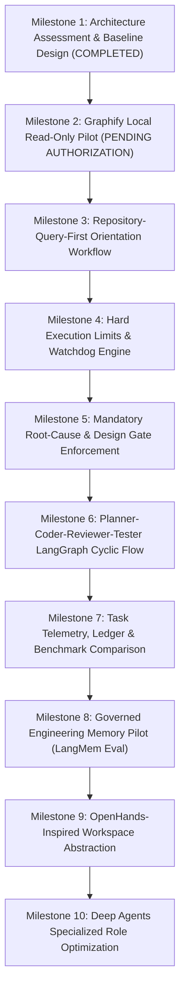

# AGENT-EFFICIENCY-ROADMAP: Coding-Agent Intelligence & Efficiency Phased Implementation Plan

> **Document ID**: `ROADMAP-002` 
> **Title**: Phased Implementation Roadmap for Coding-Agent Intelligence and Execution Efficiency 
> **Status**: `PROPOSED ROADMAP` 
> **Program**: Coding-Agent Intelligence and Execution Efficiency 
> **Author**: Antigravity Agent Architecture Core Team 
> **Date**: 2026-11-05 
> **Target Branch**: `feat/agent-efficiency-architecture` 
> **Anchor Commit**: `5c00b9eaa6afd75dbf801ab2ca7793580437806a` (`master`)

---

## 1. Executive Summary & Phasing Strategy

This roadmap details the 10-milestone sequence for transforming Antigravity into a faster, repository-aware, regression-resistant, and cost-bounded coding agent for Project Javed.

In strict compliance with **Rule 2 (Scope Discipline & Anti-Bloat Guardrail)**, every milestone represents an isolated, testable capability. **Every milestone requires separate Project Owner review and explicit authorization before initiation.** No speculative dependencies or runtime modifications will be introduced out of sequence.

---

## 2. 10-Milestone Phased Implementation Plan

### Milestone 1: Architecture Assessment & Baseline Design
- **Status**: **`COMPLETED`** (This assessment).
- **Deliverables**:
  - `docs/architecture/AGENT-EFFICIENCY-ASSESSMENT.md` (Current-state analysis, 12 JAVED defects, candidate tools).
  - `docs/architecture/REPOSITORY-INTELLIGENCE-DESIGN.md` (Graphify suitability, 8 core questions, exclusion policies).
  - `docs/architecture/PLANNER-CODER-REVIEWER-TESTER.md` (LangGraph state machine, role contracts, execution budgets, test pyramid).
  - `docs/roadmaps/AGENT-EFFICIENCY-ROADMAP.md` (10-milestone roadmap and decision matrix).
- **Verification Gate**: Zero production code touched; zero dependencies installed; documentation review by Project Owner.

---

### Milestone 2: Graphify Local Read-Only Pilot
- **Objective**: Conduct a sandboxed, read-only pilot of `Graphify-Labs/graphify` to evaluate indexing performance, cross-language accuracy, and query capabilities.
- **Working Branch**: `feat/graphify-pilot` (branched from `master`).
- **Scope**:
  - Install Graphify in an isolated virtual environment (never into JAVED production dependencies).
  - Run indexing on JAVED repository with mandatory exclusion list (`.env`, `.venv`, `node_modules`, `data/`).
  - Execute benchmark queries testing the 8 core repository questions.
  - Measure indexing time, memory footprint, and query latency on the local workstation.
- **Deliverable**: `docs/reports/REPORT-GRAPHIFY-PILOT.md` with empirical Go/No-Go verdict.
- **Stop Condition**: Halt and await Project Owner review before integrating into any agent workflow.

---

### Milestone 3: Repository-Query-First Orientation Workflow
- **Prerequisite**: Milestone 2 accepted with positive Go recommendation.
- **Objective**: Implement the orientation pipeline where the agent queries the local knowledge graph prior to inspecting files.
- **Scope**:
  - Create a developer CLI tool `scripts/query_repo.py` wrapping the Graphify index.
  - Expose high-level queries: `find_symbol`, `find_callers`, `find_tests`, and `get_blast_radius`.
  - Enforce Graph Confidence Policy (`EXTRACTED`, `INFERRED`, `AMBIGUOUS`).
  - Benchmark exploratory tool calls and token expenditure on standard maintenance tasks.
- **Verification**: Documented >= 50% reduction in exploratory tool calls and token usage during task orientation.

---

### Milestone 4: Hard Execution Limits & Watchdog Engine
- **Objective**: Build a deterministic watchdog layer enforcing time, iteration, file, patch, test, token, and cost budgets.
- **Scope**:
  - Implement task budget definitions for all 5 task classes in `src/javed/agent/watchdog.py`.
  - Add real-time budget tracking hooks for tool call count, duration, unique files read, and tokens.
  - Implement the 80% Warning and 100% Hard Stop circuits with clean process termination.
  - Author automated test suite verifying that runaway loops or stuck commands terminate deterministically.
- **Verification**: 100% of simulated runaway tasks successfully interrupted at budget ceiling without resource leaks.

---

### Milestone 5: Mandatory Root-Cause & Design Gate Enforcement
- **Objective**: Enforce the mandatory Pre-Edit Brief contract, preventing unguided code edits.
- **Scope**:
  - Implement pre-edit brief validator asserting presence of all required fields (Root Cause, Affected Symbols, Files to Modify, Files NOT to Modify, Regression Risks, Rollback Strategy).
  - Block write operations (`edit_file`, `write_file`) if the active task lacks an approved brief.
  - Integrate brief presentation into Developer Mode telemetry.
- **Verification**: Pre-edit gate rejects incomplete briefs fail-closed; verified across simulated defect tasks.

---

### Milestone 6: Planner, Coder, Reviewer, Tester LangGraph Cyclic Flow
- **Objective**: Implement the 5-role LangGraph cyclic state machine.
- **Scope**:
  - Build cyclic graph nodes: `IntakeNode`, `OrientationNode`, `PlannerNode`, `PlanGateNode`, `CoderNode`, `ReviewerNode`, `TesterNode`, `RegressionNode`, `FinalReviewNode`.
  - Enforce isolated context for the Reviewer node (independent model call with clean context).
  - Implement failure fingerprinting (`compute_failure_fingerprint`) and anti-thrashing circuit breakers.
  - Support human review gates via LangGraph native `interrupt()` / `Command(resume=...)`.
- **Verification**: End-to-end automated test suite verifying state machine transitions, reviewer rejection re-routing, and test failure recovery.

---

### Milestone 7: Task Telemetry, Ledger & Benchmark Comparison
- **Objective**: Measure and visualize coding-agent efficiency metrics.
- **Scope**:
  - Create SQLite task telemetry ledger in `data/agent_telemetry.db`.
  - Track complete metrics contract (tokens, wall-clock time, tool calls, unique files read, lines changed, reviewer cycles, cost).
  - Build Developer Mode UI dashboard panel in `frontend/src/views/dev/AgentTelemetryView.tsx`.
  - Run comparative benchmarks (Standard Antigravity vs. Efficiency-Governed Agent) on identical bugfix tasks.
- **Verification**: Verifiable reduction in cost, turn duration, and regression frequency.

---

### Milestone 8: Governed Engineering Memory Pilot (LangMem Evaluation)
- **Prerequisite**: Milestone 7 telemetry operational.
- **Objective**: Evaluate LangMem for long-term engineering memory across development sessions.
- **Scope**:
  - Sandboxed pilot assessing cross-task memory retention: architectural patterns, common bugfix solutions, and component ownership.
  - Enforce strict memory governance: source commit linking, verification timestamps, and privacy scrubbing.
- **Deliverable**: `docs/reports/REPORT-LANGMEM-PILOT.md` with Project Owner decision point.

---

### Milestone 9: OpenHands-Inspired Workspace Abstraction
- **Objective**: Formalize workspace sandboxing and transaction-like file operations.
- **Scope**:
  - Implement transactional file staging (`WorkspaceTransactionManager`) with automatic rollback on test failure.
  - Standardize structured command execution results across PowerShell and Node processes.
  - Implement process group management ensuring zero orphaned background servers.
- **Verification**: Zero orphaned processes under abrupt test cancellations or error rollbacks.

---

### Milestone 10: Deep Agents Specialized Role Optimization
- **Objective**: Integrate Deep Agents specialized subagents into the LangGraph efficiency pipeline.
- **Scope**:
  - Specialize subagents for distinct architectural domains (Extraction Specialist, Browser Operator, Security Auditor, Frontend Engineer).
  - Bound subagent tool allowlists and token budgets hierarchically from parent state.
  - Final end-to-end milestone verification and integration into master documentation.

---

## 3. Risks, Mitigation Strategies & Owner Decisions Matrix

| Risk / Trade-Off | Impact | Likelihood | Mitigation Strategy | Owner Decision Required? |
|---|---|---|---|---|
| **Graphify Index Staleness** | Agent receives outdated symbol mappings after files are edited. | Moderate | Implement incremental graph re-indexing on file save; fallback to line verification before edit. | No (Technical implementation detail). |
| **Reviewer False Rejections** | Independent Reviewer rejects valid patches due to strict style or semantic interpretation. | Moderate | Calibrate Reviewer prompt with explicit acceptance rubric; provide 2 revision cycles before human escalation. | No (Configurable prompt parameters). |
| **Execution Budget Premature Halts** | Complex architectural changes exceed tight token or time budgets. | Low | Differentiate budgets by task class (15m for single defect vs 60m for architecture); allow owner override. | **YES** (Approval of budget ceilings). |
| **Increased First-Turn Latency** | Querying graph and generating pre-edit brief adds 15–30 seconds before first edit. | High | Trade-off accepted: 30s planning prevents 15 minutes of speculative thrashing and regression fixing. | **YES** (Acceptance of planning-first paradigm). |
| **Local Hardware Resource Load** | Local indexing (Graphify/Tree-sitter) increases CPU/memory usage on developer workstation. | Low | Background indexing throttled; exclude heavy directories (`node_modules`, `data`); memory capped at 500 MB. | No (Standard hygiene rules). |
