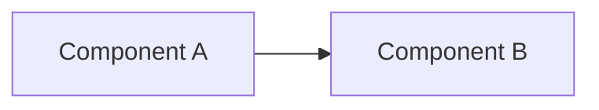

# BRICK-XXX: [Brick Title] Specification

> **Brick ID**: `BRICK-XXX`  
> **Phase**: [e.g., Phase 1 — Architecture Baseline]  
> **Status**: [NOT STARTED | IN PROGRESS | BLOCKED | READY FOR ACCEPTANCE | VERIFIED]  
> **Author**: [Agent / Developer Name]  
> **Created**: YYYY-MM-DD  
> **Last Updated**: YYYY-MM-DD  
> **Report Reference**: [docs/reports/REPORT-XXX.md](file:///c:/Users/arehman/Desktop/AI Projects/Javed/docs/reports/)  

---

## 1. Executive Summary & Objective

[Concise 2-3 sentence overview of what this brick accomplishes and why it is necessary.]

---

## 2. Scope & Boundaries

### In Scope
- [Feature / Component 1]
- [Feature / Component 2]

### Out of Scope / Non-Goals
- [Explicit boundary 1]
- [Explicit boundary 2]

---

## 3. Prerequisites & Blockers

- [ ] Prior brick verified: `BRICK-[X-1]` marked `VERIFIED` in `docs/PROGRESS.md`.
- [ ] Required ADR approved (if applicable): `docs/decisions/ADR-XXX.md`.
- [ ] No unresolved blockers in `docs/TASKS.md`.

---

## 4. Technical Design & Architecture

### 4.1 Component Diagram / Flow

### 4.2 File & Directory Changes

| Action | Path | Description |
|---|---|---|
| `CREATE` | `path/to/file.py` | New module description |
| `MODIFY` | `path/to/existing.py` | Targeted changes |
| `DELETE` | `path/to/obsolete.py` | Rationale for removal |

### 4.3 Dependencies & Licensing
- **New Libraries**: [None or List with License and Justification per TECH_STACK.md]
- **Rule 2/4 Check**: [Confirm permissive FOSS, no unapproved paid APIs]

---

## 5. Verification & Test Plan

### 5.1 Automated Tests
- Unit Tests: `tests/unit/test_xxx.py`
- Integration Tests: `tests/integration/test_xxx.py`

### 5.2 Live UI Verification (Mandatory per Rule 6)
- **UI Element**: [Panel / Modal / Stream component verifying this feature]
- **Interaction Flow**: [Step-by-step instructions to verify via browser]
- **Verification Evidence**: [Console log / DOM snapshot / Screenshot captured]

---

## 6. Acceptance Criteria

- [ ] All code implemented within scoped files.
- [ ] Automated tests pass with 100% success rate (`pytest` / `vitest` logs captured).
- [ ] Live UI verification completed without mocks or fake data.
- [ ] Verification report generated at `docs/reports/REPORT-XXX.md`.
- [ ] `docs/TASKS.md` and `docs/PROGRESS.md` updated honestly.
- [ ] Explicit human user sign-off recorded.

---

## 7. Stop Condition

Once implementation and testing are complete:
1. Update status to `READY FOR ACCEPTANCE`.
2. Generate `docs/reports/REPORT-XXX.md`.
3. **STOP** and await explicit user sign-off before advancing to the next brick.
